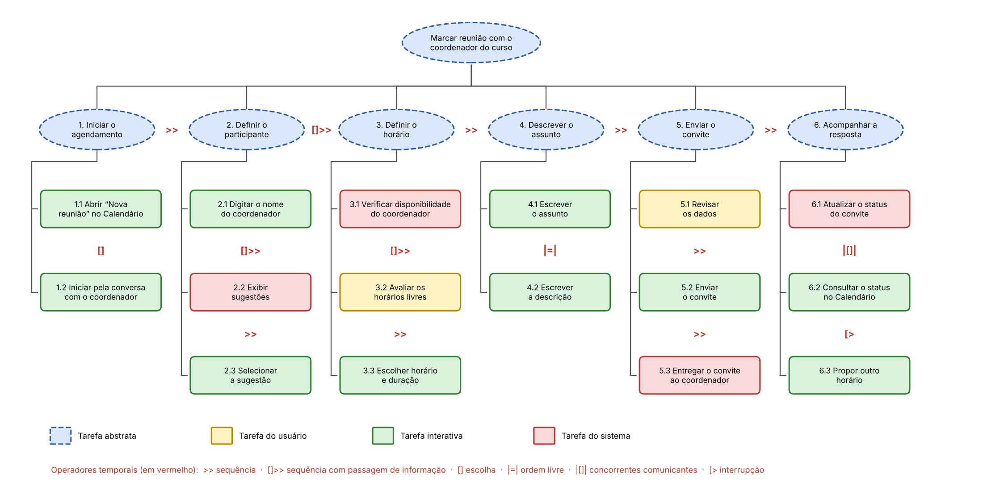

# Árvores de Tarefas Concorrentes (CTT – ConcurTaskTrees)

## Tabela de contribuição

| Data       | Contribuição | Autor(es) | Revisor(es) |
| ---------- | ------------ | --------- | ----------- |
| 22/11/2026 | Criação da página da CTT do agendamento de reunião com o coordenador do curso (Perfil 1: Estudante) | João Paulo da Silva Pereira |  |
| 22/11/2026 | Estruturação textual, tabelas e formatação, com uma ferramenta de IA (Claude), conforme a política de uso de IA da disciplina | Claude (IA) | João Paulo da Silva Pereira |

## 1. Introdução e Fundamentação Teórica

A modelagem em CTT apoia a engenharia de Interação Humano-Computador (IHC) ao articular explicitamente o diálogo entre o usuário e o sistema, categorizando quem executa cada ação e como as tarefas se relacionam no tempo. Na avaliação do **Teams**, a árvore CTT permite identificar pontos de escolha alternativa, tarefas que exigem troca simultânea de dados e momentos de processamento em segundo plano.

---

## 2. Metodologia e Elementos do CTT

### 2.1. Categorias de Tarefas

* ☁️ **Tarefa Abstrata (Abstract Task):** Representa um objetivo de alto nível ou um agrupamento hierárquico que engloba uma combinação de subtarefas de diferentes categorias.
* 👤 **Tarefa do Usuário (User Task):** Atividade cognitiva ou física realizada exclusivamente pela pessoa, sem interação direta com o sistema computacional.
* 👤💻 **Tarefa Interativa (Interactive Task):** Ação em que ocorre o diálogo direto e a troca de informações entre a pessoa e a interface do sistema.
* 💻 **Tarefa do Sistema (System Task):** Processamento ou ação executada automaticamente pelo próprio sistema, sem intervenção humana direta.

### 2.2. Operadores Temporais (Notação de Paternò)

* `>>` **Ativação Sequencial (Enabling):** A tarefa da direita só pode ser iniciada após a conclusão da tarefa da esquerda (`T1 >> T2`).
* `[]>>` **Ativação com Passagem de Informação (Enabling with Information Passing):** A tarefa `T2` inicia após o término de `T1`, recebendo as informações produzidas por `T1` (`T1 []>> T2`).
* `[]` **Escolha Alternativa (Choice):** O usuário deve escolher entre `T1` ou `T2`. O início da execução de uma desabilita imediatamente a outra (`T1 [] T2`).
* `|=|` **Independência de Ordem (Order Independence):** Ambas as tarefas devem ser realizadas, mas podem ser executadas em qualquer sequência, sem interrupção mútua (`T1 |=| T2`).
* `|||` **Tarefas Concorrentes (Interleaving):** As tarefas podem ser realizadas em paralelo ou com ações intercaladas sem ordem fixa (`T1 ||| T2`).
* `|[]|` **Tarefas Concorrentes Comunicantes (Synchronization):** As tarefas ocorrem concorrentemente e trocam informações em tempo real durante a execução (`T1 |[]| T2`).
* `[>` **Desativação / Interrupção (Disabling):** A tarefa `T1` é interrompida ou cancelada pela ativação da tarefa `T2` (`T1 [> T2`).
* `|>` **Suspensão e Retomada (Suspend / Resume):** A tarefa `T1` é pausada por `T2` e, ao término de `T2`, `T1` é retomada exatamente do ponto onde parou (`T1 |> T2`).

---

## 3. Análise de Tarefas por Perfil de Usuário

### 3.1. Perfil 1: Estudante

> **Responsável pelo Perfil:** João Paulo da Silva Pereira
> **Tarefa Analisada:** Marcar reunião com o coordenador do curso no Microsoft Teams

#### 1. Texto Explicativo e Contextualização

A análise por Árvore de Tarefas Concorrentes (CTT) do perfil do estudante modela a atividade de marcar uma reunião com o coordenador do curso no Microsoft Teams. A árvore destaca as tarefas interativas do estudante na interface (escolher o participante, o horário e descrever o assunto), os processamentos automáticos do Teams (verificação de disponibilidade e envio do convite) e as decisões exclusivas do usuário (por exemplo, avaliar se o horário serve).

#### 2. Estrutura de Decomposição e Operadores Temporais

* **0. Marcar reunião com o coordenador do curso** (☁️ Tarefa Abstrata)
  * `1. Iniciar o agendamento` (☁️ Abstrata) `>>`
    * `1.1. Abrir "Nova reunião" no Calendário` (👤💻 Interativa) `[]`
    * `1.2. Iniciar pela conversa com o coordenador` (👤💻 Interativa)
  * `2. Definir o participante` (☁️ Abstrata) `[]>>`
    * `2.1. Digitar o nome do coordenador` (👤💻 Interativa) `[]>>`
    * `2.2. Exibir sugestões` (💻 Sistema) `>>`
    * `2.3. Selecionar a sugestão` (👤💻 Interativa)
  * `3. Definir o horário` (☁️ Abstrata) `>>`
    * `3.1. Verificar disponibilidade do coordenador` (💻 Sistema) `[]>>`
    * `3.2. Avaliar os horários livres` (👤 Usuário) `>>`
    * `3.3. Escolher o horário e a duração` (👤💻 Interativa)
  * `4. Descrever o assunto` (☁️ Abstrata) `>>`
    * `4.1. Escrever o assunto` (👤💻 Interativa) `|=|`
    * `4.2. Escrever a descrição` (👤💻 Interativa)
  * `5. Enviar o convite` (☁️ Abstrata) `>>`
    * `5.1. Revisar os dados` (👤 Usuário) `>>`
    * `5.2. Enviar o convite` (👤💻 Interativa) `>>`
    * `5.3. Entregar o convite ao coordenador` (💻 Sistema)
  * `6. Acompanhar a resposta` (☁️ Abstrata)
    * `6.1. Atualizar o status do convite` (💻 Sistema) `|[]|`
    * `6.2. Consultar o status no Calendário` (👤💻 Interativa) `[>`
    * `6.3. Propor outro horário` (👤💻 Interativa)

#### 3. Diagrama Gráfico CTT

Figura 1 – CTT - Marcar reunião com o coordenador do curso.

Autor - João Paulo da Silva Pereira.

---

## 4. Referências Bibliográficas

* BARBOSA, Simone Diniz Junqueiro; SILVA, Bruno Santana da. **Interação Humano-Computador**. Rio de Janeiro: Elsevier / Campus, 2010.
* PATERNÒ, Fabio. **Model-Based Design and Evaluation of Interactive Applications**. London: Springer-Verlag, 1999.
* PATERNÒ, Fabio. ConcurTaskTrees: An Engineered Notation for Task Models. In: DIAPER, Dan; STANTON, Neville (Eds.). **The Handbook of Task Analysis for Human-Computer Interaction**. Mahwah, NJ: Lawrence Erlbaum Associates, 2003. p. 483-503.

---

## 5. Histórico de Versão

| Versão | Data       | Descrição          | Autor(es)                   | Revisor(es) |
| ------ | ---------- | ------------------ | --------------------------- | ----------- |
| `1.0`  | 22/11/2026 | Criação da página. | João Paulo da Silva Pereira |             |
