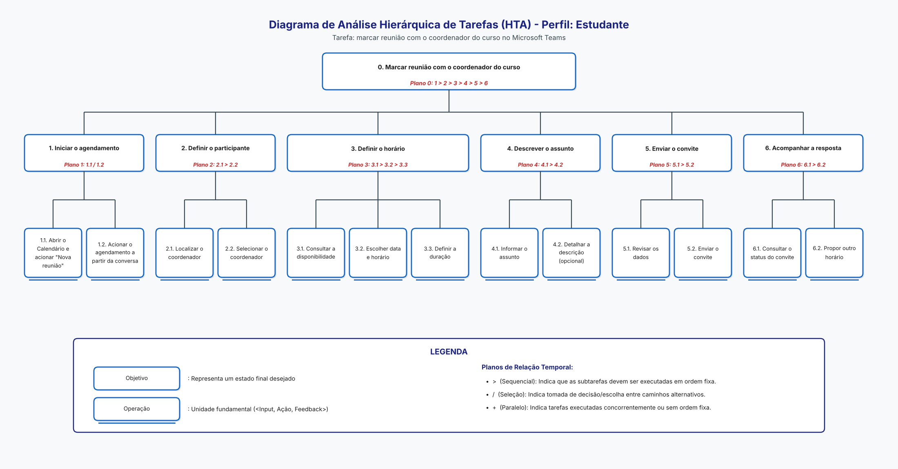

# Análise Hierárquica de Tarefas (HTA – Hierarchical Task Analysis)

## Tabela de contribuição

| Data       | Contribuição | Autor(es) | Revisor(es) |
| ---------- | ------------ | --------- | ----------- |
| 22/11/2026 | Criação da página da HTA do agendamento de reunião com o coordenador do curso (Perfil 1: Estudante) | João Paulo da Silva Pereira |  |
| 22/11/2026 | Estruturação textual, tabelas e formatação, com uma ferramenta de IA (Claude), conforme a política de uso de IA da disciplina | Claude (IA) | João Paulo da Silva Pereira |

## 1. Introdução e Fundamentação Teórica

A aplicação da HTA na avaliação do **Teams** permite identificar gargalos na navegação, quebras de fluxo, redundâncias operacionais e pontos onde o sistema exige esforço cognitivo excessivo para a conclusão de tarefas do cotidiano universitário e administrativo.

---

## 2. Metodologia e Elementos da HTA

A modelagem HTA adota a seguinte estrutura:

* **Objetivo (Goal):** Um estado final de coisas que a pessoa deseja alcançar.
* **Subobjetivo (Subgoal):** Uma meta intermediária necessária para o atingimento de um objetivo superior.
* **Operação (Operation):** A unidade atômica da tarefa que não necessita de mais decomposição. Cada operação no nível folha é especificada pela tupla `<Input, Ação, Feedback>`:
  * **Input:** As condições de ativação ou informações necessárias para iniciar a operação.
  * **Ação:** O ato físico ou cognitivo executado pelo usuário ou sistema.
  * **Feedback:** A resposta visual ou auditiva fornecida pela interface indicando o resultado da ação.
* **Planos (Plans):** Regras formais que definem a sequência e as condições sob as quais os subobjetivos devem ser alcançados:
  * `>` **Sequencial:** Execução em ordem fixa (ex: `1 > 2`).
  * `/` **Seleção / Decisão:** Escolha de um caminho entre alternativas mutuamente exclusivas (ex: `2.1 / 2.2`).
  * `+` **Paralelo / Concorrente:** Atividades realizadas ao mesmo tempo ou em qualquer ordem (ex: `4.1 + 4.2`).

---

## 3. Análise de Tarefas

### 3.1. Perfil 1: Estudante - Marcar reunião com o coordenador do curso

> **Responsável pelo Perfil:** João Paulo da Silva Pereira
> **Tarefa Analisada:** Marcar uma reunião com o coordenador do curso no Microsoft Teams

Nesta tarefa o estudante precisa marcar uma reunião com o coordenador do curso, para tirar dúvidas sobre a grade, o fluxo ou a situação acadêmica. No Teams, ele pode iniciar pelo Calendário, com "Nova reunião", ou pela conversa com o coordenador, escolher o participante e o horário, descrever o assunto, enviar o convite e acompanhar a resposta.

A principal divergência está no fim da tarefa: o estudante precisa consultar o status do convite no próprio Teams. A avaliação de IHC propõe deixar esse status visível e permitir a proposta de outro horário na mesma tela.

Figura 1 – HTA - Marcar reunião com o coordenador do curso.

Autor - João Paulo da Silva Pereira.

| Objetivos / operações | Problemas e recomendações |
| --------------------- | ------------------------- |
| **0. Marcar reunião com o coordenador do curso** `1>2>3>4>5>6` | **input:** necessidade de conversar com o coordenador **feedback:** reunião marcada e resposta do coordenador recebida **plano:** 1>2>3>4>5>6 **problema:** [PREENCHER] **recomendação:** [PREENCHER] |
| **1. Iniciar o agendamento** `1.1/1.2` | **plano:** 1.1 / 1.2, escolher um dos caminhos |
| 1.1 Abrir "Nova reunião" no Calendário | **input:** necessidade de marcar a reunião **ação:** abrir o Calendário e clicar em "Nova reunião" **feedback:** formulário de nova reunião aberto **problema:** [PREENCHER] **recomendação:** [PREENCHER] |
| 1.2 Iniciar pela conversa com o coordenador | **input:** conversa com o coordenador já aberta **ação:** acionar o agendamento a partir do chat **feedback:** formulário aberto já com o coordenador **problema:** [PREENCHER] **recomendação:** [PREENCHER] |
| **2. Definir o participante** `2.1>2.2` | **plano:** 2.1 > 2.2 |
| 2.1 Localizar o coordenador | **input:** nome do coordenador **ação:** digitar o nome no campo de participantes **feedback:** sugestões exibidas **problema:** [PREENCHER] **recomendação:** [PREENCHER] |
| 2.2 Selecionar a sugestão | **input:** sugestão correta exibida **ação:** clicar na sugestão do coordenador **feedback:** coordenador adicionado como participante **problema:** [PREENCHER] **recomendação:** [PREENCHER] |
| **3. Definir o horário** `3.1>3.2>3.3` | **plano:** 3.1 > 3.2 > 3.3 |
| 3.1 Consultar a disponibilidade | **input:** coordenador adicionado **ação:** olhar a agenda e os horários livres **feedback:** horários livres e ocupados visíveis **problema:** [PREENCHER] **recomendação:** [PREENCHER] |
| 3.2 Escolher o horário livre | **input:** horários disponíveis **ação:** selecionar o horário **feedback:** horário marcado no formulário **problema:** [PREENCHER] **recomendação:** [PREENCHER] |
| 3.3 Definir a duração | **input:** horário escolhido **ação:** ajustar o término **feedback:** duração atualizada **problema:** [PREENCHER] **recomendação:** [PREENCHER] |
| **4. Descrever o assunto** `4.1>4.2` | **plano:** 4.1 > 4.2 |
| 4.1 Escrever o assunto | **input:** motivo da reunião **ação:** escrever o título da reunião **feedback:** título exibido no formulário **problema:** [PREENCHER] **recomendação:** [PREENCHER] |
| 4.2 Escrever a descrição | **input:** detalhes do pedido **ação:** escrever a descrição **feedback:** descrição exibida **problema:** [PREENCHER] **recomendação:** [PREENCHER] |
| **5. Enviar o convite** `5.1>5.2` | **plano:** 5.1 > 5.2 |
| 5.1 Revisar | **input:** formulário preenchido **ação:** conferir participante, horário e assunto **feedback:** resumo da reunião exibido **problema:** [PREENCHER] **recomendação:** [PREENCHER] |
| 5.2 Enviar | **input:** dados conferidos **ação:** clicar em enviar **feedback:** convite enviado, com status "Pendente" **problema:** [PREENCHER] **recomendação:** [PREENCHER] |
| **6. Acompanhar a resposta** `6.1/6.2` | **plano:** 6.1 e, se necessário, 6.2 |
| 6.1 Consultar o status do convite | **input:** convite enviado **ação:** abrir o evento no Calendário **feedback:** status atualizado (Pendente ou Aceito) **problema:** [PREENCHER] **recomendação:** [PREENCHER] |
| 6.2 Propor outro horário | **input:** convite recusado ou horário inadequado **ação:** acionar "Propor outro horário" **feedback:** nova proposta enviada **problema:** [PREENCHER] **recomendação:** [PREENCHER] |

---

## 4. Referências Bibliográficas

* BARBOSA, Simone Diniz Junqueiro; SILVA, Bruno Santana da. **Interação Humano-Computador**. Rio de Janeiro: Elsevier / Campus, 2010.
* DIAPER, Dan. **Hierarchical Task Analysis (HTA)**. In: DIAPER, Dan; STANTON, Neville (Eds.). *The Handbook of Task Analysis for Human-Computer Interaction*. Mahwah, NJ: Lawrence Erlbaum Associates, 2003. p. 67-142.

---

## 5. Histórico de Versão

| Versão | Data       | Descrição          | Autor(es)                   | Revisor(es) |
| ------ | ---------- | ------------------ | --------------------------- | ----------- |
| `1.0`  | 22/11/2026 | Criação da página. | João Paulo da Silva Pereira |             |
