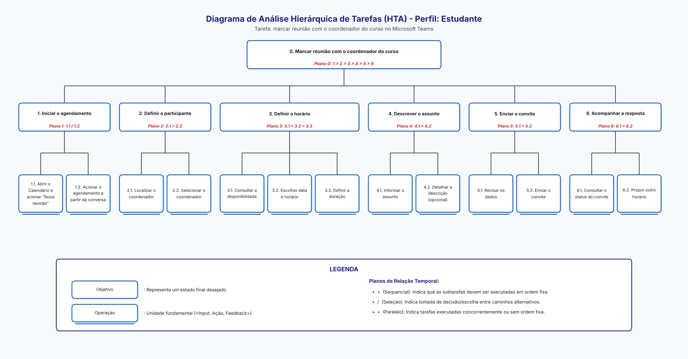

## Tabela de contribuição

| Data       | Contribuição | Autor(es) | Revisor(es) |
| ---------- | ------------ | --------- | ----------- |
| 05/11/2026 | Separação do conteúdo de João Paulo em página própria | João Paulo da Silva Pereira | A definir   |

# João Paulo - Relato dos resultados da análise de tarefas

Análise de tarefas do agendamento de reunião com o coordenador do curso (Nível 1).

> Esta página reúne, em um só lugar, a parte de João Paulo da Silva Pereira no projeto. O conteúdo foi separado de: [relato_resultados_analise_tarefas.md](../relato_resultados_analise_tarefas.md).

---

## Objetivos e escopo da avaliação

O objetivo da avaliação da análise de tarefas foi analisar **problemas na interação e na interface**, para coletar dados a respeito de se o usuário entende a funcionalidade de marcar uma reunião com o coordenador do curso no Microsoft Teams, os passos para realizar essa tarefa e se há impedimentos ou erros no diagrama HTA do Estudante ([Figura 1](#figura-1)). Ficam fora do escopo a reunião em si e outros tipos de agendamento.

<b>Figura 1:</b> HTA do Estudante: marcar reunião com o coordenador do curso.

## Método de avaliação

O método de avaliação empregado foi o de **entrevista semiestruturada**, com o participante falando da própria rotina e, em seguida, comparando-a com os passos do diagrama HTA. Não foi aplicado questionário de dados demográficos nesta sessão; o perfil do participante foi levantado na própria entrevista.

Para a entrevista semiestruturada o avaliador buscou compreender como o participante marca reuniões com outras pessoas, juntamente com a apresentação da lista de passos do diagrama HTA. A coleta de dados com o storyboard do mesmo tema, feita com outro participante, está relatada em [Relato dos resultados - Storyboard](../../storyboard/Joao_Paulo/relato_storyboard_joao_paulo.md).

### Roteiro entrevista semiestruturada

#### Introdução

- *Relacionadas à pesquisa*:
  - Objetivo da pesquisa: entender como o estudante marca uma reunião com o coordenador do curso, principalmente pelo Microsoft Teams;
  - Como será a participação: o participante conta o que faz de verdade e depois compara com uma lista de passos;
  - Tempo aproximado da coleta: de 15 a 20 minutos;
  - Tipos de dados coletados: anotações e áudio, com autorização;
  - Como serão analisados, por quem e para que: pelo grupo, para a avaliação de IHC do Microsoft Teams;
  - Enfatizar que a avaliação é sobre o produto e não sobre o usuário, e que não existe jeito certo ou errado de fazer;
  - Leitura e aceite do termo de consentimento, e esclarecimento de dúvidas, se houver;

#### Coleta de dados relacionados ao usuário

- *Experiência com um produto específico ou ferramentas semelhantes*:
  - Com que frequência usa o Microsoft Teams e para que usa na faculdade;
  - Já precisou marcar horário com um coordenador ou professor?
  - Como foi a última vez que marcou um horário com uma pessoa, do começo ao fim, em qualquer plataforma;
- *Atitudes e valores*:
  - O que no Teams ajuda e o que atrapalha nos passos de marcar a reunião;
  - Prefere outro jeito de marcar? Qual e por quê?

#### Coleta de dados relacionados ao produto

- *Objetivos*:
  - **Como o usuário atinge o objetivo de marcar uma reunião com o coordenador do curso;**
    - Como encontraria o coordenador?
    - Como escolheria o horário? Olha a agenda do coordenador antes?
    - O que costuma escrever no assunto?
    - Antes de enviar, confere alguma coisa? O quê?
    - Como ficaria sabendo da resposta, se o coordenador recusar ou não responder?
    - Algum passo seria feito mais de uma vez? Em qual passo demora mais ou fica em dúvida?
    - Já enviou convite para a pessoa errada ou para um horário em que ela estava ocupada? O que aconteceu? (consequências dos erros)
  - **Validar diagrama HTA;**
    - Apresentar a lista de passos (iniciar, definir o participante, definir o horário, descrever o assunto, enviar o convite e acompanhar a resposta);
    - Perguntar se aparece com o que o usuário faz, se falta alguma coisa e se a ordem é a mesma;
    - Perguntar se começaria pelo Calendário ou pela conversa com a pessoa;
    - Perguntar se falta algum passo ou situação que não foi perguntada;

#### Perfil de usuários e avaliadores que participaram da avaliação:

O perfil de usuário entrevistado foi o de **estudante** de graduação da UnB (Perfil 1), identificado como Participante B. Ele não é o mesmo participante da avaliação do storyboard. O número de avaliadores foi de apenas uma pessoa, o aluno João Paulo, autor da análise, que conduziu a própria sessão.

**Tabela 1 – Sessão realizada**

| ID da Sessão | Entrevistador | Participante   | Data       | Plataforma                           | Gravação                                            |
| ------------ | ------------- | -------------- | ---------- | ------------------------------------ | --------------------------------------------------- |
| **02**       | João Paulo    | Participante B | 23/10/2026 | Sessão gravada em vídeo na faculdade | [Vídeo da entrevista](https://youtu.be/w-9FIzXFeLQ) |

**Registro da sessão:** [vídeo da entrevista de análise de tarefas](https://youtu.be/w-9FIzXFeLQ)

#### Dados coletados

A gravação com o participante está disponível [neste link](https://youtu.be/w-9FIzXFeLQ).

Na entrevista, foi possível coletar os seguintes dados do participante:

- O participante usa o Teams cerca de duas a três vezes por semana, para reuniões de projeto com colegas e com professor, envio de arquivos e atividades de disciplinas;
- O participante nunca precisou marcar horário com coordenador ou professor;
- Na última vez que marcou um horário com outras pessoas, foi com um grupo de clientes de projeto, pelo WhatsApp, com uma enquete de horários, e a reunião ocorreu no horário em que todos podiam;
- O participante acredita que, para marcar reunião com o coordenador, o Teams é direto para achar a pessoa pelo nome, mas tem muitos passos necessários;
- O participante prefere o e-mail, por achar mais simples;
- O participante nunca enviou convite para a pessoa errada nem para um horário em que a pessoa estava ocupada;
- O participante não repete passos durante o agendamento;
- O passo em que mais demoraria é descrever o assunto, por ser algo formal que ele quer escrever "bonitinho";
- Antes de enviar, o participante revisa o texto, se há erro de escrita e se falta alguma informação;
- Para saber da resposta, o participante olharia a plataforma usada (e-mail, WhatsApp ou Teams); se o coordenador não respondesse até a data solicitada, o participante assumiria que não foi possível marcar;

##### Validação do diagrama HTA

O participante demonstrou compreender o fluxo demonstrado no diagrama HTA, confirmando a ordem: escolher a pessoa, o horário, o assunto, revisar o envio e ver a resposta, sem acrescentar passos. Indicou, porém, que poderia olhar o calendário primeiro, só para ver as datas disponíveis (antes do nó 2), e que olharia a agenda do coordenador antes de escolher o horário (nó 3.1). Citou o Calendário como ponto de partida e não citou a conversa com a pessoa (nó 1.2).

**Tabela 2 – Resultado por nó da HTA ([Figura 1](#figura-1))**

| Nó da HTA                     | Resultado                              | Evidência                                                                                                                                                                                    |
| ----------------------------- | -------------------------------------- | -------------------------------------------------------------------------------------------------------------------------------------------------------------------------------------------- |
| 0 (ordem geral 1 a 6)         | Confirmado, com ressalva ([T01](#t01)) | "Sim, faz sentido": escolher a pessoa, o horário, o assunto, revisar e ver a resposta. Disse que poderia olhar o calendário primeiro, só para ver as datas disponíveis.                      |
| 1.1 / 1.2 (iniciar)           | Parcial                                | Citou o calendário; não citou a conversa com a pessoa (1.2).                                                                                                                                 |
| 2.1 Localizar o coordenador   | Confirmado                             | Buscaria pelo nome; no Teams, "se eu pesquisar o nome dele… vou encontrar o coordenador".                                                                                                    |
| 3.1 Consultar disponibilidade | Confirmado                             | "Eu olharia a agenda do coordenador antes."                                                                                                                                                  |
| 4.1 / 4.2 Assunto e descrição | Confirmado ([T02](#t02))               | Escreveria o assunto com uma palavra-chave e a descrição abaixo; é o passo em que mais demoraria, por ser algo formal ("bonitinho").                                                         |
| 5.1 Revisar                   | Confirmado                             | "Reviso… se não escrevi nada errado, se está faltando alguma informação."                                                                                                                    |
| 6.1 Consultar o status        | Diferente ([T03](#t03))                | Saberia da resposta "pela plataforma" (e-mail, WhatsApp ou Teams); se o coordenador não respondesse até a data, assumiria que não foi possível marcar. Não citou olhar um status do convite. |
| Passos repetidos e erros      | Sem relato                             | Não repete passos; nunca enviou convite à pessoa errada nem para horário ocupado.                                                                                                            |

#### Interpretação e análise dos dados

O participante demonstrou entender bem todo o fluxo de marcar uma reunião com o coordenador, indicando que os passos apresentados correspondem ao que ele faria, sem passos sobrando ou faltando, conforme a [Tabela 2](#tabela-2). Dois pontos reforçam o que a HTA registra: a busca pelo nome (nó 2.1) e a consulta à agenda do coordenador antes de escolher o horário (nó 3.1). Três pontos pedem atenção: a possível ordem inversa, com o calendário antes da pessoa ([T01](#t01)); o esforço de redigir o assunto formal (nó 4.1, [T02](#t02)); e a ausência do hábito de consultar o status do convite (nó 6.1, [T03](#t03)), em que o participante dependeria de outro canal. Como o participante nunca marcou reunião com coordenador, a validade do relato sobre o fluxo é limitada, e o resultado é um indício de uma única sessão. O autor da análise conduziu a própria sessão.

#### Problemas encontrados

**Tabela 3 – Problemas encontrados na análise de tarefas**

| ID                      | Nó      | Problema                                                                                                      | Gravidade |
| ----------------------- | ------- | ------------------------------------------------------------------------------------------------------------- | --------- |
| **T01** | 2 e 3.1 | O participante prefere olhar o calendário antes de escolher a pessoa; a HTA coloca a pessoa antes do horário. | Leve      |
| **T02** | 4.1     | Redigir o assunto de forma formal é o passo mais lento e gera hesitação.                                      | Média     |
| **T03** | 6.1     | Sem hábito de consultar o status; espera a resposta por outro canal e assume recusa se ela não vier.          | Média     |
| **T04** | Geral   | O Teams parece ter "muitos passos", e o participante prefere e-mail.                                          | Leve      |

#### Planejamento para o reprojeto do sistema

Para o reprojeto do sistema, as ações são as da tabela abaixo. Para o assunto (T02), o campo deve trazer uma orientação do que escrever (motivo da reunião e o que se espera do coordenador) e pode oferecer um modelo de assunto pronto. Para o status (T03), o convite deve mostrar em texto, na lista e no evento do calendário, se está pendente, aceito ou recusado, e permitir propor outro horário no próprio evento.

**Tabela 4 – Encaminhamentos para o reprojeto**

| ID                      | Ação                                                                                                              | Responsável | Prazo     |
| ----------------------- | ----------------------------------------------------------------------------------------------------------------- | ----------- | --------- |
| **A01** | Registrar na HTA que o nó 3.1 (disponibilidade) pode ocorrer antes do nó 2 (participante) (problema [T01](#t01)). | João Paulo  | A definir |
| **A02** | Oferecer orientação ou um modelo de assunto, para reduzir o esforço do nó 4.1 (problema [T02](#t02)).             | João Paulo  | A definir |
| **A03** | Tornar o status do convite visível onde o estudante já olha (nó 6.1) (problema [T03](#t03)).                      | João Paulo  | A definir |
