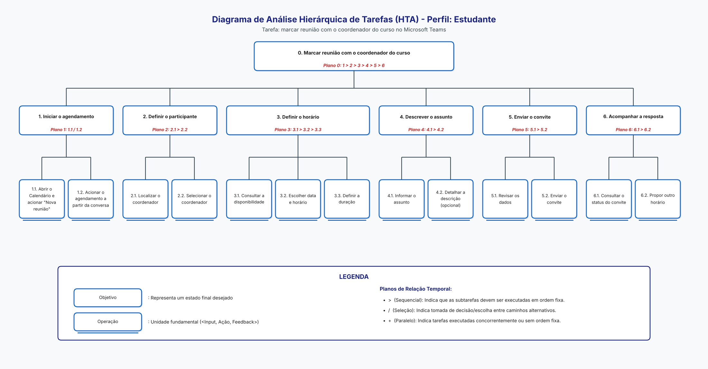

## Tabela de contribuição

| Data       | Contribuição                                                                                              | Autor(es)                   | Revisor(es) |
| ---------- | --------------------------------------------------------------------------------------------------------- | --------------------------- | ----------- |
| 05/11/2026 | Separação do conteúdo de João Paulo em página própria                                                      | João Paulo da Silva Pereira | A definir   |
| 20/11/2026 | Reorganização da página no formato do relato individual: HTA, avaliação com usuários e relato dos resultados | João Paulo da Silva Pereira | A definir   |
| 20/11/2026 | Estruturação textual, tabelas e formatação, com uma ferramenta de IA (Claude), conforme a política de uso de IA da disciplina | Claude (IA) | João Paulo da Silva Pereira |

# João Paulo da Silva Pereira - IHC - Microsoft Teams

> **Relato individual do Nível 1: análise de tarefas (HTA do Estudante).** Funcionalidade: agendamento de reunião com o coordenador do curso (Perfil 1, Estudante). O storyboard do mesmo tema está em [Relato dos resultados - Storyboard](../../storyboard/Joao_Paulo/relato_storyboard_joao_paulo.md). O planejamento está em [Planejamento da análise de tarefas](./planejamento_analise_tarefas_joao_paulo.md). O conteúdo foi separado de [relato_resultados_analise_tarefas.md](../relato_resultados_analise_tarefas.md).

---

## 1. Identificação do integrante e escopo de atuação

**Tabela 1 - Escopo de atuação**

| Atributo                | Detalhamento                                                                                     |
| ----------------------- | ------------------------------------------------------------------------------------------------ |
| Integrante              | João Paulo da Silva Pereira                                                                      |
| Produto avaliado        | Microsoft Teams (ambiente web e desktop)                                                         |
| Perfil de usuário       | Perfil 1: Estudante de graduação da UnB                                                          |
| Funcionalidade          | Agendamento de reunião com o coordenador do curso                                                |
| Artefato avaliado       | HTA do Estudante (nós 0 a 6)                                                                     |
| Método                  | Entrevista semiestruturada: o participante conta a própria rotina e compara com os passos da HTA |
| Número de participantes | 1 (Participante B)                                                                               |
| Sessão                  | 23/10/2026, com gravação em vídeo                                                                |

---

## 2. Análise de tarefas individual (HTA do Estudante)

### 2.1 Ilustração

<b>Figura 1:</b> HTA do Estudante: marcar reunião com o coordenador do curso.

Autor - João Paulo da Silva Pereira

### 2.2 Detalhamento dos nós

**Tabela 2 - Nós da HTA**

| Nó  | Ação                                                    | Descrição                                                                                   |
| --- | ------------------------------------------------------- | ------------------------------------------------------------------------------------------- |
| 0   | Marcar reunião com o coordenador do curso               | Objetivo geral, com os passos 1 a 6 em ordem                                                |
| 1   | Iniciar o agendamento                                   | 1.1 pelo Calendário, com "Nova reunião"; 1.2 pela conversa com o coordenador                |
| 2   | Definir o participante                                  | 2.1 localizar o coordenador; 2.2 selecionar a sugestão                                      |
| 3   | Definir o horário                                       | 3.1 consultar a disponibilidade; 3.2 escolher o horário livre; 3.3 definir a duração        |
| 4   | Descrever o assunto                                     | 4.1 escrever o assunto; 4.2 escrever a descrição                                            |
| 5   | Enviar o convite                                        | 5.1 revisar; 5.2 enviar                                                                     |
| 6   | Acompanhar a resposta                                   | 6.1 consultar o status do convite; 6.2 propor outro horário                                 |

---

## 3. Avaliação com usuários (entrevista com a HTA)

### 3.1 Protocolo ético

O roteiro da entrevista incluiu a leitura e o aceite do termo de consentimento, o esclarecimento de dúvidas e o pedido de autorização para anotar as respostas e gravar o áudio. O participante é identificado no relato só por uma letra (Participante B).

### 3.2 Registro audiovisual

**Tabela 3 - Sessão realizada**

| ID da Sessão | Entrevistador | Participante   | Data       | Plataforma                           | Gravação                                            |
| ------------ | ------------- | -------------- | ---------- | ------------------------------------ | --------------------------------------------------- |
| **02**       | João Paulo    | Participante B | 23/10/2026 | Sessão gravada em vídeo na faculdade | [Vídeo da entrevista](https://youtu.be/w-9FIzXFeLQ) |

### 3.3 Perfil do participante

**Tabela 4 - Perfil do Participante B**

| Atributo                    | Detalhamento                                                                                         |
| --------------------------- | ---------------------------------------------------------------------------------------------------- |
| Perfil                      | Perfil 1: estudante de graduação da UnB (não é o mesmo participante da avaliação do storyboard)      |
| Frequência de uso do Teams  | Cerca de duas a três vezes por semana, para reuniões de projeto, envio de arquivos e atividades      |
| Experiência                 | Nunca precisou marcar horário com coordenador ou professor                                           |
| Canal preferido             | E-mail, por achar mais simples                                                                       |

O número de avaliadores foi de apenas uma pessoa, o aluno João Paulo, autor da análise, que conduziu a própria sessão.

### 3.4 Roteiro da entrevista

Não foi aplicado questionário de dados demográficos nesta sessão; o perfil do participante foi levantado na própria entrevista.

###### Introdução

- *Relacionadas à pesquisa*:
  - Objetivo da pesquisa: entender como o estudante marca uma reunião com o coordenador do curso, principalmente pelo Microsoft Teams;
  - Como será a participação: o participante conta o que faz de verdade e depois compara com uma lista de passos;
  - Tempo aproximado da coleta: de 15 a 20 minutos;
  - Tipos de dados coletados: anotações e áudio, com autorização;
  - Como serão analisados, por quem e para que: pelo grupo, para a avaliação de IHC do Microsoft Teams;
  - Enfatizar que a avaliação é sobre o produto e não sobre o usuário, e que não existe jeito certo ou errado de fazer;
  - Leitura e aceite do termo de consentimento, e esclarecimento de dúvidas, se houver;

###### Coleta de dados relacionados ao usuário

- *Experiência com um produto específico ou ferramentas semelhantes*:
  - Com que frequência usa o Microsoft Teams e para que usa na faculdade;
  - Já precisou marcar horário com um coordenador ou professor?
  - Como foi a última vez que marcou um horário com uma pessoa, do começo ao fim, em qualquer plataforma;
- *Atitudes e valores*:
  - O que no Teams ajuda e o que atrapalha nos passos de marcar a reunião;
  - Prefere outro jeito de marcar? Qual e por quê?

###### Coleta de dados relacionados ao produto

- *Objetivos*:
  - **Como o usuário atinge o objetivo de marcar uma reunião com o coordenador do curso;**
    - Como encontraria o coordenador?
    - Como escolheria o horário? Olha a agenda do coordenador antes?
    - O que costuma escrever no assunto?
    - Antes de enviar, confere alguma coisa? O quê?
    - Como ficaria sabendo da resposta, se o coordenador recusar ou não responder?
    - Algum passo seria feito mais de uma vez? Em qual passo demora mais ou fica em dúvida?
    - Já enviou convite para a pessoa errada ou para um horário em que ela estava ocupada? O que aconteceu? (consequências dos erros)
  - **Validar diagrama HTA;**
    - Apresentar a lista de passos (iniciar, definir o participante, definir o horário, descrever o assunto, enviar o convite e acompanhar a resposta);
    - Perguntar se aparece com o que o usuário faz, se falta alguma coisa e se a ordem é a mesma;
    - Perguntar se começaria pelo Calendário ou pela conversa com a pessoa;
    - Perguntar se falta algum passo ou situação que não foi perguntada;

### 3.5 Síntese dos feedbacks

Na entrevista, foi possível coletar os seguintes dados do participante:

- O participante usa o Teams cerca de duas a três vezes por semana, para reuniões de projeto com colegas e com professor, envio de arquivos e atividades de disciplinas;
- O participante nunca precisou marcar horário com coordenador ou professor;
- Na última vez que marcou um horário com outras pessoas, foi com um grupo de clientes de projeto, pelo WhatsApp, com uma enquete de horários, e a reunião ocorreu no horário em que todos podiam;
- O participante acredita que, para marcar reunião com o coordenador, o Teams é direto para achar a pessoa pelo nome, mas tem muitos passos necessários;
- O participante prefere o e-mail, por achar mais simples;
- O participante nunca enviou convite para a pessoa errada nem para um horário em que a pessoa estava ocupada;
- O participante não repete passos durante o agendamento;
- O passo em que mais demoraria é descrever o assunto, por ser algo formal que ele quer escrever "bonitinho";
- Antes de enviar, o participante revisa o texto, se há erro de escrita e se falta alguma informação;
- Para saber da resposta, o participante olharia a plataforma usada (e-mail, WhatsApp ou Teams); se o coordenador não respondesse até a data solicitada, o participante assumiria que não foi possível marcar;

O participante demonstrou compreender o fluxo demonstrado no diagrama HTA, confirmando a ordem: escolher a pessoa, o horário, o assunto, revisar o envio e ver a resposta, sem acrescentar passos. Indicou, porém, que poderia olhar o calendário primeiro, só para ver as datas disponíveis (antes do nó 2), e que olharia a agenda do coordenador antes de escolher o horário (nó 3.1). Citou o Calendário como ponto de partida e não citou a conversa com a pessoa (nó 1.2).

**Tabela 5 - Resultado por nó da HTA ([Figura 1](#figura-1))**

| Nó da HTA                     | Resultado                              | Evidência                                                                                                                                                                                    |
| ----------------------------- | -------------------------------------- | -------------------------------------------------------------------------------------------------------------------------------------------------------------------------------------------- |
| 0 (ordem geral 1 a 6)         | Confirmado, com ressalva ([T01](#t01)) | "Sim, faz sentido": escolher a pessoa, o horário, o assunto, revisar e ver a resposta. Disse que poderia olhar o calendário primeiro, só para ver as datas disponíveis.                      |
| 1.1 / 1.2 (iniciar)           | Parcial                                | Citou o calendário; não citou a conversa com a pessoa (1.2).                                                                                                                                 |
| 2.1 Localizar o coordenador   | Confirmado                             | Buscaria pelo nome; no Teams, "se eu pesquisar o nome dele… vou encontrar o coordenador".                                                                                                    |
| 3.1 Consultar disponibilidade | Confirmado                             | "Eu olharia a agenda do coordenador antes."                                                                                                                                                  |
| 4.1 / 4.2 Assunto e descrição | Confirmado ([T02](#t02))               | Escreveria o assunto com uma palavra-chave e a descrição abaixo; é o passo em que mais demoraria, por ser algo formal ("bonitinho").                                                         |
| 5.1 Revisar                   | Confirmado                             | "Reviso… se não escrevi nada errado, se está faltando alguma informação."                                                                                                                    |
| 6.1 Consultar o status        | Diferente ([T03](#t03))                | Saberia da resposta "pela plataforma" (e-mail, WhatsApp ou Teams); se o coordenador não respondesse até a data, assumiria que não foi possível marcar. Não citou olhar um status do convite. |
| Passos repetidos e erros      | Sem relato                             | Não repete passos; nunca enviou convite à pessoa errada nem para horário ocupado.                                                                                                            |

---

## 4. Relato dos resultados (Barbosa e Silva, 2021, p. 309)

### 4.1 Objetivos

O objetivo da avaliação da análise de tarefas foi analisar **problemas na interação e na interface**, para coletar dados a respeito de se o usuário entende a funcionalidade de marcar uma reunião com o coordenador do curso no Microsoft Teams, os passos para realizar essa tarefa e se há impedimentos ou erros no diagrama HTA do Estudante ([Figura 1](#figura-1)).

### 4.2 Escopo

A avaliação cobre os nós 0 a 6 da HTA. Ficam fora do escopo a reunião em si e outros tipos de agendamento.

### 4.3 Método

O método de avaliação empregado foi o de **entrevista semiestruturada**, com o participante falando da própria rotina e, em seguida, comparando-a com os passos do diagrama HTA (roteiro na seção 3.4). A coleta de dados com o storyboard do mesmo tema, feita com outro participante, está relatada em [Relato dos resultados - Storyboard](../../storyboard/Joao_Paulo/relato_storyboard_joao_paulo.md).

### 4.4 Avaliadores e participantes

Um avaliador (João Paulo, autor da análise) e um participante do Perfil 1 (Participante B), conforme as Tabelas 3 e 4.

### 4.5 Interpretação dos dados

O participante demonstrou entender bem todo o fluxo de marcar uma reunião com o coordenador, indicando que os passos apresentados correspondem ao que ele faria, sem passos sobrando ou faltando, conforme a [Tabela 5](#tabela-5). Dois pontos reforçam o que a HTA registra: a busca pelo nome (nó 2.1) e a consulta à agenda do coordenador antes de escolher o horário (nó 3.1). Três pontos pedem atenção: a possível ordem inversa, com o calendário antes da pessoa ([T01](#t01)); o esforço de redigir o assunto formal (nó 4.1, [T02](#t02)); e a ausência do hábito de consultar o status do convite (nó 6.1, [T03](#t03)), em que o participante dependeria de outro canal. Como o participante nunca marcou reunião com coordenador, a validade do relato sobre o fluxo é limitada, e o resultado é um indício de uma única sessão. O autor da análise conduziu a própria sessão.

### 4.6 Problemas e oportunidades de melhoria

**Tabela 6 - Problemas encontrados na análise de tarefas**

| ID                      | Nó      | Problema                                                                                                      | Gravidade |
| ----------------------- | ------- | ------------------------------------------------------------------------------------------------------------- | --------- |
| **T01** | 2 e 3.1 | O participante prefere olhar o calendário antes de escolher a pessoa; a HTA coloca a pessoa antes do horário. | Leve      |
| **T02** | 4.1     | Redigir o assunto de forma formal é o passo mais lento e gera hesitação.                                      | Média     |
| **T03** | 6.1     | Sem hábito de consultar o status; espera a resposta por outro canal e assume recusa se ela não vier.          | Média     |
| **T04** | Geral   | O Teams parece ter "muitos passos", e o participante prefere e-mail.                                          | Leve      |

### 4.7 Planejamento para o reprojeto

Para o reprojeto do sistema, as ações são as da tabela abaixo. Para o assunto (T02), o campo deve trazer uma orientação do que escrever (motivo da reunião e o que se espera do coordenador) e pode oferecer um modelo de assunto pronto. Para o status (T03), o convite deve mostrar em texto, na lista e no evento do calendário, se está pendente, aceito ou recusado, e permitir propor outro horário no próprio evento.

**Tabela 7 - Encaminhamentos para o reprojeto**

| ID                      | Ação                                                                                                              | Responsável | Prazo     |
| ----------------------- | ----------------------------------------------------------------------------------------------------------------- | ----------- | --------- |
| **A01** | Registrar na HTA que o nó 3.1 (disponibilidade) pode ocorrer antes do nó 2 (participante) (problema [T01](#t01)). | João Paulo  | A definir |
| **A02** | Oferecer orientação ou um modelo de assunto, para reduzir o esforço do nó 4.1 (problema [T02](#t02)).             | João Paulo  | A definir |
| **A03** | Tornar o status do convite visível onde o estudante já olha (nó 6.1) (problema [T03](#t03)).                      | João Paulo  | A definir |

---

## 5. Referências bibliográficas

- BARBOSA, S. D. J. et al. **Interação Humano-Computador e Experiência do Usuário**. 2021.
- PREECE, J.; ROGERS, Y.; SHARP, H. **Design de Interação**. 2005.
- NIELSEN, J. **Usability Engineering**. 1993.

---

## 6. Histórico de versões

| Versão | Data       | Descrição                                                                         | Autor(es)                   | Revisor(es) |
| ------ | ---------- | --------------------------------------------------------------------------------- | --------------------------- | ----------- |
| `1.0`  | 05/11/2026 | Separação da parte de João Paulo em uma pasta própria                             | João Paulo da Silva Pereira |             |
| `1.1`  | 20/11/2026 | Reorganização no formato do relato individual, com numeração de seções e tabelas  | João Paulo da Silva Pereira |             |
