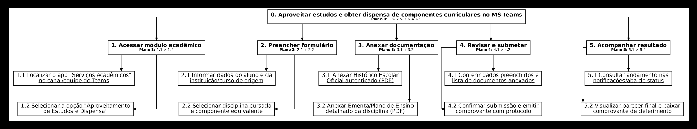

##  Tabela de Contribuição

| Data | Contribuição | Autor(es) | Revisor(es) |
| :---: | :--- | :--- | :--- |
| **22/10/2026** | Planejamento, execução do Teste-Piloto do HTA, calibração do roteiro e gravação solo | Evellyn de Sousa Rocha |  |
| **24/10/2026** | Condução da avaliação empírica do HTA com o usuário João Lima, transcrição do áudio e relato final | Evellyn de Sousa Rocha |  |

---

## 1. Introdução e Objetivos

A Análise Hierárquica de Tarefas (HTA – *Hierarchical Task Analysis*) é utilizada em IHC para compreender as competências e habilidades necessárias para realizar tarefas complexas, auxiliando no mapeamento de gargalos e falhas de desempenho (Annett, 2003; Barbosa e Silva, 2010, pp. 192–196).

Este relato consolida os resultados do **Teste-Piloto de Nível 1** e da **Avaliação Empírica com Usuário** para a funcionalidade de **Aproveitamento de Estudos e Dispensa de Disciplinas** no Microsoft Teams da Universidade de Brasília (UnB). A análise busca mapear o trabalho dos discentes em termos de objetivos, subobjetivos, planos e operações, permitindo entender como a interface possibilita ou impede os usuários de alcançarem suas metas acadêmicas de forma eficiente e sem erros.

---

## 2. Planejamento e Execução do Teste-Piloto do HTA

Conforme prescrito por Simone Barbosa et al. (2021, p. 300), o teste-piloto integra a atividade de **Preparação da Avaliação**, funcionando como um ensaio preparatório fundamental para calibrar os instrumentos de coleta, verificar as ferramentas de gravação, validar a estimativa de tempo e aperfeiçoar a postura da avaliadora antes das sessões formais.

>  **DECLARAÇÃO DE CONFORMIDADE ÉTICA (ITEM 12 DO CHECKLIST DE IHC)**  
> Conforme estabelece a literatura de IHC (Barbosa et al., 2021, p. 300), os dados, respostas e registros obtidos durante a execução deste teste-piloto têm finalidade **exclusiva de calibração metodológica e técnica**. Eles **NÃO serão computados, contabilizados nem agregados** aos resultados oficiais das avaliações do HTA com usuários.

###  Registro Audiovisual do Teste-Piloto do HTA
A gravação completa do ensaio preparatório do Teste-Piloto encontra-se disponível no link a seguir:

* **Vídeo 1:** Gravação do Teste-Piloto Individual — Validação do HTA
* **Plataforma:** Microsoft Teams (Gravação em nuvem)
* **Trecho Específico do HTA:** Minuto `3:17` ao `5:42` (Duração: 02 min 25 s)
* **Link do Vídeo:** [Clique aqui para assistir ao vídeo do Teste-Piloto](https://youtu.be/hhr29hYrU10)

### 2.1 Metadados e Registro do Vídeo do Teste-Piloto do HTA

A **Tabela 1** detalha os parâmetros operacionais da gravação do Teste-Piloto individual focado no HTA:

| Parâmetro | Definição Operacional |
| :--- | :--- |
| **Data e Horário:** | **22/10/2026** às **18h30** |
| **Avaliadora Responsável:** | **Evellyn de Sousa Rocha** |
| **Plataforma Utilizada:** | **Microsoft Teams** (com gravação em nuvem, compartilhamento de tela Full HD e áudio) |
| **Intervalo Específico do HTA:** | Minuto 3:17 ao 5:42 *(Duração do trecho HTA: 02 min 25 s)* |
| **Arquivo do Vídeo:** | teste-piloto-hta-teams.mp4 |
| **Custos Envolvidos:** | **R\$ 0,00** (infraestrutura acadêmica gratuita da UnB) |

<i><b>Tabela 1:</b> Parâmetros Logísticos e Metadados do Vídeo do Teste-Piloto do HTA.</i>

---

### 2.2 Transcrição Rastreável do Teste-Piloto (HTA)

A **Tabela 2** apresenta a transcrição síncrona extraída do registro transcrição_teste_piloto, cobrindo **estritamente o bloco de validação do Diagrama HTA** (3:17 a 5:42):

| Minutagem | Fala / Ação da Avaliadora (Evellyn de Sousa Rocha) | Etapa de Calibração do HTA |
| :---: | :--- | :--- |
| 3:17 – 3:49 | *"Bom, agora eu vou compartilhar a tela do HTA. [...] Beleza, esse aqui é o HTA."* | Projeção do diagrama HTA em tela compartilhada. |
| 3:49 – 4:36 | *"Eu vou passar agora para a validação do diagrama. O HTA está decomposto no objetivo principal e em cinco subobjetivos hierárquicos:* • *Objetivo 1: Acessar o módulo 'Serviços Acadêmicos' no canal do Teams;* • *Objetivo 2: Preencher o formulário informando a estrutura de origem;* • *Objetivo 3: Anexar a documentação em PDF, que é o histórico escolar oficial e a ementa;* • *Objetivo 4: Revisar os dados, submeter e receber a confirmação com o protocolo SEI pelo chat do Teams;* • *Objetivo 5: Acompanhar o parecer final e a linha do tempo nas notificações."* | Validação da decomposição hierárquica e leitura da árvore de objetivos (Nível 0 ao Nível 5). |
| 4:36 – 4:52 | *"Fazer uma análise sobre a estrutura do HTA frente ao roteiro de perguntas. Primeiro, eu verifico que cada tupla de operação, que é o Input, Ação e Feedback, corresponde exatamente aos passos operacionais que o discente executa na interface."* | Análise do alinhamento entre as tuplas de operação &lt;Input, Ação, Feedback&gt; e as perguntas. |
| 4:52 – 5:10 | *"Eu calibrei a pergunta verbal sobre o upload de documentos para especificamente o limite de tamanho do arquivo, que seria até 10 MB, e também a obrigatoriedade de ter autenticação conforme as regras do manual da UnB e da SAA. E também a legibilidade do diagrama que em tela cheia fica adequada..."* | Calibração do roteiro verbal (inserção do limite de 10 MB e autenticação SAA/UnB) e teste de legibilidade. |
| 5:18 – 5:42 | *"Bom, agora vou fazer o fechamento da calibração [...] A gravação em nuvem no Teams permaneceu estável, em alta resolução, captação clara de voz. A sessão durou cerca de 6 minutos, confirmando que a estimativa de 10 a 15 minutos para as sessões oficiais com os usuários é perfeitamente viável. [...] Encerro aqui o vídeo do teste-piloto."* | Fechamento da calibração técnica pós-piloto e verificação de viabilidade do tempo. |

<i><b>Tabela 2:</b> Transcrição Rastreável do Trecho do HTA no Teste-Piloto. Fonte: transcrição_teste_piloto (2026).</i>

---

### 2.3 Ficha de Calibração Técnica Pós-Piloto do HTA

Após a execução do ensaio solo, a avaliadora **Evellyn** preencheu a Ficha de Calibração técnica (**Tabela 3**), conforme o padrão de Daniel da Silva Batista (2026):

| # | Item Verificado | Critério de Aprovação | Resultado Observado | Ajuste / Ação Realizada |
| :---: | :--- | :--- | :---: | :--- |
| **1** | **Legibilidade do HTA** | Diagrama hierárquico legível durante a projeção no MS Teams. | **Aprovado** | Projeção em modo tela cheia para visualização dos 5 subobjetivos. |
| **2** | **Alinhamento HTA vs. Roteiro** | Cobertura das tuplas de operação &lt;Input, Ação, Feedback&gt;. | **Calibrado** | Inserida a especificação verbal sobre o limite de PDF (até 10 MB) e autenticação UnB. |
| **3** | **Duração do Bloco HTA** | Leitura e explicação do HTA concisas e sem ruídos (aprox. 2 a 3 min). | **Aprovado** | Trecho de HTA concluído em 02 min 25 s, confirmando a viabilidade da sessão. |
| **4** | **Qualidade de Áudio/Vídeo** | Resolução Full HD e captação clara da voz da avaliadora. | **Aprovado** | Gravação estável via Microsoft Teams sem congelamentos. |

<i><b>Tabela 3:</b> Ficha de Calibração Técnica Pós-Piloto do HTA. Fonte: Elaboração da autora (2026).</i>

---

## 3. Avaliação Empírica do HTA com Participante (João Lima)

A coleta de dados oficiais foi realizada em sessão remota síncrona com o estudante **João Lima** (discente de Matemática do 3º semestre na UnB), utilizando a entrevista semiestruturada com apoio da projeção do HTA (Barbosa e Silva, 2010, pp. 303–310).

###  Registro Audiovisual da Avaliação Empírica com Usuário
A gravação na íntegra da sessão de avaliação do HTA com o participante João Lima está disponível no link a seguir:

* **Vídeo 2:** Avaliação Empírica do HTA com o Participante João Lima
* **Plataforma:** Microsoft Teams (Gravação em nuvem com compartilhamento de tela)
* **Duração Total:** 06 minutos e 45 segundos
* **Data da Gravação:** 24/10/2026
* **Link do Vídeo:** [Clique aqui para assistir à avaliação com o usuário](https://youtu.be/Ewo-oQxVEKs)

### 3.1 Metadados e Registro do Vídeo da Avaliação Oficial

A **Tabela 5** resume os dados do protocolo da sessão com o usuário:

| Campo / Parâmetro | Registro Efetivo da Sessão |
| :--- | :--- |
| **Moderadora / Facilitadora** | **Evellyn de Sousa Rocha** |
| **Pessoa Participante (PROP01)** | **João Lima** (estudante de Matemática na UnB; usuário semanal do MS Teams) |
| **Plataforma e Gravação** | Microsoft Teams (gravação em nuvem Full HD e áudio) |
| **Duração Total do Vídeo** | **06 minutos e 45 segundos** |
| **Data da Gravação** | **24/10/2026** |
| **Consentimento Ético (TCLE)** | Confirmado verbalmente pelo participante aos 0:39 da gravação |
| **Arquivo do Vídeo:** | avaliacao-hta-teams.mp4 |

<i><b>Tabela 5:</b> Protocolo da Sessão e Metadados do Vídeo com João Lima.</i>

---

### 3.2 Transcrição Rastreável da Avaliação com o Usuário

A **Tabela 6** registra a transcrição do diálogo entre **Evellyn** e **João Lima**, mapeando os localizadores temporais minuciosos do vídeo:

| Subobjetivo HTA / Etapa | Pergunta da Moderadora (Evellyn) | Fala / Resposta do Participante (João Lima) | Localizador no Vídeo |
| :---: | :--- | :--- | :---: |
| **Abertura & TCLE** | *"Confirmando para registro, você assinou o termo de consentimento livre e esclarecido e autorizando o seu... sua participação, certo?"* | *"Sim."* | 0:24 – 0:39 |
| **Perfil do Usuário** | *"Qual o seu curso? Qual semestre você está e com que frequência utiliza o Teams?"* | *"Faço matemática na UnB mesmo, estou no terceiro semestre e utilizo o Teams semanalmente."* | 0:39 – 0:53 |
| **Apresentação HTA** | *"O objetivo zero é aproveitar os estudos e obter dispensa de componentes curriculares. Passa para acessar o módulo acadêmico, preenche o formulário com seus documentos, revisa, submete e acompanha o resultado."* | *(Participante analisa visualmente o diagrama hierárquico em tela compartilhada).* | 1:04 – 2:25 |
| **Subobjetivo 1** *(Acessar Módulo)* | *"João, no objetivo 1, o discente entra no canal do Teams, na turma da UnB na verdade, clica no aplicativo 'Serviços Acadêmicos' para abrir o formulário. Na sua visão de usuário, encontrar essa opção no canal da UnB é o caminho mais natural ou você procuraria em outro lugar?"* | *"Acho que é o mais natural, né? OK."* | 2:25 – 2:49 |
| **Subobjetivo 2** *(Preencher Dados)* | *"No objetivo 2, o estudante escolhe a matéria cursada e a disciplina equivalente na UnB. Pensando na sua experiência real, quais dificuldades você pode ter na hora de selecionar as disciplinas equivalentes? O que mais seria útil?"* | *"Acho que ver essa questão da equivalência entre as disciplinas [...] e também a questão de saber se essa disciplina... ela é equivalente ou se ela é obrigatória ou módulo livre. Acho que mais essas duas."* | 2:54 – 3:37 |
| **Subobjetivo 3** *(Anexar PDFs)* | *"No objetivo 3, o diagrama exige o anexo do histórico escolar e também a ementa em PDF. O que você precisaria ver na tela no momento do upload para ter certeza que o arquivo foi carregado com sucesso e para ter mais segurança?"* | *"Acho que depois que eu enviar, aparecer uma tela meio que dando um 'checkzinho' de que foi enviado e confirmado [...] Geralmente o que iria acontecer deveria ser o limite de megabytes, que podia estar errado."* | 3:38 – 4:17 |
| **Subobjetivo 4** *(Revisar e Submeter)* | *"No objetivo 4, o aluno revisa as informações e confirma o envio, gerando o protocolo oficial que vai ser enviado pelo chat dele. Ter uma tela de revisão antes do botão confirmar e receber esse comprovante por e-mail seria importante por quê?"* | *"Seria importante receber tanto pelo Teams, tanto por e-mail. Pelo e-mail porque a gente tem mais fácil acesso ao e-mail do que pelo Teams [...] ter dois locais que você recebeu esse comprovante de solicitação é importante e facilitaria."* | 4:17 – 5:05 |
| **Subobjetivo 5** *(Acompanhar Parecer)* | *"Por fim, no objetivo 5, o aluno acompanha a análise da coordenação. Como você gostaria de ver o andamento do processo dentro do Teams para não ter dúvidas de que ele está sendo analisado?"* | *"Acho que se dividisse... tivesse 3 coisas: que o arquivo/solicitação foi recebida, o outro que ela está sendo analisada e depois que ela foi entregue. Acho que isso facilitaria bastante."* | 5:05 – 5:40 |
| **Síntese & Concordância** | *"Para encerrar nossa conversa, vou fazer um resumo dos principais pontos que você sugeriu [...] esse resumo corresponde ao que você validou e melhorias nas tarefas?"* | *"Exatamente, sim. [...] Obrigado."* | 5:40 – 6:43 |

<i><b>Tabela 5:</b> Transcrição Rastreável da Avaliação do HTA com João Lima. Fonte: Avaliação_hta (2026).</i>

---

## 4. Representação do Diagrama HTA

Abaixo é apresentada a decomposição gráfica do objetivo 0. Aproveitar estudos e obter dispensa de componentes curriculares no MS Teams, seguindo a notação estruturada em que as **operações atômicas** representam a camada indivisível da ação (Barbosa e Silva, 2010, p. 193):

**Figura 1 – Diagrama HTA do processo de aproveitamento de estudos e dispensa de componentes curriculares**  *Fonte: Elaborado pela autora (2026).*
---

## 5. Tabela de Análise de Tarefas e Operações (Barbosa e Silva, 2010, p. 194)

Conforme a Tabela 6.3 de Barbosa e Silva (2010, p. 194), a **Tabela 7** especifica as tuplas de operação &lt;Input, Ação, Feedback&gt;, articulando o comportamento esperado do sistema com os problemas potenciais e as recomendações de IHC apontadas no teste empírico:

| Objetivos / Operações | Planos e Tuplas de Operação &lt;Input, Ação, Feedback&gt; | Problemas Identificados e Recomendações de IHC |
| :--- | :--- | :--- |
| **0. Aproveitar estudos e obter dispensa no MS Teams** | **Plano 0:** Executar 1, 2, 3 e 4 sequencialmente (1 > 2 > 3 > 4). Após confirmação, executar 5.  **Input:** Necessidade de dispensar disciplinas já cursadas.  **Feedback:** Processo deferido/indeferido e atualizado no histórico acadêmico. | **Problema:** Incerteza do aluno sobre quais disciplinas possuem equivalência e qual a modalidade de crédito.  **Recomendação:** Exibir uma lista de equivalências pré-aprovadas indicando se é matéria obrigatória, optativa ou módulo livre. |
| **1. Acessar módulo acadêmico no MS Teams** | **Plano 1:** Executar 1.1 e 1.2 sequencialmente (1.1 > 1.2). | — |
| **1.1 Localizar app "Serviços Acadêmicos" no canal** | **Input:** Barra de navegação e abas superiores do canal do Teams.  **Ação:** Clicar na guia "Serviços Acadêmicos".  **Feedback:** Abertura do painel de serviços. | **Problema:** Excesso de abas inativas no canal polui a visualização.  **Recomendação:** Fixar o atalho de solicitações na barra superior do canal geral. |
| **1.2 Selecionar "Aproveitamento de Estudos e Dispensa"** | **Input:** Menu de serviços disponíveis.  **Ação:** Clicar no card correspondente.  **Feedback:** Exibição da tela inicial do formulário com instruções. | **Problema:** Confusão conceitual entre dispensa interna e transferência.  **Recomendação:** Inserir texto explicativo diferenciando as modalidades. |
| **2. Preencher dados do formulário** | **Plano 2:** Executar 2.1 e 2.2 em conjunto/paralelo (2.1 + 2.2). | — |
| **2.1 Informar dados do aluno e da instituição de origem** | **Input:** Campos de formulário.  **Ação:** Digitar nome da instituição e curso de origem.  **Feedback:** Campos validados com destaque visual. | **Problema:** Preenchimento repetitivo de dados cadastrais.  **Recomendação:** Autopreencher matrícula, nome e curso a partir do login autenticado do Teams. |
| **2.2 Selecionar disciplina cursada e componente equivalente** | **Input:** Menu suspenso do currículo atual.  **Ação:** Selecionar a disciplina equivalente e informar a cursada.  **Feedback:** Par de disciplinas vinculado na solicitação. | **Problema:** Incerteza no mapeamento da equivalência da disciplina.  **Recomendação:** Oferecer busca por código ou nome com autocompletar e indicação da categoria de crédito. |
| **3. Anexar documentação comprobatória exigida** | **Plano 3:** Executar 3.1 e 3.2 em conjunto/paralelo (3.1 + 3.2). | — |
| **3.1 Anexar Histórico Escolar Oficial autenticado (PDF)** | **Input:** Botão "Carregar Histórico Escolar".  **Ação:** Selecionar e carregar o arquivo PDF.  **Feedback:** Ícone do arquivo anexado e barra de upload em 100%. | **Problema:** Incerteza se o PDF foi carregado com sucesso e risco de erro no limite de MB.  **Recomendação:** Exibir marca visual [✓] e indicar o limite máximo de 10 MB e extensão .pdf. |
| **3.2 Anexar Ementa/Plano de Ensino detalhado (PDF)** | **Input:** Botão "Carregar Ementa/Plano de Ensino".  **Ação:** Fazer o upload das ementas correspondentes.  **Feedback:** Lista de ementas anexadas com botão de pré-visualização. | **Problema:** Esquecimento do anexo de ementa de alguma matéria.  **Recomendação:** Alerta visual de pendência documental para cada disciplina. |
| **4. Revisar e submeter a solicitação** | **Plano 4:** Executar 4.1 e, estando correto, executar 4.2 (4.1 > 4.2). | — |
| **4.1 Conferir dados preenchidos e lista de anexos** | **Input:** Tela de resumo dos dados e arquivos.  **Ação:** Revisar as informações inseridas.  **Feedback:** Destaque em verde para itens validados. | **Problema:** Necessidade de refazer todo o formulário para corrigir um erro.  **Recomendação:** Botão "Editar" ao lado de cada seção do resumo. |
| **4.2 Confirmar submissão e emitir protocolo** | **Input:** Botão "Submeter Solicitação".  **Ação:** Clicar no botão de envio final.  **Feedback:** Mensagem de sucesso e geração do protocolo na tela. | **Problema:** Receio de perder o comprovante caso fique restrito à tela do aplicativo no Teams.  **Recomendação:** Disparar notificação automática no chat do Teams e enviar comprovante por e-mail institucional. |
| **5. Acompanhar parecer e resultado final** | **Plano 5:** Executar 5.1 para consultar e 5.2 quando houver resultado (5.1 > 5.2). | — |
| **5.1 Consultar andamento da solicitação nas notificações** | **Input:** Central de notificações do Teams / aba de status.  **Ação:** Abrir o cartão da solicitação.  **Feedback:** Exibição da linha do tempo do processo. | **Problema:** Falta de visibilidade das etapas do processo de análise pela coordenação.  **Recomendação:** Estruturar o acompanhamento em 3 fases transparentes: Recebido, Em Análise e Concluído. |
| **5.2 Visualizar parecer final e baixar comprovante** | **Input:** Notificação de conclusão do processo.  **Ação:** Acessar a notificação e fazer download do parecer.  **Feedback:** Download da declaração final de deferimento/indeferimento. | **Problema:** Indeferimento sem justificativa detalhada.  **Recomendação:** Apresentar parecer do relator com opção de recurso. |

<i><b>Tabela 6:</b> Tabela HTA de Operações e Recomendações de IHC. Fonte: Adaptado de Barbosa e Silva (2010, p. 194).</i>

---

## 6. Consolidação dos Problemas de Usabilidade e Desempenho

A consolidação dos problemas identificados na análise HTA e confirmados na entrevista empírica com João Lima foi priorizada segundo o seu impacto no desempenho e a escala de severidade de Nielsen (1994a):

- **Severidade 1 (Cosmético):** Não exige correção imediata, a menos que haja tempo no cronograma.
- **Severidade 2 (Pequeno):** Problema de baixa prioridade, mas que causa pequenos atrasos ou ruídos.
- **Severidade 3 (Grande):** Alta prioridade de correção; prejudica gravemente a eficiência e a prevenção de erros.

### Tabela de Problemas Não Corrigidos (para o Reprojeto)

A **Tabela 7** detalha os problemas mapeados na sessão de avaliação do HTA, categorizados por fator de usabilidade, impacto e nível de severidade:

| ID | Localização (Tela/Operação) | Fator de Usabilidade / Tipo de Erro | Descrição e Justificativa do Problema | Frequência e Impacto | Severidade (1 a 3) | Sugestão de Redesign / IHC |
| :---: | :--- | :--- | :--- | :--- | :---: | :--- |
| **P-01** | Operação 1.1 / Aba Superior | Visibilidade da Interface / Erro de Regra | Dificuldade em localizar o atalho do aplicativo em meio a canais poluídos. | Alta frequência no grupo. | 3 (Grande) | Fixar um botão direto "Solicitações Acadêmicas" no topo do canal geral. |
| **P-02** | Operação 2.1 / Formulário | Eficiência no Uso / Erro de Habilidade | Redundância no preenchimento manual de dados pessoais já existentes no sistema. | Todos os participantes. | 2 (Pequeno) | Autopreencher matrícula, nome e curso via perfil autenticado do Teams. |
| **P-03** | Operação 2.2 / Equivalências | Mapeamento e Clareza / Erro de Conhecimento | Incerteza do aluno sobre se a disciplina é equivalente e qual a modalidade de crédito (Obrigatória, Optativa ou Módulo Livre). | Alta frequência (3:22). | 3 (Grande) | Apresentar busca de equivalências indicando se a matéria é Obrigatória, Optativa ou Módulo Livre. |
| **P-04** | Operação 3.1 e 3.2 / Upload PDF | Prevenção de Erros / Erro de Regra | Incerteza quanto aos formatos aceitos e limite de tamanho dos documentos PDF. | Média frequência. | 2 (Pequeno) | Exibir marca visual [✓] e indicar os limites de tamanho (até 10 MB) e formato (.pdf). |
| **P-05** | Operação 4.2 / Confirmação | Feedback e Comunicabilidade / Erro de Conhecimento | Incerteza do estudante após a submissão, gerando dúvidas quanto ao recebimento. | Alta frequência no grupo. | 3 (Grande) | Disparar notificação automática no chat do Teams com o número do protocolo e enviar por e-mail. |
| **P-06** | Operação 5.1 / Acompanhamento | Feedback de Estado / Visibilidade | Falta de visibilidade clara sobre o andamento e as fases de análise pela coordenação. | Alta frequência no grupo. | 3 (Grande) | Estruturar o painel de acompanhamento indicando 3 status: Recebido, Em Análise e Concluído. |

<i><b>Tabela 7:</b> Tabela de Problemas de Usabilidade Mapeados no HTA.</i>

---

## 7. Planejamento do Reprojeto

Com base na priorização dos problemas mapeados na HTA, o cronograma de ajustes para o reprojeto do protótipo digital seguirá a ordem de severidade e impacto (**Tabela 8**):

| ID da Correção | Ação de Redesign Priorizada | Integrante Responsável | Prazo Limite | Status |
| :---: | :--- | :--- | :---: | :---: |
| **REP-01** | Implementar o envio de notificação com protocolo no chat do Teams e por e-mail institucional (P-05). | Desenvolvedor / Designer | 27/10/2026 | Pendente |
| **REP-02** | Criar busca de equivalências indicando se a matéria é Obrigatória, Optativa ou Módulo Livre (P-03). | Designer de Interface | 27/10/2026 | Pendente |
| **REP-03** | Adicionar marcas visuais [✓] e avisos de limite de PDF (10 MB) no componente de upload (P-04). | Designer de Interface | 27/10/2026 | Pendente |
| **REP-04** | Estruturar painel de acompanhamento com linha do tempo de 3 status: Recebido, Em Análise e Concluído (P-06). | Desenvolvedor / Designer | 27/10/2026 | Pendente |
| **REP-05** | Redesenhar o cabeçalho do canal geral para destacar a guia de serviços (P-01). | Designer de Interface | 27/10/2026 | Pendente |
| **REP-06** | Configurar o autopreenchimento dos dados do discente no formulário via perfil Teams (P-02). | Desenvolvedor | 27/10/2026 | Pendente |

<i><b>Tabela 8:</b> Planejamento do Reprojeto (REP).</i>

---

## 8. Limites da Avaliação e Aspectos Éticos

A avaliação por HTA concentrou-se na análise conceitual da decomposição de tarefas e no modelo mental do usuário. Conforme ressalta a literatura de IHC (Barbosa e Silva, 2010, pp. 311–313), a discussão de um diagrama hierárquico com o usuário é uma técnica de investigação que identifica expectativas e lacunas de informação, mas não afere o tempo quantitativo de execução nem substitui os testes de usabilidade em protótipos executáveis.

##  Nota de Agradecimento e Apoio Tecnológico

Agradeço ao assistente de inteligência artificial **Gemini Notebook** pelo suporte na estruturação técnica do documento em Markdown, organização das tabelas no padrão ABNT/IHC, alinhamento metodológico com a literatura de **Simone Barbosa et al. (2010/2021)** e Mapeamento Rastreável dos Tempos de Gravação e Transcrição do **Teste-Piloto** e da **Avaliação do HTA**.

##  Referências Bibliográficas

- ANNETT, John. Hierarchical Task Analysis. In: DIAPER, Dan; STANTON, Neville (Eds.). *The Handbook of Task Analysis for Human-Computer Interaction*. Mahwah, NJ: Lawrence Erlbaum Associates, 2003. pp. 67–82.
- BARBOSA, Simone Diniz Junqueira; SILVA, Bruno Santana da. *Interação Humano-Computador*. Rio de Janeiro: Elsevier / Editora Campus, 2010. ISBN 978-85-352-3418-3.
  
- BARBOSA, Simone Diniz Junqueira et al. *Interação Humano-Computador e Experiência do Usuário*. Rio de Janeiro: Autopublicação, 2021. ISBN: 978-65-00-19677-1. (Capítulo 11: Planejamento da Avaliação de IHC, pp. 258–261 e p. 300).
- BATISTA, Daniel da Silva. *Planejamento e Execução do Teste-Piloto (Nível 1)*. Repositório de IHC. Brasília: Faculdade do Gama — UnB, 2026.
- UNIVERSIDADE DE BRASÍLIA (UnB). *Manual de Peticionamento Eletrônico: Aproveitamento de Estudos e Dispensa de Componentes Curriculares*. Versão 4.0. Brasília: Secretaria de Administração Acadêmica (SAA/UnB), 2023.

---

##  Histórico de Versão

| Versão | Data | Descrição | Autor(es) | Revisor(es) |
| :---: | :---: | :--- | :--- | :--- |
| 1.0 | 20/10/2026 | Criação da página e adição de relatos de resultados HTA. | Evellyn de Sousa Rocha |  |
| 2.0 | 25/10/2026 | Integração do Teste-Piloto do HTA (minutos 3:17–5:42), transcrição rastreável da avaliação oficial com João Lima (0:06–6:43) e consolidação das tabelas P-01 a P-06 e REP-01 a REP-06. | Evellyn de Sousa Rocha |  |

---

