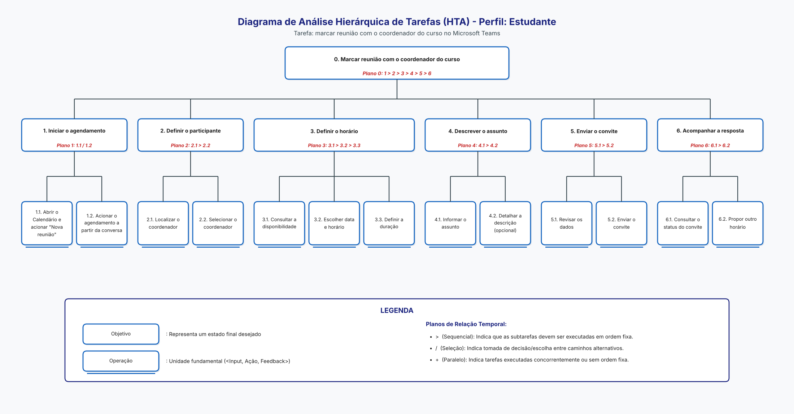

## Tabela de contribuição
| Data       | Contribuição                                                                                                               | Autor(es)                   | Revisor(es) |
| ---------- | -------------------------------------------------------------------------------------------------------------------------- | --------------------------- | ----------- |
| 20/10/2026 | Criação da página                                                                                                          | Lucas Sales Ribeiro         | A definir   |
| 24/10/2026 | Relato dos resultados da entrevista de análise de tarefas do agendamento de reunião com o coordenador do curso (Estudante) | João Paulo da Silva Pereira | A definir   |

# Relato dos Resultados da Avaliação da Análise de Tarefas – Agendamento de Reunião com o Coordenador (Estudante)

Este relato segue os tópicos da página [Planejamento do relato dos resultados](../../../planejamento/planejamento_relato_resultados.md): [objetivos](#objetivos), [método](#metodo), [participantes](#participantes), [sumário dos dados](#sumario), [interpretação](#interpretacao), [problemas](#problemas) e [reprojeto](#reprojeto). As falas vêm da transcrição automática do vídeo da sessão e podem ter erros; o participante é identificado por letra, e não por nome.

## 1. Objetivos e escopo da avaliação

Verificar se o caminho que um estudante descreve para marcar uma reunião com o coordenador do curso no Microsoft Teams corresponde ao caminho da HTA do Estudante (nós 1 a 6, [Figura 1](#figura-1)), e identificar dificuldades nesse caminho. Ficam fora do escopo a reunião em si e outros tipos de agendamento.

<b>Figura 1:</b> HTA do Estudante: marcar reunião com o coordenador do curso.

## 2. Forma como a avaliação foi realizada

Entrevista semiestruturada, com consentimento do participante (termo lido e aceito; anotações e gravação de áudio autorizadas). O entrevistador pediu que o participante contasse a última vez que marcou um horário com alguém, mostrou a lista de passos da HTA e perguntou sobre ordem, passos que faltam, dúvidas, erros anteriores e o que ajuda ou atrapalha no Teams.

**Tabela 1 – Sessão realizada**

| ID da Sessão                 | Entrevistador | Participante  | Data       | Plataforma                        |
| ---------------------------- | ------------- | ------------- | ---------- | --------------------------------- |
| **02** | João Paulo    | Gabriel Diniz | 23/10/2026 | Sessão gravada em vídeo faculdade |

**Registro da sessão:** [vídeo da entrevista de análise de tarefas](https://youtu.be/w-9FIzXFeLQ).

## 3. Número e perfil dos participantes e avaliadores

Um participante (B) e um entrevistador (João Paulo, autor da análise). O Participante B é estudante universitário e usa o Teams duas a três vezes por semana, para reuniões de projeto, envio de arquivos e atividades de disciplinas. Nunca marcou horário com coordenador ou professor; relatou como exemplo a marcação de reuniões de grupo pelo WhatsApp, com enquete de horários. Não é o mesmo participante da avaliação do storyboard.

## 4. Sumário dos dados coletados

**Tabela 2 – Resultado por nó da HTA ([Figura 1](#figura-1))**

| Nó da HTA                     | Resultado                              | Evidência                                                                                                                                                                                    |
| ----------------------------- | -------------------------------------- | -------------------------------------------------------------------------------------------------------------------------------------------------------------------------------------------- |
| 0 (ordem geral 1 a 6)         | Confirmado, com ressalva ([T01](#t01)) | "Sim, faz sentido": escolher a pessoa, o horário, o assunto, revisar e ver a resposta. Disse que poderia olhar o calendário primeiro, só para ver as datas disponíveis.                      |
| 1.1 / 1.2 (iniciar)           | Parcial                                | Citou o calendário; não citou a conversa com a pessoa (1.2).                                                                                                                                 |
| 2.1 Localizar o coordenador   | Confirmado                             | Buscaria pelo nome; no Teams, "se eu pesquisar o nome dele… vou encontrar o coordenador".                                                                                                    |
| 3.1 Consultar disponibilidade | Confirmado                             | "Eu olharia a agenda do coordenador antes."                                                                                                                                                  |
| 4.1 / 4.2 Assunto e descrição | Confirmado ([T02](#t02))               | Escreveria o assunto com uma palavra-chave e a descrição abaixo; é o passo em que mais demoraria, por ser algo formal ("bonitinho").                                                         |
| 5.1 Revisar                   | Confirmado                             | "Reviso… se não escrevi nada errado, se está faltando alguma informação."                                                                                                                    |
| 6.1 Consultar o status        | Diferente ([T03](#t03))                | Saberia da resposta "pela plataforma" (e-mail, WhatsApp ou Teams); se o coordenador não respondesse até a data, assumiria que não foi possível marcar. Não citou olhar um status do convite. |
| Passos repetidos e erros      | Sem relato                             | Não repete passos; nunca enviou convite à pessoa errada nem para horário ocupado.                                                                                                            |

O que ajuda no Teams: achar a pessoa pelo nome é direto. O que atrapalha: "muitos passos necessários". Prefere o e-mail, que acha mais simples. Não acrescentou passos que faltassem.

## 5. Interpretação e análise dos dados

A HTA ([Figura 1](#figura-1)) se sustentou, conforme a [Tabela 2](#tabela-2): os seis grupos de passos apareceram na fala do participante, sem passos sobrando ou faltando. Dois pontos reforçam o que a HTA registra: a busca pelo nome (nó 2.1) e a consulta à agenda do coordenador antes de escolher o horário (nó 3.1). Três pontos pedem atenção: a possível ordem inversa (calendário antes da pessoa, [T01](#t01)), o esforço de redigir o assunto formal (nó 4.1, [T02](#t02)) e a ausência do hábito de consultar o status do convite (nó 6.1, [T03](#t03)), em que o participante dependeria de outro canal. Como o participante nunca marcou reunião com coordenador, a validade do relato sobre o fluxo é limitada, e o resultado é um indício de uma única sessão. O autor da análise conduziu a própria sessão. Os problemas estão na [Tabela 3](#tabela-3) e os encaminhamentos na [Tabela 4](#tabela-4).

## 6. Lista dos problemas encontrados

**Tabela 3 – Problemas encontrados na análise de tarefas**

| ID                      | Nó      | Problema                                                                                                      | Gravidade |
| ----------------------- | ------- | ------------------------------------------------------------------------------------------------------------- | --------- |
| **T01** | 2 e 3.1 | O participante prefere olhar o calendário antes de escolher a pessoa; a HTA coloca a pessoa antes do horário. | Leve      |
| **T02** | 4.1     | Redigir o assunto de forma formal é o passo mais lento e gera hesitação.                                      | Média     |
| **T03** | 6.1     | Sem hábito de consultar o status; espera a resposta por outro canal e assume recusa se ela não vier.          | Média     |
| **T04** | Geral   | O Teams parece ter "muitos passos", e o participante prefere e-mail.                                          | Leve      |

## 7. Planejamento para o reprojeto

**Tabela 4 – Encaminhamentos para o reprojeto**

| ID                      | Ação                                                                                                              | Responsável | Prazo     |
| ----------------------- | ----------------------------------------------------------------------------------------------------------------- | ----------- | --------- |
| **A01** | Registrar na HTA que o nó 3.1 (disponibilidade) pode ocorrer antes do nó 2 (participante) (problema [T01](#t01)). | João Paulo  | A definir |
| **A02** | Oferecer orientação ou um modelo de assunto, para reduzir o esforço do nó 4.1 (problema [T02](#t02)).             | João Paulo  | A definir |
| **A03** | Tornar o status do convite visível onde o estudante já olha (nó 6.1) (problema [T03](#t03)).                      | João Paulo  | A definir |

# Relato dos resultados comunicação com usuário(s)

## Objetivos e escopo da avaliação

O objetivo da avaliação da análise de tarefas, foi de analisar **problemas na interação e na interface**, para coletar dados a respeito de se o usuário entende a funcionalidade, os passos para realizar tarefas que utilizem a mesma e verificar se há impedimentos ou erros na diagramação.

## Método de avaliação
O método de avaliação empregado foi o de **entrevista semiestruturada** juntamente com um **questionário**. O objetivo do questionário foi de coletar dados demográficos do participante, juntamente com questões específicas relacionadas à perfil profissional, empresa que atua, experiência com textos complexos, experiência com computadores e preferências de aprendizado.

Para a entrevista semiestruturada o avaliador buscou compreender a rotina de tarefas realizadas no Microsoft Teams, juntamente com a apresentação do diagrama HTA, e do storyboard, o qual a coleta de dados está relatada em [Relato dos resultados - Storyboard](/design_avaliacao_desenvolvimento/nivel_1/storyboard/relato_resultados_storyboard/).

### Roteiro entrevista semiestruturada

#### Introdução

- *Relacionadas à pesquisa*:
  - Objetivos da pesquisa;
  - Como será a participação dos participantes;
  - O que irá ocorrer durante a coleta de dados;
  - Tempo aproximado da coleta;
  - Tipos de dados que serão coletados;
  - Como serão analisados, por quem e para que;
  - Enfatizar que a avaliação é sobre o produto e não os usuários;
  - Esclarecimento de dúvidas, se houver;
  
#### Coleta de dados relacionados ao usuário
- *Experiência com um produto específico ou ferramentas semelhantes*
  - Experiência com produtos concorrentes;
  - Hábitos de uso;
  - Preferências e descontentamentos;
- *Atitudes e valores*:
  - Medo de tecnologia;
  - Costuma assumir riscos e explorar novas formas de fazer o mesmo trabalho ou prefere seguir o mesmo caminho já percorrido;
  - Prefere que alguem lhes mostre cada passo de uma nova tarefa sendo aprendida ou prefere aprender sozinho?;
- *Conhecimento de domínio*:
  - Quanto o usuário conhece sobre o assunto em questão?;
  - É especialista?;
  - É esperado que se torne um especialista?;

#### Coleta de dados relacionados ao produto
- *Objetivos*:
  - **Como o usuário atinge o objetivo de se comunicar com outros usuários;**
    - Como os objetivos são alcançados atualmente?
    - Porque esses objetivos são importantes?
    - Quais subobjetivos são necessários para se atingir o objetivo?
    - Quais *tarefas*(ex:clicar na foto de uma pessoa, copiar o email, etc) são necessárias para se atingir um subobjetivo(adicionar usuário na reunião)?
    - Quais são as possíveis consequencias negativas dos erros do usuário?
  - **Validação do storyboard;**
    - Apresentar o storyboard;
    - Questionar o que o personagem está fazendo em cada quadro;
    - Verificar se a descrição está realista;
    - Questionar se faltou algo, ou alguem;
    - Questionar se algum quadro está confuso;
  - **Validar diagrama HTA;**
    - Apresentar o HTA;
    - Perguntar se está de acordo com o fluxo que o usuário descreveu;
    - Pedir para analisar as tabelas, se a sequência lógica faz sentido, se falta algum elemento;

##### Questionário de dados demográficos

O documento fornecido aos participantes está disponível através do link [Questionário de dados demográficos](https://docs.google.com/document/d/1PiLUUMS-pLNv3hex2WRdZdoAxsmZT64ii92lxzsAZX4/edit?usp=sharing)

Abaixo, está descrito o mesmo documento, com formatação adaptada:

Este questionário faz parte de um trabalho da disciplina de Interação Humano Computador da Faculdade de Ciências e Tecnologias em Engenharia (FCTE) da Universidade de Brasília (UnB). Ele leva cerca de 15 minutos e tem como objetivo coletar dados a respeito do perfil da pessoa participante. Suas respostas serão usadas apenas para fins acadêmicos, de uma avaliação de Interação Humano Computador do Microsoft Teams.

- Não existe resposta certa ou errada;
- Responda com sinceridade, o que importa é a sua opinião real;
- Você está avaliando o material, não sendo avaliado(a);
- Sua participação é voluntária e você pode parar a qualquer momento;
- Suas respostas são anônimas e confidenciais;
- Se não souber ou não quiser responder algo, pode pular;
- O questionário possui um total de 23 perguntas.

---

**1. Qual seu sexo?** *(Escolha uma opção)*

- [ ] Masculino
- [ ] Feminino
- [ ] Não-binário
- [ ] Outro: _______________

**2. Qual sua idade em anos?** *(Escolha uma opção)*

- [ ] 18 - 40
- [ ] 40 - 60
- [ ] 60 - 80
- [ ] 80+
- [ ] Outro: _______________

**3. Qual sua formação?**

_______________________________________________

**4. Possui dificuldade com informação impressa?** *(Escolha uma opção)*

- [ ] Sim
- [ ] Não
- [ ] Não sei

**5. Possui experiência com textos complexos?** *(Escolha uma opção)*

- [ ] Sim
- [ ] Não
- [ ] Não sei

**6. Está disposto(a) a ler textos como manuais ou ebooks ao utilizar produtos como o Microsoft Teams?** *(Escolha uma opção)*

- [ ] Sim
- [ ] Não
- [ ] Não sei

**7. Prefere aprender com outras pessoas, ou aprender fazendo?** *(Escolha uma opção)*

- [ ] Prefiro aprender com outras pessoas
- [ ] Prefiro aprender fazendo
- [ ] Ambas as opções
- [ ] Outra: _______________

**8. Qual seu cargo atual?**

_______________________________________________

**9. Possui quanto tempo de experiência nesse cargo em anos?** *(Escolha uma opção)*

- [ ] Menos de 1
- [ ] Entre 1 e 3
- [ ] Entre 3 e 5
- [ ] Mais de 5
- [ ] Não sei

**10. Possui quanto tempo na empresa atual em anos?** *(Escolha uma opção)*

- [ ] Menos de 1
- [ ] Entre 1 e 3
- [ ] Entre 3 e 5
- [ ] Mais de 5
- [ ] Não sei

**11. Quais suas principais responsabilidades?** *(Tarefas realizadas no dia a dia)*

_______________________________________________

_______________________________________________

_______________________________________________

**12. Possui plano de carreira?** *(Escolha uma opção)*

- [ ] Sim
- [ ] Não
- [ ] Não sei

**13. Quais cargos já trabalhou antes?**

_______________________________________________

_______________________________________________

**14. Aproximadamente quantas pessoas trabalham na empresa onde você atua?** *(Escolha uma opção)*

- [ ] Apenas eu (autônomo)
- [ ] 2 a 9
- [ ] 10 a 49
- [ ] 50 a 99
- [ ] 100 a 499
- [ ] 500+
- [ ] Não sei informar

**15. Qual a sua área de atuação?**

_______________________________________________

**16. O quanto você acredita que treinamento é valioso?** *(Escolha uma opção)*

- [ ] Pouco valioso
- [ ] Parcialmente pouco valioso
- [ ] Indiferente
- [ ] Parcialmente valioso
- [ ] Muito valioso
- [ ] Não sei

**17. Qual estilo de aprendizado você prefere?** *(Múltipla escolha)*

- [ ] Auditivo
- [ ] Visual
- [ ] Leitura/Escrita
- [ ] Prática
- [ ] Não sei

**18. Na sua rotina de trabalho atual, você conseguiria investir tempo para aprender a utilizar um produto como o Microsoft Teams?** *(Escolha uma opção)*

- [ ] Sim
- [ ] Não
- [ ] Não sei

**19. Qual seu domínio com computadores?** *(Escolha uma opção)*

- [ ] Domínio nenhum
- [ ] Pouco domínio
- [ ] Indiferente
- [ ] Bom domínio
- [ ] Domínio completo
- [ ] Não sei

**20. Quanto tempo de experiência, em anos, você tem com computadores?** *(Escolha uma opção)*

- [ ] Menos de 1
- [ ] 1 - 5
- [ ] 5 - 10
- [ ] 10 - 15
- [ ] 15 - 20
- [ ] 20+
- [ ] Não sei

**21. Quais sistemas operacionais de computadores conhece?** *(Múltipla escolha)*

- [ ] Windows
- [ ] Linux/Ubuntu
- [ ] Mac OS
- [ ] ChromeOS
- [ ] Outro(s): _______________

**22. Quais sistemas operacionais de computadores utiliza?** *(Múltipla escolha)*

- [ ] Windows
- [ ] Linux/Ubuntu
- [ ] Mac OS
- [ ] ChromeOS
- [ ] Outro(s): _______________

**23. Quais dispositivos utiliza no dia a dia?** *(Múltipla escolha)*

- [ ] Smartphones
- [ ] Tablets
- [ ] Notebook/Laptop
- [ ] Computador de mesa
- [ ] Outro(s): _______________

---

Agradecemos pela sua participação! Suas respostas irão contribuir para o desenvolvimento da avaliação de Interação Humano Computador do produto Microsoft Teams. Se tiver dúvidas ou quiser saber dos resultados, a pessoa avaliadora irá lhe fornecer todos os recursos.

#### Perfil de usuários e avaliadores que participaram da avaliação:

O perfil de usuário entrevistado foi o de **funcionário**, para analisar como o Microsoft Teams se comporta dentro de empresas, independente do tamanho ou escala de funcionários.

O número de avaliadores foi de apenas uma pessoa, o aluno Lucas Sales.

#### Dados coletados

A gravação com o participante está disponível [neste link](https://youtu.be/JlWh0enZWTM)

Para os dados demográficos, o questionário está disponível abaixo:

(foto do questionário preenchido)

Na entrevista, foi possível coletar os seguintes dados do participante:

- O participante possui experiência com a plataforma Google Meet;
- A rotina com o Teams, envolve o aplicativo abrir de forma automática no computador do participante, assim que o mesmo é ligado.
- O participante acredita que atualmente, os produtos de videoconferência e colaboração online estão equiparados em funcionalidade e usabilidade;
- O participante prefere utilizar o Google Meet, por conseguir utilizar com maior objetividade;
- O participante relata ter medo de produzir e não ter seu trabalho salvo;
- O participante prefere realizar a mesma rotina e fluxo de tarefas todos os dias;
- O participante prefere aprender sendo ensinado e orientado, mais especificamente observando a pessoa mais experiente, realizar as tarefas;
- O participante conhece poucos produtos de videoconferência e colaboração online, mais especificamente o Microsoft Teams, Google Meet e Zoom;
- O participante usa o Microsoft Teams em sua maioria, para realizar palestras online para empresas;
- Anteriormente de usar o Microsoft Teams, o participante utilizava o Google Meet;
- Para realizar as palestras, o participante informou que a reuniao era marcada previamente pela empresa de contratação e a mesma era responsável por divulgar o link aos colaboradores que iriam participar da reunião, o participante recebia o mesmo link da empresa e ingressava na reunião no horário e dia devido;

##### Validação do diagrama HTA
O participante demonstrou compreender o fluxo demonstrado no diagrama HTA, indicando que no diagrama o objetivo de obter retorno dos usuários, poderia ser acrescentado a funcionalidade de **transcrição de áudio.**

#### Interpretação e análise dos dados

O participante demonstrou entender bem todo o fluxo da comunicação com usuário(s) utilizando os recursos disponíveis via chat do Microsoft Teams, indicou que todos os recursos presentes no chat, estão indicados no diagrama, faltando apenas a funcionalidade de **transcrição de áudio.**

#### Problemas encontrados

O único apontamente que o participante realizou foi de faltar a **transcrição do áudio**, segundo o mesmo, a transcrição ajuda a pessoa que recebe o áudio a entender mais rapidamente a mensagem o que da mais celeridade ao retorno da mesma.

#### Planejamento para o reprojeto do sistema

Para o reprojeto do sistema, se faz necessário incluir a **transcrição automática de áudio**.
A funcionalidade deverá acrescentar o ícone de uma seta apontada para baixo no canto inferior direito do componente de mensagem de áudio, quando o usuário selecionar o ícone, a transcrição deve ocorrer, apresentando um componente que represente um carregamento, e logo em seguida, demonstrar o texto relativo à mensagem.

Tal funcionalidade, não pode ocorrer em mensagens de áudio muito longas, dado que a transcrição levaria um tempo considerável de espera, o que tornaria mais rápido escutar o áudio. Por essa questão, **para a transcrição ocorrer, a mensagem de áudio deve ter no máximo 00:1:30 (um minuto e trinta segundos) para ocorrer a transcrição.**

## Referências Bibliográficas
> 1. BARBOSA, Simone Diniz Junqueira et al. Interação humano-computador e experiência do usuário. 1. ed. Rio de Janeiro: Simone Diniz Junqueira Barbosa, 2021. Capítulo 11: Planejamento da Avaliação de IHC. Página 263. Autopublicação. ISBN: 978-65-00-19677-1.

## Histórico de versão
| Versão | Data       | Descrição                                                                                              | Autor(es)                   | Revisor(es) |
| ------ | ---------- | ------------------------------------------------------------------------------------------------------ | --------------------------- | ----------- |
| `1.0`  | 20/10/2026 | Criação da página.                                                                                     | Lucas Sales                 |             |
| `1.1`  | 24/10/2026 | Relato dos resultados da entrevista de análise de tarefas do agendamento de reunião com o coordenador. | João Paulo da Silva Pereira | A definir   |
