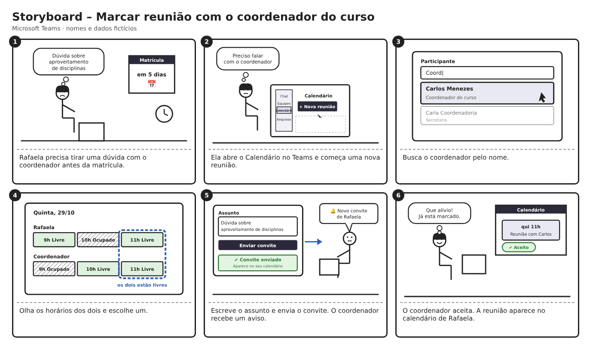

## Tabela de contribuição

| Data       | Contribuição | Autor(es) | Revisor(es) |
| ---------- | ------------ | --------- | ----------- |
| 05/11/2026 | Separação do conteúdo de João Paulo em página própria | João Paulo da Silva Pereira | A definir   |

# João Paulo - Relato dos resultados do storyboard

Storyboard do agendamento de reunião com o coordenador do curso (Nível 1).

> Esta página reúne, em um só lugar, a parte de João Paulo da Silva Pereira no projeto. O conteúdo foi separado de: [relato_resultados_storyboard.md](../relato_resultados_storyboard.md), seção 3.3.

---

### 3.3. Storyboard — Agendamento de reunião com o coordenador do curso - João Paulo

<b>Figura 4:</b> Storyboard do fluxo de agendamento de reunião com o coordenador do curso no MS Teams, como apresentado ao participante, com nomes e dados fictícios (Autor: João Paulo).

#### Explicação do Storyboard

O Storyboard elaborado por João Paulo retrata a jornada de uma estudante ao marcar uma reunião com o **coordenador do curso** no Microsoft Teams. A persona é provisória e fictícia (Rafaela Duarte, 21 anos, estudante de graduação), até que a persona oficial do Estudante seja definida pelo grupo. A reunião é entre duas pessoas, sem canal de turma [1]:

1. **Quadro 1 (Necessidade):** Rafaela precisa tirar uma dúvida com o coordenador sobre aproveitamento de disciplinas antes da matrícula.
2. **Quadro 2 (Início do agendamento):** abre o Calendário e aciona "Nova reunião"; o sistema abre um formulário enxuto.
3. **Quadro 3 (Participante):** busca o coordenador pelo nome; o sistema exibe sugestões com nome e cargo.
4. **Quadro 4 (Horário):** consulta a disponibilidade dos dois e escolhe um horário livre; os horários livres e ocupados aparecem para os dois.
5. **Quadro 5 (Assunto e duração):** informa o assunto, com orientação do que escrever, e a duração da reunião.
6. **Quadro 6 (Envio):** envia o convite; o sistema confirma o envio, mostra que a reunião aparece no calendário e agenda um lembrete padrão, que pode ser alterado.
7. **Quadro 7 (Resposta):** confere o status do convite (pendente ou aceito) e pode propor outro horário.

#### Objetivos e escopo da avaliação

O objetivo da avaliação do storyboard foi analisar **problemas na interação e na interface**, para coletar dados a respeito de se o usuário entende a funcionalidade de marcar uma reunião com o coordenador do curso, os passos para realizar a tarefa e verificar se há impedimentos ou erros na diagramação. A avaliação também verifica as melhorias propostas M01 a M07 da Tabela 1-B da página [Planejamento da avaliação do storyboard](/planejamento/storyboard/planejamento_avaliacao_storyboard/).

#### Método de avaliação

O método de avaliação empregado foi o de **entrevista semiestruturada**, guiada pelo storyboard, com um quadro por vez e com o participante falando em voz alta o que entende de cada quadro, seguida das seis perguntas da Tabela 3-A do planejamento. Não foi aplicado questionário de dados demográficos nesta sessão; o perfil do participante foi levantado em três perguntas rápidas no início da entrevista.

Para a entrevista semiestruturada o avaliador buscou compreender a rotina do participante no Microsoft Teams, juntamente com a apresentação do Storyboard, e a coleta de dados com o diagrama HTA do mesmo tema, feita com outro participante, está relatada em [Relato dos resultados - Análise de tarefas](../../analise_tarefas/Joao_Paulo/relato_analise_tarefas_joao_paulo.md).

##### Roteiro entrevista semiestruturada

###### Introdução

- *Relacionadas à pesquisa*:
  - Objetivo da pesquisa: mostrar um desenho de como seria marcar uma reunião com o coordenador do curso pelo Microsoft Teams e saber o que o participante entende dele;
  - Como será a participação: o participante olha um quadro de cada vez e diz em voz alta o que acha que está acontecendo;
  - O que irá ocorrer durante a coleta de dados: o avaliador não explica o desenho e pode ficar em silêncio algumas vezes, o que é normal;
  - Tempo aproximado da coleta: de 15 a 20 minutos;
  - Tipos de dados que serão coletados: anotações e áudio, com autorização;
  - Como serão analisados, por quem e para que: pelo grupo, para a avaliação de IHC do Microsoft Teams, com o participante identificado só por uma letra;
  - Enfatizar que a avaliação é sobre o desenho e não sobre o usuário, que não existe resposta certa ou errada e que os nomes e dados do desenho são fictícios;
  - Leitura e aceite do termo de consentimento, e esclarecimento de dúvidas, se houver;

###### Coleta de dados relacionados ao usuário

- *Experiência com um produto específico ou ferramentas semelhantes*:
  - Com que frequência usa o Microsoft Teams;
  - Já marcou uma reunião com outra pessoa pelo Teams? Como foi, teve dificuldade?
  - Hábitos de uso e preferências, como a plataforma que prefere;

###### Coleta de dados relacionados ao produto

- *Objetivos*:
  - **Validação do storyboard;**
    - Apresentar o storyboard, um quadro de cada vez;
    - Questionar o que está acontecendo em cada quadro, o que o participante escolheria no quadro 4 e o que escreveria no quadro 5;
    - Verificar se a situação retratada é compatível com a experiência de marcar reuniões no Teams;
    - Questionar se faltou algum passo ou se algum quadro está confuso;
  - **Perguntas da Tabela 3-A (respostas sim, não ou parcialmente, com justificativa);**
    - 1. A narrativa visual é coerente com o objetivo de marcar uma reunião com o coordenador?
    - 2. A situação retratada é compatível com sua experiência ao marcar reuniões no Teams?
    - 3. O storyboard apresenta os passos necessários, da abertura do formulário ao status da resposta?
    - 4. Fica claro como encontrar o coordenador e o que cada campo significa?
    - 5. A disponibilidade do coordenador e a confirmação de envio do convite são fáceis de perceber?
    - 6. A proposta parece facilitar o agendamento em relação ao que você conhece do Teams?
  - **Pergunta extra:** gostaria de escolher se e quando recebe o lembrete da reunião?

#### Perfil de usuários e avaliadores que participaram da avaliação

O perfil de usuário entrevistado foi o de **estudante** de graduação da UnB (Perfil 1), identificado como Participante A, que usa o Microsoft Teams cerca de duas vezes por semana, principalmente para reuniões com colegas de projeto.

O número de avaliadores foi de apenas uma pessoa, o aluno João Paulo, autor do storyboard, que conduziu a própria sessão, o que o planejamento recomenda evitar.

**Tabela 1 – Sessão realizada**

| ID da Sessão | Entrevistador | Participante   | Data       | Plataforma                           | Gravação                                            |
| ------------ | ------------- | -------------- | ---------- | ------------------------------------ | --------------------------------------------------- |
| **01**       | João Paulo    | Participante A | 23/10/2026 | Sessão gravada em vídeo na faculdade | [Vídeo da entrevista](https://youtu.be/WuMsJ7XuEXo) |

#### Questões éticas

Previamente à gravação, foi apresentado o Termo de Consentimento Livre e Esclarecido, que o participante leu e aceitou, e foi pedida a autorização para anotar as respostas e gravar o áudio, que ele concedeu. Foi dito que ele poderia pular qualquer pergunta e parar quando quisesse, e que apareceria no relato só como uma letra. O participante se mostrou à vontade durante toda a entrevista.

#### Dados coletados

A gravação com o participante está disponível [neste link](https://youtu.be/WuMsJ7XuEXo).

Na entrevista, foi possível coletar os seguintes dados do participante:

- O participante usa o Teams cerca de duas vezes por semana, para trabalhos com colegas de projeto;
- O participante já marcou reuniões pelo Teams, sem dificuldades, e diz que o Teams não é uma plataforma de que seja muito fã, pelo visual e pelos passos;
- O participante prefere o Google Meet;
- O participante entendeu o início da história (a dúvida sobre aproveitamento de disciplinas), mas leu o notebook como uma entrada com e-mail e senha em um portal;
- O participante reconheceu o menu do quadro 2 (chat, equipes e calendário) como o caminho para marcar uma reunião;
- O participante interpretou o quadro 3 como a seleção do coordenador, com dúvida sobre os dois itens da lista;
- O participante escolheria 11h no quadro 4, por ser o horário livre para os dois;
- O participante escreveria no assunto a pauta da reunião, de forma condensada e com uma palavra-chave;
- O participante entendeu o quadro 6 como uma notificação de que o convite "foi enviado, vai ser enviado" e o quadro 7 como a confirmação final, com a possibilidade de editar e o status de aceite;
- Depois de enviar, o participante aguardaria o aceite do coordenador;
- O participante gostaria de escolher se e quando recebe o lembrete, que usa muito;

**Respostas às perguntas da Tabela 3-A**

| ID  | Resposta          | Justificativa do participante                                                                                     |
| --- | ----------------- | ----------------------------------------------------------------------------------------------------------------- |
| 1   | Sim               | "O passo a passo está bem descrito… a gente consegue ver uma segmentação das tarefas bem dada."                   |
| 2   | Sim               | "É mais ou menos esse passo a passo"; imagina um cartão único em que se coloca horário, assunto e resumo.         |
| 3   | Sim               | Vê o status de aceite no fim e o começo desde a entrada nos menus.                                                |
| 4   | Sim, com ressalva | Ficou claro, mas no quadro 3 teve dificuldade por falta de legenda; os demais campos ficaram "muito tranquilo".   |
| 5   | Sim               | "Na tela de horário a gente percebe os horários, se o coordenador tem vaga ou não", e o status mostra se aceitou. |
| 6   | Sim, com ressalva | "Na verdade é mais ou menos igual… tá mais facilzinho mesmo. Os passos estão meio reinventados, mas tá bom."      |

##### Validação do Storyboard

O storyboard apresentado ao usuário está disponível na [Figura 4](#figura-4) e no [link](storyboardjoao.png) para melhor visualização.

O participante explicou com clareza a maior parte do storyboard, demonstrando entender as etapas do processo e as ações realizadas pela personagem. Associou a funcionalidade ao uso de um e-mail ou mensagem para marcar a reunião e indicou que o quadro 3 poderia trazer uma legenda, como "participantes da reunião", com um quadro de seleção do coordenador, embora o campo "Participante" já exista no desenho. Disse que o quadro 6 confirma as informações e que o quadro 7 é uma confirmação a mais, "o que é muito bom". Disse ainda que não faltou nenhum passo além da dúvida do quadro 3.

#### Interpretação e análise dos dados

O participante demonstrou entender bem todo o fluxo de agendamento de uma reunião com o coordenador, incluindo os passos necessários, as respostas do sistema e o status do convite, e considerou o fluxo satisfatório, ainda que "mais ou menos igual" ao que conhece do Teams.

A [Tabela 2](#tabela-2) relaciona as melhorias M01 a M07 da Tabela 1-B do planejamento ao resultado da sessão. Com um participante, o resultado foi:

**Tabela 2 – Resultado por melhoria proposta**

| ID  | Melhoria                                             | Resultado    | Evidência                                                                                                |
| --- | ---------------------------------------------------- | ------------ | -------------------------------------------------------------------------------------------------------- |
| M01 | Sugerir o coordenador ao digitar e oferecer o atalho | Parcialmente | Quadro 3: entendeu a ideia de selecionar o coordenador, mas teve dúvida (P01).                           |
| M02 | Mostrar a disponibilidade e sinalizar conflitos      | Atendida     | Escolheu 11h por ser livre para os dois.                                                                 |
| M03 | Mostrar só os campos essenciais                      | Parcialmente | Entendeu o menu e o formulário, sem citar "Nova reunião" (P02).                                          |
| M04 | Orientar o assunto                                   | Parcialmente | Disse que escreveria a pauta, de forma condensada e com palavra-chave; não citou o texto de orientação.  |
| M05 | Lembrete discreto com opção de escolha               | Atendida     | Entendeu o lembrete e disse querer escolher quando recebê-lo.                                            |
| M06 | Confirmar o envio                                    | Parcialmente | Entendeu a confirmação, mas hesitou (P03).                                                               |
| M07 | Mostrar o status do convite                          | Parcialmente | Entendeu o status de aceite; o botão "Propor outro horário" não foi citado e a recusa não foi discutida. |

Os resultados vêm de uma única sessão e devem ser lidos como indício, sem generalizar.

#### Problemas encontrados

**Tabela 3 – Problemas de IHC encontrados no storyboard de agendamento**

| ID do Problema | Quadro Afetado | Ação do Usuário no Fluxo                         | Descrição da Dificuldade / Inconsistência                                                                                                                                                                                                                                                                                     | Fator de Usabilidade Afetado | Grau de Severidade |
| -------------- | -------------- | ------------------------------------------------ | ----------------------------------------------------------------------------------------------------------------------------------------------------------------------------------------------------------------------------------------------------------------------------------------------------------------------------- | ---------------------------- | ------------------ |
| **P01**        | Quadro 3       | Identificar o coordenador na lista de sugestões. | Disse ter tido "um pouco de dificuldade" e ficou "meio burro" neste quadro. Leu os dois itens da lista como "coordenador do curso" e "coordenador e secretária", sem ter certeza de qual escolher. Sugeriu um rótulo "Participantes da reunião" com um quadro de seleção, embora o campo "Participante" já exista no desenho. | Visibilidade / Clareza       | Média              |
| **P02**        | Quadro 2       | Dizer o que o quadro mostra.                     | Reconheceu o menu (chat, equipes e calendário) e que servia para marcar reunião, mas não citou a ação "Nova reunião" e disse "talvez ele, talvez o professor. Não sei".                                                                                                                                                       | Facilidade de Aprendizado    | Leve               |
| **P03**        | Quadro 6       | Entender a tela de resumo e envio.               | Descreveu como "pop-up de notificação" em que o convite "foi enviado, vai ser enviado"; só depois entendeu como tela de confirmação.                                                                                                                                                                                          | Feedback                     | Leve               |
| **P04**        | Quadro 1       | Entender o início da história.                   | Leu o desenho do notebook como "e-mail e senha" e supôs entrada em um portal, mas entendeu o motivo da reunião (dúvida sobre aproveitamento de disciplinas).                                                                                                                                                                  | Facilidade de Aprendizado    | Leve               |

*Fonte: Elaborado pelo autor, a partir da sessão 01, no modelo da Tabela 2 do planejamento.*

#### Planejamento para o reprojeto do sistema

Para o reprojeto do sistema, as ações são as da tabela abaixo. No quadro 3, o rótulo do campo ("Participantes da reunião") e o cargo de cada sugestão devem ficar mais visíveis. No quadro 6, a revisão (resumo e botão de envio) deve ficar separada da confirmação de envio, ou o texto da confirmação deve ser reforçado. No quadro 2, o botão "Nova reunião" deve ganhar destaque, e no quadro 1 o notebook pode ser trocado por uma cena mais clara.

**Tabela 4 – Encaminhamentos após a avaliação**

| ID  | Ação ou Encaminhamento                                              | Responsável(is) | Prazo     |
| --- | ------------------------------------------------------------------- | --------------- | --------- |
| A01 | Destacar o rótulo "Participantes da reunião" e o cargo no quadro 3. | João Paulo      | A definir |
| A02 | Reforçar o botão "Nova reunião" no quadro 2.                        | João Paulo      | A definir |
| A03 | Separar a revisão do envio da confirmação no quadro 6.              | João Paulo      | A definir |
| A04 | Trocar o desenho do quadro 1 por uma cena mais clara.               | João Paulo      | A definir |

---

---

## Histórico de versão

| Versão | Data       | Descrição | Autor(es) | Revisor(es) |
| ------ | ---------- | --------- | --------- | ----------- |
| `1.0` | 05/11/2026 | Separação da parte de João Paulo em uma pasta própria | João Paulo da Silva Pereira | |
