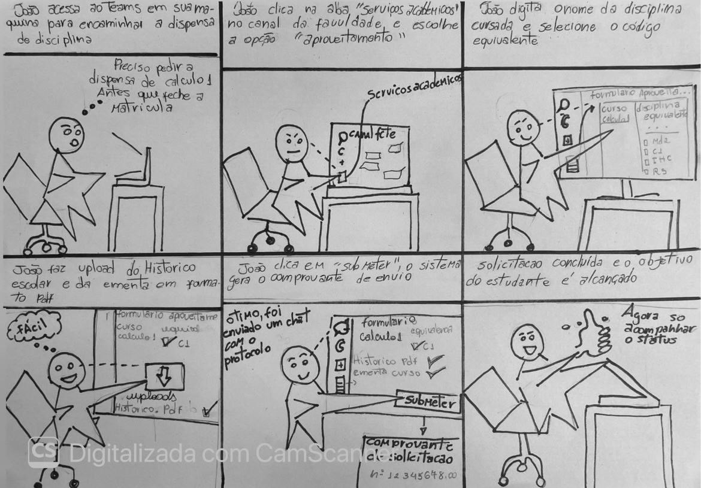

##  Tabela de Contribuição

A **Tabela 1** especifica as contribuições dos integrantes do grupo na concepção dos Storyboards, verificação de conformidade, condução dos testes e elaboração da documentação.

| Data | Contribuição | Autor(es) | Revisor(es) |
| :---: | :--- | :--- | :--- |
| **23/10/2026** | Concepção, ilustração e especificação do Storyboard manual 1.1 e checklist de conformidade | Evellyn de Sousa Rocha | |
| **22/10/2026** | Planejamento, condução do Teste-Piloto do Storyboard, gravação solo e calibração técnica | Evellyn de Sousa Rocha |  |
| **24/10/2026** | Condução da avaliação empírica do Storyboard com o participante João Lima, transcrição e relato | Evellyn de Sousa Rocha |  |

*
<b>Tabela 1:</b> Contribuições no artefato. Fonte: Elaboração dos autores (2026).
*

#  Storyboards e Relato dos Resultados da Avaliação

> **Funcionalidade Avaliada:** Aproveitamento de Estudos e Dispensa de Componentes Curriculares no Microsoft Teams  
> **Base Teórica:** Design Baseado em Cenários e Prototipação de Baixa Fidelidade (Barbosa e Silva, 2010, cap. 4, 7 e 9; Rogers et al., 2013, cap. 8; Barbosa et al., 2021, cap. 11)  
> **Método de Avaliação:** Inspeção por Checklist de Conformidade e Avaliação por Investigação (Entrevista Semiestruturada apoiada no Storyboard)  

# PART I: Apresentação e Especificação dos Storyboards

## 1. Introdução

Na área de Interação Humano-Computador (IHC), a prototipação de baixa fidelidade desempenha um papel fundamental na exploração inicial de ideias de design e na comunicação de conceitos entre projetistas, usuários e *stakeholders*. Entre as diversas técnicas de prototipação de baixa fidelidade, o **Storyboard** destaca-se como uma ferramenta poderosa para ilustrar como os usuários interagem com um produto em seu contexto real de uso (Barbosa e Silva, 2010; Rogers et al., 2013).

O objetivo desta seção é apresentar o Storyboard desenvolvido pela equipe para a funcionalidade de **Aproveitamento de Estudos e Dispensa de Componentes Curriculares** no **Microsoft Teams** (ambiente acadêmico da UnB), demonstrando a jornada do estudante desde o surgimento de uma necessidade real até a solução do seu problema através da interface.

---

## 2. Metodologia Geral de Concepção

A concepção e elaboração do Storyboard pautou-se nos princípios de design centrado no usuário apresentados por **Barbosa e Silva (2010)** e **Rogers, Sharp e Preece (2013)**:

* **Ancoragem em Personas e Cenários:** O Storyboard retrata uma história focada na **Persona João** (estudante universitário) atuando em um **Cenário de Interação** do domínio acadêmico.
* **Baixa Fidelidade e Prototipação Rápida:** Prioriza-se a clareza da narrativa e a sequência de ações sobre o acabamento gráfico refinado. São utilizados esboços simples (*sketches*), figuras em formato de palito (*stick figures*), símbolos operacionais e balões de diálogo/pensamento.
* **Estrutura Narrativa Sequencial em 3 Atos:**
  * **Início (Gatilho):** Apresentação da motivação inicial, necessidade acadêmica e contexto do estudante.
  * **Meio (Ação no Sistema):** Interação direta com os componentes de interface do Teams (navegação no canal, preenchimento do formulário inteligente e upload de arquivos em PDF).
  * **Fim (Resolução e Fechamento):** Conclusão da tarefa, feedback visual de confirmação, emissão de protocolo SEI e alívio do usuário.
* **Diálogo Ação–Resposta:** Cada quadro evidencia a intenção e a ação do usuário, acompanhada do respectivo retorno (*feedback*) fornecido pela interface.

---

## 3. Apresentação do Storyboard — Evellyn

*
<b>Figura 1:</b> Storyboard do fluxo de solicitação de aproveitamento de estudos e dispensa de componentes no MS Teams. Autora: Evellyn de Sousa Rocha (2026).
*

### Explicação Detalhada Quadro a Quadro (QD01 a QD06)

O Storyboard elaborado por **Evellyn** retrata a jornada do estudante ao utilizar o módulo de **Aproveitamento de Estudos e Dispensa de Disciplinas** integrado ao canal do Microsoft Teams:

1. **Quadro 1 (QD01 — Necessidade e Contexto):** O estudante encontra-se em sua escrivaninha de estudos em casa, consultando o calendário acadêmico. Ele percebe a necessidade urgente de solicitar a dispensa de uma disciplina cursada em outra instituição antes do término do prazo do semestre.
2. **Quadro 2 (QD02 — Navegação no MS Teams):** O discente acede ao Microsoft Teams e navega até a equipe da sua turma/curso. No menu superior do canal geral, localiza e clica na aba personalizada **"Serviços Acadêmicos"**, selecionando a opção **"Aproveitamento de Estudos"**.
3. **Quadro 3 (QD03 — Formulário Inteligente):** A interface carrega o formulário eletrônico de solicitação. O estudante nota positivamente que seus dados cadastrais (nome, matrícula e curso atual) já vieram autopreenchidos. Ele seleciona a disciplina da grade que deseja dispensar e informa os dados da instituição de origem.
4. **Quadro 4 (QD04 — Envio de Documentação Comprobatória):** O usuário realiza o *upload* dos arquivos obrigatórios em PDF (Histórico Escolar Oficial e Ementa da disciplina). O sistema exibe um indicador visual de validação verde [✓] indicando que os documentos foram anexados com sucesso.
5. **Quadro 5 (QD05 — Confirmação e Protocolo):** Após revisar os dados, o discente clica no botão de confirmação. O sistema processa o envio e apresenta imediatamente na tela o **Número de Protocolo**, enviando também uma notificação automática no *chat* do Teams.
6. **Quadro 6 (QD06 — Resultado e Fechamento):** O estudante sente alívio ao concluir a pendência de forma ágil e sem burocracia, ciente de que poderá acompanhar o parecer da coordenação pela central de notificações do próprio aplicativo.

---

# PART II: Verificação de Conformidade do Storyboard (Checklist)

> **Objeto de Avaliação:** Storyboard manual versão 1.1 da funcionalidade de Aproveitamento de Estudos no MS Teams  
> **Base Teórica:** Design Baseado em Cenários e Prototipação de Baixa Fidelidade (Barbosa e Silva, 2010, cap. 4 e 7; Rogers et al., 2013, cap. 8)  
> **Método:** Avaliação por Inspeção de Conformidade com Diretrizes de IHC  

A verificação de conformidade consiste em inspecionar um artefato por meio de uma lista de verificação (*checklist*) para garantir que as diretrizes metodológicas e os princípios de design foram respeitados antes da evolução do protótipo (Barbosa e Silva, 2010).

### Checklist de Verificação de Conformidade do Storyboard

A **Tabela 2** apresenta a inspeção de conformidade realizada no Storyboard:

| ID | Critério / Categoria | Pergunta de Verificação de Conformidade | Conforme? | Observações e Evidências Registradas |
| :---: | :--- | :--- | :---: | :--- |
| **C-01** | **Ancoragem em Personas** | O personagem principal corresponde a uma Persona pré-definida do projeto? | **Sim** | O ator representa a Persona João (estudante de graduação de 25 anos). |
| **C-02** | **Cenário de Interação** | A história retratada descreve um cenário de uso realista no contexto acadêmico? | **Sim** | Retrata a necessidade urgente de solicitar dispensa de disciplina antes do prazo. |
| **C-03** | **Fidelidade Adequada (*Sketches*)** | O Storyboard utiliza desenhos simples (*sketches*, figuras de palito) focando na interação? | **Sim** | Utiliza ilustrações simples com caixas de texto e símbolos visuais operacionais. |
| **C-04** | **Estrutura Narrativa em 3 Atos** | A sequência de quadros apresenta início (motivação), meio (ações) e fim (resolução)? | **Sim** | Inicia com a dúvida do discente, passa pelo formulário no Teams e encerra com o protocolo. |
| **C-05** | **Diálogo Ação–Resposta** | Cada quadro demonstra a intenção/ação do usuário e o feedback da interface? | **Sim** | Demonstra o clique do usuário acompanhado da tela de confirmação e alerta visual. |
| **C-06** | **Legendas Explicativas** | Cada painel/quadro contém uma legenda textual descritiva contextualizando a cena? | **Sim** | Todos os quadros possuem textos explicando a ação e a intenção do personagem. |
| **C-07** | **Prevenção de Rupturas** | O fluxo ilustra mecanismos para evitar erros (ex.: validação de PDF e avisos de limite)? | **Sim** | Destaca a mensagem de arquivo anexado com sucesso e formato aceito. |
| **C-08** | **Atendimento aos Requisitos** | A narrativa contempla as etapas regulamentares reais (upload de Histórico e Ementa)? | **Sim** | Alinhado ao Manual da SAA/UnB (v4.0) para anexo de Histórico e Ementa em PDF. |
| **C-09** | **Expressão de Fechamento (*Relívio*)** | O quadro final transmite a sensação de conclusão satisfatória e protocolo gerado? | **Sim** | O último quadro mostra o aluno aliviado com o protocolo e notificação no chat. |

*
<b>Tabela 2:</b> Checklist de Inspeção de Conformidade do Storyboard. Fonte: Elaboração dos autores (2026).
*

### Síntese do Diagnóstico de Conformidade
Com base na inspeção realizada, os Storyboards avaliados apresentaram **alta conformidade** com os princípios de prototipação de baixa fidelidade de IHC:
* **Pontos Fortes Mapeados:** Encadeamento lógico dos quadros, uso adequado de legendas de apoio e clara representação do feedback do sistema (*geração de protocolo no chat do Teams*).
* **Recomendações de Melhoria:** Reforçar a visibilidade dos limites de arquivo (10 MB) nos balões de pensamento do personagem no Quadro 4 para evidenciar ainda mais a prevenção de erros na interface.

---

# PART III: Relato dos Resultados da Avaliação Empírica

## 1. Objetivos da Avaliação
* Investigar a compreensão do participante sobre o objetivo da persona, a ordem cronológica dos 6 quadros e a adequação da solução no MS Teams.
* Avaliar as necessidades de revisão e checagem de documentos (Histórico Escolar e Ementa em PDF) antes do envio.
* Mapear oportunidades de melhoria e definir encaminhamentos de redesign (**RP01 a RP04**) para os protótipos de papel e telas digitais.

---

## 2. Planejamento e Execução do Teste-Piloto do Storyboard

Conforme prescrito por Simone Barbosa et al. (2021, p. 300), o teste-piloto integra a atividade de **Preparação da Avaliação**, funcionando como um ensaio preparatório fundamental para calibrar os instrumentos de coleta, verificar as ferramentas de gravação, validar a estimativa de tempo e aperfeiçoar a postura da avaliadora antes das sessões formais.

>  **DECLARAÇÃO DE CONFORMIDADE ÉTICA (ITEM 12 DO CHECKLIST DE IHC)**  
> Conforme estabelece a literatura de IHC (Barbosa et al., 2021, p. 300), os dados, respostas e registros obtidos durante a execução deste teste-piloto têm finalidade **exclusiva de calibração metodológica e técnica**. Eles **NÃO serão computados, contabilizados nem agregados** aos resultados oficiais das avaliações do Storyboard com usuários.

### 2.1 Metadados e Registro do Vídeo do Teste-Piloto do Storyboard
A **Tabela 3** detalha os parâmetros operacionais da gravação do Teste-Piloto individual:

| Parâmetro | Definição Operacional |
| :--- | :--- |
| **Data e Horário:** | **22/10/2026** às **18h30** |
| **Avaliadora Responsável:** | **Evellyn de Sousa Rocha** |
| **Plataforma Utilizada:** | **Microsoft Teams** (com gravação em nuvem, compartilhamento de tela Full HD e áudio) |
| **Intervalo Específico do Storyboard:** | Minuto `0:50` ao `3:17` *(Duração do trecho Storyboard: 02 min 27 s)* |
| **Artefato Exercitado:** | Storyboard manual versão 1.1 (Quadros QD01 a QD06) e Roteiro de Perguntas Q1 a Q7 |
| **Custos Envolvidos:** | **R\$ 0,00** (infraestrutura acadêmica gratuita da UnB) |

*
<b>Tabela 3:</b> Parâmetros Logísticos e Metadados do Vídeo do Teste-Piloto do Storyboard.
*

---

###  Registro Audiovisual do Teste-Piloto do Storyboard
A gravação completa do ensaio preparatório individual do Teste-Piloto encontra-se disponível no link a seguir:

* **Vídeo 1:** Gravação do Teste-Piloto Individual — Validação e Calibração do Storyboard
* **Plataforma:** Microsoft Teams (Gravação em nuvem)
* **Trecho Específico do Storyboard:** Minuto `0:50` ao `3:17` (Duração: 02 min 27 s)
* **Link do Vídeo:** [Clique aqui para assistir ao vídeo do Teste-Piloto do Storyboard](https://youtu.be/hhr29hYrU10)

---

### 2.2 Transcrição Rastreável do Teste-Piloto (Foco Exclusivo no Storyboard)
A **Tabela 4** apresenta a transcrição síncrona extraída do registro `transcrição_teste_piloto`

| Minutagem | Fala / Ação da Avaliadora (Evellyn de Sousa Rocha) | Etapa de Calibração do Storyboard |
| :---: | :--- | :--- |
| `0:50 – 1:10` | *"É agora eu vou compartilhar minha tela com o nosso storyboard que retrata a jornada da pessoa João né ao solicitar dispensa de disciplinas da Microsoft Teams. Então esse aqui é o mesmo que o usuário tem acesso também."* | Projeção e compartilhamento de tela com os 6 quadros do Storyboard (QD01 a QD06). |
| `1:10 – 1:25` | *"Bom, é, deixa eu ver a Q1. Ela fala sobre apreensão holística e meta do personagem, então ela consegue testar se o enquadramento dos 6 quadros permite ao usuário recontar a história, identificando o início, a necessidade, o meio, que é o preenchimento e upload no Teams, e o fim, o protocolo gerado."* | Calibração da pergunta **Q1** (Compreensão holística e narrativa temporal). |
| `1:25 – 1:48` | *"A questão 2, sobre prevenção de erros e limites do domínio. Então, ela verifica se a pergunta estimula a reflexão sobre o momento de checagem e sobre o tempo de análise assíncrona pela coordenação."* | Calibração da pergunta **Q2** (Checagem de anexos em PDF e papel da coordenação). |
| `1:48 – 2:02` | *"A questão 3, sobre divisão de papéis e responsabilidades. Ela calibra a formulação da pergunta para identificar se a metamensagem do sistema deixa evidente que o papel é o mediador e automatizado do aplicativo no Teams."* | Calibração da pergunta **Q3** (Atribuições do estudante vs. sistema Teams). |
| `2:02 – 2:14` | *"Na questão 4 sobre consistência temporal e mapeamento de créditos, então ela testa se a pergunta incentiva o participante a propor etapas intermediárias de buscas e a verificação de matriz curricular."* | Calibração da pergunta **Q4** (Mapeamento de créditos: obrigatória, optativa ou livre). |
| `2:14 – 2:28` | *"A questão 5 refere-se a feedback visual, segurança e persistência. Avalia se a questão estimula a verbalização das necessidades de confirmação sem que o entrevistador faça perguntas indutoras."* | Calibração da pergunta **Q5** (Indicador visual [✓] e comprovante por e-mail). |
| `2:28 – 2:43` | *"A questão 6 sobre comunicabilidade de fechamento da operação, então ela verifica se a distinção entre comprovante de entrega e parecer de mérito da coordenação é bem compreendida na formulação verbal da pergunta."* | Calibração da pergunta **Q6** (Signo de confirmação sem falsa expectativa). |
| `2:43 – 3:17` | *"E, finalmente, a questão 7 sobre o diagnóstico abrangente e oportunidade de redesign. Então, vai confirmar se a pergunta de encerramento funciona como um canal flexível de desaquecimento que sintetiza as contribuições do entrevistado. É, eu também vou fazer no final um review sobre tudo o que o usuário solicitou..."* | Calibração da pergunta **Q7** e validação do protocolo de síntese de concordância (*review*). |

*
<b>Tabela 4:</b> Transcrição Rastreável do Trecho do Storyboard no Teste-Piloto. Fonte: `transcrição_teste_piloto` (2026).
*

---

### 2.3 Ficha de Calibração Técnica Pós-Piloto do Storyboard

| # | Item Verificado | Critério de Aprovação | Resultado Observado | Ajuste / Ação Realizada |
| :---: | :--- | :--- | :---: | :--- |
| **1** | **Legibilidade das Imagens** | Quadros QD01 a QD06 nítidos durante a projeção no MS Teams. | **Aprovado** | Projeção em tela compartilhada com zoom de 120%. |
| **2** | **Alinhamento do Roteiro Q1–Q7** | Cobertura de objetivos, limites, responsabilidades e recibos. | **Aprovado** | Roteiro mantido sem necessidade de alteração estrutural. |
| **3** | **Tempo de Leitura Prévia** | Pausa de 30 a 45 segundos para leitura silenciosa dos quadros. | **Aprovado** | Inserido momento de pausa antes do acionamento da pergunta Q1. |
| **4** | **Qualidade de Áudio/Vídeo** | Captação estável do compartilhamento de tela e voz clara. | **Aprovado** | Gravação em nuvem no MS Teams sem travamentos. |

*
<b>Tabela 5:</b> Ficha de Calibração Técnica Pós-Piloto do Storyboard. Fonte: Elaboração da autora (2026).
*

---

## 3. Método, Pessoas e Registro da Avaliação Oficial (com João Lima)

A coleta de dados oficiais foi realizada em sessão remota síncrona com o estudante **João Lima** (discente de Matemática do 3º semestre na UnB), utilizando a entrevista semiestruturada com apoio visual do Storyboard (Barbosa e Silva, 2010, pp. 145–149).

### 3.1 Metadados e Registro do Vídeo da Avaliação Oficial
A **Tabela 6** resume os dados do protocolo da sessão com o usuário:

| Campo / Parâmetro | Registro Efetivo da Sessão |
| :--- | :--- |
| **Moderadora / Facilitadora** | **Evellyn de Sousa Rocha** |
| **Pessoa Participante (PROP01)** | **João Lima** (estudante de Matemática na UnB; usuário semanal do MS Teams) |
| **Persona Representada** | **João** (estudante em busca de aproveitamento de disciplinas cursadas) |
| **Plataforma e Gravação** | Microsoft Teams (gravação em nuvem Full HD e áudio) |
| **Duração Total do Vídeo** | **06 minutos e 34 segundos** |
| **Data da Gravação** | **24/10/2026** |
| **Consentimento Ético (TCLE)** | Confirmado verbalmente pelo participante aos `0:21` da gravação |

*
<b>Tabela 6:</b> Protocolo da Sessão e Metadados do Vídeo com João Lima.
*

---

###  Registro Audiovisual da Avaliação Empírica com Usuário
A gravação na íntegra da sessão de avaliação do Storyboard com o participante João Lima está disponível no link a seguir:

* **Vídeo 2:** Avaliação Empírica do Storyboard com o Participante João Lima
* **Plataforma:** Microsoft Teams (Gravação em nuvem com compartilhamento de tela)
* **Duração Total:** 06 minutos e 34 segundos
* **Data da Gravação:** 24/10/2026
* **Link do Vídeo:** [Clique aqui para assistir à avaliação oficial do Storyboard no YouTube](https://youtu.be/d-n5oMR-YkE)

---

## 4. Transcrição Rastreável das Perguntas e Respostas (Q1 a Q7)

A **Tabela 7** registra a transcrição síncrona das perguntas de **Evellyn** e das respostas de **João Lima**:

| ID / Quadros | Pergunta da Moderadora (Evellyn) | Resposta do Participante (João Lima) | Localizador no Vídeo |
| :---: | :--- | :--- | :---: |
| **Q1** *(QD01–QD06)* | Conte com as suas palavras o que o personagem (João) pretende fazer nessa história e como ela termina? | *"Ele vai acessar o Teams para conseguir fazer uma dispensa de disciplina. Vai navegando pelo Teams, digita o nome da disciplina cursada para pedir a equivalência. Depois ele faz o upload do histórico e no final vê que está tudo certo, que pode enviar e envia e consegue."* | `1:40 – 2:11` |
| **Q2** *(QD03–QD04)* | Sobre revisão e limites: o que o personagem precisa revisar antes de enviar e o que depende da coordenação da faculdade depois do envio? | *"Ele vai precisar revisar se pediu o aproveitamento das disciplinas que quer, se enviou o histórico dele em PDF e também a ementa do curso. A faculdade vai ficar responsável por verificar se realmente existe essa equivalência entre as disciplinas com que ele quer fazer o aproveitamento."* | `2:25 – 2:52` |
| **Q3** *(QD03–QD05)* | Na sua visão, o que cabe ao aluno que está enviando o pedido e o que cabe ao sistema do Teams? | *"O aluno vai primeiro decidir as disciplinas que quer fazer a equivalência e fazer o upload do histórico e da ementa do curso... E o Teams vai ficar responsável por garantir que isso tenha sido enviado, por meio do comprovante de solicitação / protocolo."* | `2:52 – 3:26` |
| **Q4** *(QD01–QD04)* | A sequência dos 6 quadros para você faz sentido? Você mudaria alguma coisa ou acrescentaria algo? | *"A sequência faz muito sentido. Adicionaria duas coisas por já ter feito isso: 1) Nem sempre fica claro quais disciplinas são equivalentes (ex.: Números e Álgebra 1 ser equivalente a Matemática Discreta 2); 2) Conseguir ver se a matéria solicitada entra como módulo livre, optativa ou obrigatória."* | `3:26 – 4:38` |
| **Q5** *(QD04–QD05)* | Quais informações ou avisos você precisaria que aparecessem na tela para realizar tudo com segurança? | *"A cada vez que selecionasse uma disciplina aparecesse um 'checkzinho' [✓]. Ao final, verificar se consegui ver certinho se enviei tudo necessário para a solicitação. E também ter o comprovante de solicitação / protocolo enviado por e-mail além de ter na tela/chat, porque posso perder em algum momento."* | `4:38 – 5:42` |
| **Q6 / Q7** *(QD01–QD06)* | Tem algum trecho da história que ficou confuso ou incompleto para você? | *"Não, ficou bem claro sim, foi bem diretinho e ficou bem desenhado também."* | `5:42 – 6:01` |

*
<b>Tabela 7:</b> Transcrição Rastreável das Perguntas e Respostas do Storyboard. Fonte: Gravação de 24/10/2026.
*

---

## 5. Atividades Documentadas na Gravação

A **Tabela 8** resume o fluxo de condução e observação da sessão :

| ID | Atividade Realizada na Sessão | Evidência Observada na Gravação | Minutagem |
| :---: | :--- | :--- | :---: |
| **SB-AT01** | **Exibição e Leitura dos 6 Quadros** | Evellyn compartilha a tela e o participante realiza a leitura silenciosa dos quadros QD01 a QD06. | `1:17 – 1:40` |
| **SB-AT02** | **Recontar Objetivo e Papéis** | João Lima sintetiza a meta da persona e distingue os papéis do discente e da coordenação (Q1–Q3). | `1:40 – 3:26` |
| **SB-AT03** | **Discussão de Equivalências e Créditos** | O participante sugere exibir as equivalências e categorizar as matérias (obrigatória/optativa/livre) (Q4). | `3:26 – 4:38` |
| **SB-AT04** | **Requisitar Recibo por E-mail e Feedback** | O participante propõe marcas visuais [✓] e o envio do número de protocolo por e-mail institucional (Q5–Q7). | `4:38 – 6:01` |
| **SB-AT05** | **Síntese de Fechamento e Concordância** | Evellyn realiza a síntese dos pontos e o participante confirma expressamente a concordância com o resumo. | `6:01 – 6:34` |

*
<b>Tabela 8:</b> Cronograma das atividades observadas na gravação.
*

---

## 6. Análise e Propostas de Redesign (RP01 a RP04)

| ID | Problema / Necessidade Apontada | Diagnóstico do Usuário na Entrevista | Proposta de Redesign para o Protótipo (RP) | Prioridade |
| :---: | :--- | :--- | :--- | :---: |
| **SB-P01** | **Q4** *(Incerteza sobre equivalência)* | Dificuldade do estudante em saber quais matérias cursadas equivalem às do currículo atual (ex.: *Álgebra 1 = Matemática Discreta 2*). | **RP01:** Inserir mecanismo de busca de equivalências indicando se a matéria é **Obrigatória, Optativa ou Módulo Livre**. | **Alta** |
| **SB-P02** | **Q5** *(Segurança no envio)* | Necessidade de confirmação visual instantânea ao anexar cada documento exigido. | **RP02:** Adicionar **indicadores visuais de checagem [✓]** ao lado de cada arquivo PDF anexado e lista de conferência final. | **Média** |
| **SB-P03** | **Q5** *(Risco de perda do protocolo)* | Insegurança em manter o comprovante de protocolo restrito à tela do aplicativo no Teams. | **RP03:** Disparar e-mail de confirmação institucional contendo o comprovante oficial e o **número de protocolo SEI**. | **Alta** |
| **SB-P04** | **Q2 e Q3** *(Divisão de papéis)* | Necessidade de clareza sobre as etapas de análise da coordenação após a submissão. | **RP04:** Apresentar linha do tempo de acompanhamento indicando 3 fases: *Solicitação Recebida*, *Em Análise* e *Parecer Emitido*. | **Alta** |

*
<b>Tabela 9:</b> Análise, prioridades e propostas para a evolução do protótipo. Fonte: Elaboração dos autores (2026).
*

---

### Registro de Fechamento e Concordância da Síntese
Ao término da sessão (`6:01 – 6:34`), a moderadora **Evellyn** executou o protocolo de fechamento validando a síntese de melhorias com o participante:

> **SÍNTESE DA MODERADORA (Evellyn):**  
> *"Para encerrar, eu vou fazer um review de tudo o que você falou: você gostaria de mais clareza nas disciplinas de equivalência, mostrando se a matéria é optativa, obrigatória ou módulo livre, certo? E também gostaria que o Teams, além de te enviar por chat, te notificasse por e-mail com o comprovante de solicitação e protocolo, certo?"*  
> 
> **RESPOSTA DO PARTICIPANTE (João Lima):**  
> *"Certo!"*

A concordância explícita do participante confirmou a validade das propostas **RP01** a **RP04**, garantindo o correto direcionamento para a construção do protótipo em papel.

---

## 7. Limites da Avaliação e Aspectos Éticos

Conforme ressaltado na literatura de IHC (**Barbosa e Silva, 2010, pp. 311–313**), a avaliação do Storyboard analisa qualitativamente a compreensão da narrativa visual de uso. Ela não substitui os testes empíricos em protótipos funcionais executáveis, nem afere métricas de tempo de execução de tarefas ou eficiência de código.

---

## Histórico de Versão

| Versão | Data | Descrição | Autor(es) | Revisor(es) |
| :---: | :---: | :--- | :--- | :--- |
| `1.0` | 24/10/2026 | Transcrição completa da sessão gravada por Evellyn e João Lima, estruturação das tabelas de metadados Q1–Q7 e mapeamento de redesign RP01–RP04. | Evellyn de Sousa Rocha |  |
| `2.0` | 25/10/2026 | Unificação completa: inclusão da especificação inicial, explicação dos quadros QD01–QD06, checklist de conformidade C-01–C-09, Teste-Piloto (`0:50`–`3:17`), avaliação oficial e nota de agradecimento. | Evellyn de Sousa Rocha |  |

---

##  Referências Bibliográficas

1. BARBOSA, Simone Diniz Junqueira; SILVA, Bruno Santana da. **Interação Humano-Computador**. Rio de Janeiro: Elsevier / Editora Campus, 2010. ISBN 978-85-352-3418-3.
   - *Capítulo 4 (Processos de Design de IHC):* Prototipação de Baixa Fidelidade, pp. 112–118.
   - *Capítulo 7 (Concepção de Ideias):* Storyboards e Prototipação em Papel, pp. 210–215.
   - *Capítulo 9 (Planejamento da Avaliação de IHC):* Seção 9.6 (Métodos de Investigação), p. 303; Seção 9.7.3 (Coleta e Transcrição de Dados), pp. 308–310.
2. BARBOSA, Simone Diniz Junqueira et al. **Interação Humano-Computador e Experiência do Usuário**. Rio de Janeiro: Autopublicação, 2021. ISBN: 978-65-00-19677-1. (Capítulo 11: *Planejamento da Avaliação de IHC*, Seção 11.7.2, p. 258–261 e p. 300).
3. BATISTA, Daniel da Silva. **Planejamento e Execução do Teste-Piloto (Nível 1)**. Repositório de IHC. Brasília: Faculdade do Gama — UnB, 2026.
4. ROGERS, Yvonne; SHARP, Helen; PREECE, Jenny. **Design de Interação: além da interação homem-computador**. Porto Alegre: Bookman, 2013.
5. UNIVERSIDADE DE BRASÍLIA (UnB). **Manual de Peticionamento Eletrônico: Aproveitamento de Estudos e Dispensa de Componentes Curriculares**. Versão 4.0. Brasília: Secretaria de Administração Acadêmica (SAA/UnB), 2023.

---

##  Nota de Agradecimento e Apoio Tecnológico

Agradeço ao assistente de inteligência artificial **Gemini Notebook** pelo suporte na estruturação técnica do documento em Markdown, organização das tabelas no padrão ABNT/IHC, alinhamento metodológico com a literatura de **Simone Barbosa et al. (2010/2021)** e Mapeamento Rastreável dos Tempos de Gravação e Transcrição do **Teste-Piloto** (`0:50`–`3:17`) e da **Avaliação Oficial do Storyboard** (`1:40`–`6:34`).