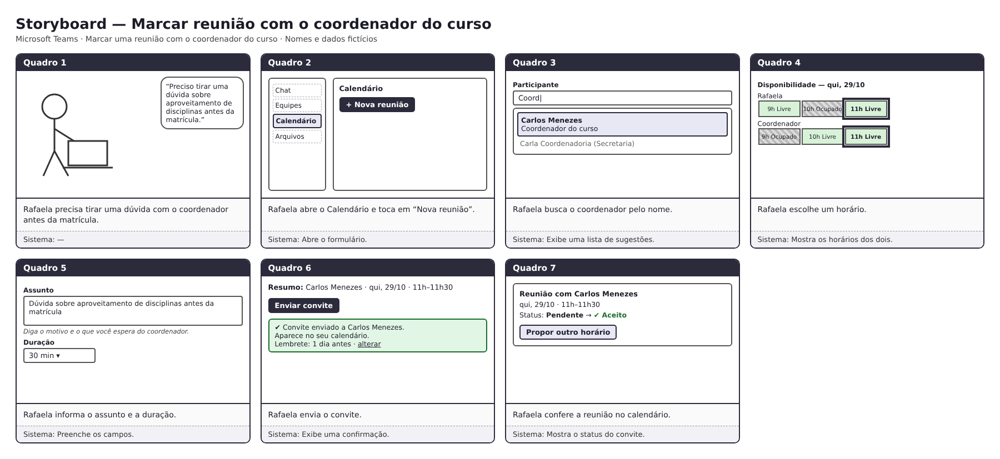

##  Tabela de Contribuição

| Data | Contribuição | Autor(es) | Revisor(es) |
| :---: | :--- | :--- | :--- |
| 20/10/2026 | Criação da página e estrutura inicial | Lucas Sales Ribeiro | A definir |
| 23/10/2026 | Elaboração e especificação do Storyboard, metodologia e referências bibliográficas | Evellyn de Sousa Rocha | A definir |
| 24/10/2026 | Storyboard de agendamento de reunião com o coordenador (3.3) e relato dos resultados da entrevista de avaliação (seção 4) | João Paulo da Silva Pereira | A definir |

#  Storyboards de Interação

## 1. Introdução

Na área de Interação Humano-Computador (IHC), a prototipação de baixa fidelidade desempenha um papel fundamental na exploração inicial de ideias de design e na comunicação de conceitos entre projetistas, usuários e *stakeholders* [1, 2, 4]. Entre as diversas técnicas de prototipação de baixa fidelidade, o **Storyboard** destaca-se como uma ferramenta poderosa para ilustrar como os usuários interagem com um produto em seu contexto real de uso.

O objetivo desta página é apresentar os Storyboards desenvolvidos pela equipe para a funcionalidade de **Aproveitamento de Estudos e Dispensa de Componentes Curriculares** no **Microsoft Teams** (ambiente acadêmico), demonstrando a jornada do usuário desde o surgimento de uma necessidade real até a solução do seu problema através do sistema.

---

## 2. Metodologia Geral

A concepção e elaboração dos Storyboards pela equipe pautou-se nos princípios de design centrado no usuário apresentados por **Barbosa e Silva (2010)** e **Rogers, Sharp e Preece (2013)** [1, 5]:

* **Ancoragem em Personas e Cenários:** Cada Storyboard retrata uma história focada em uma **Persona** pré-definida do projeto (estudante universitário) atuando em um **Cenário de Interação** do domínio acadêmico.
* **Baixa Fidelidade e Prototipação Rápida:** Prioriza-se a clareza da narrativa e a sequência de ações sobre o acabamento gráfico refinado [1, 6]. São utilizados esboços simples (*sketches*), figuras em formato de palito (*stick figures*), símbolos operacionais e balões de diálogo/pensamento [7].
* **Estrutura Narrativa Sequencial:** As histórias seguem uma linha temporal clara de três atos:
  * **Início:** Apresentação da motivação inicial, necessidade acadêmica e contexto do estudante.
  * **Meio:** Interação direta com os componentes de interface do sistema (procura de abas, formulários e envio de documentos PDF).
  * **Fim:** Conclusão da tarefa, feedback de confirmação do sistema e alívio do usuário.
* **Diálogo Ação–Resposta:** Cada quadro evidencia a intenção e a ação do usuário, acompanhada do respectivo retorno (*feedback*) fornecido pela interface.

---

## 3. Apresentação dos Storyboards

### 3.1. Storyboard — Evellyn

<b>Figura 1:</b> Storyboard do fluxo de solicitação de aproveitamento de estudos e dispensa de componentes no MS Teams (Autora: Evellyn).

#### Explicação do Storyboard

O Storyboard elaborado por Evellyn retrata a jornada do estudante ao utilizar o módulo de **Aproveitamento de Estudos e Dispensa de Disciplinas** integrado ao canal do Microsoft Teams [1, 3]:

1. **Quadro 1 (Necessidade e Contexto):** O estudante encontra-se em sua escrivaninha de estudos em casa, consultando o calendário acadêmico. Ele percebe a necessidade urgente de solicitar a dispensa de uma disciplina cursada em outra instituição antes do término do prazo do semestre.
2. **Quadro 2 (Navegação no MS Teams):** O discente acede ao Microsoft Teams e navega até a equipe da sua turma/curso. No menu superior do canal geral, localiza e clica na aba personalizada **"Serviços Acadêmicos"**, selecionando a opção **"Aproveitamento de Estudos"** [1].
3. **Quadro 3 (Formulário Inteligente):** A interface carrega o formulário eletrônico de solicitação. O estudante nota positivamente que seus dados cadastrais (nome, matrícula e curso atual) já vieram autopreenchidos. Ele seleciona a disciplina da grade que deseja dispensar e informa os dados da instituição de origem.
4. **Quadro 4 (Envio de Documentação Comprobatória):** O usuário realiza o *upload* dos arquivos obrigatórios em PDF (Histórico Escolar Oficial e Ementa da disciplina). O sistema exibe um indicador visual de validação verde [✓] indicando que os documentos foram anexados com sucesso.
5. **Quadro 5 (Confirmação e Protocolo):** Após revisar os dados, o discente clica no botão de confirmação. O sistema processa o envio e apresenta imediatamente na tela o **Número de Protocolo**, enviando também uma notificação automática no *chat* do Teams.
6. **Quadro 6 (Resultado e Fechamento):** O estudante sente alívio ao concluir a pendência de forma ágil e sem burocracia, ciente de que poderá acompanhar o parecer da coordenação pela central de notificações do próprio aplicativo.

---

### 3.2. Storyboard — [Lucas Sales]

#### 🔍 Explicação do Storyboard
`[Inserir aqui a explicação detalhada do Storyboard].`

---

### 3.3. Storyboard — João Paulo

<b>Figura 2:</b> Storyboard do fluxo de agendamento de reunião com o coordenador do curso no MS Teams, como apresentado ao participante, com nomes e dados fictícios (Autor: João Paulo).

#### Explicação do Storyboard

O Storyboard elaborado por João Paulo retrata a jornada de uma estudante ao marcar uma reunião com o **coordenador do curso** no Microsoft Teams. A persona é provisória e fictícia (Rafaela Duarte, 21 anos, estudante de graduação), até que a persona oficial do Estudante seja definida pelo grupo. A reunião é entre duas pessoas, sem canal de turma [1]:

1. **Quadro 1 (Necessidade):** Rafaela precisa tirar uma dúvida com o coordenador sobre aproveitamento de disciplinas antes da matrícula.
2. **Quadro 2 (Início do agendamento):** abre o Calendário e aciona "Nova reunião"; o sistema abre um formulário enxuto.
3. **Quadro 3 (Participante):** busca o coordenador pelo nome; o sistema exibe sugestões com nome e cargo.
4. **Quadro 4 (Horário):** consulta a disponibilidade dos dois e escolhe um horário livre; os horários livres e ocupados aparecem para os dois.
5. **Quadro 5 (Assunto e duração):** informa o assunto, com orientação do que escrever, e a duração da reunião.
6. **Quadro 6 (Envio):** envia o convite; o sistema confirma o envio, mostra que a reunião aparece no calendário e agenda um lembrete padrão, que pode ser alterado.
7. **Quadro 7 (Resposta):** confere o status do convite (pendente ou aceito) e pode propor outro horário.

A avaliação deste storyboard com um participante está no tópico 4 desta página.

---

## 4. Relato dos Resultados da Avaliação do Storyboard de Agendamento (João Paulo)

Este tópico segue a estrutura prevista na página [Planejamento do relato dos resultados](../../../planejamento/storyboard/planejamento_relato_resultados_storyboard.md) e o roteiro da Tabela 3-A da página [Planejamento da avaliação](../../../planejamento/storyboard/planejamento_avaliacao_storyboard.md). As falas vêm da transcrição automática do vídeo da sessão e podem ter erros; o participante é identificado por letra, e não por nome.

### 4.1. Objetivo e escopo da avaliação

Identificar problemas na interação e interface do storyboard de agendamento de reunião com o coordenador, verificando se o participante entende a sequência de ações, encontra o coordenador, percebe a disponibilidade e a confirmação do envio e entende o status do convite. A avaliação também verifica as melhorias propostas M01 a M07 da Tabela 1-B do planejamento.

### 4.2. Método de avaliação e cronograma executado

Entrevista semiestruturada guiada pelo storyboard, com um quadro por vez, pensando em voz alta, seguida das perguntas da Tabela 3-A.

**Tabela 1 – Cronograma das avaliações do storyboard de agendamento**

| ID da Sessão | Entrevistador(es) | Participante (Identificação) | Data  | Local / Plataforma Utilizada |
| ------------ | ----------------- | ---------------------------- | ---------------------------- | ---------------------------- |
| **01**       | João Paulo        | Pedro               | 23/10/2026  | Sessão gravada em vídeo na faculdade |

*Fonte: Elaborado por João Paulo.*
Registro da sessão: vídeo da entrevista de avaliação do storyboard.

### 4.3. Seleção dos participantes e perfil de usuário

Participante A: estudante universitário que usa o Microsoft Teams cerca de duas vezes por semana, principalmente para reuniões com colegas de projeto. Já marcou reuniões pelo Teams e disse preferir o Meet. Antes da sessão, leu e concordou com o termo de consentimento e autorizou a anotação e a gravação do áudio.

### 4.4. Problemas e dificuldades encontradas

**Tabela 2 – Problemas de IHC encontrados no storyboard de agendamento**

| ID do Problema | Quadro Afetado | Ação do Usuário no Fluxo | Descrição da Dificuldade / Inconsistência | Fator de Usabilidade Afetado | Grau de Severidade |
| -------------- | -------------- | ------------------------ | ----------------------------------------- | ---------------------------- | ------------------ |
| **P01** | Quadro 3 | Identificar o coordenador na lista de sugestões. | Disse ter tido "um pouco de dificuldade" e ficou "meio burro" neste quadro. Leu os dois itens da lista como "coordenador do curso" e "coordenador e secretária", sem ter certeza de qual escolher. Sugeriu um rótulo "Participantes da reunião" com um quadro de seleção, embora o campo "Participante" já exista no desenho. | Visibilidade / Clareza | Média |
| **P02** | Quadro 2 | Dizer o que o quadro mostra. | Reconheceu o menu (chat, equipes e calendário) e que servia para marcar reunião, mas não citou a ação "Nova reunião" e disse "talvez ele, talvez o professor. Não sei". | Facilidade de Aprendizado | Leve |
| **P03** | Quadro 6 | Entender a tela de resumo e envio. | Descreveu como "pop-up de notificação" em que o convite "foi enviado, vai ser enviado"; só depois entendeu como tela de confirmação. | Feedback | Leve |
| **P04** | Quadro 1 | Entender o início da história. | Leu o desenho do notebook como "e-mail e senha" e supôs entrada em um portal, mas entendeu o motivo da reunião (dúvida sobre aproveitamento de disciplinas). | Facilidade de Aprendizado | Leve |

*Fonte: Elaborado pelo autor, a partir da sessão 01, no modelo da Tabela 2 do planejamento.*

**Respostas às perguntas da Tabela 3-A**

| ID | Resposta | Justificativa do participante |
| -- | -------- | ----------------------------- |
| 1 | Sim | "O passo a passo está bem descrito… a gente consegue ver uma segmentação das tarefas bem dada." |
| 2 | Sim | "É mais ou menos esse passo a passo"; imagina um cartão único em que se coloca horário, assunto e resumo. |
| 3 | Sim | Vê o status de aceite no fim e o começo desde a entrada nos menus. |
| 4 | Sim, com ressalva | Ficou claro, mas no quadro 3 teve dificuldade por falta de legenda; os demais campos ficaram "muito tranquilo". |
| 5 | Sim | "Na tela de horário a gente percebe os horários, se o coordenador tem vaga ou não", e o status mostra se aceitou. |
| 6 | Sim, com ressalva | "Na verdade é mais ou menos igual… tá mais facilzinho mesmo. Os passos estão meio reinventados, mas tá bom." |

Pergunta extra (lembrete): respondeu "Sim, com certeza. Esse eu uso muito", ao ser perguntado se gostaria de escolher se e quando recebe o lembrete.

### 4.5. Sugestões de melhoria e recomendações de redesign

| Problema | Resultado esperado | Resultado observado | Proposta |
| -------- | ------------------ | ------------------- | -------- |
| P01 | Reconhecer o coordenador na lista e saber que está escolhendo o participante. | Dúvida sobre qual cartão escolher. | Destacar o rótulo do campo ("Participantes da reunião") e deixar o cargo mais visível em cada sugestão. |
| P02 | Citar a ação "Nova reunião". | Reconheceu o menu, mas não a ação. | Dar mais destaque ao botão "Nova reunião". |
| P03 | Entender que o convite foi enviado. | Hesitou entre "foi enviado" e "vai ser enviado". | Separar a revisão (resumo e botão de envio) da confirmação de envio, ou reforçar o texto da confirmação. |
| P04 | Entender o início da história. | Supôs login em um portal. | Trocar o notebook por um balão de fala ou uma cena mais clara. |

### 4.6. Feedback e percepções dos usuários

- "O passo a passo está bem descrito, está bem certinho."
- "Aqui foi o único que eu fiquei meio burro" (quadro 3).
- "Aqui tem um botãozinho de editar… e tem os status, isso aqui é muito interessante."
- "Esse [lembrete] eu uso muito."
- "Os passos estão meio reinventados, mas tá bom."

### 4.7. Análise e interpretação dos resultados

A Tabela 1-B do planejamento lista as melhorias M01 a M07. Com um participante, o resultado foi:

| ID | Melhoria | Resultado | Evidência |
| -- | -------- | --------- | --------- |
| M01 | Sugerir o coordenador ao digitar e oferecer o atalho | Parcialmente | Quadro 3: entendeu a ideia de selecionar o coordenador, mas teve dúvida (P01). |
| M02 | Mostrar a disponibilidade e sinalizar conflitos | Atendida | Escolheu 11h por ser livre para os dois. |
| M03 | Mostrar só os campos essenciais | Parcialmente | Entendeu o menu e o formulário, sem citar "Nova reunião" (P02). |
| M04 | Orientar o assunto | Parcialmente | Disse que escreveria a pauta, de forma condensada e com palavra-chave; não citou o texto de orientação. |
| M05 | Lembrete discreto com opção de escolha | Atendida | Entendeu o lembrete e disse querer escolher quando recebê-lo. |
| M06 | Confirmar o envio | Parcialmente | Entendeu a confirmação, mas hesitou (P03). |
| M07 | Mostrar o status do convite | Parcialmente | Entendeu o status de aceite; o botão "Propor outro horário" não foi citado e a recusa não foi discutida. |

Os resultados vêm de uma única sessão e devem ser lidos como indício, sem generalizar. O autor do storyboard conduziu a própria sessão, o que o planejamento recomenda evitar.

### 4.8. Sumário dos principais resultados

O participante entendeu o fluxo do começo ao fim e percebeu sem ajuda a disponibilidade dos dois (M02), o status do convite e o lembrete (M05). A dificuldade principal foi identificar o coordenador no quadro 3 (M01). Os demais problemas foram leves.

### 4.9. Planejamento do reprojeto

**Tabela 3 – Encaminhamentos após a avaliação**

| ID | Ação ou Encaminhamento | Responsável(is) | Prazo |
| -- | ---------------------- | --------------- | ----- |
| A01 | Destacar o rótulo "Participantes da reunião" e o cargo no quadro 3. | João Paulo | A definir |
| A02 | Reforçar o botão "Nova reunião" no quadro 2. | João Paulo | A definir |
| A03 | Separar a revisão do envio da confirmação no quadro 6. | João Paulo | A definir |
| A04 | Trocar o desenho do quadro 1 por uma cena mais clara. | João Paulo | A definir |

*Fonte: Elaborado pela equipe.*

##  Referências Bibliográficas

1. BARBOSA, Simone Diniz Junqueira; SILVA, Bruno Santana da. **Interação Humano-Computador**. Rio de Janeiro: Elsevier / Editora Campus, 2010. ISBN 978-85-352-3418-3.
   
2. ROGERS, Yvonne; SHARP, Helen; PREECE, Jenny. **Design de Interação: além da interação homem-computador**. Porto Alegre: Bookman, 2013.
  
3. UNIVERSIDADE DE BRASÍLIA (UnB). **Manual de Peticionamento Eletrônico: Aproveitamento de Estudos e Dispensa de Componentes Curriculares**. Versão 4.0. Brasília: Secretaria de Administração Acadêmica (SAA/UnB), 2023.

## Histórico de Versão

| Versão | Data | Descrição | Autor(es) | Revisor(es) |
| :---: | :---: | :--- | :--- | :--- |
| `1.0` | 20/10/2026 | Criação da página. | Lucas Sales Ribeiro | A definir |
| `1.1` | 23/10/2026 | Detalhamento do Storyboard (quadro a quadro), fundamentação em IHC e referências, espaço aos outros integrantes. | Evellyn de Sousa Rocha | A definir |
| `1.2` | 24/10/2026 | Storyboard de agendamento de reunião (3.3) e relato dos resultados da avaliação (tópico 4). | João Paulo da Silva Pereira | A definir |
