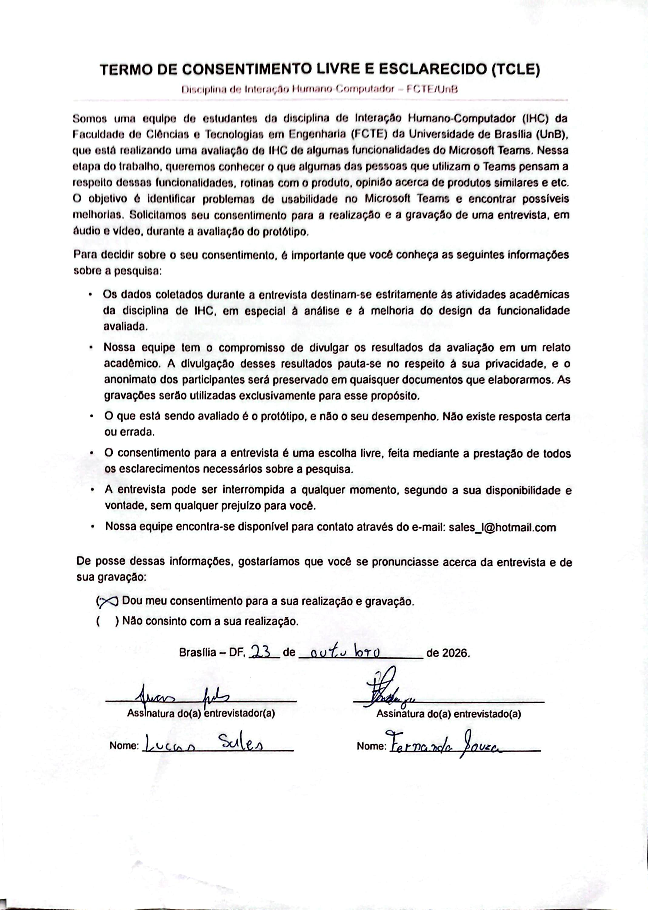
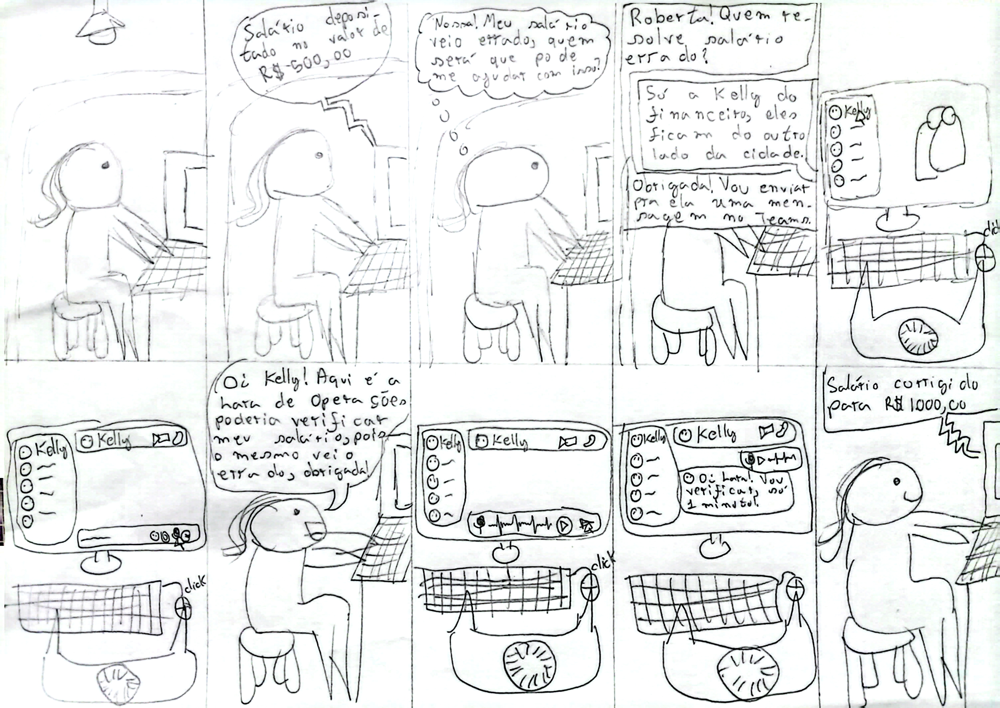

##  Tabela de Contribuição

|    Data    | Contribuição                                                                                                              | Autor(es)                   | Revisor(es) |
| :--------: | :------------------------------------------------------------------------------------------------------------------------ | :-------------------------- | :---------- |
| 20/10/2026 | Criação da página e estrutura inicial                                                                                     | Lucas Sales Ribeiro         | A definir   |
| 23/10/2026 | Elaboração e especificação do Storyboard, metodologia e referências bibliográficas                                        | Evellyn de Sousa Rocha      | A definir   |
| 24/10/2026 | Storyboard de agendamento de reunião com o coordenador (3.3) e relato dos resultados da entrevista de avaliação (seção 4) | João Paulo da Silva Pereira | A definir   |
| 25/10/2026 | Relato dos resultado do storyboard da comunicação com usuário(s)                                                          | Lucas Sales Ribeiro         | A definir   |

#  Storyboards  

## 1. Introdução

Na área de Interação Humano-Computador (IHC), a prototipação de baixa fidelidade desempenha um papel fundamental na exploração inicial de ideias de design e na comunicação de conceitos entre projetistas, usuários e *stakeholders* [1, 2, 4]. Entre as diversas técnicas de prototipação de baixa fidelidade, o **Storyboard** destaca-se como uma ferramenta poderosa para ilustrar como os usuários interagem com um produto em seu contexto real de uso.

O objetivo desta página é apresentar os Storyboards desenvolvidos pela equipe para a funcionalidade de **Aproveitamento de Estudos e Dispensa de Componentes Curriculares** no **Microsoft Teams** (ambiente acadêmico), demonstrando a jornada do usuário desde o surgimento de uma necessidade real até a solução do seu problema através do sistema.

---

## 2. Metodologia Geral

A concepção e elaboração dos Storyboards pela equipe pautou-se nos princípios de design centrado no usuário apresentados por **Barbosa e Silva (2010)** e **Rogers, Sharp e Preece (2013)** [1, 5]:

* **Ancoragem em Personas e Cenários:** Cada Storyboard retrata uma história focada em uma **Persona** pré-definida do projeto (estudante universitário) atuando em um **Cenário de Interação** do domínio acadêmico.
* **Baixa Fidelidade e Prototipação Rápida:** Prioriza-se a clareza da narrativa e a sequência de ações sobre o acabamento gráfico refinado [1, 6]. São utilizados esboços simples (*sketches*), figuras em formato de palito (*stick figures*), símbolos operacionais e balões de diálogo/pensamento [7].
* **Estrutura Narrativa Sequencial:** As histórias seguem uma linha temporal clara de três atos:
  * **Início:** Apresentação da motivação inicial, necessidade acadêmica e contexto do estudante.
  * **Meio:** Interação direta com os componentes de interface do sistema (procura de abas, formulários e envio de documentos PDF).
  * **Fim:** Conclusão da tarefa, feedback de confirmação do sistema e alívio do usuário.
* **Diálogo Ação–Resposta:** Cada quadro evidencia a intenção e a ação do usuário, acompanhada do respectivo retorno (*feedback*) fornecido pela interface.

---

## 3. Apresentação dos Storyboards

### 3.1. Storyboard — Evellyn

<b>Figura 1:</b> Storyboard do fluxo de solicitação de aproveitamento de estudos e dispensa de componentes no MS Teams (Autora: Evellyn).

#### Explicação do Storyboard

O Storyboard elaborado por Evellyn retrata a jornada do estudante ao utilizar o módulo de **Aproveitamento de Estudos e Dispensa de Disciplinas** integrado ao canal do Microsoft Teams :

1. **Quadro 1 (Necessidade e Contexto):** O estudante encontra-se em sua escrivaninha de estudos em casa, consultando o calendário acadêmico. Ele percebe a necessidade urgente de solicitar a dispensa de uma disciplina cursada em outra instituição antes do término do prazo do semestre.
2. **Quadro 2 (Navegação no MS Teams):** O discente acede ao Microsoft Teams e navega até a equipe da sua turma/curso. No menu superior do canal geral, localiza e clica na aba personalizada **"Serviços Acadêmicos"**, selecionando a opção **"Aproveitamento de Estudos"** .
3. **Quadro 3 (Formulário Inteligente):** A interface carrega o formulário eletrônico de solicitação. O estudante nota positivamente que seus dados cadastrais (nome, matrícula e curso atual) já vieram autopreenchidos. Ele seleciona a disciplina da grade que deseja dispensar e informa os dados da instituição de origem.
4. **Quadro 4 (Envio de Documentação Comprobatória):** O usuário realiza o *upload* dos arquivos obrigatórios em PDF (Histórico Escolar Oficial e Ementa da disciplina). O sistema exibe um indicador visual de validação verde [✓] indicando que os documentos foram anexados com sucesso.
5. **Quadro 5 (Confirmação e Protocolo):** Após revisar os dados, o discente clica no botão de confirmação. O sistema processa o envio e apresenta imediatamente na tela o **Número de Protocolo**, enviando também uma notificação automática no *chat* do Teams.
6. **Quadro 6 (Resultado e Fechamento):** O estudante sente alívio ao concluir a pendência de forma ágil e sem burocracia, ciente de que poderá acompanhar o parecer da coordenação pela central de notificações do próprio aplicativo.

#  Verificação de Conformidade do Storyboard (Checklist)

> **Objeto de Avaliação:** Storyboards da funcionalidade de Aproveitamento de Estudos e Dispensa no MS Teams  
> **Base Teórica:** Design Baseado em Cenários e Prototipação de Baixa Fidelidade (Barbosa e Silva, 2010, cap. 4 e 7; Rogers et al., 2013, cap. 8)  
> **Método:** Avaliação por Inspeção de Conformidade com Diretrizes  

---

A verificação de conformidade consiste em inspecionar um artefato de IHC por meio de uma lista de verificação (*checklist*) para garantir que as diretrizes metodológicas e os princípios de design foram respeitados antes da evolução do protótipo [3]. 

Este documento apresenta a verificação de conformidade dos **Storyboards** produzidos para o aplicativo de **Aproveitamento de Estudos no Microsoft Teams**, avaliando a aderência dos desenhos e narrativas aos conceitos formais da literatura.

---

## Checklist de Verificação de Conformidade do Storyboard

|    ID    | Critério / Categoria                    | Pergunta de Verificação de Conformidade                                                                                         | Conforme? (Sim/Não/Parcial) | Observações e Evidências Registradas                                                   |
| :------: | :-------------------------------------- | :------------------------------------------------------------------------------------------------------------------------------ | :-------------------------: | :------------------------------------------------------------------------------------- |
| **C-01** | **Ancoragem em Personas**               | O personagem principal retratado no Storyboard corresponde explicitamente a uma Persona pré-definida do projeto?                |           **Sim**           | O ator representa a Persona João (estudante de 25 anos com rotina atarefada).          |
| **C-02** | **Cenário de Interação**                | A história retratada descreve um cenário de uso realista no contexto acadêmico?                                                 |           **Sim**           | Retrata a necessidade urgente de solicitar dispensa de disciplina antes do prazo.      |
| **C-03** | **Fidelidade Adequada (*Sketches*)**    | O Storyboard utiliza desenhos simples (*sketches*, figuras de palito, caixas) focando na interação e não no acabamento gráfico? |           **Sim**           | Utiliza ilustrações simples com caixas de texto e símbolos visuais de fácil alteração. |
| **C-04** | **Estrutura Narrativa em 3 Atos**       | A sequência de quadros apresenta início (gatilho/motivação), meio (ações e formulários) e fim (resolução do problema)?          |           **Sim**           | Inicia com a dúvida do discente, passa pelo upload no Teams e encerra com o protocolo. |
| **C-05** | **Diálogo Ação–Resposta**               | Cada quadro demonstra tanto a intenção/ação do usuário quanto o feedback visual fornecido pela interface?                       |           **Sim**           | Demonstra o clique do usuário acompanhado da tela de confirmação e alerta visual.      |
| **C-06** | **Legendas Explicativas**               | Cada painel/quadro contém uma legenda textual descritiva contextualizando a cena abaixo da ilustração?                          |           **Sim**           | Todos os quadros possuem textos explicando a ação e a intenção do personagem.          |
| **C-07** | **Prevenção e Tratamento de Rupturas**  | O fluxo retratado ilustra mecanismos para evitar erros (ex.: validação de PDF e avisos de limite)?                              |           **Sim**           | Destaca a mensagem de arquivo anexado com sucesso e formato aceito.                    |
| **C-08** | **Atendimento aos Requisitos**          | A narrativa contempla as etapas regulamentares reais do peticionamento eletrônico (upload de Histórico e Ementa)?               |           **Sim**           | Alinhado ao Manual da SAA/UnB (v4.0) para anexo de Histórico e Ementa em PDF.          |
| **C-09** | **Expressão de Fechamento (*Relívio*)** | O quadro final transmite a sensação de conclusão satisfatória e fornecimento de número de protocolo?                            |           **Sim**           | O último quadro mostra o aluno aliviado com o protocolo e notificação no chat.         |

---

## . Síntese do Diagnóstico de Conformidade

Com base na inspeção realizada, os Storyboards avaliados apresentaram **alta conformidade** com os princípios de prototipação de baixa fidelidade de IHC:

* **Pontos Fortes Mapeados:**  encadeamento lógico dos quadros, uso adequado de legendas de apoio e clara representação do feedback do sistema (*geração de protocolo no chat do Teams*).
* **Recomendações de Melhoria:** Reforçar a visibilidade dos limites de arquivo  nos balões de pensamento do personagem no Quadro 4 para evidenciar ainda mais a prevenção de erros na interface.

---

### 3.2. Storyboard — Comunicação com usuário(s) - Lucas Sales

#### Objetivos e escopo da avaliação

O objetivo da avaliação do storyboard, foi de analisar **problemas na interação e na interface**, para coletar dados a respeito de se o usuário entende a funcionalidade, os passos para realizar tarefas que utilizem a mesma e verificar se há impedimentos ou erros na diagramação.

#### Método de avaliação
O método de avaliação empregado foi o de **entrevista semiestruturada** juntamente com um **questionário**. O objetivo do questionário foi de coletar dados demográficos do participante, juntamente com questões específicas relacionadas à perfil profissional, empresa que atua, experiência com textos complexos, experiência com computadores e preferências de aprendizado.

Para a entrevista semiestruturada o avaliador buscou compreender a rotina de tarefas realizadas no Microsoft Teams, juntamente com a apresentação do Storyboard e do diagrama HTA, o qual a coleta de dados está relatada em [Relato dos resultados - Análise de tarefas](/design_avaliacao_desenvolvimento/nivel_1/analise_tarefas/relato_resultados_analise_tarefas/).

##### Roteiro entrevista semiestruturada

###### Introdução

- *Relacionadas à pesquisa*:
  - Objetivos da pesquisa;
  - Como será a participação dos participantes;
  - O que irá ocorrer durante a coleta de dados;
  - Tempo aproximado da coleta;
  - Tipos de dados que serão coletados;
  - Como serão analisados, por quem e para que;
  - Enfatizar que a avaliação é sobre o produto e não os usuários;
  - Esclarecimento de dúvidas, se houver;
  
###### Coleta de dados relacionados ao usuário
- *Experiência com um produto específico ou ferramentas semelhantes*
  - Experiência com produtos concorrentes;
  - Hábitos de uso;
  - Preferências e descontentamentos;
- *Atitudes e valores*:
  - Medo de tecnologia;
  - Costuma assumir riscos e explorar novas formas de fazer o mesmo trabalho ou prefere seguir o mesmo caminho já percorrido;
  - Prefere que alguem lhes mostre cada passo de uma nova tarefa sendo aprendida ou prefere aprender sozinho?;
- *Conhecimento de domínio*:
  - Quanto o usuário conhece sobre o assunto em questão?;
  - É especialista?;
  - É esperado que se torne um especialista?;

###### Coleta de dados relacionados ao produto
- *Objetivos*:
  - **Como o usuário atinge o objetivo de se comunicar com outros usuários;**
    - Como os objetivos são alcançados atualmente?
    - Porque esses objetivos são importantes?
    - Quais subobjetivos são necessários para se atingir o objetivo?
    - Quais *tarefas*(ex:clicar na foto de uma pessoa, copiar o email, etc) são necessárias para se atingir um subobjetivo(adicionar usuário na reunião)?
    - Quais são as possíveis consequencias negativas dos erros do usuário?
  - **Validação do storyboard;**
    - Apresentar o storyboard;
    - Questionar o que o personagem está fazendo em cada quadro;
    - Verificar se a descrição está realista;
    - Questionar se faltou algo, ou alguem;
    - Questionar se algum quadro está confuso;
  - **Validar diagrama HTA;**
    - Apresentar o HTA;
    - Perguntar se está de acordo com o fluxo que o usuário descreveu;
    - Pedir para analisar as tabelas, se a sequência lógica faz sentido, se falta algum elemento;

##### Questionário de dados demográficos

O documento fornecido aos participantes está disponível através do link [Questionário de dados demográficos](https://docs.google.com/document/d/1PiLUUMS-pLNv3hex2WRdZdoAxsmZT64ii92lxzsAZX4/edit?usp=sharing)

Abaixo, está descrito o mesmo documento, com formatação adaptada:

Este questionário faz parte de um trabalho da disciplina de Interação Humano Computador da Faculdade de Ciências e Tecnologias em Engenharia (FCTE) da Universidade de Brasília (UnB). Ele leva cerca de 15 minutos e tem como objetivo coletar dados a respeito do perfil da pessoa participante. Suas respostas serão usadas apenas para fins acadêmicos, de uma avaliação de Interação Humano Computador do Microsoft Teams.

- Não existe resposta certa ou errada;
- Responda com sinceridade, o que importa é a sua opinião real;
- Você está avaliando o material, não sendo avaliado(a);
- Sua participação é voluntária e você pode parar a qualquer momento;
- Suas respostas são anônimas e confidenciais;
- Se não souber ou não quiser responder algo, pode pular;
- O questionário possui um total de 23 perguntas.

---

**1. Qual seu sexo?** *(Escolha uma opção)*

- [ ] Masculino
- [ ] Feminino
- [ ] Não-binário
- [ ] Outro: _______________

**2. Qual sua idade em anos?** *(Escolha uma opção)*

- [ ] 18 - 40
- [ ] 40 - 60
- [ ] 60 - 80
- [ ] 80+
- [ ] Outro: _______________

**3. Qual sua formação?**

_______________________________________________

**4. Possui dificuldade com informação impressa?** *(Escolha uma opção)*

- [ ] Sim
- [ ] Não
- [ ] Não sei

**5. Possui experiência com textos complexos?** *(Escolha uma opção)*

- [ ] Sim
- [ ] Não
- [ ] Não sei

**6. Está disposto(a) a ler textos como manuais ou ebooks ao utilizar produtos como o Microsoft Teams?** *(Escolha uma opção)*

- [ ] Sim
- [ ] Não
- [ ] Não sei

**7. Prefere aprender com outras pessoas, ou aprender fazendo?** *(Escolha uma opção)*

- [ ] Prefiro aprender com outras pessoas
- [ ] Prefiro aprender fazendo
- [ ] Ambas as opções
- [ ] Outra: _______________

**8. Qual seu cargo atual?**

_______________________________________________

**9. Possui quanto tempo de experiência nesse cargo em anos?** *(Escolha uma opção)*

- [ ] Menos de 1
- [ ] Entre 1 e 3
- [ ] Entre 3 e 5
- [ ] Mais de 5
- [ ] Não sei

**10. Possui quanto tempo na empresa atual em anos?** *(Escolha uma opção)*

- [ ] Menos de 1
- [ ] Entre 1 e 3
- [ ] Entre 3 e 5
- [ ] Mais de 5
- [ ] Não sei

**11. Quais suas principais responsabilidades?** *(Tarefas realizadas no dia a dia)*

_______________________________________________

_______________________________________________

_______________________________________________

**12. Possui plano de carreira?** *(Escolha uma opção)*

- [ ] Sim
- [ ] Não
- [ ] Não sei

**13. Quais cargos já trabalhou antes?**

_______________________________________________

_______________________________________________

**14. Aproximadamente quantas pessoas trabalham na empresa onde você atua?** *(Escolha uma opção)*

- [ ] Apenas eu (autônomo)
- [ ] 2 a 9
- [ ] 10 a 49
- [ ] 50 a 99
- [ ] 100 a 499
- [ ] 500+
- [ ] Não sei informar

**15. Qual a sua área de atuação?**

_______________________________________________

**16. O quanto você acredita que treinamento é valioso?** *(Escolha uma opção)*

- [ ] Pouco valioso
- [ ] Parcialmente pouco valioso
- [ ] Indiferente
- [ ] Parcialmente valioso
- [ ] Muito valioso
- [ ] Não sei

**17. Qual estilo de aprendizado você prefere?** *(Múltipla escolha)*

- [ ] Auditivo
- [ ] Visual
- [ ] Leitura/Escrita
- [ ] Prática
- [ ] Não sei

**18. Na sua rotina de trabalho atual, você conseguiria investir tempo para aprender a utilizar um produto como o Microsoft Teams?** *(Escolha uma opção)*

- [ ] Sim
- [ ] Não
- [ ] Não sei

**19. Qual seu domínio com computadores?** *(Escolha uma opção)*

- [ ] Domínio nenhum
- [ ] Pouco domínio
- [ ] Indiferente
- [ ] Bom domínio
- [ ] Domínio completo
- [ ] Não sei

**20. Quanto tempo de experiência, em anos, você tem com computadores?** *(Escolha uma opção)*

- [ ] Menos de 1
- [ ] 1 - 5
- [ ] 5 - 10
- [ ] 10 - 15
- [ ] 15 - 20
- [ ] 20+
- [ ] Não sei

**21. Quais sistemas operacionais de computadores conhece?** *(Múltipla escolha)*

- [ ] Windows
- [ ] Linux/Ubuntu
- [ ] Mac OS
- [ ] ChromeOS
- [ ] Outro(s): _______________

**22. Quais sistemas operacionais de computadores utiliza?** *(Múltipla escolha)*

- [ ] Windows
- [ ] Linux/Ubuntu
- [ ] Mac OS
- [ ] ChromeOS
- [ ] Outro(s): _______________

**23. Quais dispositivos utiliza no dia a dia?** *(Múltipla escolha)*

- [ ] Smartphones
- [ ] Tablets
- [ ] Notebook/Laptop
- [ ] Computador de mesa
- [ ] Outro(s): _______________

---

Agradecemos pela sua participação! Suas respostas irão contribuir para o desenvolvimento da avaliação de Interação Humano Computador do produto Microsoft Teams. Se tiver dúvidas ou quiser saber dos resultados, a pessoa avaliadora irá lhe fornecer todos os recursos.

#### Perfil de usuários e avaliadores que participaram da avaliação

O perfil de usuário entrevistado foi o de **funcionário**, para analisar como o Microsoft Teams se comporta dentro de empresas, independente do tamanho ou escala de funcionários.

O número de avaliadores foi de apenas uma pessoa, o aluno Lucas Sales.

Abaixo estão descritas as informações demográficos do participante:

| Nº  | Pergunta                                                                                                                     | Resposta                                                                                                                                 |
| --- | ---------------------------------------------------------------------------------------------------------------------------- | ---------------------------------------------------------------------------------------------------------------------------------------- |
| 1   | Qual seu sexo?                                                                                                               | Feminino                                                                                                                                 |
| 2   | Qual sua idade em anos?                                                                                                      | 18 - 40                                                                                                                                  |
| 3   | Qual sua formação?                                                                                                           | Bacharel em Psicologia                                                                                                                   |
| 4   | Possui dificuldade com informação impressa?                                                                                  | Não                                                                                                                                      |
| 5   | Possui experiência com textos complexos?                                                                                     | Sim                                                                                                                                      |
| 6   | Está disposto(a) a ler textos como manuais ou ebooks ao utilizar produtos como o Microsoft Teams?                            | Não                                                                                                                                      |
| 7   | Prefere aprender com outras pessoas, ou aprender fazendo?                                                                    | Prefiro aprender com outras pessoas                                                                                                      |
| 8   | Qual seu cargo atual?                                                                                                        | Gerente de RH                                                                                                                            |
| 9   | Possui quanto tempo de experiência nesse cargo em anos?                                                                      | Menos de 1                                                                                                                               |
| 10  | Possui quanto tempo na empresa atual em anos?                                                                                | Menos de 1                                                                                                                               |
| 11  | Quais suas principais responsabilidades?                                                                                     | Supervisionar a folha de pagamento; controle de ponto, férias, admissões e demissões; analisar indicadores e definir metas para a equipe |
| 12  | Possui plano de carreira?                                                                                                    | Não                                                                                                                                      |
| 13  | Quais cargos já trabalhou antes?                                                                                             | Psicóloga clínica                                                                                                                        |
| 14  | Aproximadamente quantas pessoas trabalham na empresa onde você atua?                                                         | Não sei informar                                                                                                                         |
| 15  | Qual a sua área de atuação?                                                                                                  | Psicologia (RH)                                                                                                                          |
| 16  | O quanto você acredita que treinamento é valioso?                                                                            | Parcialmente valioso                                                                                                                     |
| 17  | Qual estilo de aprendizado você prefere?                                                                                     | Visual                                                                                                                                   |
| 18  | Na sua rotina de trabalho atual, você conseguiria investir tempo para aprender a utilizar um produto como o Microsoft Teams? | Não                                                                                                                                      |
| 19  | Qual seu domínio com computadores?                                                                                           | Bom domínio                                                                                                                              |
| 20  | Quanto tempo de experiência, em anos, você tem com computadores?                                                             | 20+                                                                                                                                      |
| 21  | Quais sistemas operacionais de computadores conhece?                                                                         | Windows, Mac OS                                                                                                                          |
| 22  | Quais sistemas operacionais de computadores utiliza?                                                                         | Windows                                                                                                                                  |
| 23  | Quais dispositivos utiliza no dia a dia?                                                                                     | Smartphones, Tablets, Notebook/Laptop, Computador de mesa                                                                                |

Tabela 1 - Respostas do questionário de perfil do participante.

#### Questões éticas

Previamente à gravação, foi solicitado permissão e assinatura do Termo de Consentimento Livre e Esclarecido, disponível logo abaixo, o participante se demonstrou confortável em todo o processo e respeitado, realizando com tranquilidade e respeito a entrevista.

Figura 2 - Termo de Consentimento Livre e Esclarecido preenchido 

#### Dados coletados

A gravação com o participante está disponível [neste link](https://youtu.be/JlWh0enZWTM)

Para os dados demográficos, o questionário está disponível abaixo [neste link](/assets/questionario_preenchido.pdf)

Na entrevista, foi possível coletar os seguintes dados do participante:

- O participante possui experiência com a plataforma Google Meet;
- A rotina com o Teams, envolve o aplicativo abrir de forma automática no computador do participante, assim que o mesmo é ligado.
- O participante acredita que atualmente, os produtos de videoconferência e colaboração online estão equiparados em funcionalidade e usabilidade;
- O participante prefere utilizar o Google Meet, por conseguir utilizar com maior objetividade;
- O participante relata ter medo de produzir e não ter seu trabalho salvo;
- O participante prefere realizar a mesma rotina e fluxo de tarefas todos os dias;
- O participante prefere aprender sendo ensinado e orientado, mais especificamente observando a pessoa mais experiente, realizar as tarefas;
- O participante conhece poucos produtos de videoconferência e colaboração online, mais especificamente o Microsoft Teams, Google Meet e Zoom;
- O participante usa o Microsoft Teams em sua maioria, para realizar palestras online para empresas;
- Anteriormente de usar o Microsoft Teams, o participante utilizava o Google Meet;
- Para realizar as palestras, o participante informou que a reuniao era marcada previamente pela empresa de contratação e a mesma era responsável por divulgar o link aos colaboradores que iriam participar da reunião, o participante recebia o mesmo link da empresa e ingressava na reunião no horário e dia devido;

##### Validação do Storyboard

O storyboard apresentado ao usuário, está disponível abaixo e no [link](../../../assets/storyboard_lucas_sales.jpg) para melhor visualização:

Figura 3 - Storyboard de comunicação com usuário(s) 

O participante explicou com clareza o storyboard, demonstrando entender cada etapa do processo e das ações realizadas pela personagem, associou a funcionalidade de comunicação com usuários via mensagem de voz pelo chat do Microsoft Teams, com a comunicação por mensagem de voz do Whatsapp o que levou o participante a indicar faltar a transcrição do audio, orientando que esta funcionalidade, pode ajudar a pessoa que recebe o áudio a dar um direcionamento com mais celeridade e objetividade.

#### Interpretação e análise dos dados

O participante demonstrou entender bem todo o fluxo da comunicação com usuário(s) utilizando os recursos disponíveis via chat do Microsoft Teams, incluindo os passos necessários para realizar as ações, as respostas do sistema e que o fluxo está satisfatório para entendimento.

#### Problemas encontrados

O único apontamente que o participante realizou foi de faltar a **transcrição do áudio**, segundo o mesmo, a transcrição ajuda a pessoa que recebe o áudio a entender mais rapidamente a mensagem o que da mais celeridade ao retorno da mesma.

#### Planejamento para o reprojeto do sistema

Para o reprojeto do sistema, se faz necessário incluir a **transcrição automática de áudio**.
A funcionalidade deverá acrescentar o ícone de uma seta apontada para baixo no canto inferior direito do componente de mensagem de áudio, quando o usuário selecionar o ícone, a transcrição deve ocorrer, apresentando um componente que represente um carregamento, e logo em seguida, demonstrar o texto relativo à mensagem.

Tal funcionalidade, não pode ocorrer em mensagens de áudio muito longas, dado que a transcrição levaria um tempo considerável de espera, o que tornaria mais rápido escutar o áudio. Por essa questão, **para a transcrição ocorrer, a mensagem de áudio deve ter no máximo 00:1:30 (um minuto e trinta segundos) para ocorrer a transcrição.**

### 3.3. Storyboard — João Paulo

<b>Figura 2:</b> Storyboard do fluxo de agendamento de reunião com o coordenador do curso no MS Teams, como apresentado ao participante, com nomes e dados fictícios (Autor: João Paulo).

#### Explicação do Storyboard

O Storyboard elaborado por João Paulo retrata a jornada de uma estudante ao marcar uma reunião com o **coordenador do curso** no Microsoft Teams. A persona é provisória e fictícia (Rafaela Duarte, 21 anos, estudante de graduação), até que a persona oficial do Estudante seja definida pelo grupo. A reunião é entre duas pessoas, sem canal de turma [1]:

1. **Quadro 1 (Necessidade):** Rafaela precisa tirar uma dúvida com o coordenador sobre aproveitamento de disciplinas antes da matrícula.
2. **Quadro 2 (Início do agendamento):** abre o Calendário e aciona "Nova reunião"; o sistema abre um formulário enxuto.
3. **Quadro 3 (Participante):** busca o coordenador pelo nome; o sistema exibe sugestões com nome e cargo.
4. **Quadro 4 (Horário):** consulta a disponibilidade dos dois e escolhe um horário livre; os horários livres e ocupados aparecem para os dois.
5. **Quadro 5 (Assunto e duração):** informa o assunto, com orientação do que escrever, e a duração da reunião.
6. **Quadro 6 (Envio):** envia o convite; o sistema confirma o envio, mostra que a reunião aparece no calendário e agenda um lembrete padrão, que pode ser alterado.
7. **Quadro 7 (Resposta):** confere o status do convite (pendente ou aceito) e pode propor outro horário.

A avaliação deste storyboard com um participante está no tópico 4 desta página.

---

## 4. Relato dos Resultados da Avaliação do Storyboard de Agendamento (João Paulo)

Este tópico segue a estrutura prevista na página [Planejamento do relato dos resultados](../../../planejamento/storyboard/planejamento_relato_resultados_storyboard.md) e o roteiro da Tabela 3-A da página [Planejamento da avaliação](../../../planejamento/storyboard/planejamento_avaliacao_storyboard.md). As falas vêm da transcrição automática do vídeo da sessão e podem ter erros; o participante é identificado por letra, e não por nome.

### 4.1. Objetivo e escopo da avaliação

Identificar problemas na interação e interface do storyboard de agendamento de reunião com o coordenador, verificando se o participante entende a sequência de ações, encontra o coordenador, percebe a disponibilidade e a confirmação do envio e entende o status do convite. A avaliação também verifica as melhorias propostas M01 a M07 da Tabela 1-B do planejamento.

### 4.2. Método de avaliação e cronograma executado

Entrevista semiestruturada guiada pelo storyboard, com um quadro por vez, pensando em voz alta, seguida das perguntas da Tabela 3-A.

**Tabela 1 – Cronograma das avaliações do storyboard de agendamento**

| ID da Sessão | Entrevistador(es) | Participante (Identificação) | Data       | Local / Plataforma Utilizada         |
| ------------ | ----------------- | ---------------------------- | ---------- | ------------------------------------ |
| **01**       | João Paulo        | Pedro                        | 23/10/2026 | Sessão gravada em vídeo na faculdade |

*Fonte: Elaborado por João Paulo.*
Registro da sessão: vídeo da entrevista de avaliação do storyboard.

### 4.3. Seleção dos participantes e perfil de usuário

Participante A: estudante universitário que usa o Microsoft Teams cerca de duas vezes por semana, principalmente para reuniões com colegas de projeto. Já marcou reuniões pelo Teams e disse preferir o Meet. Antes da sessão, leu e concordou com o termo de consentimento e autorizou a anotação e a gravação do áudio.

### 4.4. Problemas e dificuldades encontradas

**Tabela 2 – Problemas de IHC encontrados no storyboard de agendamento**

| ID do Problema | Quadro Afetado | Ação do Usuário no Fluxo                         | Descrição da Dificuldade / Inconsistência                                                                                                                                                                                                                                                                                     | Fator de Usabilidade Afetado | Grau de Severidade |
| -------------- | -------------- | ------------------------------------------------ | ----------------------------------------------------------------------------------------------------------------------------------------------------------------------------------------------------------------------------------------------------------------------------------------------------------------------------- | ---------------------------- | ------------------ |
| **P01**        | Quadro 3       | Identificar o coordenador na lista de sugestões. | Disse ter tido "um pouco de dificuldade" e ficou "meio burro" neste quadro. Leu os dois itens da lista como "coordenador do curso" e "coordenador e secretária", sem ter certeza de qual escolher. Sugeriu um rótulo "Participantes da reunião" com um quadro de seleção, embora o campo "Participante" já exista no desenho. | Visibilidade / Clareza       | Média              |
| **P02**        | Quadro 2       | Dizer o que o quadro mostra.                     | Reconheceu o menu (chat, equipes e calendário) e que servia para marcar reunião, mas não citou a ação "Nova reunião" e disse "talvez ele, talvez o professor. Não sei".                                                                                                                                                       | Facilidade de Aprendizado    | Leve               |
| **P03**        | Quadro 6       | Entender a tela de resumo e envio.               | Descreveu como "pop-up de notificação" em que o convite "foi enviado, vai ser enviado"; só depois entendeu como tela de confirmação.                                                                                                                                                                                          | Feedback                     | Leve               |
| **P04**        | Quadro 1       | Entender o início da história.                   | Leu o desenho do notebook como "e-mail e senha" e supôs entrada em um portal, mas entendeu o motivo da reunião (dúvida sobre aproveitamento de disciplinas).                                                                                                                                                                  | Facilidade de Aprendizado    | Leve               |

*Fonte: Elaborado pelo autor, a partir da sessão 01, no modelo da Tabela 2 do planejamento.*

**Respostas às perguntas da Tabela 3-A**

| ID  | Resposta          | Justificativa do participante                                                                                     |
| --- | ----------------- | ----------------------------------------------------------------------------------------------------------------- |
| 1   | Sim               | "O passo a passo está bem descrito… a gente consegue ver uma segmentação das tarefas bem dada."                   |
| 2   | Sim               | "É mais ou menos esse passo a passo"; imagina um cartão único em que se coloca horário, assunto e resumo.         |
| 3   | Sim               | Vê o status de aceite no fim e o começo desde a entrada nos menus.                                                |
| 4   | Sim, com ressalva | Ficou claro, mas no quadro 3 teve dificuldade por falta de legenda; os demais campos ficaram "muito tranquilo".   |
| 5   | Sim               | "Na tela de horário a gente percebe os horários, se o coordenador tem vaga ou não", e o status mostra se aceitou. |
| 6   | Sim, com ressalva | "Na verdade é mais ou menos igual… tá mais facilzinho mesmo. Os passos estão meio reinventados, mas tá bom."      |

Pergunta extra (lembrete): respondeu "Sim, com certeza. Esse eu uso muito", ao ser perguntado se gostaria de escolher se e quando recebe o lembrete.

### 4.5. Sugestões de melhoria e recomendações de redesign

| Problema | Resultado esperado                                                            | Resultado observado                              | Proposta                                                                                                 |
| -------- | ----------------------------------------------------------------------------- | ------------------------------------------------ | -------------------------------------------------------------------------------------------------------- |
| P01      | Reconhecer o coordenador na lista e saber que está escolhendo o participante. | Dúvida sobre qual cartão escolher.               | Destacar o rótulo do campo ("Participantes da reunião") e deixar o cargo mais visível em cada sugestão.  |
| P02      | Citar a ação "Nova reunião".                                                  | Reconheceu o menu, mas não a ação.               | Dar mais destaque ao botão "Nova reunião".                                                               |
| P03      | Entender que o convite foi enviado.                                           | Hesitou entre "foi enviado" e "vai ser enviado". | Separar a revisão (resumo e botão de envio) da confirmação de envio, ou reforçar o texto da confirmação. |
| P04      | Entender o início da história.                                                | Supôs login em um portal.                        | Trocar o notebook por um balão de fala ou uma cena mais clara.                                           |

### 4.6. Feedback e percepções dos usuários

- "O passo a passo está bem descrito, está bem certinho."
- "Aqui foi o único que eu fiquei meio burro" (quadro 3).
- "Aqui tem um botãozinho de editar… e tem os status, isso aqui é muito interessante."
- "Esse [lembrete] eu uso muito."
- "Os passos estão meio reinventados, mas tá bom."

### 4.7. Análise e interpretação dos resultados

A Tabela 1-B do planejamento lista as melhorias M01 a M07. Com um participante, o resultado foi:

| ID  | Melhoria                                             | Resultado    | Evidência                                                                                                |
| --- | ---------------------------------------------------- | ------------ | -------------------------------------------------------------------------------------------------------- |
| M01 | Sugerir o coordenador ao digitar e oferecer o atalho | Parcialmente | Quadro 3: entendeu a ideia de selecionar o coordenador, mas teve dúvida (P01).                           |
| M02 | Mostrar a disponibilidade e sinalizar conflitos      | Atendida     | Escolheu 11h por ser livre para os dois.                                                                 |
| M03 | Mostrar só os campos essenciais                      | Parcialmente | Entendeu o menu e o formulário, sem citar "Nova reunião" (P02).                                          |
| M04 | Orientar o assunto                                   | Parcialmente | Disse que escreveria a pauta, de forma condensada e com palavra-chave; não citou o texto de orientação.  |
| M05 | Lembrete discreto com opção de escolha               | Atendida     | Entendeu o lembrete e disse querer escolher quando recebê-lo.                                            |
| M06 | Confirmar o envio                                    | Parcialmente | Entendeu a confirmação, mas hesitou (P03).                                                               |
| M07 | Mostrar o status do convite                          | Parcialmente | Entendeu o status de aceite; o botão "Propor outro horário" não foi citado e a recusa não foi discutida. |

Os resultados vêm de uma única sessão e devem ser lidos como indício, sem generalizar. O autor do storyboard conduziu a própria sessão, o que o planejamento recomenda evitar.

### 4.8. Sumário dos principais resultados

O participante entendeu o fluxo do começo ao fim e percebeu sem ajuda a disponibilidade dos dois (M02), o status do convite e o lembrete (M05). A dificuldade principal foi identificar o coordenador no quadro 3 (M01). Os demais problemas foram leves.

### 4.9. Planejamento do reprojeto

**Tabela 3 – Encaminhamentos após a avaliação**

| ID  | Ação ou Encaminhamento                                              | Responsável(is) | Prazo     |
| --- | ------------------------------------------------------------------- | --------------- | --------- |
| A01 | Destacar o rótulo "Participantes da reunião" e o cargo no quadro 3. | João Paulo      | A definir |
| A02 | Reforçar o botão "Nova reunião" no quadro 2.                        | João Paulo      | A definir |
| A03 | Separar a revisão do envio da confirmação no quadro 6.              | João Paulo      | A definir |
| A04 | Trocar o desenho do quadro 1 por uma cena mais clara.               | João Paulo      | A definir |

*Fonte: Elaborado pela equipe.*

##  Referências Bibliográficas

1. BARBOSA, Simone Diniz Junqueira; SILVA, Bruno Santana da. **Interação Humano-Computador**. Rio de Janeiro: Elsevier / Editora Campus, 2010. ISBN 978-85-352-3418-3.
   
2. ROGERS, Yvonne; SHARP, Helen; PREECE, Jenny. **Design de Interação: além da interação homem-computador**. Porto Alegre: Bookman, 2013.
  
3. UNIVERSIDADE DE BRASÍLIA (UnB). **Manual de Peticionamento Eletrônico: Aproveitamento de Estudos e Dispensa de Componentes Curriculares**. Versão 4.0. Brasília: Secretaria de Administração Acadêmica (SAA/UnB), 2023.

## Histórico de Versão

| Versão |    Data    | Descrição                                                                                                        | Autor(es)                   | Revisor(es) |
| :----: | :--------: | :--------------------------------------------------------------------------------------------------------------- | :-------------------------- | :---------- |
| `1.0`  | 20/10/2026 | Criação da página.                                                                                               | Lucas Sales Ribeiro         | A definir   |
| `1.1`  | 23/10/2026 | Detalhamento do Storyboard (quadro a quadro), fundamentação em IHC e referências, espaço aos outros integrantes. | Evellyn de Sousa Rocha      | A definir   |
| `1.2`  | 24/10/2026 | Storyboard de agendamento de reunião (3.3) e relato dos resultados da avaliação (tópico 4).                      | João Paulo da Silva Pereira | A definir   |
| `1.3`  | 24/10/2026 | Criação e publicação do checklist de conformidade do Storyboard.                                                 | Evellyn                     |             |
| `1.4`  | 24/10/2026 | Adição de todo o escopo do relato do storyboard da comunicação com usuário(s)                                    | Lucas Sales                 |             |