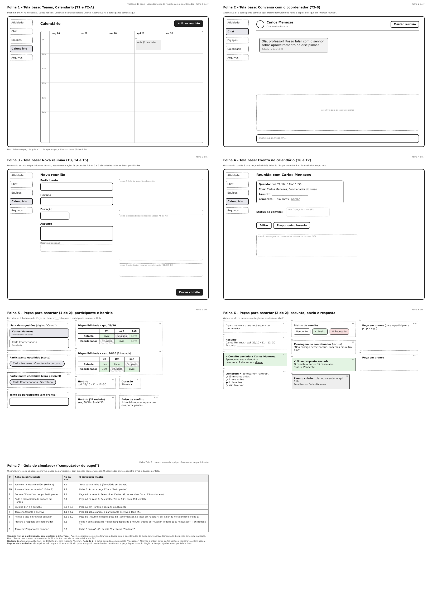

## Tabela de contribuição

| Data       | Contribuição | Autor(es) | Revisor(es) |
| ---------- | ------------ | --------- | ----------- |
| 05/11/2026 | Separação do conteúdo de João Paulo em página própria | João Paulo da Silva Pereira | A definir   |

# João Paulo - Planejamento da avaliação do protótipo de papel

Planejamento da avaliação do protótipo de papel do agendamento de reunião com o coordenador do curso (Nível 2).

> Esta página reúne, em um só lugar, a parte de João Paulo da Silva Pereira no projeto. O conteúdo foi separado de: [planejamento_prototipo_papel.md](../planejamento_prototipo_papel.md).

---

### Objetivos da avaliação do protótipo de papel - Agendamento de reunião com o coordenador do curso

Para esta funcionalidade valem os mesmos objetivos e perguntas da Tabela 1. O protótipo de papel representa o reprojeto do agendamento de uma reunião com o coordenador do curso no Microsoft Teams, pelo Perfil 1 (Estudante). Nele, o formulário mostra só os campos essenciais, sugere o coordenador com nome e cargo ao digitar, exibe a disponibilidade dos dois antes do envio, orienta o que escrever no assunto, confirma o envio e mostra o status do convite (melhorias M01 a M07 do [planejamento da avaliação do storyboard](/planejamento/storyboard/planejamento_avaliacao_storyboard/)).

O autor João Paulo escolhe analisar dois objetivos da Tabela 1:

- **Comparar ideias e alternativas de design:** a HTA do Estudante prevê duas entradas para a mesma tarefa (nós 1.1 e 1.2, plano `1.1 / 1.2`). A **alternativa A** é abrir o Calendário e acionar "Nova reunião"; a **alternativa B** é abrir a conversa com o coordenador e acionar "Marcar reunião". Depois da entrada, as duas seguem o mesmo fluxo. A pergunta é qual entrada é mais eficiente, mais fácil de aprender e a preferida pelo usuário.
- **Problemas na interação e interface:** verificar se o usuário consegue marcar a reunião sem ajuda, encontra o coordenador certo, percebe os horários livres para os dois, entende a confirmação de envio e o status do convite.

O protótipo parte do storyboard avaliado no Nível 1, em que a avaliação com um participante apontou dificuldade em identificar o coordenador na lista de sugestões e dúvida sobre a tela de resumo e envio.

### Perguntas a serem respondidas na avaliação - Agendamento de reunião com o coordenador do curso

As perguntas 1 a 3 da Tabela 1 comparam as duas entradas (alternativas A e B). As perguntas abaixo, extraídas de Barbosa e Silva (2021) para o objetivo de identificar problemas na interação e na interface, são aplicadas ao agendamento com os seguintes pontos de atenção:

**1. O usuário consegue operar o sistema?** Consegue abrir o formulário pela entrada indicada (Calendário ou conversa)?

**2. Ele atinge seu objetivo? Com quanta eficiência? Em quanto tempo? Após cometer quantos erros?** Envia o convite ao coordenador certo, no horário livre para os dois, com a duração pedida? Erros possíveis: escolher a secretaria no lugar do coordenador, escolher horário ocupado, deixar o assunto vazio ou não enviar o convite.

**3. Ele entende o que significa e para que serve cada elemento da interface?** Entende a lista de sugestões (nome e cargo), os horários livres e ocupados, a orientação do campo Assunto, o lembrete e o status do convite?

**4. Ele vai entender o que deve fazer em seguida?** Sabe que, depois de revisar o resumo, deve enviar, e que, depois do envio, deve esperar a resposta ou propor outro horário?

**5. Que problemas de IHC dificultam ou impedem o usuário de alcançar seus objetivos?**

**6. Onde esses problemas se manifestam?** Em qual tela (T1 a T7) e em qual nó da HTA.

**7. Com que frequência tendem a ocorrer?**

**8. Qual é a gravidade desses problemas?**

**9. Quais barreiras o usuário encontra para atingir seus objetivos?**

### Método de avaliação - Agendamento de reunião com o coordenador do curso

Para o agendamento é usada a **prototipação em papel**, como descrito para a comunicação entre usuários: dois avaliadores, um simulando o sistema (o "computador de papel", que coloca as peças sem explicar oralmente) e outro observando e registrando. O participante fala em voz alta o que pensa (*think aloud*) e, depois da tarefa, responde a uma entrevista curta.

A **entrevista pós-teste** pergunta de qual entrada o participante gostou mais e por quê, o que causou dúvida, o que faltou e como saberia que o coordenador aceitou a reunião. A **avaliação heurística** é feita pelo avaliador sobre as telas T1 a T7, com as heurísticas de Nielsen (1994) mais ligadas à tarefa: visibilidade do estado do sistema (confirmação de envio e status do convite), correspondência com o mundo real ("Participante", "Assunto"), controle e liberdade (editar o horário, propor outro horário), prevenção de erros (conflito de horário, pessoa errada), reconhecimento em vez de memorização (sugestões de pessoas) e design minimalista (campos essenciais).

Quando a sessão de cada funcionalidade for do mesmo participante, a ordem das funcionalidades e, no agendamento, das alternativas A e B é registrada, para considerar o efeito de ordem.

### Questões práticas - Agendamento de reunião com o coordenador do curso

#### Definição da tarefa

O Microsoft Teams permite marcar reuniões de várias formas. A funcionalidade analisada é a **marcação de uma reunião entre duas pessoas, o estudante e o coordenador do curso**, sem canal de turma. Consideramos no protótipo que o login já foi feito. Os nomes e dados do protótipo são fictícios (coordenador "Carlos Menezes", estudante "Rafaela Duarte", persona provisória até que a persona oficial do Estudante seja definida).

Cenário lido ao participante, sem explicar a interface: *"Você é estudante e precisa tirar uma dúvida com o coordenador do curso sobre aproveitamento de disciplinas antes da matrícula. Use o Teams para marcar uma reunião de 30 minutos com ele na quinta-feira, dia 29."*

O passo a passo esperado, ligado aos nós da HTA do Estudante, é:

1. Abrir o Calendário e acionar "Nova reunião" (alternativa A, nó 1.1) ou abrir a conversa com o coordenador e acionar "Marcar reunião" (alternativa B, nó 1.2).
2. Digitar o nome ou o cargo do coordenador e selecionar a pessoa certa na lista de sugestões, e não a secretaria (nós 2.1 e 2.2).
3. Consultar a disponibilidade dos dois, escolher quinta-feira, dia 29, às 11h, que é livre para os dois, e definir 30 minutos de duração (nós 3.1 a 3.3).
4. Informar o assunto e, se quiser, detalhar a descrição (nós 4.1 e 4.2).
5. Revisar o resumo e enviar o convite (nós 5.1 e 5.2).
6. Conferir a confirmação do envio e o status do convite (nó 6.1).
7. Em uma segunda rodada, o simulador mostra o convite como recusado e o participante propõe outro horário (nó 6.2).

#### Definição de perfil dos participantes e recrutamento

Perfil 1 (Estudante): estudantes de graduação da FCTE/UnB que usam o Microsoft Teams para trabalhos em grupo e comunicação com professores e servidores. Preferência por participantes que ainda não viram o storyboard do agendamento, para não haver aprendizado prévio. O recrutamento ocorre dentro da universidade, junto com o da funcionalidade de comunicação entre usuários.

#### Preparação de ambiente e de equipamentos

Mesma sala e mesmos equipamentos da avaliação da comunicação entre usuários (celular, tripé e canetas), mais as folhas impressas das telas e as peças móveis do agendamento.

#### Criação do protótipo de papel

As telas e componentes representados em papel são:

| Tela | Conteúdo                                                                                                   | Nó da HTA |
| ---- | ---------------------------------------------------------------------------------------------------------- | --------- |
| T1   | Menu lateral do Teams (Chat, Equipes, Calendário, Arquivos), com usuário já logado                         | 1         |
| T2-A | Calendário com o botão "Nova reunião"                                                                      | 1.1       |
| T2-B | Conversa com o coordenador, com o botão "Marcar reunião"                                                   | 1.2       |
| T3   | Formulário com o campo Participante e peças da lista de sugestões (nome e cargo; coordenador e secretaria) | 2.1 e 2.2 |
| T4   | Disponibilidade dos dois, com peças de horários livres e ocupados                                          | 3.1 a 3.3 |
| T5   | Campos Assunto (com orientação) e Duração                                                                  | 4.1 e 4.2 |
| T6   | Resumo, botão Enviar e peça de confirmação de envio com lembrete                                           | 5.1 e 5.2 |
| T7   | Evento com peça de status do convite (pendente, aceito ou recusado) e botão "Propor outro horário"         | 6.1 e 6.2 |

A tela T2-B foi desenhada e as demais partem dos quadros do storyboard do agendamento. Abaixo está o registro do protótipo de papel do agendamento (folhas 1 a 7: telas base, peças para recortar e guia do simulador):

Figura 1 - Registro do protótipo de papel do agendamento de reunião com o coordenador do curso 

Autor - João Paulo da Silva Pereira 

#### Teste piloto

Segundo Barbosa e Silva (2021), o objetivo do teste-piloto é avaliar o planejamento e analisar se a avaliação planejada produz os dados necessários para responder às questões e aos objetivos do estudo. Para o agendamento, o avaliador conduziu uma sessão normal simulando um participante, para verificar a linguagem, as peças em papel, os equipamentos e o tempo.

O teste-piloto foi realizado, estando disponível no seguinte link: [Clique aqui para acessar a gravação do teste-piloto do agendamento](https://youtu.be/teP38Bix2wg)

##### Análise dos dados do teste-piloto

**Linguagem, material e condução:**
[PREENCHER: a linguagem do roteiro foi adequada? alguma fala precisou mudar?]

**Equipamentos de gravação e de registros de dados:**
O celular filmou a mesa de cima, em plano fixo, e mostra com clareza as folhas impressas e as mãos movendo as peças. O vídeo tem 2 minutos e 2 segundos. [PREENCHER: o áudio ficou audível? algum problema de enquadramento?]

**Tempo necessário:**
O vídeo da sessão dura 2 minutos e 2 segundos. [PREENCHER: tempo total da tarefa e da entrevista, comparado à meta de 30 a 40 minutos do planejamento.]

**Material em papel:**
No vídeo aparecem as folhas da versão de 7 folhas do protótipo (por exemplo, "Folha 3 de 7 – Tela base: Conversa com o coordenador (T2-B)" e "Folha 5 de 7 – Tela base: Nova reunião (T3, T4 e T5)") e as peças móveis (lista de sugestões, quadro de disponibilidade e botão "Enviar convite"). [PREENCHER: alguma peça escorregou, ficou ilegível ou faltou?]

**Produz os dados necessários:**
Para analisar a produção dos dados necessários foram utilizadas as [perguntas específicas do agendamento](#perguntas-a-serem-respondidas-na-avaliacao-agendamento-de-reuniao-com-o-coordenador-do-curso):

**1. O usuário consegue operar o sistema?**
[PREENCHER]

**2. Ele atinge seu objetivo? Com quanta eficiência? Em quanto tempo? Após cometer quantos erros?**
[PREENCHER: enviou o convite ao coordenador certo, no horário livre para os dois, com a duração pedida? tempo? erros?]

**3. Ele entende o que significa e para que serve cada elemento da interface?**
[PREENCHER]

**4. Ele vai entender o que deve fazer em seguida?**
[PREENCHER]

**5. Que problemas de IHC dificultam ou impedem o usuário de alcançar seus objetivos?**
[PREENCHER]

**6 a 9. Onde, com que frequência, gravidade e barreiras**
[PREENCHER ou "Não foram observados problemas no teste-piloto."]

**Ajustes feitos depois do teste-piloto:**
[PREENCHER]

#### Cronograma

O cronograma do agendamento segue o cronograma geral da avaliação do protótipo de papel (Tabela 2), com os avaliadores Lucas Sales e João Paulo, e acrescenta as atividades da funcionalidade de agendamento. Participante, horário e sala da sessão estão a definir.

| Data  | Dia    | Atividade                                                                 | Responsável |
| ----- | ------ | ------------------------------------------------------------------------- | ----------- |
| 28/10 | Quarta | Criação do protótipo de papel do agendamento (folhas e peças)             | João Paulo  |
| 29/10 | Quinta | Teste piloto do agendamento, com gravação em vídeo                        | João Paulo  |
| 30/10 | Sexta  | Sessão de avaliação do agendamento com o participante, com gravação em vídeo | João Paulo e Lucas Sales |

Tabela 3 - Cronograma do agendamento no protótipo de papel 

Autor - João Paulo da Silva Pereira 

### Questões éticas e avaliação dos dados - Agendamento de reunião com o coordenador do curso

Valem o TCLE e os princípios descritos acima. Para o agendamento, o participante é identificado por uma letra, os nomes do protótipo são fictícios e a gravação só ocorre com a permissão dele. Os dados serão analisados com os indicadores do planejamento do relato (conclusão sem ajuda, tempo, erros por tela, passos fora da HTA e preferência entre as alternativas A e B), e com poucas sessões os resultados serão tratados como indício, sem generalizar.

---

## Histórico de versão

| Versão | Data       | Descrição | Autor(es) | Revisor(es) |
| ------ | ---------- | --------- | --------- | ----------- |
| `1.0` | 05/11/2026 | Separação da parte de João Paulo em uma pasta própria | João Paulo da Silva Pereira | |
