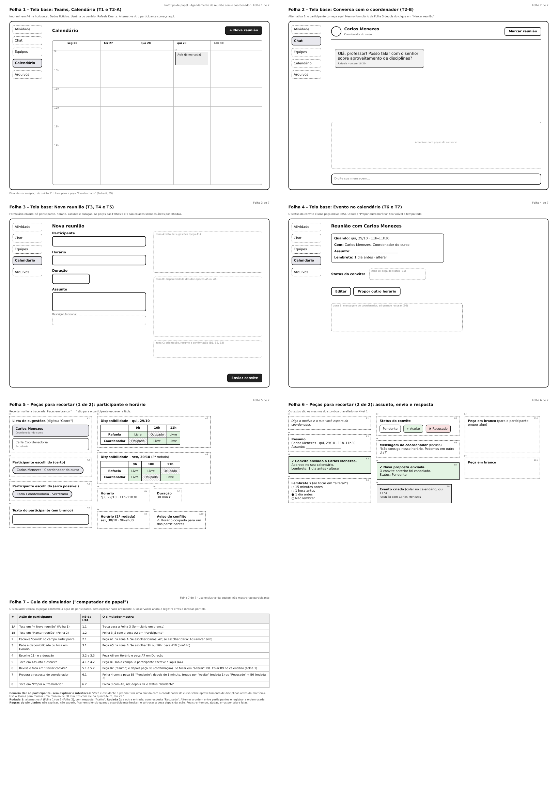

## Tabela de contribuição

| Data       | Contribuição                                                                                           | Autor(es)                   | Revisor(es) |
| ---------- | ------------------------------------------------------------------------------------------------------ | --------------------------- | ----------- |
| 05/11/2026 | Criação da página, com o relato individual do protótipo de papel do agendamento de reunião com o coordenador | João Paulo da Silva Pereira | A definir   |

# João Paulo da Silva Pereira - Relato dos resultados da avaliação do protótipo de papel

> **Funcionalidade avaliada:** Agendamento de reunião com o coordenador do curso no Microsoft Teams (Perfil 1, Estudante)

Este relato individual reúne, em uma só página, o protótipo de papel, o teste piloto, a sessão com participante e o relato dos resultados do agendamento. O planejamento está em [Planejamento da avaliação do protótipo de papel](./planejamento_prototipo_papel_joao_paulo.md) e [Planejamento do relato de resultados](./planejamento_relato_prototipo_papel_joao_paulo.md).

---

## 1. Identificação e escopo

| Item                    | Descrição                                                                                                         |
| ----------------------- | ----------------------------------------------------------------------------------------------------------------- |
| Autor                   | João Paulo da Silva Pereira                                                                                       |
| Produto avaliado        | Microsoft Teams (ambiente web e desktop)                                                                          |
| Perfil                  | Perfil 1: Estudante de graduação da FCTE/UnB                                                                      |
| Cenário                 | Uma estudante com dúvida sobre aproveitamento de disciplinas precisa falar com o coordenador antes da matrícula    |
| Tarefa                  | Marcar uma reunião de 30 minutos com o coordenador do curso, na quinta-feira, dia 29                              |
| Ligação com a HTA       | Nós 1 a 6 da HTA do Estudante (abrir nova reunião, escolher coordenador, horário, assunto, enviar, conferir status) |
| Método                  | Prototipação em papel, com um avaliador simulando o sistema ("computador de papel"), *think aloud* e entrevista pós-teste |
| Sessões                 | 1 teste piloto e 1 sessão com participante (Participante A)                                                       |
| Gravação do teste piloto | [https://youtu.be/teP38Bix2wg](https://youtu.be/teP38Bix2wg)                                                      |
| Gravação da sessão      | [https://youtu.be/BYcVsZbYZR0](https://youtu.be/BYcVsZbYZR0)                                                      |

---

## 2. Peças do protótipo

O protótipo de papel é composto por sete folhas: quatro telas base, duas folhas de peças para recortar e uma folha com o guia do simulador. Os dados são fictícios (estudante Rafaela Duarte, coordenador Carlos Menezes, secretaria Carla Coordenadoria).

| Folha | Conteúdo                                                                                  | Nós da HTA |
| ----- | ----------------------------------------------------------------------------------------- | ---------- |
| 1     | Tela base: Calendário do Teams com o botão "+ Nova reunião"                               | 1.1        |
| 2     | Tela base: conversa com o coordenador, com o botão "Marcar reunião"                       | 1.2        |
| 3     | Tela base: formulário Nova reunião (participante, horário, duração, assunto)              | 2 a 5      |
| 4     | Tela base: evento no calendário, com o status do convite e o botão "Propor outro horário" | 6.1 e 6.2  |
| 5 e 6 | Peças para recortar: lista de sugestões, disponibilidade, orientação do assunto, resumo, confirmação e status | 2 a 6 |
| 7     | Guia do simulador (uso exclusivo da equipe)                                               | 1 a 6      |

Figura 1 - Folhas do protótipo de papel do agendamento 

Autor - João Paulo da Silva Pereira 

---

## 3. Autoinspeção analítica

Antes do teste piloto, o autor conferiu o protótipo com os critérios de Nielsen (1994) e Snyder (2003) para protótipos de papel:

| #   | Critério                                                                              | Atende |
| --- | ------------------------------------------------------------------------------------- | ------ |
| 1   | Cada folha tem título e número ("Folha n de 7"), e o fluxo da tarefa está coberto     | Sim    |
| 2   | Os textos e as peças são legíveis e as peças podem ser recortadas e coladas nas áreas pontilhadas | Sim |
| 3   | Os nomes e dados são fictícios e iguais aos do storyboard avaliado no Nível 1         | Sim    |
| 4   | O caminho da HTA (nós 1 a 6) pode ser percorrido sem o simulador explicar oralmente   | Sim    |
| 5   | O guia do simulador diz qual peça mostrar a cada ação do participante                 | Sim    |

---

## 4. Teste piloto

O teste piloto foi conduzido pelo autor, simulando um participante, para calibrar a linguagem, as peças, os equipamentos de gravação e o tempo. A gravação tem 2 minutos e 2 segundos e mostra a mesa filmada de cima, com as folhas e as mãos movendo as peças. O vídeo está em [https://youtu.be/teP38Bix2wg](https://youtu.be/teP38Bix2wg).

Os dados do teste piloto servem apenas para a calibração e **não entram nos resultados** abaixo.

---

## 5. Sessão com participante

### 5.1 Participante e condução

Participou 1 estudante do Perfil 1, identificado como **Participante A**, que cursa o primeiro semestre e já usou o Microsoft Teams. Dois avaliadores estiveram presentes:

1. **João Paulo (observador e moderador):** explicou o termo de consentimento, fez as perguntas de perfil, registrou as observações e conduziu a entrevista final.
2. **Evellyn de Sousa Rocha (simulador do sistema):** manipulou as folhas e as peças de papel conforme as ações do participante.

Antes da tarefa, o participante assinou o termo de consentimento e foi informado de que poderia parar a qualquer momento, de que a avaliação era do protótipo e não dele, e de que deveria pensar em voz alta. A gravação completa tem 3 minutos e 26 segundos e inclui a explicação inicial, a tarefa e as considerações finais.

### 5.2 Tarefa e ações do participante

| Passo | Ação esperada (HTA)                                              | Ação do participante                                                                  | Ajuda necessária |
| ----- | ---------------------------------------------------------------- | ------------------------------------------------------------------------------------- | ---------------- |
| 1     | Abrir o Calendário e selecionar "+ Nova reunião" (1.1)           | Foi ao Calendário e selecionou "Nova reunião", o "botão grandão"                      | Não              |
| 2     | Escolher o coordenador na lista de sugestões (2.1 e 2.2)         | Entre coordenador e secretaria, escolheu o coordenador, Carlos                        | Não              |
| 3     | Consultar disponibilidade, escolher horário e duração (3.1 a 3.3) | Viu que o coordenador estava livre às 11h e escolheu 11h, com 30 minutos              | Não              |
| 4     | Informar o assunto (4.1)                                         | Escreveu como assunto um estágio                                                      | Não              |
| 5     | Revisar e enviar o convite (5.1 e 5.2)                           | Enviou o convite                                                                      | Não              |
| 6     | Conferir a confirmação e o status (6.1)                          | Viu o status mudar de pendente para aceito e concluiu: "já tem uma reunião marcada"   | Não              |

### 5.3 Entrevista pós-teste

Na entrevista final, o participante disse que a única parte que ficou um pouco mais confusa foi a entrada: "a gente precisa, necessariamente, ir direto em Calendário". Segundo ele, ao pensar em marcar uma reunião, o primeiro pensamento não foi o Calendário, porque o Calendário lembra tempos livres e não "fazer coisas dentro do Calendário". Ele iria primeiro às reuniões e, depois, o Calendário mostraria a reunião marcada. Não acrescentou outras considerações.

---

## 6. Relato dos resultados

O relato segue o framework DECIDE e a estrutura de Barbosa e Silva (2021).

### 6.1 Objetivos e escopo

Para o protótipo de papel, de baixa fidelidade, foi escolhido o objetivo de **Problemas na interação e interface**, para coletar dados sobre se o usuário entende o design, as operações e realiza a tarefa de agendar uma reunião com o coordenador. Os objetivos e perguntas estão no [planejamento da avaliação](./planejamento_prototipo_papel_joao_paulo.md/#objetivos-da-avaliacao-do-prototipo-de-papel-agendamento-de-reuniao-com-o-coordenador-do-curso).

### 6.2 Método

Prototipação em papel, um método de observação (Barbosa e Silva, 2021; Snyder, 2003), com dois avaliadores (simulador e observador), *think aloud* e entrevista pós-teste.

### 6.3 Perguntas respondidas

| #   | Pergunta                                                                  | Resposta                                                                                                                                                                  |
| --- | ------------------------------------------------------------------------- | ------------------------------------------------------------------------------------------------------------------------------------------------------------------------- |
| 1   | O usuário consegue operar o sistema?                                      | Sim, sem ajuda dos avaliadores.                                                                                                                                           |
| 2   | Ele atinge seu objetivo? Com quanta eficiência? Em quanto tempo? Após cometer quantos erros? | Sim. Enviou o convite ao coordenador, no horário livre (11h) e com 30 minutos. Nenhum erro foi observado (não escolheu a secretaria nem horário ocupado). A gravação completa tem 3 min 26 s, incluindo explicação inicial e entrevista final. |
| 3   | Ele entende o que significa e para que serve cada elemento da interface?  | Sim: botão "Nova reunião", lista de sugestões, disponibilidade, duração, assunto e status do convite.                                                                     |
| 4   | Ele vai entender o que deve fazer em seguida?                             | Sim. Depois de enviar, acompanhou o status e concluiu que a reunião estava marcada.                                                                                       |
| 5   | Que problemas de IHC dificultam ou impedem o usuário de alcançar seus objetivos? | A entrada pelo Calendário não correspondeu à expectativa do participante (OPO-AG01). Não impediu a tarefa.                                                          |
| 6   | Onde esses problemas se manifestam?                                       | Folha 1 (Calendário), passo 1 da tarefa, nó 1.1 da HTA.                                                                                                                   |
| 7   | Com que frequência tendem a ocorrer?                                      | 1 de 1 participante. Com uma só sessão, é indício.                                                                                                                        |
| 8   | Qual é a gravidade desses problemas?                                      | Pequena (2, na escala de 1 a 3, segundo Nielsen), pois não impediu a tarefa.                                                                                              |
| 9   | Quais barreiras o usuário encontra para atingir seus objetivos?           | Nenhuma barreira impediu o objetivo.                                                                                                                                      |

### 6.4 Oportunidades de melhoria e elementos validados

| ID       | Tipo         | Local                       | Descrição                                                                                                            | Heurística / fator                       | Severidade |
| -------- | ------------ | --------------------------- | -------------------------------------------------------------------------------------------------------------------- | ---------------------------------------- | ---------- |
| OPO-AG01 | Melhoria     | Folha 1, nó 1.1             | O participante esperava iniciar por uma área de reuniões, e não pelo Calendário, que associa a "tempos livres".      | Correspondência entre o sistema e o mundo real; facilidade de aprendizado | 2 |
| VAL-AG01 | Validado     | Folha 3, nós 2.1 e 2.2      | A lista de sugestões com nome e cargo permitiu escolher o coordenador sem confundir com a secretaria.                | Reconhecimento em vez de memorização     | n/a        |
| VAL-AG02 | Validado     | Folha 3, nós 3.1 a 3.3      | A disponibilidade dos dois ("ele está livre às 11 horas") levou à escolha de um horário livre, sem conflito.         | Visibilidade do estado do sistema        | n/a        |
| VAL-AG03 | Validado     | Folha 4, nó 6.1             | O status do convite (pendente para aceito) mostrou que a reunião estava marcada.                                     | Visibilidade do estado do sistema        | n/a        |

### 6.5 Reprojeto para o protótipo de alta fidelidade

| ID     | Ação                                                                                                           | Origem              | Previsão |
| ------ | -------------------------------------------------------------------------------------------------------------- | ------------------- | -------- |
| REP-01 | Incluir uma entrada pela conversa com o coordenador ("Marcar reunião", nó 1.2 da HTA), além do Calendário      | OPO-AG01            | 07 a 09/11 |
| REP-02 | Manter a lista de sugestões com nome e cargo                                                                   | VAL-AG01            | 07 a 09/11 |
| REP-03 | Manter a disponibilidade dos dois antes do envio                                                               | VAL-AG02            | 07 a 09/11 |
| REP-04 | Manter o status do convite e o botão "Propor outro horário"                                                    | VAL-AG03            | 07 a 09/11 |

As datas seguem o [planejamento do teste de usabilidade](../../../nivel_3/Joao_Paulo/planejamento_teste_usabilidade_joao_paulo.md).

### 6.6 Limitações e validade

- Apenas um participante foi entrevistado. Krug indica de três a quatro participantes para detectar a maioria dos problemas, então os resultados são tratados como indício e não podem ser generalizados.
- O participante é estudante do primeiro semestre, parte do Perfil 1.
- O protótipo usa dados fictícios, e o resultado do teste piloto não foi incluído.
- Na análise de tarefas do Nível 1, o participante disse que olharia primeiro o Calendário. Aqui, o participante esperava começar por reuniões. As expectativas divergem, e a entrada deve ser avaliada em novas sessões.

---

## Referências bibliográficas

1. BARBOSA, Simone Diniz Junqueira et al. **Interação humano-computador e experiência do usuário.** Rio de Janeiro: Autopublicação, 2021.
2. NIELSEN, Jakob. **Usability Inspection Methods**. New York: John Wiley & Sons, 1994.
3. SNYDER, Carolyn. **Paper Prototyping: The Fast and Easy Way to Design and Refine User Interfaces**. San Diego: Morgan Kaufmann, 2003.

## Histórico de versão

| Versão | Data       | Descrição                                                                    | Autor(es)                   | Revisor(es) |
| ------ | ---------- | ---------------------------------------------------------------------------- | --------------------------- | ----------- |
| `1.0`  | 05/11/2026 | Criação da página com o relato individual do protótipo de papel do agendamento | João Paulo da Silva Pereira |             |
