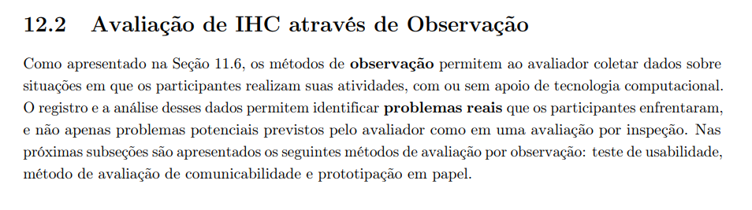
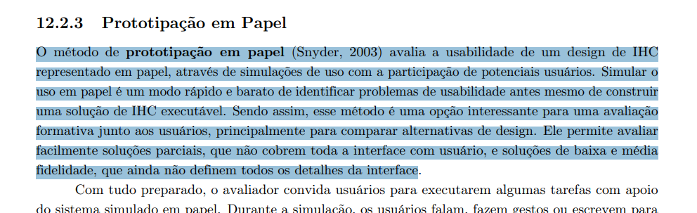
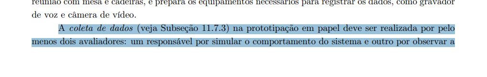
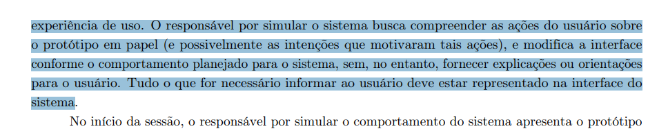
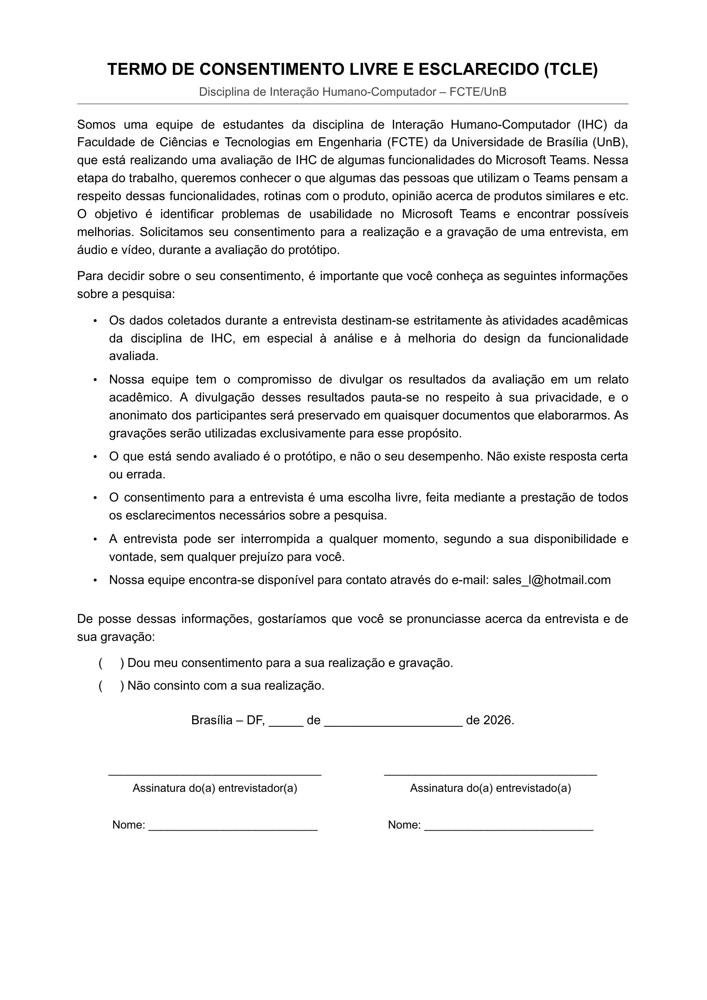
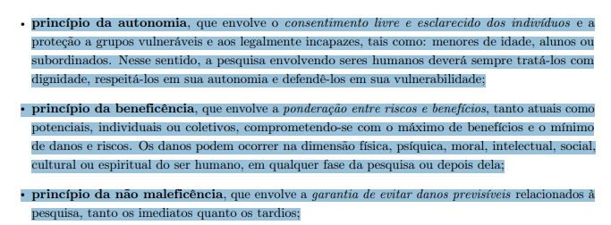
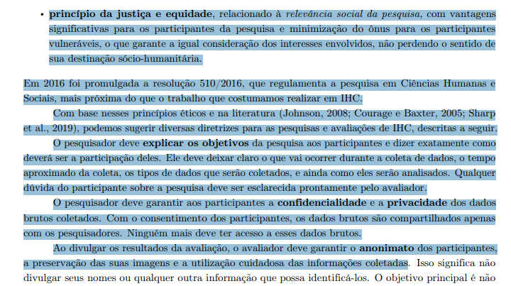

## Tabela de contribuição
| Data       | Contribuição                                                                                                | Autor(es)   | Revisor(es) |
| ---------- | ----------------------------------------------------------------------------------------------------------- | ----------- | ----------- |
| 20/10/2026 | Criação da página                                                                                           | Lucas Sales | A definir   |
| 20/10/2026 | Adicionando informações                                                                                     | João Paulo  | A definir   |
| 21/10/2026 | Determinando objetivos, perguntas e método de avaliação para a funcionalidade de comunicação entre usuários | Lucas Sales | A definir   |
| 22/10/2026 | Determinando questões práticas para a funcionalidade de comunicação entre usuários                          | Lucas Sales | A definir   |
| 24/10/2026 | Adicionando teste piloto e cronograma da funcionalidade de comunicação entre usuários                       | Lucas Sales | A definir   |
| 25/10/2026 | Reformulando questões éticas e avaliação dos resultados                                                     | Lucas Sales | A definir   |

# Planejamento da Avaliação do Protótipo de Papel

## Introdução

A avaliação de Interação Humano-Computador (IHC) é uma etapa essencial no desenvolvimento de sistemas interativos, pois permite julgar a qualidade de uso da solução e identificar problemas na interação e interface que possam comprometer a experiência do usuário. Essa atividade orienta o processo de melhorias, garantindo que o sistema atenda às necessidades específicas dos usuários e promova uma interação eficiente e satisfatória (Barbosa, 2021)

## Metodologia

A metodologia adotada para a avaliação segue o modelo do framework DECIDE (Barbosa, 2021), uma abordagem estruturada que organiza o processo de avaliação em seis etapas principais: (D) determinar os objetivos da avaliação, (E) explorar perguntas a serem respondidas, (C) escolher os métodos de avaliação, (I) identificar e administrar questões práticas, (D) decidir como lidar com questões éticas, e, por fim, (E) avaliar, interpretar e apresentar os dados. Essa metodologia permite um planejamento claro e detalhado, garantindo que a avaliação aborde tanto alternativas de design quanto a identificação de problemas na interação e interface.

## D - Determinar os objetivos da avaliação de IHC

Os objetivos dessa avaliação são essenciais para direcionar o processo e garantir que ela se concentre nas áreas mais críticas da interação. O primeiro objetivo é explorar diferentes alternativas de design, identificando qual delas proporciona uma melhor experiência de interação, levando em consideração aspectos como clareza, eficácia e satisfação do usuário. Além disso, a avaliação buscará identificar problemas na interação e na interface, como pontos de confusão, erros de navegação ou inconsistências na interface, para garantir uma experiência de uso mais fluida e eficiente. Esses objetivos visam assegurar que o protótipo atenda às necessidades dos usuários e proporcione uma melhor experiência de usuário.

### Objetivos da avaliação do protótipo de papel - Comunicação entre usuários

Barbosa e Silva (2021), propõem 4 objetivos para realizar uma avaliação de IHC e perguntas específicas relacionadas a cada um deles, para decidir os objetivos da avaliação do protótipo de papel, foram analisados estes objetivos e suas perguntas:

| Objetivo                                       | Exemplos de perguntas a serem respondidas                                                                                |
| ---------------------------------------------- | ------------------------------------------------------------------------------------------------------------------------ |
| Analisar a apropriação da tecnologia           | De que maneira os usuários utilizam o sistema?                                                                           |
|                                                | Em que difere do planejado?                                                                                              |
|                                                | Como o sistema interativo afeta o modo de as pessoas se comunicarem e relacionarem?                                      |
|                                                | Que variação houve no número de erros cometidos pelos usuários ao utilizarem o novo sistema?                             |
|                                                | E no tempo que levam para atingir seus objetivos?                                                                        |
|                                                | E na sua satisfação com o sistema?                                                                                       |
|                                                | O quanto os usuários consideram o apoio computacional adequado para auxiliá-los na realização de suas atividades?        |
|                                                | O quanto eles são motivados a explorar novas funcionalidades?                                                            |
|                                                | Quais são os pontos fortes e fracos do sistema, na opinião dos usuários?                                                 |
|                                                | Quais objetivos dos usuários podem ser alcançados através do sistema? E quais não podem?                                 |
|                                                | Quais necessidades e desejos foram ou não atendidos?                                                                     |
|                                                | A tecnologia disponível pode oferecer maneiras mais interessantes ou eficientes de os usuários atingirem seus objetivos? |
|                                                | O que é possível modificar no sistema interativo para adequá-lo melhor ao ambiente de trabalho?                          |
|                                                | Por que os usuários não incorporaram o sistema no seu cotidiano?                                                         |
| Comparar ideias e alternativas de design       | Qual das alternativas é a mais eficiente? Mais fácil de aprender?                                                        |
|                                                | Qual delas pode ser construída em menos tempo?                                                                           |
|                                                | De qual delas se espera que tenha um impacto negativo menor ao ser adotada?                                              |
|                                                | Qual delas torna mais evidente os diferenciais da solução projetada?                                                     |
|                                                | Qual delas os usuários preferem? Por quê?                                                                                |
| Verificar a conformidade com um padrão         | O sistema está de acordo com os padrões de acessibilidade do W3C?                                                        |
|                                                | A interface segue o padrão do sistema operacional? E da empresa?                                                         |
|                                                | Os termos na interface seguem convenções estabelecidas no domínio?                                                       |
| Identificar problemas na interação e interface | Considerando cada perfil de usuário esperado: O usuário consegue operar o sistema?                                       |
|                                                | Ele atinge seu objetivo? Com quanta eficiência? Em quanto tempo? Após cometer quantos erros?                             |
|                                                | Que parte da interface e da interação o deixa insatisfeito?                                                              |
|                                                | Que parte da interface o desmotiva a explorar novas funcionalidades?                                                     |
|                                                | Ele entende o que significa e para que serve cada elemento de interface?                                                 |
|                                                | Ele vai entender o que deve fazer em seguida?                                                                            |
|                                                | Que problemas de IHC dificultam ou impedem o usuário de alcançar seus objetivos?                                         |
|                                                | Onde esses problemas se manifestam?                                                                                      |
|                                                | Com que frequência tendem a ocorrer?                                                                                     |
|                                                | Qual é a gravidade desses problemas?                                                                                     |
|                                                | Quais barreiras o usuário encontra para atingir seus objetivos?                                                          |
|                                                | Ele tem acesso a todas as informações oferecidas pelo sistema?                                                           |

Tabela 1 - Relação de objetivos x perguntas de IHC.

Para o protótipo de papel, que representa um protótipo de baixa fidelidade do produto, será aplicada uma atualização da funcionalidade de gravação de áudio, originalmente disponível apenas em aplicativo mobile do Microsoft Teams, neste protótipo, a funcionalidade estará disponível em ambiente web e desktop, os quais compartilham elementos de layout, design e interação.

Como o usuário irá interagir com o protótipo, o autor Lucas Sales escolhe analisar nesta avaliação, o objetivo de **Problemas na interação e interface** para coletar dados a respeito de se o usuário consegue entender o design, as operações e consegue realizar a tarefa, mesmo em um protótipo de baixa fidelidade.

**Fonte:**

Conteúdo de Barbosa e Silva (2021), páginas 250 e 251:

Figura 1 - Objetivos e perguntas 

Figura 2 - Objetivos e perguntas 

A Tabela 1 foi gerada com auxílio de inteligência artificial (Claude) a partir do conteúdo da literatura.

## E - Explorar perguntas a serem respondidas com a avaliação 

As perguntas a serem exploradas nesta avaliação foram adaptadas a partir da tabela de exemplos de perguntas que uma avaliação de IHC pode responder (Barbosa, 2021), visando o contexto específico da avaliação de protótipos de papel. O objetivo é compreender como os usuários percebem os fluxos de interação e quais aspectos podem afetar a experiência de uso. As questões foram elaboradas para investigar tanto as alternativas de design quanto a identificação de problemas de IHC, considerando as interações apresentadas no protótipo. Essas perguntas serão essenciais para entender se o design facilita ou dificulta o uso do sistema, e se há aspectos que precisam ser ajustados para melhorar a experiência do usuário.

<b>Tabela 1</b> - Roteiro de perguntas para Avaliação do Protótipo de Papel

| Objetivo                           | Pergunta                                                                                                                                  | Resposta |
| ---------------------------------- | ----------------------------------------------------------------------------------------------------------------------------------------- | -------- |
| Ideias e Alternativas de Design    | 1. Qual das alternativas de design do protótipo de papel é mais eficiente e fácil de aprender?                                            |          |
| Ideias e Alternativas de Design    | 2. Qual alternativa de design os usuários preferem? Por quê?                                                                              |          |
| Ideias e Alternativas de Design    | 3. Qual alternativa de design se espera que tenha um impacto negativo menor ao ser adotada?                                               |          |
| Problemas na Interação e Interface | 4. Os usuários conseguem operar o protótipo de papel? Eles atingem seus objetivos de maneira eficiente? Com que frequência cometem erros? |          |
| Problemas na Interação e Interface | 5. Que parte da interface do protótipo de papel deixa os usuários insatisfeitos ou causa confusão?                                        |          |
| Problemas na Interação e Interface | 6. Os usuários entendem claramente o que cada elemento do protótipo de papel significa e o que devem fazer em seguida?                    |          |

Autor(es): João Paulo

### Perguntas a serem respondidas na avaliação - Comunicação entre usuários

Foram extraídas da literatura de Barbosa e Silva (2021) as seguintes perguntas relacionadas ao objetivo de identificar problemas na interação e na interface, que serão utilizadas na avaliação do protótipo de papel:

**1. O usuário consegue operar o sistema?**

**2. Ele atinge seu objetivo? Com quanta eficiência? Em quanto tempo? Após cometer quantos erros?**

**3. Ele entende o que significa e para que serve cada elemento da interface?**

**4. Ele vai entender o que deve fazer em seguida?**

**5. Que problemas de IHC dificultam ou impedem o usuário de alcançar seus objetivos?**

**6. Onde esses problemas se manifestam?**

**7. Com que frequência tendem a ocorrer?**

**8. Qual é a gravidade desses problemas?**

**9. Quais barreiras o usuário encontra para atingir seus objetivos?**

## C - Escolher os métodos de avaliação a serem utilizados

Para a avaliação do protótipo de papel, serão utilizados dois métodos principais: **entrevista semiestruturada** e **avaliação heurística**, cada um focando em aspectos específicos da avaliação.

A entrevista semiestruturada será utilizada para avaliar o aspecto da apropriação da tecnologia. Esse método permitirá captar dados qualitativos importantes sobre a usabilidade, a compreensão do protótipo e as motivações para sua adoção ou rejeição.

Já a avaliação heurística, por outro lado, será empregada para avaliar as alternativas de design e identificar problemas de interação e interface (problemas de IHC). Essa análise ajudará a identificar falhas de design que podem comprometer a eficiência, a satisfação e a experiência do usuário com o protótipo.

A combinação desses dois métodos permitirá uma análise detalhada, com foco em diferentes aspectos da usabilidade e do design, fornecendo uma base sólida para melhorias no protótipo.

### Método de avaliação - Comunicação entre usuários

Como requisito da disciplina, os estudantes devem utilizar **prototipação em papel** para realizar uma avaliação de IHC das funcionalidades analisadas durante o semestre. 

A prototipação em papel, é um método de observação, tais métodos permitem ao avaliador coletar dados sobre situações em que os participantes realizam suas atividades, com ou sem apoio de tecnologia computacional (Barbosa e Silva, 2021).

A prototipação em papel, avalia a usabilidade de um design de IHC representado em papel, simulando o uso do produto com a participação de potenciais usuários, uma das características do método, é ser rápido e barato, além de a solução ser construída juntamente do usuário no processo de avaliação.

Serão construídos protótipos do sistema em papel com a atualização da funcionalidade definida nos [Objetivos da avaliação de IHC](#objetivos-da-avaliacao-do-prototipo-de-papel-comunicacao-entre-usuarios), o usuário terá de realizar a tarefa de enviar uma mensagem de voz por um sistema web ou desktop do produto Microsoft Teams.

Como requisito do método de prototipação em papel, descrito por Barbosa e Silva (2021), a aplicação do método exigirá dois avaliadores, um simulando o sistema e o outro realizando a observação do usuário e registrando por meio de anotações as respostas do mesmo, visando obter dados suficientes para responder as [perguntas estabelecidas](#perguntas-a-serem-respondidas-na-avaliacao-comunicacao-entre-usuarios).

**Fonte:**

Conteúdo de Barbosa e Silva (2021), páginas 288, 303, 304 e 305:

Figura 3 - Método de observação 

Figura 4 - Prototipação em papel 

Figura 5 - Quantidade de avaliadores 

Figura 6 - Quantidade de avaliadores 

## I - Identificar e administrar as questões práticas da avaliação

A identificação e administração das questões práticas são fundamentais para garantir que a avaliação do protótipo de papel ocorra de forma eficiente, respeitando as limitações de recursos, tempo e logística. A seguir, são detalhadas as questões práticas relacionadas a recrutamento, preparação, custos e prazos.

### Recrutamento

Os participantes serão selecionados serão alunos, professores e gestores definido durante a análise de requisitos, priorizando indivíduos que representem o público-alvo do protótipo. O processo de recrutamento será realizado por meio de convites diretos e seleção de voluntários, que devem atender aos critérios estabelecidos.

### Preparação

A preparação para a avaliação do protótipo de papel envolve a organização dos materiais e recursos necessários para os dois métodos de avaliação: a entrevista semiestruturada e a avaliação heurística.  

> **Entrevista Semiestruturada:**  
Ferramentas: Celular para gravação de áudio e vídeo;    
Materiais: Protótipos de papel impressos e roteiros de avaliação;    
Ambiente: A entrevista ocorrerá presencialmente em local combinado com os participantes ou, em último caso, de forma remota;

> **Avaliação Heurística:**  
Ferramentas: computador para redigir o relatório/relato dos resultados;  
Materiais: Lista de princípios heurísticos;  
Ambiente: A avaliação será realizada em um ambiente controlado e silencioso para garantir que o avaliador possa se concentrar na análise do protótipo sem distrações;  

### Custos

Os custos envolvidos na avaliação incluem despesas com impressão de materiais, transporte dos participantes e equipamentos para gravação, caso necessário. A equipe buscará otimizar o uso dos recursos disponíveis, minimizando despesas e aproveitando ao máximo os materiais já disponíveis.

### Prazos

A avaliação será realizada conforme cronograma a ser definido, considerando a disponibilidade dos participantes e dos entrevistadores.

<b>Tabela 2</b> - Cronograma da Entrevista

| Entrevistador      | Entrevistado(a) | Horário Início | Horário Fim | Data      |
| ------------------ | --------------- | -------------- | ----------- | --------- |
| `Lucas Sales`      | a definir       | a definir      | a definir   | a definir |
| `João Paulo`       | a definir       | a definir      | a definir   | a definir |
| `Evellyn de Sousa` | a definir       | A a definir    | a definir   | a definir |

Autor:  João Paulo da Silva Pereira

Os entrevistadores deverão garantir que os materiais estejam prontos com antecedência e que os participantes sejam contatados para confirmar o horário agendado.

### Questões práticas - Comunicação entre usuários

As questões práticas relativas à avaliação do protótipo de papel incluem: definição da tarefa a ser realizada, definição de perfil dos participantes e recrutamento dos mesmos, preparação de ambiente e de equipamentos, a criação do protótipo de papel em si e a execução de teste piloto.

#### Definição da tarefa

A comunicação entre usuários no Microsoft Teams pode acontecer de várias formas, dentre elas, reuniões, mensagens de texto via chat teams, envio de emojis, stickers e loop components. A funcionalidade analisada na avaliação, é a gravação de mensagem de voz, disponível apenas no aplicativo mobile do Microsoft Teams, no contexto da avaliação, a funcionalidade estará disponível em ambiente web e desktop.

Desta forma, a tarefa que o participante irá realizar, é a **gravação de áudio no Microsoft Teams, em ambiente web ou desktop**, consideraremos no protótipo que o login na plataforma já foi realizado e que o participante irá enviar uma mensagem de áudio para um dos usuários que houve interação recente, para evitar o fluxo de pesquisa de um usuário.

O passo a passo esperado que o participante realize é:

1. Selecionar uma conversa recente.
2. Selecionar o ícone de microfone para iniciar a gravação de áudio.
3. Falar a mensagem a ser transmitida.
4. Selecionar o ícone de quadrado vermelho, para encerrar a gravação de áudio ou selecionar o ícone com duas barras verticais que indica a pausa, podendo continuar o áudio, até o momento de encerrar.
5. Selecionar o ícone de triângulo apontado para a direita *(play)* para escutar o próprio áudio antes do envio. *(opcional)*
6. Selecionar o ícone de seta apontada para a direita para enviar o áudio.

#### Definição de perfil dos participantes e recrutamento

Para esta avaliação o perfil de participantes esperados são estudantes de graduação da Faculdade de Ciências e Tecnologias em Engenharia (FCTE) da Universidade de Brasília (UnB), que utilizam o Microsoft Teams para realizar trabalhos em grupo, comunicações com professores e servidores da universidade.

O recrutamento ocorrerá dentro da própria universidade, sendo solicitado aos estudantes para realizarem uma rápida pesquisa para contribuir com o trabalho da disciplina.

#### Preparação de ambiente e de equipamentos

A avaliação será realizada na Universidade de Brasília (UnB), mais especificamente na Faculdade de Ciências e Tecnologias em Engenharia (FCTE). Uma sala vaga será ocupada pelos avaliadores e o participante, a própria universidade já dispõe de cadeiras com mesas para serem utilizadas. 

Os demais equipamentos que serão utilizados são:

1. Telefone celular;
2. Tripé de apoio;
3. Canetas;

#### Criação do protótipo de papel

A criação do protótipo de papel envolve representar graficamente as telas do Microsoft Teams para que o participante interaja com a mesma. As telas e componentes que serão representadas em papel, são:

1. Tela inicial, com usuário já logado e conversas recentes aparentes;
2. Tela de conversa selecionada, com o chat disponível, com o ícone de gravação de áudio;
3. Componente representando o áudio sendo gravado;
4. Componente representando um ícone de pausa;
5. Componente representando o áudio gravado;
6. Componente representando o áudio enviado no chat; 

#### Teste piloto

Segundo Barbosa e Silva (2021), o objetivo do teste-piloto, é avaliar o planejamento, analisar se a avaliação planejada produz os dados necessários para responder as questões e objetivos do estudo.

Para realizar o teste-piloto, é necessário que o avaliador conduza uma sessão normal de avaliação, conseguindo verificar se a linguagem, materiais e condução da avaliação são adequeadas e suficientes para orientar o participante durante a avaliação. O teste-piloto também permite avaliar se o produto, equipamentos de condução e de registro de dados estão funcionando corretamente e se o tempo necessário para executar as tarefas é suficiente.

Por fim, o avaliador deve realizar uma breve análise dos dados coletados para garantir que eles permitirão responder as questões da avaliação.

Portanto, para esta avaliação, o teste-piloto foi realizado, estando disponível no seguinte link: [CLique aqui para acessar a gravação do teste-piloto](https://www.youtube.com/watch?v=dQw4w9WgXcQ&list=RDdQw4w9WgXcQ&start_radio=1)

##### Análise dos dados do teste-piloto

Por questões de disponibilidade do avaliador, não foi possível realizar o teste-piloto no ambiente exato onde ocorrerá a avaliação, dado inclusive o fato de que o ambiente utilizada dependerá do fator de disponibilidade de sala da própria universidade. Contudo, o teste-piloto permitiu analisar as principais questões do planejamento da avaliação:

**Linguagem, material e condução:**
Durante a execucação do teste-piloto, a linguagem utilizada demonstrou ser amigável e acolhedora, demonstrando ao participante que a avaliação é sobre o produto e não sobre a pessoa em si.

**Equipamentos de gravação e de registros de dados:**
Os equipamentos de gravação (tripé e telefone celular) apresentaram funcionamento normal e esperado, produzindo o vídeo com estabilidade e demonstrando com clareza os processos envolvidos no teste-piloto.

**Tempo necessário:**
O tempo aproximado que o avaliador, simulando um participante levou para concluir a tarefa foi de 23 minutos e 15 segundos, o que demonstra estar dentro do escopo da avaliação, que visa durar em torno de 30 a 40 minutos.

**Produz os dados necessarios:**
Para analisar a produção dos dados necessários, foram utilizadas as (perguntas específicas)[#perguntas-a-serem-respondidas-na-avaliacao-comunicacao-entre-usuarios] e abaixo estão descritas a relação do avaliador, simulando um participante e as questões em si:

**1. O usuário consegue operar o sistema?**
No teste-piloto, o avaliador, simulando um participante, conseguiu utilizar todas as telas e componentes em papel descritos na [criação do protótipo de papel](#criacao-do-prototipo-de-papel). 

*2. Ele atinge seu objetivo? Com quanta eficiência? Em quanto tempo? Após cometer quantos erros?*

*3. Ele entende o que significa e para que serve cada elemento da interface?*

*4. Ele vai entender o que deve fazer em seguida?*

*5. Que problemas de IHC dificultam ou impedem o usuário de alcançar seus objetivos?*

*6. Onde esses problemas se manifestam?*

*7. Com que frequência tendem a ocorrer?*

*8. Qual é a gravidade desses problemas?*

*9. Quais barreiras o usuário encontra para atingir seus objetivos?*

#### Cronograma

O cronograma abaixo considera a disponibilidade dos avaliadores e dos participantes. Cada sessão terá dois avaliadores (um simulando o sistema e outro observando e registrando), com duração prevista de 30 a 40 minutos, reservando-se uma hora por sessão para preparação e margem.

Cronograma da avaliação do protótipo de papel 

| Data  | Dia    | Atividade                                                                                                      | Responsável(is)          |
| ----- | ------ | -------------------------------------------------------------------------------------------------------------- | ------------------------ |
| 27/10 | Terça  | Confirmar participantes e horários, buscar sala vaga na FCTE para o dia 28/10, conferir tripé, celular e áudio | Lucas Sales              |
| 28/10 | Quarta | Sessão de coleta de dados do protótipo de papel                                                                | Lucas Sales              |
| 29/10 | Quinta | Organizar anotações e gravações                                                                                | Lucas Sales e João Paulo |
| 30/10 | Sexta  | Construção do relato de resultados do protótipo de papel                                                       | Lucas Sales              |

Tabela 2 - Cronograma da avaliação do protótipo de papel 

Autor - Lucas Sales 

## D - Decidir como lidar com as questões éticas

Para garantir a integridade e o aspecto ético da pesquisa, são utilizadas os princípios éticos descritos por Barbosa e Silva(2021).

- **Princípio da autonomia:** Envolve o consentimento livre e esclarecido dos indivíduos e a proteção a grupos vulneráveis e aos legalmente incapazes, tais como: menores de idade, alunos ou subordinados. Nesse sentido, a pesquisa envolvendo seres humanos deverá sempre tratá-los com dignidade, respeitá-los em sua autonomia e defendê-los em sua vulnerabilidade;

- **Princípio da beneficência:** Envolve a ponderação entre riscos e benefícios, tanto atuais como potenciais, individuais ou coletivos, comprometendo-se com o máximo de benefícios e o mínimo de danos e riscos. Os danos podem ocorrer na dimensão física psíquica, moral, intelectual, social, cultural ou espiritual do ser humano, em qualquer fase da pesquisa ou depois dela;

- **Princípio da não maleficência:**Envolve a garantia de evitar danos previsíveis relacionados à pesquisa, tanto os imediatos quanto os tardios;

- **Princípio da justiça e equidade:** Relacionado à relevância social da pesquisa, com vantagens
significativas para os participantes da pesquisa e minimização do ônus para os participantes vulneráveis, o que garante a igual consideração dos interesses envolvidos, não perdendo o sentido de sua destinação sócio-humanitária.

Além destes, os avaliadores se comprometem a sempre **explicar os objetivos** da pesquisa previamente, garantir a **confidencialidade** e a **privacidade** dos participantes, que serão sempre apresentados de forma **anônima.** Obtendo sua **permissão para gravação de imagem e voz** antes de iniciar a mesma.

Por fim, todos os participantes da pesquisa, devem preencher o **Termo de Consentimento Livre e Esclarecido (TCLE)** previamente à sua participação nesta, que está disponível abaixo.

Figura 7 - Termo de Consentimento Livre e Esclarecido 

Autor - Lucas Sales 

**Fonte:**

Conteúdo de Barbosa e Silva (2021), páginas 126,127 e 128:

Figura 8 - Princípios éticos 

Figura 9 - Princípios éticos 

## E - Avaliar, interpretar e apresentar os dados

Barbosa e Silva(2021), orienta que para interpretar e apresentar os dados o avaliador precisa estar atento a alguns
aspectos da avaliação realizada antes de tirar conclusões e divulgar resultados. deve se considerar o grau de confiabilidade dos dados, a validade interna do estudo, a validade externa do estudo, e a validade ecológica do estudo.

Desta forma a avaliação dos dados coletados será conduzida de acordo com as etapas descritas neste documento, de acordo com cada funcionalidade e seu autor.

O relato dos resultados estará disponível na pagina [Relato dos resultados - Protótipo de papel](/design_avaliacao_desenvolvimento/nivel_2/prototipo_papel/resultados_prototipo_papel/) de acordo com o seguimento da disciplina de IHC. 

## Agradecimento e Uso de IA generativa

O documento utiliza IA generativa nos seguintes pontos:

- Formatação e redação de texto;
- Geração e adaptação de código markdown;

## Referências Bibliográficas

> 1. BARBOSA, Simone Diniz Junqueira et al. Interação humano-computador e experiência do usuário. 1. ed. Rio de Janeiro: Simone Diniz Junqueira Barbosa, 2021. Capítulo 11: Planejamento da Avaliação de IHC. Página 261. Autopublicação. ISBN: 978-65-00-19677-1.

> 2. BARBOSA, Simone Diniz Junqueira et al. Interação humano-computador e experiência do usuário. 1. ed. Rio de Janeiro: Simone Diniz Junqueira Barbosa, 2021. Capítulo 11: Planejamento da Avaliação de IHC. Páginas 279-280. Autopublicação. ISBN: 978-65-00-19677-1.

> 3. BARBOSA, Simone Diniz Junqueira et al. Interação humano-computador e experiência do usuário. 1. ed. Rio de Janeiro: Simone Diniz Junqueira Barbosa, 2021. Capítulo 11: Planejamento da Avaliação de IHC. Páginas 266-267. Autopublicação. ISBN: 978-65-00-19677-1.

## Histórico de versão
| Versão | Data       | Descrição               | Autor(es)   | Revisor(es) |
| ------ | ---------- | ----------------------- | ----------- | ----------- |
| `1.0`  | 20/10/2026 | Criação da página.      | Lucas Sales |             |
| `2.0`  | 20/10/2026 | Adicionando informações | João Paulo  |             |
