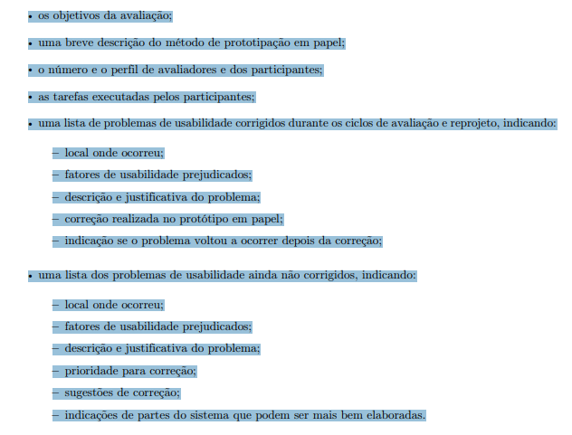

## Tabela de contribuição

| Data       | Contribuição                                                                                             | Autor(es)                   | Revisor(es) |
| ---------- | -------------------------------------------------------------------------------------------------------- | --------------------------- | ----------- |
| 20/10/2026 | Criação da página                                                                                        | Lucas Sales Ribeiro         | A definir   |
| 23/10/2026 | Adição do planejamento do relato dos resultados e bibliografia                                           | Evellyn de Sousa Rocha      | A definir   |
| 25/10/2026 | Adição do planejamento do relato dos para comunicação com usuário(s)                                     | Lucas Sales Ribeiro         | A definir   |
| 25/10/2026 | Adição do planejamento do relato dos resultados para o agendamento de reunião com o coordenador do curso | João Paulo da Silva Pereira | A definir   |

## Planejamento do relato dos resultado - Evellyn

### Introdução

Este documento apresenta o planejamento do relato dos resultados da avaliação de IHC realizada por meio da prototipação em papel. Com base nas orientações de Barbosa e Silva (2021), e Snyder (2003) e no framework DECIDE, são estabelecidos os aspectos que deverão compor a apresentação e a análise dos dados coletados, incluindo o perfil dos participantes, os resultados quantitativos e qualitativos, os problemas de usabilidade identificados e as propostas de melhoria.

### Planejamento do Relato dos Resultados da Avaliação de IHC

> **Método de Avaliação:** Prototipação em Papel (Snyder, 2003) / Teste Empírico de Observação.

> **Base Metodológica:** Estrutura de Consolidação e Relato de Resultados (Barbosa e Silva, 2010, capítulos 9 e 10) e Framework DECIDE.

---

#### 1. Objetivos e Escopo da Avaliação

- **Objetivos do Estudo:** Apresentar a justificativa do estudo e os objetivos gerais de qualidade de uso (usabilidade, comunicabilidade e experiência do usuário) definidos na etapa de preparação.
- **Escopo Avaliado:** Delimitar expressamente os fluxos de tarefas, telas em papel, *widgets* e componentes do sistema que foram submetidos à avaliação.

#### 2. Método de Avaliação Empregado

- **Descrição do Método:** Detalhar a metodologia de **Prototipação em Papel**, explicando a dinâmica de simulação em que um avaliador atua como "computador de papel", fornecendo as respostas da interface em peças móveis de papel sem dar explicações orais, enquanto outro atua como observador.
- **Procedimento de Teste:** Descrever os cenários de tarefas aplicados (*task scenarios*), com limite de até 20 minutos por tarefa e sessões de no máximo 1 hora, além da aplicação do *think aloud* (pensar em voz alta) e da entrevista pós-teste.

---

#### 3. Perfil dos Participantes e dos Avaliadores

- **Amostra e Perfil dos Usuários:** Apresentar o número total de participantes recrutados (amostra típica de 5 a 6 usuários), detalhando o alinhamento de suas características com o Perfil de Usuário e as Personas do projeto.
- **Equipe de Avaliação:** Identificar os avaliadores e seus respectivos papéis durante a coleta de dados (facilitador/observador e simulador do sistema).

---

#### 4. Sumário dos Dados Coletados

- **Dados Quantitativos:** Apresentar tabelas e gráficos resumindo indicadores mensurados, tais como taxa de conclusão das tarefas sem ajuda, tempo médio de execução e frequência de erros.
- **Dados Qualitativos:** Sintetizar as observações de comportamento, opiniões, dúvidas e comentários expressos pelos participantes durante as sessões e na entrevista pós-teste.

---

#### 5. Interpretação e Análise dos Dados

- **Análise Intersujeito (Interparticipante):** Demonstrar a consolidação conjunta dos dados individuais para identificar padrões de uso e problemas recorrentes no grupo de participantes.
- **Triangulação de Dados:** Relacionar as anotações do observador, os registros de áudio/vídeo e os depoimentos dos usuários para identificar as causas dos problemas encontrados.

---

#### 6. Lista de Problemas de Usabilidade Encontrados

Conforme a literatura de IHC, a lista de problemas deve ser dividida em duas categorias principais.

##### 6.1. Problemas Corrigidos Durante os Ciclos de Avaliação e Reprojeto

Listar os problemas simples que foram identificados e corrigidos na própria folha de papel entre uma sessão e outra.

| ID    | Localização (Tela/Componente) | Fator de Usabilidade Prejudicado | Descrição e Justificativa da Falha | Alteração Realizada no Papel            | Reincidência pós-correção |
| ----- | ----------------------------- | -------------------------------- | ---------------------------------- | --------------------------------------- | ------------------------- |
| PC-01 | [Identificar tela ou widget]  | [Ex.: Facilidade de aprendizado] | [Descrever o obstáculo observado]  | [Descrever o ajuste realizado em papel] | [Sim/Não]                 |

##### 6.2. Problemas Não Corrigidos (a Serem Tratados no Reprojeto)

Listar as falhas que demandam alterações mais complexas e devem ser priorizadas para a próxima versão do sistema.

| ID     | Localização (Tela/Componente) | Fator de Usabilidade Prejudicado | Descrição e Justificativa do Problema | Frequência e Impacto   | Grau de Severidade (1 a 3) | Sugestão de Solução/Redesign |
| ------ | ----------------------------- | -------------------------------- | ------------------------------------- | ---------------------- | -------------------------- | ---------------------------- |
| PNC-01 | [Identificar tela ou widget]  | [Ex.: Eficiência / Erros]        | [Detalhar a falha de interface]       | [Ocorrências no grupo] | [1, 2 ou 3]                | [Proposta de correção]       |

**Nota:** A classificação de severidade segue os critérios de Nielsen (1994a): 1 = problema cosmético, 2 = problema pequeno e 3 = problema grande.

---

#### 7. Planejamento do Reprojeto

- **Priorização das Correções:** Definir a ordem de tratamento dos problemas não corrigidos com base no grau de severidade e na frequência.
- **Indicações de Refinamento:** Mapear partes da interface que necessitam de maior detalhamento antes da evolução para o protótipo digital.
- **Cronograma de Atribuições:** Elaborar uma matriz com as ações de redesign, os integrantes responsáveis e os prazos.

---

## Planejamento do relato dos resultados - Comunicação com usuário(s) - Lucas Sales

Segundo Barbosa e Silva(2021) após cada experiência de uso observada, os avaliadores se reúnem para realizar a atividade de interpretação. As anotações dos avaliadores sobre a experiência de uso, as entrevistas pré e pós-teste, e possivelmente o áudio e o vídeo gravados são analisados a fim de identificar problemas de usabilidade no protótipo de interface avaliado. O resultado dessa análise é uma lista de problemas na interface que devem ser corrigidos, além de indicações de partes do sistema que podem ser aperfeiçoadas.

São descritos inclusive que os avaliadores devem:

Para **Interpretação:**
- Listar os problemas encontrados.
- Refinar os protótipos em papel para resolver os problemas mais simples.
Para a **Consolidação dos resultados:**
- Priorizar a correção dos problemas não resolvidos.
- Sugerir correções.
- Verificar quais problemas não puderam ser resolvidos no reprojeto rápido do protótipo de interface.
Para o **Relato dos resultados:**
• Relatar os problemas encontrados e sugestões de correção.

### Objetivos da avaliação

Barbosa e Silva (2021), propõem 4 objetivos para realizar uma avaliação de IHC e perguntas específicas relacionadas a cada um deles, para decidir os objetivos da avaliação do protótipo de papel, foram analisados estes objetivos e suas perguntas, que estão descritos no [Planejamento da avaliação do protótipo de papel](./planejamento_prototipo_papel.md)

Em suma, para o protótipo de papel, que representa um protótipo de baixa fidelidade do produto, será aplicada uma atualização da funcionalidade de gravação de áudio, originalmente disponível apenas em aplicativo mobile do Microsoft Teams, neste protótipo, a funcionalidade estará disponível em ambiente web e desktop, os quais compartilham elementos de layout, design e interação.

Como o usuário irá interagir com o protótipo, o autor Lucas Sales escolhe analisar nesta avaliação, o objetivo de **Problemas na interação e interface** para coletar dados a respeito de se o usuário consegue entender o design, as operações e consegue realizar a tarefa, mesmo em um protótipo de baixa fidelidade.

### Método de prototipação em papel

A prototipação em papel, é um método de observação, tais métodos permitem ao avaliador coletar dados sobre situações em que os participantes realizam suas atividades, com ou sem apoio de tecnologia computacional (Barbosa e Silva, 2021).

A prototipação em papel, avalia a usabilidade de um design de IHC representado em papel, simulando o uso do produto com a participação de potenciais usuários, uma das características do método, é ser rápido e barato, além de a solução ser construída juntamente do usuário no processo de avaliação.

Serão construídos protótipos do sistema em papel com a atualização da funcionalidade definida nos [Objetivos da avaliação de IHC](./planejamento_prototipo_papel.md/#objetivos-da-avaliacao-do-prototipo-de-papel-comunicacao-entre-usuarios), o usuário terá de realizar a tarefa de enviar uma mensagem de voz por um sistema web ou desktop do produto Microsoft Teams.

Como requisito do método de prototipação em papel, descrito por Barbosa e Silva (2021), a aplicação do método exigirá dois avaliadores, um simulando o sistema e o outro realizando a observação do usuário e registrando por meio de anotações as respostas do mesmo, visando obter dados suficientes para responder as [perguntas estabelecidas](./planejamento_prototipo_papel.md/#perguntas-a-serem-respondidas-na-avaliacao-comunicacao-entre-usuarios).

**Fonte:**

Conteúdo de Barbosa e Silva (2021), páginas 288, 303, 304 e 305:

Figura 3 - Método de observação 

Figura 4 - Prototipação em papel 

Figura 5 - Quantidade de avaliadores 

Figura 6 - Quantidade de avaliadores 

### O número e o perfil de avaliadores e dos participantes

Para realizar a coleta de dados, como o próprio método descreve na [figura 5](#figura-5) serão necessários dois avaliadores, que serão os alunos Lucas Sales e Jõao Paulo. Os participantes serão estudantes da Faculdade de Ciências e Tecnologia em Engenharia (FCTE) da Universidade de Brasília (UnB).

### As tarefas executadas pelos participantes

A comunicação entre usuários no Microsoft Teams pode acontecer de várias formas, dentre elas, reuniões, mensagens de texto via chat teams, envio de emojis, stickers e loop components. A funcionalidade analisada na avaliação, é a gravação de mensagem de voz, disponível apenas no aplicativo mobile do Microsoft Teams, no contexto da avaliação, a funcionalidade estará disponível em ambiente web e desktop.

Desta forma, a tarefa que o participante irá realizar, é a **gravação de áudio no Microsoft Teams, em ambiente web ou desktop**, consideraremos no protótipo que o login na plataforma já foi realizado e que o participante irá enviar uma mensagem de áudio para um dos usuários que houve interação recente, para evitar o fluxo de pesquisa de um usuário.

O passo a passo esperado que o participante realize é:

1. Selecionar uma conversa recente.
2. Selecionar o ícone de microfone para iniciar a gravação de áudio.
3. Falar a mensagem a ser transmitida.
4. Selecionar o ícone de quadrado vermelho, para encerrar a gravação de áudio ou selecionar o ícone com duas barras verticais que indica a pausa, podendo continuar o áudio, até o momento de encerrar.
5. Selecionar o ícone de triângulo apontado para a direita *(play)* para escutar o próprio áudio antes do envio. *(opcional)*
6. Selecionar o ícone de seta apontada para a direita para enviar o áudio.

### Lista de problemas de usabilidade corrigidos durante os ciclos de avaliação e reprojeto

Para o relato, é necessário construir uma lista de problemas de usabilidade que foram corrigidos durante a coleta de dados, Barbosa e Silva (2021) orientam que a lista deve conter:

- Local onde o problema ocorreu;
- Fatores de usabilidade prejudicados;
- Descrição e justificativa do problema;
- Correção realizada no protótipo em papel;
- Indicação se o problema voltou a ocorrer depois da correção;

### Lista de problemas de usabilidade ainda não corrigidos

Além dos problemas corrigidos durante a coleta de dados, devem ser indicados os problemas que não foram possíveis de se corrigir, indicando:

- Local onde ocorreu;
- Fatores de usabilidade prejudicados;
- Descrição e justificativa do problema;
- Prioridade para correção;
- Sugestões de correção;
- Indicações de partes do sistema que podem ser mais bem elaboradas.

**Fonte:**

Conteúdo de Barbosa e Silva (2021), página 306:

Figura 7 - Relato dos resultados do protótipo de papel 

## Planejamento do relato dos resultados - Agendamento de reunião com o coordenador do curso - João Paulo

Segundo Barbosa e Silva (2021), depois de cada experiência de uso observada os avaliadores se reúnem para interpretar os dados: anotações, entrevistas e as gravações de áudio e vídeo são analisados para identificar problemas de usabilidade no protótipo. O relato do agendamento segue a mesma estrutura da comunicação entre usuários: lista os problemas encontrados e as sugestões de correção, separando os corrigidos durante a coleta dos não corrigidos.

### Objetivos da avaliação

Os objetivos e perguntas estão no [Planejamento da avaliação do protótipo de papel](/design_avaliacao_desenvolvimento/nivel_2/prototipo_papel/planejamento_prototipo_papel/#objetivos-da-avaliacao-do-prototipo-de-papel-agendamento-de-reuniao-com-o-coordenador-do-curso). Em suma, o protótipo de papel representa o reprojeto do agendamento de uma reunião entre o estudante e o coordenador do curso no Microsoft Teams. O autor João Paulo analisa dois objetivos: **comparar as duas entradas** (alternativa A, pelo Calendário, e alternativa B, pela conversa com o coordenador) e **identificar problemas na interação e interface**.

### Método de prototipação em papel

A prototipação em papel é o método de observação descrito para a comunicação entre usuários: um avaliador simula o sistema com peças de papel, sem explicar oralmente, e o outro observa e registra, com *think aloud* e entrevista pós-teste. O procedimento do agendamento está no [planejamento da avaliação](/design_avaliacao_desenvolvimento/nivel_2/prototipo_papel/planejamento_prototipo_papel/#metodo-de-avaliacao-agendamento-de-reuniao-com-o-coordenador-do-curso).

### O número e o perfil de avaliadores e dos participantes

Os avaliadores são Lucas Sales e João Paulo, com os papéis de simulador e observador a definir. Os participantes são estudantes da FCTE/UnB (Perfil 1, Estudante), identificados por letra no relato. O número de participantes do agendamento será registrado depois das sessões.

### As tarefas executadas pelos participantes

A tarefa é **marcar uma reunião de 30 minutos com o coordenador do curso, na quinta-feira, dia 29**, nas duas entradas (A e B), com os dados fictícios do protótipo. O passo a passo esperado, ligado aos nós da HTA do Estudante, é:

1. Abrir o Calendário e acionar "Nova reunião" (A, nó 1.1) ou acionar "Marcar reunião" na conversa com o coordenador (B, nó 1.2).
2. Digitar o nome ou o cargo e selecionar o coordenador, e não a secretaria (nós 2.1 e 2.2).
3. Consultar a disponibilidade dos dois, escolher o horário livre e definir a duração (nós 3.1 a 3.3).
4. Informar o assunto e, se quiser, a descrição (nós 4.1 e 4.2).
5. Revisar o resumo e enviar o convite (nós 5.1 e 5.2).
6. Conferir a confirmação e o status do convite (nó 6.1).
7. Se o convite for recusado, propor outro horário (nó 6.2).

### Indicadores do agendamento

| Indicador           | Como medir                                                                      | Alternativa A (Calendário) | Alternativa B (Conversa) |
| ------------------- | ------------------------------------------------------------------------------- | -------------------------- | ------------------------ |
| Conclusão sem ajuda | O participante envia o convite com os dados certos sem ajuda do entrevistador.  |                            |                          |
| Tempo de execução   | Do início da tarefa ao convite enviado.                                         |                            |                          |
| Erros               | Por tela: pessoa errada, horário ocupado, assunto vazio ou convite não enviado. |                            |                          |
| Passos fora da HTA  | Passos além ou fora do caminho da HTA do Estudante.                             |                            |                          |
| Preferência         | Entrada preferida e justificativa (pergunta pós-teste).                         |                            |                          |

Com poucas sessões, os indicadores são tratados como indício, e a ordem em que as alternativas foram usadas é registrada.

### Lista de problemas de usabilidade corrigidos durante os ciclos de avaliação e reprojeto

Barbosa e Silva (2021) orientam que a lista contenha o local do problema (tela T1 a T7 e nó da HTA), os fatores de usabilidade prejudicados, a descrição e justificativa, a correção feita no papel e a indicação de reincidência. Os problemas serão registrados na tabela 6.1 do modelo acima, com a tela e o nó da HTA em "Localização".

### Lista de problemas de usabilidade ainda não corrigidos

Os problemas que não puderem ser corrigidos durante a coleta serão registrados na tabela 6.2 do modelo acima, com o local, os fatores de usabilidade, a descrição, a prioridade (severidade de 1 a 3, segundo Nielsen), as sugestões de correção e as partes do sistema que podem ser mais bem elaboradas. Os problemas já apontados no Nível 1, como a identificação do coordenador na lista de sugestões e a dúvida sobre a tela de resumo e envio, serão comparados com os do protótipo de papel.

## Referências Bibliográficas

1. BARBOSA, Simone Diniz Junqueira; SILVA, Bruno Santana da. **Interação Humano-Computador**. Rio de Janeiro: Elsevier / Editora Campus, 2010. ISBN 978-85-352-3418-3.
   - **Capítulo 9 (Planejamento da Avaliação de IHC):** Seção 9.7.5 (Consolidação e Relato dos Resultados), pp. 311–312; Seção 9.8 (O Framework DECIDE), pp. 312–314.
   - **Capítulo 10 (Métodos de Avaliação de IHC):** Seção 10.2.3 (Prototipação em Papel), pp. 358–362.
2. NIELSEN, Jakob. **Usability Inspection Methods**. New York: John Wiley & Sons, 1994.
3. SHARP, Helen; ROGERS, Yvonne; PREECE, Jenny. **Interaction Design: Beyond Human-Computer Interaction**. 2nd ed. New York: John Wiley & Sons, 2007.
4. SNYDER, Carolyn. **Paper Prototyping: The Fast and Easy Way to Design and Refine User Interfaces**. San Diego: Morgan Kaufmann / Elsevier, 2003.

---

## Histórico de versão

| Versão | Data       | Descrição                                                          | Autor(es)        | Revisor(es) |
| ------ | ---------- | ------------------------------------------------------------------ | ---------------- | ----------- |
| `1.0`  | 20/10/2026 | Criação da página.                                                 | Lucas Sales      | A definir   |
| `1.1`  | 23/10/2026 | Adição do planejamento do relato dos resultados e bibliografia.    | Evellyn de Sousa | A definir   |
| `1.2`  | 25/10/2026 | Planejamento do relato do agendamento de reunião com o coordenador | João Paulo       | A definir   |
