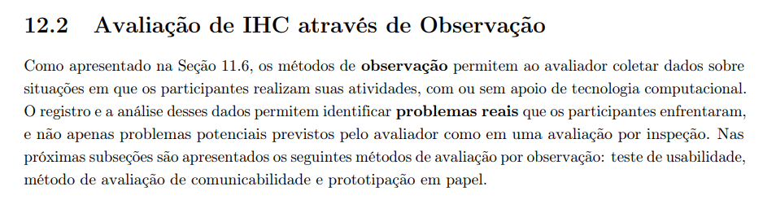
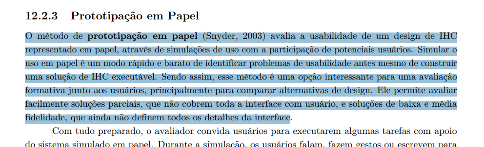
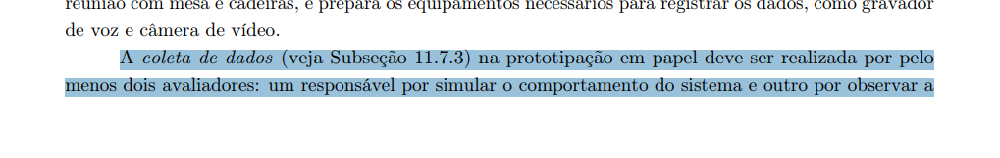
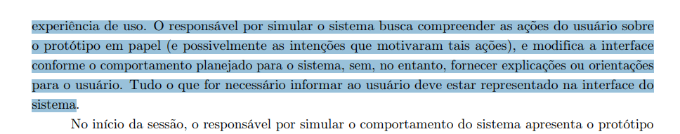

## Tabela de contribuição
| Data       | Contribuição                                                                 | Autor(es)   | Revisor(es) |
| ---------- | ---------------------------------------------------------------------------- | ----------- | ----------- |
| 31/10/2026 | Criação da página                                                            | Lucas Sales | A definir   |
| 03/11/2026 | Adição do relato de resultados para o objetivo de comunicação entre usuários | Lucas Sales | A definir   |
| 03/11/2026 | Adição do relato de resultados para o agendamento de reunião com o coordenador do curso | João Paulo da Silva Pereira | A definir   |

## Relato dos resultados - Comunicação entre usuário(s)

O relato dos resultados, seguirá os passos descritos no [planejamento do relato da avaliação do protótipo de papel](../prototipo_papel/planejamento_relato_prototipo_papel.md), o qual também segue a estrutura definida por Barbosa e Silva (2021).

A gravação da avaliação do protótipo de papel, está disponível [neste link.](https://youtu.be/1huioQh2BaA)

### Objetivos da avaliação

Barbosa e Silva (2021), propõem 4 objetivos para realizar uma avaliação de IHC e perguntas específicas relacionadas a cada um deles, para decidir os objetivos da avaliação do protótipo de papel, foram analisados estes objetivos e suas perguntas, que estão descritos no [Planejamento da avaliação do protótipo de papel](./planejamento_prototipo_papel.md)

Em suma, para o protótipo de papel, que representa um protótipo de baixa fidelidade do produto, foi aplicada uma atualização da funcionalidade de gravação de áudio, originalmente disponível apenas em aplicativo mobile do Microsoft Teams, neste protótipo, a funcionalidade estará disponível em ambiente web e desktop, os quais compartilham elementos de layout, design e interação.

Como o usuário irá interagir com o protótipo, o autor Lucas Sales escolhe analisar nesta avaliação, o objetivo de **Problemas na interação e interface** para coletar dados a respeito de se o usuário consegue entender o design, as operações e consegue realizar a tarefa, mesmo em um protótipo de baixa fidelidade.

### Método de prototipação em papel

O método utilizado para a coleta de dados foi a prototipação em papel, este é um método de observação, tais métodos permitem ao avaliador coletar dados sobre situações em que os participantes realizam suas atividades, com ou sem apoio de tecnologia computacional (Barbosa e Silva, 2021).

A prototipação em papel, avalia a usabilidade de um design de IHC representado em papel, simulando o uso do produto com a participação de potenciais usuários, uma das características do método, é ser rápido e barato, além de a solução ser construída juntamente do usuário no processo de avaliação.

Foram construídos protótipos do sistema em papel com a atualização da funcionalidade definida nos [Objetivos da avaliação de IHC](../../nivel_2/prototipo_papel/planejamento_prototipo_papel.md/#objetivos-da-avaliacao-do-prototipo-de-papel-comunicacao-entre-usuarios), o usuário terá de realizar a tarefa de enviar uma mensagem de voz por um sistema web ou desktop do produto Microsoft Teams.

Como requisito do método de prototipação em papel, descrito por Barbosa e Silva (2021), a aplicação do método foi realizada com a presença de dois avaliadores, um simulando o sistema e o outro realizando a observação do usuário e registrando por meio de anotações as respostas do mesmo, visando obter dados suficientes para responder as [perguntas estabelecidas](../../planejamento_prototipo_papel.md/#perguntas-a-serem-respondidas-na-avaliacao-comunicacao-entre-usuarios).

**Fonte:**

Conteúdo de Barbosa e Silva (2021), páginas 288, 303, 304 e 305:

Figura 3 - Método de observação 

Figura 4 - Prototipação em papel 

Figura 5 - Quantidade de avaliadores 

Figura 6 - Quantidade de avaliadores 

### O número e o perfil de avaliadores e dos participantes

Para realizar a coleta de dados, como o próprio método descreve na [figura 5](#figura-5) dois avaliadores estiveram presentes, os alunos Lucas Sales Ribeiro (observador) e João Paulo (Simulador do sistema). Apenas um participante foi entrevistado, realizando a tarefa designada, descrita mais abaixo.

| #   | Pergunta                                                                                                                     | Resposta                                                                                                                                                                                                                                        |
| --- | ---------------------------------------------------------------------------------------------------------------------------- | ----------------------------------------------------------------------------------------------------------------------------------------------------------------------------------------------------------------------------------------------- |
| 1   | Qual seu sexo?                                                                                                               | Masculino                                                                                                                                                                                                                                       |
| 2   | Qual sua idade em anos?                                                                                                      | 18 - 40                                                                                                                                                                                                                                         |
| 3   | Qual sua formação?                                                                                                           | Estudante                                                                                                                                                                                                                                       |
| 4   | Possui dificuldade com informação impressa?                                                                                  | Não                                                                                                                                                                                                                                             |
| 5   | Possui experiência com textos complexos?                                                                                     | Sim                                                                                                                                                                                                                                             |
| 6   | Está disposto(a) a ler textos como manuais ou ebooks ao utilizar produtos como o Microsoft Teams?                            | Não                                                                                                                                                                                                                                             |
| 7   | Prefere aprender com outras pessoas, ou aprender fazendo?                                                                    | Prefiro aprender fazendo                                                                                                                                                                                                                        |
| 8   | Qual seu cargo atual?                                                                                                        | Operador de combustível de aeronaves                                                                                                                                                                                                            |
| 9   | Possui quanto tempo de experiência nesse cargo em anos?                                                                      | Menos de 1                                                                                                                                                                                                                                      |
| 10  | Possui quanto tempo na empresa atual em anos?                                                                                | Menos de 1                                                                                                                                                                                                                                      |
| 11  | Quais suas principais responsabilidades?                                                                                     | Seguir os procedimentos de abastecimento e as normas da ANAC; verificar o tipo de combustível correto; fazer os testes de controle de qualidade; registrar as inspeções diárias do equipamento; manter a limpeza e a integridade do equipamento |
| 12  | Possui plano de carreira?                                                                                                    | Não                                                                                                                                                                                                                                             |
| 13  | Quais cargos já trabalhou antes?                                                                                             | Estagiário de administração                                                                                                                                                                                                                     |
| 14  | Aproximadamente quantas pessoas trabalham na empresa onde você atua?                                                         | Não sei informar                                                                                                                                                                                                                                |
| 15  | Qual a sua área de atuação?                                                                                                  | Estudante de engenharia automotiva                                                                                                                                                                                                              |
| 16  | O quanto você acredita que treinamento é valioso?                                                                            | Muito valioso                                                                                                                                                                                                                                   |
| 17  | Qual estilo de aprendizado você prefere?                                                                                     | Visual, Leitura/Escrita, Prática                                                                                                                                                                                                                |
| 18  | Na sua rotina de trabalho atual, você conseguiria investir tempo para aprender a utilizar um produto como o Microsoft Teams? | Não                                                                                                                                                                                                                                             |
| 19  | Qual seu domínio com computadores?                                                                                           | Domínio completo                                                                                                                                                                                                                                |
| 20  | Quanto tempo de experiência em anos, você tem com computadores?                                                              | 20+                                                                                                                                                                                                                                             |
| 21  | Quais sistemas operacionais de computadores conhece?                                                                         | Windows, Linux/Ubuntu, Mac OS                                                                                                                                                                                                                   |
| 22  | Quais sistemas operacionais de computadores utiliza?                                                                         | Windows                                                                                                                                                                                                                                         |
| 23  | Quais dispositivos utiliza no dia a dia?                                                                                     | Smartphones, Notebook/Laptop, Computador de mesa                                                                                                                                                                                                |

### Tarefas executadas pelos participantes

Para a coleta de dados do protótipo de papel, foi solicitado ao participante realizar a tarefa de se **comunicar com outro usuário, por meio de mensagem de voz**, simulando o aplicativo Microsoft Teams em ambiente web/desktop. Foi considerado no protótipo que o login na plataforma já havia sido realizado e que o participante deve apenas enviar uma mensagem de áudio para um dos usuários que houve interação recente, para evitar o fluxo de pesquisa de um usuário.

O passo a passo realizado pelo participante foi:

1. Selecionou uma conversa recente, com a usuária Maria.
2. Foi selecionado o ícone de microfone para iniciar a gravação de áudio.
3. O participante enunciou a mensagem.
4. Selecionou o ícone de quadrado vermelho, para encerrar a gravação de áudio.
5. Selecionou o ícone de triângulo apontado para a direita *(play)* para escutar o próprio áudio antes do envio.
6. Selecionou o ícone de seta para a direita para enviar a mensagem de áudio.

### Perguntas respondidas na avaliação

**1. O usuário consegue operar o sistema?**
Sim.
**2. Ele atinge seu objetivo? Com quanta eficiência? Em quanto tempo? Após cometer quantos erros?**
O participante atingiu o objetivo sem problemas diversos. 
Em aproximadamente 2 minutos.
Nenhum erro foi cometido.
**3. Ele entende o que significa e para que serve cada elemento da interface?**
O participante demonstrou domínio dos elementos da interface.
**4. Ele vai entender o que deve fazer em seguida?**
O participante conseguiu seguir o fluxo esperado sem demonstrar dificuldades.
**5. Que problemas de IHC dificultam ou impedem o usuário de alcançar seus objetivos?**
Nenhum problema de IHC foi encontrado na avaliação.
**6. Onde esses problemas se manifestam?**
Não se aplica.
**7. Com que frequência tendem a ocorrer?**
Não se aplica.
**8. Qual é a gravidade desses problemas?**
Não se aplica.
**9. Quais barreiras o usuário encontra para atingir seus objetivos?**
Nenhuma barreira foi observada ou mencionada pelo usuário.

### Problemas de usabilidade corrigidos durante a avaliação

O participante não demonstrou dificuldade em operar o protótipo, desta forma, não foi necessária nenhuma correção durante a avaliação.

### Problemas de usabilidade não corrigidos

Nenhum problema de usabilidade foi apontado pelo participante durante todo o ciclo da avaliação, desta forma, nesta avaliação, não houveram problemas a serem corrigidos.

## Relato dos resultados - Agendamento de reunião com o coordenador do curso

O relato dos resultados segue os passos descritos no [planejamento do relato da avaliação do protótipo de papel](../prototipo_papel/planejamento_relato_prototipo_papel.md), o qual também segue a estrutura definida por Barbosa e Silva (2021).

A gravação da validação do protótipo de papel do agendamento está disponível [neste link.](https://youtu.be/BYcVsZbYZR0) A gravação do teste piloto está no [planejamento da avaliação](./planejamento_prototipo_papel.md).

### Objetivos da avaliação

Os objetivos e perguntas estão descritos no [Planejamento da avaliação do protótipo de papel](./planejamento_prototipo_papel.md/#objetivos-da-avaliacao-do-prototipo-de-papel-agendamento-de-reuniao-com-o-coordenador-do-curso).

Em suma, o protótipo de papel, que representa um protótipo de baixa fidelidade do produto, mostra o reprojeto do agendamento de uma reunião entre o estudante e o coordenador do curso no Microsoft Teams. Como o usuário interage com o protótipo, o autor João Paulo escolhe analisar nesta avaliação o objetivo de **Problemas na interação e interface**, para coletar dados sobre se o usuário consegue entender o design, as operações e realizar a tarefa, mesmo em um protótipo de baixa fidelidade.

### Método de prototipação em papel

O método utilizado para a coleta de dados foi a prototipação em papel, um método de observação que permite ao avaliador coletar dados sobre situações em que os participantes realizam suas atividades (Barbosa e Silva, 2021). Foram construídas as folhas e as peças em papel do agendamento, mostradas na [Figura 1 do planejamento](./planejamento_prototipo_papel.md), e a aplicação do método foi realizada com dois avaliadores, um simulando o sistema e o outro observando e registrando as respostas do participante, com *think aloud* e entrevista pós-teste, para responder as [perguntas estabelecidas](./planejamento_prototipo_papel.md/#perguntas-a-serem-respondidas-na-avaliacao-agendamento-de-reuniao-com-o-coordenador-do-curso).

### O número e o perfil de avaliadores e dos participantes

Dois avaliadores estiveram presentes, os alunos Lucas Sales Ribeiro e João Paulo. João Paulo conduziu a sessão (explicou o termo de consentimento, fez as perguntas de perfil e a entrevista final) [PREENCHER: confirmar quem simulou o sistema e quem observou]. Apenas um participante do Perfil 1 (Estudante) foi entrevistado, identificado por letra (Participante A). A gravação completa da sessão tem 3 minutos e 26 segundos e inclui a explicação inicial, a tarefa e as considerações finais.

| #   | Pergunta                        | Resposta             |
| --- | ------------------------------- | -------------------- |
| 1   | Qual seu semestre?              | Primeiro semestre    |
| 2   | Já usou o Microsoft Teams?      | Sim                  |

Antes da tarefa, o participante assinou o termo de consentimento e foi informado de que poderia parar a qualquer momento, de que a avaliação era do protótipo e não dele, e de que deveria pensar em voz alta (*think aloud*).

### Tarefas executadas pelos participantes

Foi solicitado ao participante **marcar uma reunião de 30 minutos com o coordenador do curso, na quinta-feira, dia 29**, simulando o Microsoft Teams, com os dados fictícios do protótipo (coordenador Carlos Menezes). Foi considerado que o login já havia sido realizado.

O passo a passo realizado pelo participante foi:

1. Foi ao Calendário e selecionou o botão "Nova reunião".
2. Na lista de sugestões, com duas pessoas (coordenador e secretaria), escolheu o coordenador, Carlos.
3. Consultou a disponibilidade, viu que o coordenador estava livre às 11h e escolheu esse horário, com 30 minutos de duração.
4. Informou o assunto: um estágio.
5. Enviou o convite.
6. Viu o status do convite mudar de pendente para aceito e concluiu que a reunião estava marcada.

### Perguntas respondidas na avaliação

**1. O usuário consegue operar o sistema?**
Sim. O participante operou o protótipo sem ajuda dos avaliadores.
**2. Ele atinge seu objetivo? Com quanta eficiência? Em quanto tempo? Após cometer quantos erros?**
O participante atingiu o objetivo: enviou o convite ao coordenador, no horário livre (11h) e com 30 minutos de duração, e viu a reunião marcada. Nenhum erro foi observado (não escolheu a secretaria nem um horário ocupado). A gravação completa tem 3 minutos e 26 segundos, incluindo a explicação inicial e a entrevista final [PREENCHER: tempo apenas da tarefa, medido no vídeo].
**3. Ele entende o que significa e para que serve cada elemento da interface?**
Sim. O participante entendeu o botão "Nova reunião", a lista de sugestões (coordenador e secretaria), a disponibilidade ("ele está livre às 11 horas"), a duração, o campo de assunto e o status do convite ("estava pendente, mas aí passou").
**4. Ele vai entender o que deve fazer em seguida?**
Sim. Depois de enviar, acompanhou o status do convite e concluiu: "já tem uma reunião marcada".
**5. Que problemas de IHC dificultam ou impedem o usuário de alcançar seus objetivos?**
Um problema na entrada da tarefa: o participante disse que, ao pensar em marcar uma reunião, o primeiro pensamento não foi ir ao Calendário, e sim a uma área de reuniões. Segundo ele, o Calendário lembra "tempos livres", e não "fazer coisas dentro do Calendário". O problema não impediu a tarefa.
**6. Onde esses problemas se manifestam?**
Na tela inicial (Calendário), no primeiro passo da tarefa (nó 1.1 da HTA, "Abrir o Calendário e acionar Nova reunião").
**7. Com que frequência tendem a ocorrer?**
Apareceu com 1 de 1 participante, na fala da entrevista final. Com uma só sessão, é tratado como indício.
**8. Qual é a gravidade desses problemas?**
Pequena (2, na escala de 1 a 3), pois não impediu a tarefa, mas pode atrasar quem procura outro caminho [PREENCHER: confirmar a severidade com Lucas na interpretação].
**9. Quais barreiras o usuário encontra para atingir seus objetivos?**
Nenhuma barreira impediu o objetivo. A única dificuldade apontada foi a expectativa de iniciar a tarefa por uma área de reuniões, e não pelo Calendário.

### Problemas de usabilidade corrigidos durante a avaliação

O participante concluiu a tarefa sem ajuda e, pela gravação, o protótipo não foi alterado durante a sessão. Desta forma, não houve problema corrigido durante a avaliação.

### Problemas de usabilidade não corrigidos

| ID  | Local                          | Fator de usabilidade prejudicado                         | Descrição e justificativa                                                                                                                              | Prioridade | Sugestão de correção                                                                                                       |
| --- | ------------------------------ | -------------------------------------------------------- | ------------------------------------------------------------------------------------------------------------------------------------------------------ | ---------- | -------------------------------------------------------------------------------------------------------------------------- |
| P01 | Tela inicial, nó 1.1 da HTA    | Facilidade de aprendizado; correspondência com a expectativa do usuário | O participante esperava começar por uma área de reuniões, e não pelo Calendário, que associa a "tempos livres". Concluiu a tarefa, mas disse que o primeiro pensamento não foi ir ao Calendário. | 2          | Oferecer também uma entrada pela área de reuniões ou pela conversa com o coordenador ("Marcar reunião", nó 1.2 da HTA). |

Indicação de parte do sistema que pode ser mais bem elaborada: a entrada da tarefa, isto é, o local onde o botão de nova reunião aparece. Na análise de tarefas do Nível 1, o participante disse que olharia primeiro o Calendário, ou seja, as expectativas divergem entre participantes e a entrada pela conversa e pela área de reuniões deve ser avaliada em novas sessões.

## Referência bibliográfica:

1.  Barbosa, S. D. J.; Silva, B. S. da; Silveira, M. S.; Gasparini, I.; Darin, T.; Barbosa, G. D. J.
(2021) **Interação Humano-Computador e Experiência do usuário.** Autopublicação.

## Histórico de versão
| Versão | Data       | Descrição                                                                    | Autor(es)   | Revisor(es) |
| ------ | ---------- | ---------------------------------------------------------------------------- | ----------- | ----------- |
| `1.0`  | 31/10/2026 | Criação da página.                                                           | Lucas Sales |             |
| `1.1`  | 03/11/2026 | Adição do relato de resultados para o objetivo de comunicação entre usuários | Lucas Sales |             |
| `1.2`  | 03/11/2026 | Adição do relato de resultados do agendamento de reunião com o coordenador   | João Paulo  |             |
