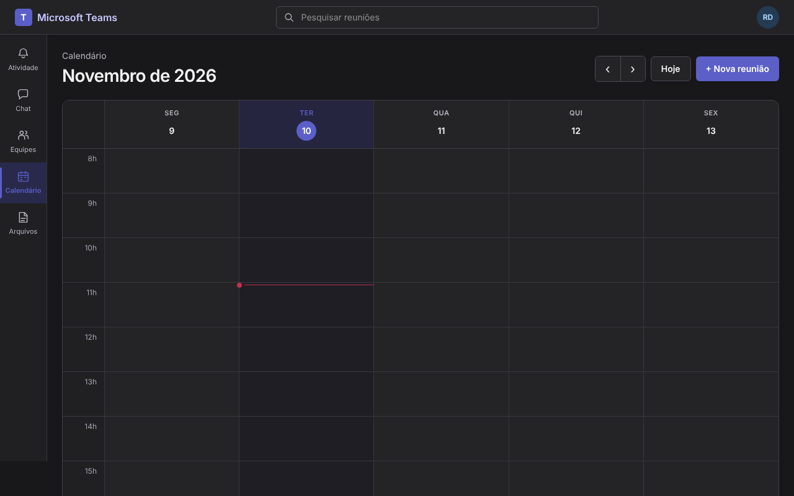
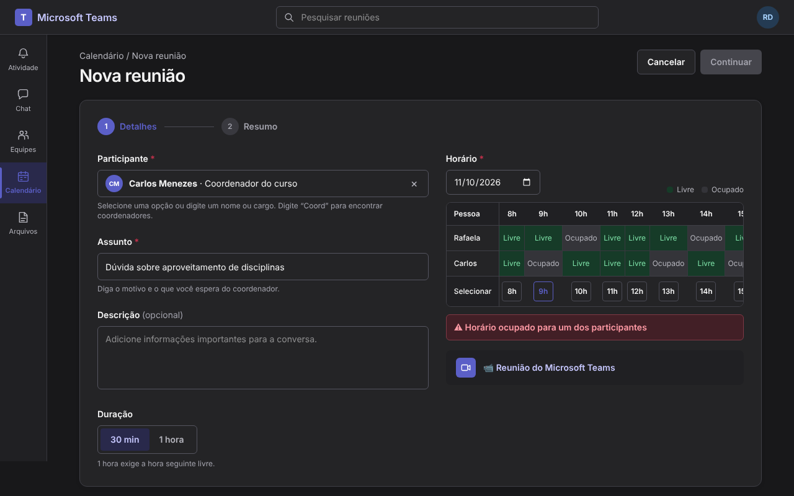
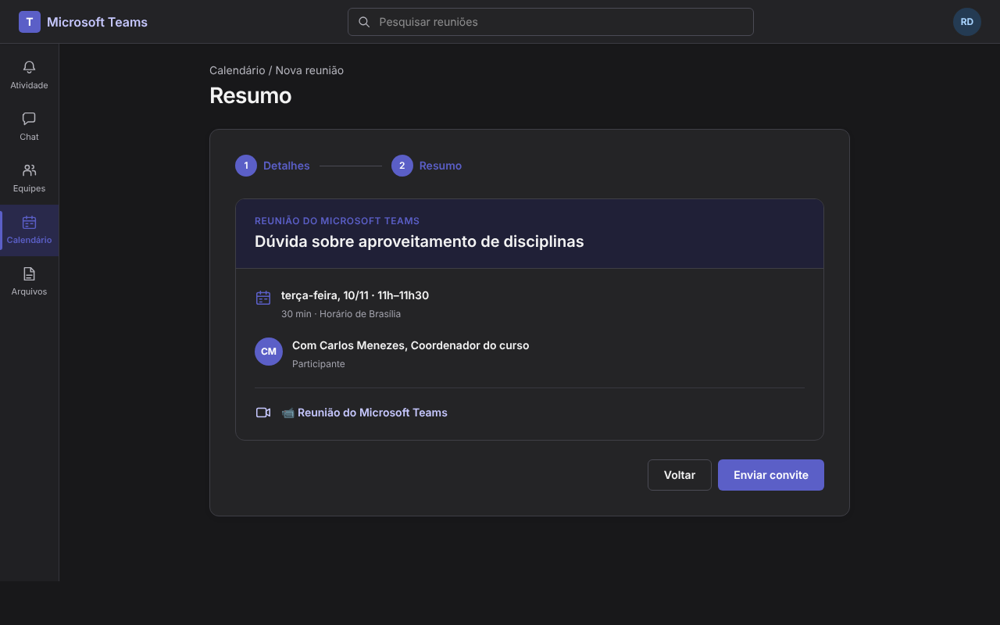
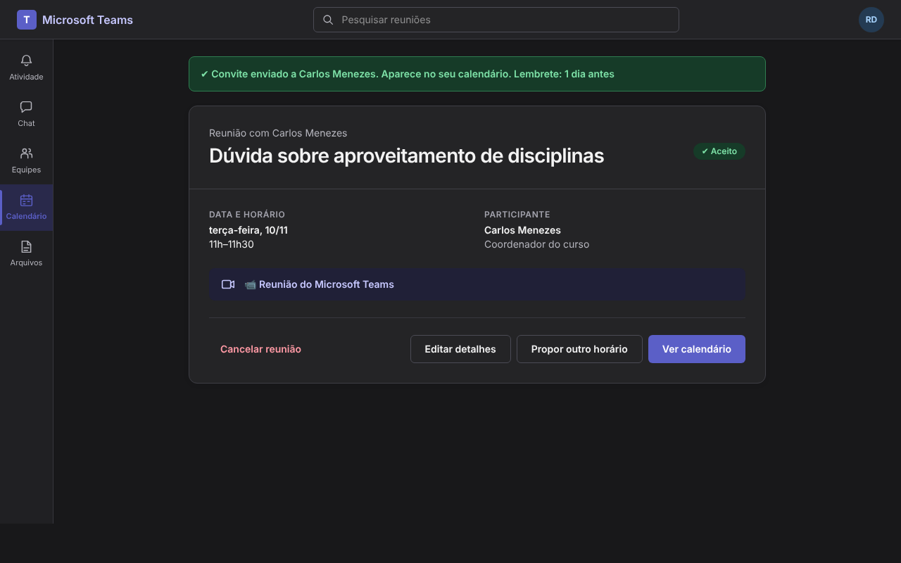

## Tabela de contribuição

| Data       | Contribuição                                                                                                  | Autor(es)                   | Revisor(es) |
| ---------- | ------------------------------------------------------------------------------------------------------------- | --------------------------- | ----------- |
| 14/11/2026 | Criação da página, com o relato individual do protótipo de alta fidelidade do agendamento de reunião com o coordenador | João Paulo da Silva Pereira | A definir   |

# João Paulo da Silva Pereira - IHC - Microsoft Teams

> **Relato individual do protótipo de alta fidelidade (Nível 3).** Funcionalidade: agendamento de reunião com o coordenador do curso (Perfil 1, Estudante). Segue o DECIDE e a estrutura de Barbosa e Silva (2021). O planejamento está em [Planejamento da avaliação](./planejamento_teste_usabilidade_joao_paulo.md) e [Planejamento do relato](./planejamento_relato_resultados_teste_usabilidade_joao_paulo.md).

---

## 1. Identificação do integrante e escopo de atuação

**Tabela 1 - Escopo de atuação**

| Atributo      | Descrição                                                                                                                  |
| ------------- | -------------------------------------------------------------------------------------------------------------------------- |
| Responsável   | João Paulo da Silva Pereira                                                                                                |
| Protótipo     | [https://player-schema-84676242.figma.site/](https://player-schema-84676242.figma.site/)                                                                                   |
| Perfil        | Perfil 1: Estudante de graduação da FCTE/UnB                                                                               |
| Cenário       | Uma estudante com dúvida sobre aproveitamento de disciplinas precisa falar com o coordenador antes da matrícula             |
| Tarefa        | Marcar uma reunião de 30 minutos com o coordenador do curso, na quinta-feira, e conferir se ele aceitou                    |
| Artefato      | Protótipo digital de alta fidelidade publicado como site (Figma), com a interface do Microsoft Teams e dados fictícios                    |
| Método        | Teste de usabilidade presencial com *Think-Aloud* e entrevista pós-teste                                                   |
| Inspeção      | Autoinspeção com lista de verificação baseada em Nielsen (1993)                                                            |
| Participantes | 3 reais do Perfil 1 (A, B e C), mais 1 piloto descartado                                                            |

---

## 2. Apresentação do protótipo de alta fidelidade

O protótipo evolui o protótipo de papel (Nível 2) e imita a interface do Teams (barra superior, menu lateral, tema escuro e roxo #5b5fc7). Foi feito no Figma Make e publicado como site. Os dados são fictícios (estudante Rafaela Duarte, coordenador Carlos Menezes, secretaria Carla Coordenadoria).

**Tabela 2 - Rastreabilidade Nível 2 para Nível 3**

| Achado do papel | Descrição                                                                           | Tratamento no protótipo digital                                                                          |
| --------------- | ----------------------------------------------------------------------------------- | -------------------------------------------------------------------------------------------------------- |
| VAL-AG01        | Lista de sugestões com nome e cargo evitou confundir coordenador e secretaria        | Mantida: lista de sugestões com iniciais, nome e cargo (dica "Digite Coord")                                                      |
| VAL-AG02        | Disponibilidade dos dois levou a um horário livre, sem conflito                      | Mantida: tabela Livre/Ocupado, com aviso "Horário ocupado para um dos participantes"                      |
| VAL-AG03        | Status do convite mostrou que a reunião estava marcada                               | Mantida: chip Pendente, que passa a "✔ Aceito" (simulado), e botão "Propor outro horário"                           |
| OPO-AG01        | Participante esperava começar por uma área de reuniões, e não pelo Calendário        | **Não implementada**: o protótipo só tem a entrada pelo Calendário, e o item Chat do menu não leva à conversa com o coordenador. A entrada pela conversa (REP-01) fica como ponto a observar no teste |

### 2.1 Tela 1 - Calendário

Grade semanal com navegação entre semanas, botão "Hoje" e botão "+ Nova reunião". A reunião enviada aparece depois na grade.

Figura 1 - Tela 1 do protótipo: Calendário

Autor - João Paulo da Silva Pereira

### 2.2 Tela 2 - Nova reunião

Etapa 1 de 2 (Detalhes). Participante com sugestões (nome e cargo), assunto com a dica "Diga o motivo e o que você espera do coordenador.", descrição opcional, duração de 30 min ou 1 hora e, à direita, a tabela de disponibilidade dos dois com a linha "Selecionar". A figura mostra o aviso "Horário ocupado para um dos participantes" ao tocar num horário ocupado.

Figura 2 - Tela 2 do protótipo: Nova reunião

Autor - João Paulo da Silva Pereira

### 2.3 Tela 3 - Resumo

Etapa 2 de 2 (Resumo). Resumo da reunião e botão "Enviar convite".

Figura 3 - Tela 3 do protótipo: Resumo

Autor - João Paulo da Silva Pereira

### 2.4 Tela 4 - Reunião com status

Confirmação "Convite enviado… Aparece no seu calendário. Lembrete: 1 dia antes", status do convite (Pendente, depois Aceito) e os botões "Cancelar reunião", "Editar detalhes", "Propor outro horário" e "Ver calendário".

Figura 4 - Tela 4 do protótipo: Reunião com status

Autor - João Paulo da Silva Pereira

---

## 3. Autoinspeção analítica prévia

**Tabela 3 - Lista de verificação (Nielsen, 1993)**

| #   | Critério                                                                            | Atende  |
| --- | ----------------------------------------------------------------------------------- | ------- |
| 1   | Consistência: textos e botões iguais em todas as telas e iguais ao protótipo de papel | Sim     |
| 2   | Visibilidade do estado do sistema: confirmação do envio e status do convite          | Sim     |
| 3   | Controle e liberdade: "Cancelar", "Voltar", "Editar detalhes" e "Cancelar reunião"   | Sim     |
| 4   | Correspondência com o mundo real: aparência e termos do Teams                        | Sim     |
| 5   | Prevenção de erros: horário ocupado é bloqueado com aviso                            | Sim     |
| 6   | Acesso pela conversa com o coordenador (OPO-AG01)                                    | Não     |

---

## 4. Teste piloto

| Item     | Descrição                                                   |
| -------- | ----------------------------------------------------------- |
| Data     | 11/11/2026                                                  |
| Duração  | 2min02s                                                     |
| Local    | Remoto, em reunião do Teams gravada, com compartilhamento de tela do site do protótipo |
| Vídeo    | [https://youtu.be/BnJXBjhV1T4](https://youtu.be/BnJXBjhV1T4) |
| Ajustes  | Nenhum: o protótipo não mudou depois do piloto              |

No piloto, o próprio autor percorreu o fluxo completo: abriu "Nova reunião", escolheu o coordenador Carlos Menezes, preencheu assunto e descrição, escolheu o dia e o horário (segunda-feira, 16/11, às 11h), conferiu o resumo, enviou o convite, viu o status "Aceito" e a reunião no calendário, e notou os botões "Cancelar reunião", "Editar detalhes" e "Propor outro horário". O fluxo funcionou do início ao fim.

Os dados do piloto foram descartados, conforme Barbosa e Silva (2021).

---

## 5. Avaliação empírica com usuários reais

### 5.1 Protocolo ético

Os participantes receberam o TCLE verbal, registrado em vídeo. Eles são identificados só por letra (Participante A, B...).

**Tabela 4 - Participantes**

| Participante | Perfil                         | Experiência com o Teams | Data da sessão | Duração   |
| ------------ | ------------------------------ | ----------------------- | -------------- | --------- |
| A            | Estudante da UnB (Perfil 1)    | Já usa o Teams          | 12/11/2026     | 2min27s (duração do vídeo) |
| B            | Estudante da UnB (Perfil 1)    | Já usa o Teams          | 12/11/2026     | 2min51s (duração do vídeo) |
| C            | Estudante da UnB (Perfil 1)    | Já usa o Teams          | 12/11/2026     | 3min04s (duração do vídeo) |

### 5.2 Registro das sessões

**Tabela 5 - Vídeos das sessões**

| Participante | Vídeo 1 (reação do participante)                           | Vídeo 2 (tela do computador)                               |
| ------------ | ---------------------------------------------------------- | ---------------------------------------------------------- |
| A            | [https://youtu.be/1tqsTU8mZqk](https://youtu.be/1tqsTU8mZqk) | [https://youtu.be/PMB1sAvfChI](https://youtu.be/PMB1sAvfChI) |
| B            | [https://youtu.be/nZUtAAEzQXs](https://youtu.be/nZUtAAEzQXs) | [https://youtu.be/t7nB3OYuvyY](https://youtu.be/t7nB3OYuvyY) |
| C            | [https://youtu.be/meAwtltAatg](https://youtu.be/meAwtltAatg) | [https://youtu.be/mdpM_tNhOhs](https://youtu.be/mdpM_tNhOhs) |

O vídeo 1 de cada participante mostra a reação dele durante a sessão (câmera na mesa, com o moderador). O vídeo 2 mostra a tela do computador, com os cliques e o fluxo no protótipo.

### 5.3 Desempenho por participante

As tabelas resumem o que cada participante fez e disse em voz alta (*Think-Aloud*), a partir das transcrições das gravações. O tempo de cada sessão é a duração da gravação (A: 2min27s, B: 2min51s, C: 3min04s). Ela inclui a apresentação do moderador e a entrevista, então o tempo só da tarefa é menor. Com as gravações de tela, o tempo da tarefa, do clique em "Nova reunião" (ou do início da gravação, no A) até o status "Aceito", foi de cerca de 1min10s no participante A, 1min38s no B e 1min02s no C.

**Tabela 6 - Participante A** (vídeo de 2min27s)

| Etapa (HTA)                    | Ação e fala observadas                                                                              | Resultado |
| ------------------------------ | --------------------------------------------------------------------------------------------------- | --------- |
| Abrir nova reunião (1)         | A gravação da tela já começa na tela "Nova reunião", com o campo Participante aberto                | Sem ajuda |
| Escolher coordenador (2)       | Abriu a lista de sugestões (nome e cargo de 5 pessoas) e escolheu "Carlos Menezes, que é o coordenador do curso" | Sem ajuda |
| Escolher horário e duração (3) | Consultou a disponibilidade ("deixa eu ver o dia que eu estou livre"). Clicou num horário ocupado, viu o aviso "Horário ocupado para um dos participantes", e escolheu terça-feira, 12h às 12h30. Manteve 30 minutos | Sem ajuda; corrigiu sozinho |
| Escrever o assunto (4)         | Assunto "Estágio" e descrição "Vagas"                                                               | Sem ajuda |
| Revisar e enviar (5)           | Clicou em Continuar, leu o resumo (terça-feira, dia 10, com Carlos Menezes) e enviou o convite      | Sem ajuda |
| Conferir o status (6)          | Abriu o convite e viu que "foi aceito"                                                              | Sem ajuda |

Na entrevista, o participante disse que não teve problema nenhum e não quis acrescentar nada.

**Tabela 7 - Participante B** (vídeo de 2min51s)

| Etapa (HTA)                    | Ação e fala observadas                                                                                                                                                            | Resultado |
| ------------------------------ | --------------------------------------------------------------------------------------------------------------------------------------------------------------------------------- | --------- |
| Abrir nova reunião (1)         | Foi direto ao botão "Nova reunião" ("eu vou em nova reunião, nesse botão")                                                                                                        | Sem ajuda |
| Escolher participante (2)      | Hesitou com os campos ("e agora tem sobre editar o cargo, né?"). Escolheu na lista **Paulo Ribeiro, Professor orientador**, e não o coordenador Carlos Menezes, apesar de a instrução ser marcar com o coordenador. Ele não comentou o motivo | Concluiu com outra pessoa |
| Escolher horário e duração (3) | Escolheu 1 hora. Tentou um horário e não funcionou ("espera aí, eu tenho que clicar"). O aviso "Horário ocupado para um dos participantes" ficou na tela por cerca de 30 segundos. Ele percebeu que "os dois têm que estar livres", voltou para 30 minutos e escolheu terça-feira, das 9h às 9h30 | Concluiu, com dificuldade |
| Escrever o assunto (4)         | Assunto "Novo método de ensino na UnB" e descrição "Vamos discutir" | Sem ajuda |
| Revisar e enviar (5)           | Clicou em Continuar e em Enviar convite                                                                                                                                           | Sem ajuda |
| Conferir o status (6)          | Esperou o aceite ("beleza, aceitou"), foi ao calendário e viu a reunião das 9h às 9h30 | Sem ajuda |

Na entrevista, o participante disse que a única dificuldade foi marcar o horário "porque não estava indo, de uma hora".

**Tabela 8 - Participante C** (vídeo de 3min04s)

| Etapa (HTA)                    | Ação e fala observadas                                                                                                         | Resultado |
| ------------------------------ | ------------------------------------------------------------------------------------------------------------------------------ | --------- |
| Abrir nova reunião (1)         | Clicou em "Nova reunião" e descreveu os campos: participante, assunto, descrição e horários livres                              | Sem ajuda |
| Escolher coordenador (2)       | Escolheu Carlos Menezes                                                                                                        | Sem ajuda |
| Escolher horário e duração (3) | Escolheu 8h ("os dois aqui que eu não tenho aula") e 30 minutos ("vai ser rapidinho")                                          | Sem ajuda |
| Escrever o assunto (4)         | Assunto "Novo cronograma" e descrição "Conversar com o coordenador"                                                                              | Sem ajuda |
| Revisar e enviar (5)           | Continuou e revisou o resumo ("terça-feira, 8 horas, 8h30, com o coordenador do curso Carlos Menezes. Perfeito"). Enviou o convite | Sem ajuda |
| Conferir o status (6)          | Viu o convite no calendário, o lembrete de um dia antes e notou que dá para editar o horário                                   | Sem ajuda |

**Tabela 9 - Entrevista pós-teste (Participante C)**

| Pergunta                                          | Resposta                                                                                           |
| ------------------------------------------------- | -------------------------------------------------------------------------------------------------- |
| Dificuldade no site?                              | Nenhuma                                                                                            |
| Fácil de usar e de entender?                      | "Muito tranquilo, bem tudo especificado, várias vezes o passo confirmando". Já usa o Teams, o que facilitou |
| Realizou a tarefa sem dificuldade?                | Sim                                                                                                |
| Botões e funções intuitivos?                      | "Bem intuitivos"                                                                                   |
| Teve dúvida sobre o que fazer?                    | Em nenhum momento                                                                                  |
| Sentiu falta de alguma funcionalidade?            | Talvez a localização onde o coordenador se encontra (não precisa ser dentro do Teams)               |
| Tempo adequado?                                   | "Bem adequado, foi rápido"                                                                         |

---

## 6. Relato dos resultados (Barbosa e Silva, 2021, p. 309)

**6.1 Objetivos:** avaliar a apropriação da tecnologia, comparar com o protótipo de papel e identificar problemas.
**6.2 Escopo:** as quatro telas do protótipo e a tarefa de marcar a reunião com o coordenador.
**6.3 Método:** teste presencial, *Think-Aloud* (Ericsson e Simon, 1993), entrevista pós-teste e piloto.
**6.4 Critérios:** heurísticas de Nielsen, metas de usabilidade (ISO/IEC 9241-11) e a rastreabilidade com o protótipo de papel.
**6.5 Avaliadores:** um moderador, um observador e 3 participantes.
**6.6 Resultados e limitações:**

Nas sessões de 12/11/2026, os três participantes enviaram o convite e viram o status "Aceito", sem ajuda do moderador. Os participantes A e C marcaram com o coordenador. O participante B marcou com o professor orientador.

**Tabela 10 - Achados do teste de usabilidade** (severidade de Nielsen, de 0 a 4)

| Id       | Tipo        | Onde                     | Descrição                                                                                                                                  | Heurística                         | Severidade | Origem            |
| -------- | ----------- | ------------------------ | ------------------------------------------------------------------------------------------------------------------------------------------ | ---------------------------------- | ---------- | ----------------- |
| PRO-AG01 | Problema    | Tela 2, horário e duração | O participante B escolheu 1 hora e não conseguiu marcar o horário que queria, porque a hora seguinte estava ocupada. O aviso ficou cerca de 30 s na tela até ele trocar para 30 min | Prevenção de erros; visibilidade do estado | 2          | Participante B    |
| PRO-AG02 | Problema    | Tela 2, participante     | O participante B enviou o convite a Paulo Ribeiro (Professor orientador), e não ao coordenador. A lista mostra 5 pessoas e a dica "Digite Coord" é pequena. Não está claro se foi escolha ou confusão | Reconhecimento em vez de memorização | 2          | Participante B    |
| VAL-AG04 | Validado    | Tela 2, participante     | A lista com nome e cargo levou os participantes A e C ao Carlos Menezes sem confusão com a secretaria (o participante B escolheu outra pessoa, ver PRO-AG02)                                      | Reconhecimento em vez de memorização | n/a      | A e C             |
| VAL-AG05 | Validado    | Tela 2, disponibilidade  | A tabela dos dois levou B e C a horários livres para os dois ("os dois têm que estar livres")                                              | Visibilidade do estado do sistema  | n/a        | B e C             |
| VAL-AG06 | Validado    | Telas 3 e 4              | O resumo, a confirmação com lembrete de um dia antes e o status "Aceito" foram entendidos e citados em voz alta                           | Visibilidade do estado do sistema  | n/a        | A, B e C          |
| VAL-AG07 | Validado    | Tela 2, horário          | O participante A clicou num horário ocupado, entendeu o aviso "Horário ocupado para um dos participantes" e escolheu outro horário sozinho | Prevenção de erros                 | n/a        | Participante A    |
| SUG-AG01 | Sugestão    | Tela 3 ou 4              | O participante C sentiu falta da localização onde o coordenador se encontra                                                                | Correspondência com o mundo real   | 1          | Participante C    |

**Comparação com o protótipo de papel:** os problemas do papel (OPO-AG01, entrada pelo Calendário) não apareceram. Nas gravações em que o início é visível (B e C), os participantes foram direto ao botão "Nova reunião", sem procurar outra entrada. Como o protótipo não tem a entrada pela conversa, esse ponto não foi testado.

**Limitações:**
- Os dados são fictícios, o convite não é enviado de verdade e a resposta do coordenador é simulada.
- Foram 3 participantes, todos estudantes da UnB que já usam o Teams. A familiaridade pode ter facilitado a tarefa, e o resultado pode ser diferente para quem nunca usou.
- No participante C, o moderador deixou a escolha livre entre "coordenador ou professor", e o cenário não foi lido na íntegra como nas outras sessões.
- Só o participante C respondeu à entrevista completa. Os participantes A e B responderam a perguntas curtas.
- As transcrições são automáticas e têm trechos errados. Por isso, os horários e falas devem ser conferidos nos vídeos antes da entrega.

---

## 7. Referências

- BARBOSA, S. D. J. et al. Interação Humano-Computador e Experiência do Usuário. 2021.
- ERICSSON, K. A.; SIMON, H. A. Protocol Analysis. 1993.
- NIELSEN, J. Usability Engineering. 1993.
- KRUG, S. Rocket Surgery Made Easy. 2010.

---

## 8. Histórico de versões

| Versão | Data       | Descrição                                                    | Autor(es)                   |
| ------ | ---------- | ------------------------------------------------------------ | --------------------------- |
| 0.1    | 14/11/2026 | Estrutura da página e apresentação do protótipo digital      | João Paulo da Silva Pereira |
| 0.2    | 14/11/2026 | Desempenho dos participantes, achados e limitações a partir das transcrições | João Paulo da Silva Pereira |
