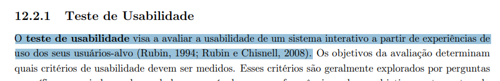
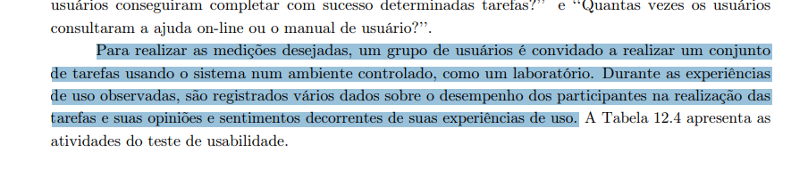
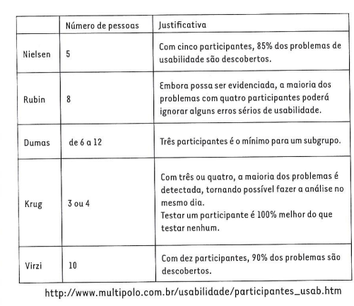
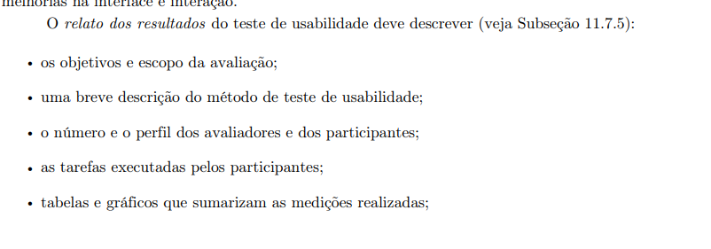
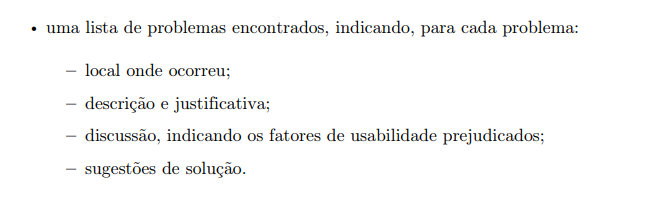

## Tabela de contribuição
| Data       | Contribuição                                                        | Autor(es)   | Revisor(es) |
| ---------- | ------------------------------------------------------------------- | ----------- | ----------- |
| 10/11/2026 | Criação da página                                                   | Lucas Sales | A definir   |
| 15/11/2026 | Adição do perfil dos participantes, resultados e lista de problemas | Lucas Sales | A definir   |

Segundo Barbosa e Silva (2021) após cada experiência de uso observada, os avaliadores se reúnem para realizar a atividade de interpretação. As anotações dos avaliadores sobre a experiência de uso, as entrevistas pré e pós-teste, e possivelmente o áudio e o vídeo gravados são analisados a fim de identificar problemas de usabilidade no protótipo de interface avaliado. O resultado dessa análise é uma lista de problemas na interface que devem ser corrigidos, além de indicações de partes do sistema que podem ser aperfeiçoadas.

São descritos inclusive que os avaliadores devem:

Para **Interpretação:**

- reunir, contabilizar e sumarizar os dados coletados dos participantes

Para o **Relato dos resultados:**

- Relatar a performance e a opinião dos participantes.

### Objetivos da avaliação

Barbosa e Silva (2021), propõem 4 objetivos para realizar uma avaliação de IHC e perguntas específicas relacionadas a cada um deles, para decidir os objetivos da avaliação do protótipo de alta fidelidade, foram analisados estes objetivos e suas perguntas, que estão descritos no [Planejamento da avaliação do teste de usabilidade](../planejamento_relato_resultados_teste_usabilidade.md)

Para o protótipo de alta fidelidade, foi aplicada uma atualização da funcionalidade de gravação de áudio, originalmente disponível apenas em aplicativo mobile do Microsoft Teams, neste protótipo, a funcionalidade estará disponível em ambiente web e desktop, os quais compartilham elementos de layout, design e interação. Para analisar a performance e opinião do usuário, foi aplicado o **teste de usabilidade**.

Como o usuário interage com o protótipo, o autor Lucas Sales escolheu analisar na avaliação, o objetivo de **Problemas na interação e interface** coletando dados a respeito de se o usuário consegue entender o design, as operações e consegue realizar a tarefa, em um protótipo de alta fidelidade.

### Método de teste de usabilidade

O método de avaliação foi o método de **observação por teste de usabilidade**, que, segundo Barbosa e Silva (2021), visa a avaliar a usabilidade de um sistema interativo a partir de experiências de uso dos seus usuários-alvo (RUBIN, 1994; RUBIN; CHISNELL, 2008).

Para realizar a coleta de dados, um grupo de usuários foi convidado a realizar tarefas no protótipo de alta fidelidade, em ambiente controlado. Durante a avaliação, foram observados e registrados dados sobre o desempenho dos participantes, a realização das tarefas, seus sentimentos e opiniões a respeito da experiência de uso.

**Fonte:**

Conteúdo de Barbosa e Silva (2021), página 288.

Figura 1 - Teste de usabilidade 

Figura 2 - Coleta de dados do teste de usabilidade 

### O número e o perfil de avaliadores e dos participantes

A avaliação contou com **3 participantes**, identificados no relato como **P1, P2 e P3**. O perfil dos participantes é o de estudantes de graduação da Faculdade de Ciências e Tecnologias em Engenharia (FCTE) da Universidade de Brasília (UnB), que utilizam o Microsoft Teams para realizar trabalhos em grupo e comunicações com professores e servidores da universidade. O recrutamento ocorreu dentro da própria universidade, sendo solicitado aos estudantes que participassem de uma rápida pesquisa para contribuir com o trabalho da disciplina.

Para esta avaliação, foi seguido o número de usuários propostos por Krug, que indica que com três ou quatro usuários é possível detectar a maioria dos problemas de usabilidade, como referenciado na [figura 3](#figura-3).

Por se tratar de poucas sessões, os resultados a seguir são tratados como indícios dos problemas de usabilidade, e não como dados estatísticos.

**Fonte:**

Conteúdo de MORAES; SANTA ROSA, 2010, página 157.

Figura 3 - Tabela de número de participantes de acordo com cada pesquisador. 

### As tarefas executadas pelos participantes

A comunicação entre usuários no Microsoft Teams pode acontecer de várias formas, dentre elas, reuniões, mensagens de texto via chat teams, envio de emojis, stickers e loop components. A funcionalidade analisada na avaliação, é a gravação de mensagem de voz, disponível apenas no aplicativo mobile do Microsoft Teams, no contexto da avaliação, a funcionalidade estará disponível em ambiente web e desktop.

Desta forma, a tarefa que o participante irá realizar, é a **gravação de áudio no Microsoft Teams, em ambiente web ou desktop**, consideraremos no protótipo que o login na plataforma já foi realizado e que o participante irá enviar uma mensagem de áudio para um dos usuários que houve interação recente, para evitar o fluxo de pesquisa de um usuário.

O passo a passo esperado que o participante realize é:

1. Selecionar uma conversa recente.
2. Selecionar o ícone de microfone para iniciar a gravação de áudio.
3. Falar a mensagem a ser transmitida.
4. Selecionar o ícone de quadrado vermelho, para encerrar a gravação de áudio ou selecionar o ícone com duas barras verticais que indica a pausa, podendo continuar o áudio, até o momento de encerrar.
5. Selecionar o ícone de triângulo apontado para a direita *(play)* para escutar o próprio áudio antes do envio. *(opcional)*
6. Selecionar o ícone de seta apontada para a direita para enviar o áudio.

### Resultados da avaliação

Após cada sessão, os dados coletados (observações dos avaliadores e opiniões dos participantes) foram reunidos e sumarizados, conforme a atividade de interpretação descrita por Barbosa e Silva (2021).

As sessões estão disponíveis abaixo:
[Sessão 1 de coleta de dados](https://youtu.be/paTQ3ld71bw)
[Sessão 2 de coleta de dados](https://youtu.be/Z6JvDPy-4v4)
[Sessão 3 de coleta de dados](https://youtu.be/SjRPN0pwb2k)

#### Performance dos participantes

Os três participantes (P1, P2 e P3) conseguiram realizar o fluxo de gravação e envio de áudio sem dificuldades, seguindo o passo a passo esperado. Nenhum participante deixou de concluir a tarefa.

| Participante | Concluiu a tarefa | Observação                                                                                                                         |
| ------------ | ----------------- | ---------------------------------------------------------------------------------------------------------------------------------- |
| P1           | Sim               | Realizou o fluxo sem dificuldades.                                                                                                 |
| P2           | Sim               | Realizou o fluxo sem dificuldades.                                                                                                 |
| P3           | Sim               | Realizou o fluxo, mas precisou de um clique adicional no passo 4 para identificar o botão correto (pausar ou encerrar a gravação). |

#### Opinião dos participantes

Todos os participantes avaliaram a experiência de forma positiva e disseram ter gostado da funcionalidade. O participante P3 apresentou, além disso, duas considerações:

- os botões de **pausar** e **encerrar** a gravação são confusos, o que exigiu um clique extra para descobrir qual era qual;
- seria um ponto de melhoria não permitir a **transcrição do áudio de visualização única** antes de escutá-lo.

#### Síntese

| Aspecto                                      | Resultado                                                       |
| -------------------------------------------- | --------------------------------------------------------------- |
| Participantes que concluíram a tarefa        | 3 de 3                                                          |
| Participantes que gostaram da funcionalidade | 3 de 3                                                          |
| Participantes que relataram dificuldade      | 1 de 3 (P3, botões de pausar e encerrar a gravação)             |
| Sugestões de melhoria                        | 1 (transcrição do áudio de visualização única, sugerida por P3) |

### Lista de problemas encontrados

Após a coleta de dados, foi construída a lista dos problemas de usabilidade encontrados e das oportunidades de melhoria, descrevendo, para cada item: o local onde ocorreu, a descrição e justificativa, a discussão (com os fatores de usabilidade prejudicados) e as sugestões de solução.

#### Problema 1 - Confusão entre os botões de pausar e encerrar a gravação

- **Local onde ocorreu:** tela de gravação de áudio, passo 4 do fluxo (ícone de quadrado vermelho e ícone de duas barras verticais).
- **Descrição e justificativa:** o participante P3 relatou que a diferença entre pausar e encerrar a gravação não é clara, o que resultou em um clique a mais para descobrir qual botão executava cada ação.
- **Discussão:** o problema prejudica principalmente a **facilidade de uso e de aprendizado** (a função de cada ícone não é imediatamente reconhecível) e a **eficiência** (cliques adicionais para concluir uma etapa). Como os dois controles ficam lado a lado e têm funções próximas, a distinção depende de o usuário já conhecer a convenção dos ícones. A dificuldade foi observada em 1 de 3 participantes e não impediu a conclusão da tarefa, portanto tem gravidade baixa a moderada.
- **Sugestões de solução:**
  - exibir *tooltip* ou rótulo de texto nos botões (por exemplo, "Pausar" e "Concluir");
  - diferenciar visualmente os dois controles (cor, tamanho ou posição), destacando a ação principal;
  - indicar o estado da gravação (gravando ou pausada) de forma visível.

#### Oportunidade de melhoria 1 - Transcrição do áudio de visualização única

- **Local onde ocorreu:** recebimento e visualização da mensagem de áudio de visualização única.
- **Descrição e justificativa:** o participante P3 sugeriu permitir a transcrição do áudio de visualização única sem precisar escutá-lo. Não se trata de uma falha na realização da tarefa, e sim de uma sugestão de aperfeiçoamento, uma vez que esse trecho do fluxo não fazia parte do passo a passo avaliado.
- **Discussão:** a sugestão se relaciona à **acessibilidade** e à **flexibilidade de uso**, pois a transcrição permitiria acessar o conteúdo em situações em que não é possível ouvir o áudio (ambiente silencioso, por exemplo). Por outro lado, é necessário avaliar a compatibilidade com o propósito da visualização única, que costuma buscar maior controle sobre o conteúdo enviado.
- **Sugestões de solução:**
  - oferecer a transcrição como opção do usuário, em vez de comportamento padrão;
  - avaliar em um próximo ciclo de testes se a funcionalidade atende às expectativas dos usuários.

**Fonte:**

Conteúdo de Barbosa e Silva (2021), página 306:

Figura 4 - Relato dos resultados do teste de usabilidade 

Figura 5 - Relato dos resultados do teste de usabilidade 

## Agradecimento e Uso de IA generativa

O documento utiliza IA generativa nos seguintes pontos:

- Formatação e redação de texto;
- Geração e adaptação de código markdown;

## Referências Bibliográficas

> 1. BARBOSA, Simone Diniz Junqueira et al. Interação humano-computador e experiência do usuário. 1. ed. Rio de Janeiro: Simone Diniz Junqueira Barbosa, 2021. Capítulo 11: Planejamento da Avaliação de IHC. Autopublicação. ISBN: 978-65-00-19677-1.

> 2. MORAES, Anamaria de; SANTA ROSA, José Guilherme. Avaliação e projeto no design de interfaces. Rio de Janeiro: 2AB, 2010.

## Histórico de versão
| Versão | Data       | Descrição                                                           | Autor(es)   | Revisor(es) |
| ------ | ---------- | ------------------------------------------------------------------- | ----------- | ----------- |
| `1.0`  | 10/11/2026 | Criação da página.                                                  | Lucas Sales |             |
| `1.1`  | 15/11/2026 | Adição do perfil dos participantes, resultados e lista de problemas | Lucas Sales |             |