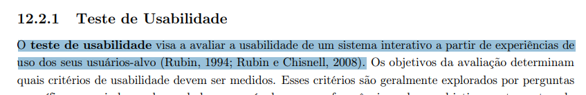
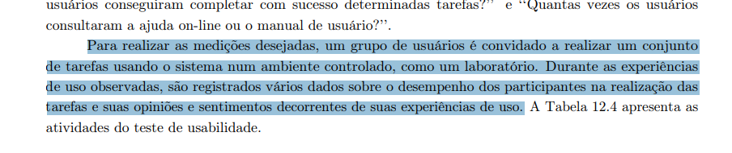
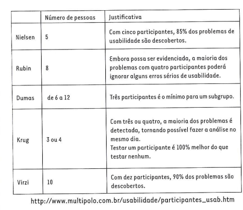
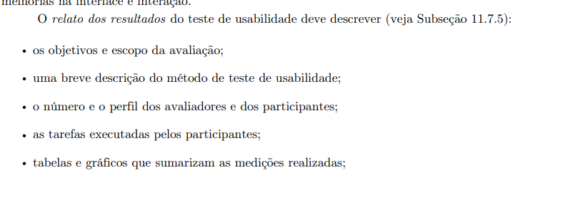
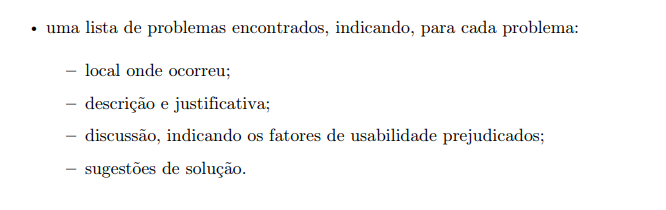

## Tabela de contribuição
| Data       | Contribuição                                                                                 | Autor(es)   | Revisor(es) |
| ---------- | -------------------------------------------------------------------------------------------- | ----------- | ----------- |
| 31/10/2026 | Criação da página                                                                            | Lucas Sales | A definir   |
| 03/11/2026 | Adição do planejamento do relato de resultados para o objetivo de comunicação entre usuários | Lucas Sales | A definir   |

## Planejamento do relato dos resultados - Comunicação com usuário(s) - Lucas Sales

Segundo Barbosa e Silva(2021) após cada experiência de uso observada, os avaliadores se reúnem para realizar a atividade de interpretação. As anotações dos avaliadores sobre a experiência de uso, as entrevistas pré e pós-teste, e possivelmente o áudio e o vídeo gravados são analisados a fim de identificar problemas de usabilidade no protótipo de interface avaliado. O resultado dessa análise é uma lista de problemas na interface que devem ser corrigidos, além de indicações de partes do sistema que podem ser aperfeiçoadas.

São descritos inclusive que os avaliadores devem:

Para **Interpretação:**

- reunir, contabilizar e sumarizar os dados coletados dos participantes

Para o **Relato dos resultados:**

- Relatar a performance e a opinião dos participantes.

### Objetivos da avaliação

Barbosa e Silva (2021), propõem 4 objetivos para realizar uma avaliação de IHC e perguntas específicas relacionadas a cada um deles, para decidir os objetivos da avaliação do protótipo de alta fidelidade, foram analisados estes objetivos e suas perguntas, que estão descritos no [Planejamento da avaliação do teste de usabilidade](./planejamento_teste_usabilidade.md)

Em suma, para o protótipo de alta fidelidade, será aplicada uma atualização da funcionalidade de gravação de áudio, originalmente disponível apenas em aplicativo mobile do Microsoft Teams, neste protótipo, a funcionalidade estará disponível em ambiente web e desktop, os quais compartilham elementos de layout, design e interação. Para analisar a performance e opinião do usuário, será aplicado o **teste de usabilidade**.

Como o usuário irá interagir com o protótipo, o autor Lucas Sales escolhe analisar nesta avaliação, o objetivo de **Problemas na interação e interface** para coletar dados a respeito de se o usuário consegue entender o design, as operações e consegue realizar a tarefa, em um protótipo de alta fidelidade.

### Método de teste de usabilidade

O método de avaliação será o método de **observação por teste de usabilidade**, que, segundo Barbosa e Silva (2021), visa a avaliar a usabilidade de um sistema interativo a partir de experiências de uso dos seus usuários-alvo (RUBIN, 1994; RUBIN; CHISNELL, 2008).

Para realizar a coleta de dados, um grupo de usuários é convidado a realizar tarefas no protótipo de alta fidelidade, em ambiente controlado. Durante a avaliação, são observados e registrados dados sobre o desempenho dos participantes, a realização das tarefas, seus sentimentos e opiniões a respeito da experiência de uso.

**Fonte:**

Conteúdo de Barbosa e Silva (2021), página 288.

Figura 1 - Teste de usabilidade 

Figura 2 - Coleta de dados do teste de usabilidade 

### O número e o perfil de avaliadores e dos participantes

Para esta avaliação o perfil de participantes esperados são estudantes de graduação da Faculdade de Ciências e Tecnologias em Engenharia (FCTE) da Universidade de Brasília (UnB), que utilizam o Microsoft Teams para realizar trabalhos em grupo, comunicações com professores e servidores da universidade.

O recrutamento ocorrerá dentro da própria universidade, sendo solicitado aos estudantes para realizarem uma rápida pesquisa para contribuir com o trabalho da disciplina.

Para esta avaliação, será seguido o número de usuários propostos por Krug, que indica que com três ou quatro usuários é possível detectar a maioria dos problemas de usabilidade, como referenciado na [figura 3](#figura-3).

**Fonte:**

Conteúdo de MORAES; SANTA ROSA, 2010, página 157.

Figura 3 - Tabela de número de participantes de acordo com cada pesquisador. 

### As tarefas executadas pelos participantes

A comunicação entre usuários no Microsoft Teams pode acontecer de várias formas, dentre elas, reuniões, mensagens de texto via chat teams, envio de emojis, stickers e loop components. A funcionalidade analisada na avaliação, é a gravação de mensagem de voz, disponível apenas no aplicativo mobile do Microsoft Teams, no contexto da avaliação, a funcionalidade estará disponível em ambiente web e desktop.

Desta forma, a tarefa que o participante irá realizar, é a **gravação de áudio no Microsoft Teams, em ambiente web ou desktop**, consideraremos no protótipo que o login na plataforma já foi realizado e que o participante irá enviar uma mensagem de áudio para um dos usuários que houve interação recente, para evitar o fluxo de pesquisa de um usuário.

O passo a passo esperado que o participante realize é:

1. Selecionar uma conversa recente.
2. Selecionar o ícone de microfone para iniciar a gravação de áudio.
3. Falar a mensagem a ser transmitida.
4. Selecionar o ícone de quadrado vermelho, para encerrar a gravação de áudio ou selecionar o ícone com duas barras verticais que indica a pausa, podendo continuar o áudio, até o momento de encerrar.
5. Selecionar o ícone de triângulo apontado para a direita *(play)* para escutar o próprio áudio antes do envio. *(opcional)*
6. Selecionar o ícone de seta apontada para a direita para enviar o áudio.

### Lista de problemas encontrados

Após a coleta de dados, é necessário construir, uma lista dos problemas de usabilidade encontrados, onde para cada erro, é necessário descrever:

- local onde ocorreu;
- descrição e justificativa;
- discussão, indicando os fatores de usabilidade prejudicados;
- sugestões de solução.

**Fonte:**

Conteúdo de Barbosa e Silva (2021), página 306:

Figura 4 - Relato dos resultados do teste de usabilidade 

Figura 5 - Relato dos resultados do teste de usabilidade 

## Agradecimento e Uso de IA generativa

O documento utiliza IA generativa nos seguintes pontos:

- Formatação e redação de texto;
- Geração e adaptação de código markdown;

## Referências Bibliográficas

> 1. BARBOSA, Simone Diniz Junqueira et al. Interação humano-computador e experiência do usuário. 1. ed. Rio de Janeiro: Simone Diniz Junqueira Barbosa, 2021. Capítulo 11: Planejamento da Avaliação de IHC. Página 261. Autopublicação. ISBN: 979-65-00-19677-1.

> 2. BARBOSA, Simone Diniz Junqueira et al. Interação humano-computador e experiência do usuário. 1. ed. Rio de Janeiro: Simone Diniz Junqueira Barbosa, 2021. Capítulo 11: Planejamento da Avaliação de IHC. Páginas 279-280. Autopublicação. ISB10: 978-65-00-19677-1.

> 3. BARBOSA, Simone Diniz Junqueira et al. Interação humano-computador e experiência do usuário. 1. ed. Rio de Janeiro10 Simone Diniz Junqueira Barbosa, 2021. Capítulo 11: Planejamento da Avaliação de IHC. Páginas 266-267. Autopublicação. ISBN: 978-65-00-19677-1.

> 4. NIELSEN, Jakob. **Usability Inspection Methods**. New York: John Wiley & Sons, 1994.

> 5. MORAES, Anamaria de; SANTA ROSA, José Guilherme. Avaliação e projeto no design de interfaces. Rio de Janeiro: 2AB, 2010.

## Histórico de versão
| Versão | Data       | Descrição                                                                                    | Autor(es)   | Revisor(es) |
| ------ | ---------- | -------------------------------------------------------------------------------------------- | ----------- | ----------- |
| `1.0`  | 31/10/2026 | Criação da página.                                                                           | Lucas Sales |             |
| `1.1`  | 03/11/2026 | Adição do planejamento do relato de resultados para o objetivo de comunicação entre usuários | Lucas Sales |             |