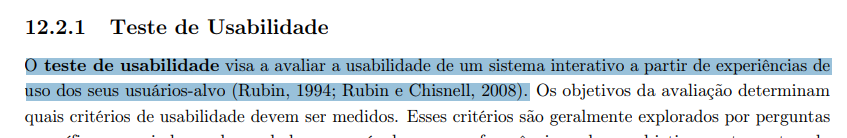
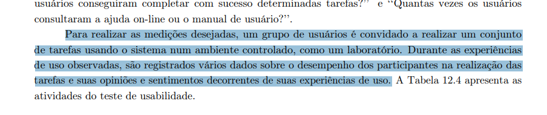

## Tabela de contribuição
| Data       | Contribuição                                                                                 | Autor(es)   | Revisor(es) |
| ---------- | -------------------------------------------------------------------------------------------- | ----------- | ----------- |
| 31/10/2026 | Criação da página                                                                            | Lucas Sales | A definir   |
| 03/11/2026 | Adição do planejamento do teste de usabilidade para o objetivo de comunicação entre usuários | Lucas Sales | A definir   |
| 03/11/2026 | Adição do planejamento do teste de usabilidade da funcionalidade de agendamento de reunião com o coordenador do curso | João Paulo da Silva Pereira | A definir   |

## Planejamento da avaliação do protótipo de alta fidelidade - Comunicação entre usuários

### Objetivos da avaliação do protótipo de alta fidelidade - Comunicação entre usuários

Barbosa e Silva (2021), propõem 4 objetivos para realizar uma avaliação de IHC e perguntas específicas relacionadas a cada um deles, para decidir os objetivos da avaliação do protótipo de alta fidelidade, foram analisados estes objetivos e suas perguntas:

| Objetivo                                       | Exemplos de perguntas a serem respondidas                                                                                |
| ---------------------------------------------- | ------------------------------------------------------------------------------------------------------------------------ |
| Analisar a apropriação da tecnologia           | De que maneira os usuários utilizam o sistema?                                                                           |
|                                                | Em que difere do planejado?                                                                                              |
|                                                | Como o sistema interativo afeta o modo de as pessoas se comunicarem e relacionarem?                                      |
|                                                | Que variação houve no número de erros cometidos pelos usuários ao utilizarem o novo sistema?                             |
|                                                | E no tempo que levam para atingir seus objetivos?                                                                        |
|                                                | E na sua satisfação com o sistema?                                                                                       |
|                                                | O quanto os usuários consideram o apoio computacional adequado para auxiliá-los na realização de suas atividades?        |
|                                                | O quanto eles são motivados a explorar novas funcionalidades?                                                            |
|                                                | Quais são os pontos fortes e fracos do sistema, na opinião dos usuários?                                                 |
|                                                | Quais objetivos dos usuários podem ser alcançados através do sistema? E quais não podem?                                 |
|                                                | Quais necessidades e desejos foram ou não atendidos?                                                                     |
|                                                | A tecnologia disponível pode oferecer maneiras mais interessantes ou eficientes de os usuários atingirem seus objetivos? |
|                                                | O que é possível modificar no sistema interativo para adequá-lo melhor ao ambiente de trabalho?                          |
|                                                | Por que os usuários não incorporaram o sistema no seu cotidiano?                                                         |
| Comparar ideias e alternativas de design       | Qual das alternativas é a mais eficiente? Mais fácil de aprender?                                                        |
|                                                | Qual delas pode ser construída em menos tempo?                                                                           |
|                                                | De qual delas se espera que tenha um impacto negativo menor ao ser adotada?                                              |
|                                                | Qual delas torna mais evidente os diferenciais da solução projetada?                                                     |
|                                                | Qual delas os usuários preferem? Por quê?                                                                                |
| Verificar a conformidade com um padrão         | O sistema está de acordo com os padrões de acessibilidade do W3C?                                                        |
|                                                | A interface segue o padrão do sistema operacional? E da empresa?                                                         |
|                                                | Os termos na interface seguem convenções estabelecidas no domínio?                                                       |
| Identificar problemas na interação e interface | Considerando cada perfil de usuário esperado: O usuário consegue operar o sistema?                                       |
|                                                | Ele atinge seu objetivo? Com quanta eficiência? Em quanto tempo? Após cometer quantos erros?                             |
|                                                | Que parte da interface e da interação o deixa insatisfeito?                                                              |
|                                                | Que parte da interface o desmotiva a explorar novas funcionalidades?                                                     |
|                                                | Ele entende o que significa e para que serve cada elemento de interface?                                                 |
|                                                | Ele vai entender o que deve fazer em seguida?                                                                            |
|                                                | Que problemas de IHC dificultam ou impedem o usuário de alcançar seus objetivos?                                         |
|                                                | Onde esses problemas se manifestam?                                                                                      |
|                                                | Com que frequência tendem a ocorrer?                                                                                     |
|                                                | Qual é a gravidade desses problemas?                                                                                     |
|                                                | Quais barreiras o usuário encontra para atingir seus objetivos?                                                          |
|                                                | Ele tem acesso a todas as informações oferecidas pelo sistema?                                                           |

Tabela 1 - Relação de objetivos x perguntas de IHC.

Para o teste de usabilidade, que representa um protótipo de alta fidelidade do produto, será aplicada uma atualização da funcionalidade de gravação de áudio, originalmente disponível apenas em aplicativo mobile do Microsoft Teams, neste protótipo, a funcionalidade estará disponível em ambiente web e desktop, os quais compartilham elementos de layout, design e interação.

Como o usuário irá interagir com o protótipo, o autor Lucas Sales escolhe analisar nesta avaliação, o objetivo de **Problemas na interação e interface** para coletar dados a respeito de se o usuário consegue entender o design, as operações e consegue realizar a tarefa em um protótipo de alta fidelidade.

**Fonte:**

Conteúdo de Barbosa e Silva (2021), páginas 250 e 251:

Figura 1 - Objetivos e perguntas 

Figura 2 - Objetivos e perguntas 

A Tabela 1 foi gerada com auxílio de inteligência artificial (Claude) a partir do conteúdo da literatura.

### Perguntas a serem respondidas na avaliação - Comunicação entre usuários

Foram extraídas da literatura de Barbosa e Silva (2021) as seguintes perguntas relacionadas ao objetivo de identificar problemas na interação e na interface, que serão utilizadas na avaliação do teste de usabilidade:

**1. O usuário consegue operar o sistema?**

**2. Ele atinge seu objetivo? Com quanta eficiência? Em quanto tempo? Após cometer quantos erros?**

**3. Ele entende o que significa e para que serve cada elemento da interface?**

**4. Ele vai entender o que deve fazer em seguida?**

**5. Que problemas de IHC dificultam ou impedem o usuário de alcançar seus objetivos?**

**6. Onde esses problemas se manifestam?**

**7. Com que frequência tendem a ocorrer?**

**8. Qual é a gravidade desses problemas?**

**9. Quais barreiras o usuário encontra para atingir seus objetivos?**

### Método de avaliação - Comunicação entre usuários

Como requisito da disciplina, o método de avaliação será o método de **observação por teste de usabilidade**, que, segundo Barbosa e Silva (2021), visa a avaliar a usabilidade de um sistema interativo a partir de experiências de uso dos seus usuários-alvo (RUBIN, 1994; RUBIN; CHISNELL, 2008).

Para realizar a coleta de dados, um grupo de usuários é convidado a realizar tarefas no protótipo de alta fidelidade, em ambiente controlado. Durante a avaliação, são observados e registrados dados sobre o desempenho dos participantes, a realização das tarefas, seus sentimentos e opiniões a respeito da experiência de uso.

**Fonte:**

Conteúdo de Barbosa e Silva (2021), página 288.

Figura 3 - Teste de usabilidade 

Figura 4 - Coleta de dados do teste de usabilidade 

### Questões práticas - Comunicação entre usuários

#### Definição das tarefas

A comunicação entre usuários no Microsoft Teams pode acontecer de várias formas, dentre elas, reuniões, mensagens de texto via chat teams, envio de emojis, stickers e loop components. A funcionalidade analisada na avaliação, é a gravação de mensagem de voz, disponível apenas no aplicativo mobile do Microsoft Teams, no contexto da avaliação, a funcionalidade estará disponível em ambiente web e desktop.

Desta forma, a tarefa que o participante irá realizar, é a **gravação de áudio no Microsoft Teams, em ambiente web ou desktop**, consideraremos no protótipo que o login na plataforma já foi realizado e que o participante irá enviar uma mensagem de áudio para um dos usuários que houve interação recente, para evitar o fluxo de pesquisa de um usuário.

O passo a passo esperado que o participante realize é:

1. Selecionar uma conversa recente.
2. Selecionar o ícone de microfone para iniciar a gravação de áudio.
3. Falar a mensagem a ser transmitida.
4. Selecionar o ícone de quadrado vermelho, para encerrar a gravação de áudio ou selecionar o ícone com duas barras verticais que indica a pausa, podendo continuar o áudio, até o momento de encerrar.
5. Selecionar o ícone de triângulo apontado para a direita *(play)* para escutar o próprio áudio antes do envio. *(opcional)*
6. Selecionar o ícone de seta apontada para a direita para enviar o áudio.

#### Definição de perfil dos participantes e recrutamento

Para esta avaliação o perfil de participantes esperados são estudantes de graduação da Faculdade de Ciências e Tecnologias em Engenharia (FCTE) da Universidade de Brasília (UnB), que utilizam o Microsoft Teams para realizar trabalhos em grupo, comunicações com professores e servidores da universidade.

O recrutamento ocorrerá dentro da própria universidade, sendo solicitado aos estudantes para realizarem uma rápida pesquisa para contribuir com o trabalho da disciplina.

Para esta avaliação, será seguido o número de usuários propostos por Krug, que indica que com três ou quatro usuários é possível detectar a maioria dos problemas de usabilidade.

#### Preparação de ambiente e de equipamentos

A avaliação será realizada na Universidade de Brasília (UnB), mais especificamente na Faculdade de Ciências e Tecnologias em Engenharia (FCTE). Uma sala vaga será ocupada pelo avaliador e o participante, a própria universidade já dispõe de cadeiras com mesas para serem utilizadas. 

Os demais equipamentos que serão utilizados são:

1. Telefone celular;
2. Tripé de apoio;
3. Canetas;
4. Cadernos;
5. Notebook;

#### Criação do protótipo de alta fidelidade

O protótipo de alta fidelidade será construído utilizando a ferramenta [Figma](https://www.figma.com/), o qual terá as seguintes telas e componentes:

1. Conversas recentes;
2. Conversa selecionada;
3. Barra de mensagem de texto com componentes de emoji, sticker, mensagem de áudio, loop component.

A funcionalidade que estará disponível será a de **envio de mensagem de áudio** na qual o usuário poderá:

1. Gravar a mensagem; 
2. Pausar e retomar a gravação;
3. Encerrar a gravação de áudio;
4. Escutar a mensagem gravada;
5. Excluir a mensagem gravada;
6. Enviar a mensagem gravada;

#### Cronograma

| Data  | Dia     | Atividade                                                                        | Responsável(is) |
| ----- | ------- | -------------------------------------------------------------------------------- | --------------- |
| 06/11 | Sexta   | Roteiro da entrevista e questionário                                             | Lucas Sales     |
| 07/11 | Sábado  | Construção do protótipo de alta fidelidade                                       | Lucas Sales     |
| 08/11 | Domingo | Construção do protótipo de alta fidelidade                                       | Lucas Sales     |
| 09/11 | Segunda | Construção do protótipo de alta fidelidade                                       | Lucas Sales     |
| 10/11 | Terça   | Teste piloto 1 e gravação da sessão 1 de coleta de dados do teste de usabilidade | Lucas Sales     |
| 11/11 | Quarta  | Teste piloto 2 e gravação da sessão 2 de coleta de dados do teste de usabilidade | Lucas Sales     |
| 12/11 | Quinta  | Teste piloto 3 e gravação da sessão 3 de coleta de dados do teste de usabilidade | Lucas Sales     |
| 13/11 | Sexta   | Interpretação dos dados                                                          | Lucas Sales     |
| 14/11 | Sábado  | Construção do relato de resultados do teste de usabilidade                       | Lucas Sales     |
| 15/11 | Domingo | Construção do relato de resultados do teste de usabilidade                       | Lucas Sales     |
| 16/11 | Segunda | Revisões e entrega do relato dos resultados do teste de usabilidade              | Lucas Sales     |

# Planejamento do Teste de Usabilidade

## 1. Definição das tarefas- Evellyn

A comunicação e a disponibilização de serviços acadêmicos no Microsoft Teams podem ocorrer por meio de equipes, canais, abas e aplicativos integrados à plataforma. No contexto desta avaliação, será analisada a funcionalidade de **Aproveitamento de Estudos e Dispensa de Componentes Curriculares**, proposta para facilitar o processo de solicitação de aproveitamento de disciplinas cursadas anteriormente em outras Instituições de Ensino Superior (IES) pelos estudantes da Universidade de Brasília (UnB).

A funcionalidade permite que o estudante realize uma solicitação diretamente pela plataforma Microsoft Teams, preenchendo seus dados cadastrais, informando a instituição de origem, selecionando as disciplinas que deseja aproveitar, anexando a documentação necessária e acompanhando o andamento da solicitação.

Dessa forma, a tarefa que os participantes deverão realizar consiste em solicitar o Aproveitamento de Estudos e Dispensa de Componentes Curriculares no Microsoft Teams, em ambiente Web/Desktop. Para a avaliação, será considerado que o participante já realizou o login na plataforma e possui acesso ao canal da UnB no Teams.

O participante deverá realizar uma solicitação de aproveitamento de uma disciplina cursada anteriormente, utilizando os dados e documentos disponibilizados para a execução da tarefa.

O passo a passo esperado que o participante realize é:

1. Acessar o canal da UnB no Microsoft Teams e localizar a aba **"Serviços Acadêmicos"** na barra superior.
2. Selecionar a opção **"Aproveitamento de Estudos e Dispensa"** no menu de serviços.
3. Conferir os dados cadastrais autopreenchidos, como nome, matrícula e curso.
4. Informar a Instituição de Ensino Superior (IES) de origem e selecionar a disciplina cursada anteriormente.
5. Associar a disciplina cursada à disciplina equivalente oferecida pela Universidade de Brasília.
6. Realizar o upload dos documentos necessários em formato PDF, incluindo o Histórico Escolar Oficial e a Ementa do Curso, observando o limite de tamanho dos arquivos (até 10 MB) e os indicadores visuais de validação.
7. Revisar as informações preenchidas e os documentos anexados na tela de resumo da solicitação.
8. Selecionar o botão **"Submeter Solicitação"** para finalizar o envio.
9. Verificar a emissão do Número de Protocolo SEI, exibido na tela de confirmação, e identificar a notificação enviada pelo chat do Microsoft Teams e pelo e-mail institucional.
10. Consultar o painel de acompanhamento para verificar o andamento da solicitação e os respectivos status do processo: **Solicitação Recebida**, **Em Análise pela Coordenação** e **Parecer Concluído**.

## 2. Definição de perfil dos participantes e recrutamento

Para esta avaliação, o perfil dos participantes esperados são estudantes de graduação da Faculdade de Ciências e Tecnologias em Engenharia (FCTE) da Universidade de Brasília (UnB), que utilizam o Microsoft Teams para realizar atividades acadêmicas, desenvolver trabalhos em grupo e manter comunicação com professores e servidores da universidade.

É desejável que os participantes tenham familiaridade com a plataforma Microsoft Teams e com atividades acadêmicas relacionadas à graduação. Entretanto, não é necessário que tenham realizado anteriormente uma solicitação real de Aproveitamento de Estudos e Dispensa de Componentes Curriculares, uma vez que a avaliação busca verificar a facilidade de compreensão e utilização da funcionalidade proposta.

O recrutamento ocorrerá dentro da própria universidade, sendo solicitado aos estudantes que participem de uma avaliação rápida para contribuir com o desenvolvimento do trabalho da disciplina.

Para esta avaliação, será seguido o número de usuários proposto por Krug, que indica que, com três ou quatro usuários, é possível identificar a maioria dos problemas de usabilidade.

## 3. Preparação de ambiente e de equipamentos

A avaliação será realizada na Universidade de Brasília (UnB), mais especificamente na Faculdade de Ciências e Tecnologias em Engenharia (FCTE). Uma sala disponível será utilizada pelo avaliador e pelo participante. O ambiente contará com cadeiras e mesas disponibilizadas pela própria universidade.

Os equipamentos e materiais que serão utilizados são:

- Notebook com acesso à internet;
- Protótipo de alta fidelidade desenvolvido no Figma;
- Telefone celular, para eventual gravação da sessão;
- Tripé de apoio, para posicionamento do celular durante a gravação;
- Canetas;
- Cadernos ou folhas de papel para anotações.

Durante a avaliação, o participante será orientado a executar a tarefa proposta utilizando o protótipo interativo. O avaliador observará as interações, dificuldades, dúvidas e possíveis problemas encontrados ao longo da execução, registrando as informações relevantes para a análise posterior.

## 4. Criação do protótipo de alta fidelidade

O protótipo de alta fidelidade será desenvolvido utilizando a ferramenta **Figma**, buscando representar visualmente a interface do Microsoft Teams e o fluxo de solicitação de Aproveitamento de Estudos e Dispensa de Componentes Curriculares.

O protótipo será composto por telas interativas que permitirão ao participante navegar pelas etapas da funcionalidade e simular a realização de uma solicitação completa.

As telas e os componentes previstos para o protótipo são:

- Canal da UnB no Microsoft Teams;
- Aba "Serviços Acadêmicos" na barra superior;
- Menu de serviços acadêmicos;
- Tela inicial de Aproveitamento de Estudos e Dispensa;
- Formulário de identificação do estudante, com dados cadastrais autopreenchidos;
- Campos para identificação da Instituição de Ensino Superior (IES) de origem;
- Área de seleção da disciplina cursada anteriormente;
- Campo para associação da disciplina cursada à disciplina equivalente na UnB;
- Área para anexação dos documentos obrigatórios em formato PDF;
- Indicadores visuais de validação dos arquivos anexados;
- Tela de revisão e resumo das informações preenchidas;
- Botão "Submeter Solicitação";
- Tela de confirmação com emissão do Número de Protocolo SEI;
- Representação das notificações de confirmação pelo chat do Teams e pelo e-mail institucional;
- Painel de acompanhamento da solicitação, com apresentação da linha do tempo e dos respectivos status do processo.

A funcionalidade disponibilizada no protótipo permitirá que o usuário:

- Acesse o serviço de Aproveitamento de Estudos e Dispensa;
- Visualize e confira seus dados cadastrais;
- Informe a instituição de origem;
- Selecione a disciplina cursada anteriormente;
- Associe a disciplina de origem à disciplina equivalente da UnB;
- Simule a anexação do Histórico Escolar Oficial e da Ementa do Curso;
- Visualize a validação dos documentos anexados;
- Revise os dados e as informações da solicitação;
- Simule a submissão da solicitação;
- Visualize o Número de Protocolo SEI;
- Consulte o andamento da solicitação por meio do painel de acompanhamento.

As interações serão configuradas no próprio Figma por meio de conexões entre telas, botões e elementos interativos, permitindo simular a navegação e as principais ações necessárias para concluir a tarefa.

Por se tratar de um protótipo, não haverá integração real com os sistemas institucionais, com o SEI ou com o serviço de envio de e-mails. As etapas de submissão, emissão de protocolo e notificações serão representadas visualmente para permitir a avaliação da experiência de uso.

## 5. Cronograma

| Data | Dia | Atividade | Responsável(is) |
|---|---|---|---|
| 06/11 | Sexta-feira | Elaboração do roteiro da entrevista e do questionário para avaliação da funcionalidade de Aproveitamento de Estudos e Dispensa de Componentes Curriculares. | Evellyn de Sousa Rocha |
| 07/11 | Sábado | Planejamento e organização das telas, componentes e fluxo de navegação do protótipo de alta fidelidade no Figma. | Evellyn de Sousa Rocha |
| 08/11 | Domingo | Construção do protótipo de alta fidelidade, contemplando o acesso aos Serviços Acadêmicos e o preenchimento do formulário de solicitação. | Evellyn de Sousa Rocha |
| 09/11 | Segunda-feira | Finalização do protótipo no Figma, incluindo anexação de documentos, revisão das informações, submissão e acompanhamento do protocolo. | Evellyn de Sousa Rocha |
| 10/11 | Terça-feira | Realização do teste piloto e gravação da primeira sessão de coleta de dados do teste de usabilidade. | Evellyn de Sousa Rocha |
| 11/11 | Quarta-feira | Realização do segundo teste de usabilidade e gravação da segunda sessão de coleta de dados. | Evellyn de Sousa Rocha |
| 12/11 | Quinta-feira | Realização do terceiro teste de usabilidade e gravação da terceira sessão de coleta de dados. | Evellyn de Sousa Rocha |
| 13/11 | Sexta-feira | Organização e interpretação dos dados coletados durante as sessões de avaliação. | Evellyn de Sousa Rocha |
| 14/11 | Sábado | Elaboração do relato dos resultados do teste de usabilidade. | Evellyn de Sousa Rocha |
| 15/11 | Domingo | Continuação da elaboração do relato dos resultados, incluindo identificação dos problemas de usabilidade e análise das observações dos participantes. | Evellyn de Sousa Rocha |
| 16/11 | Segunda-feira | Revisão, finalização e entrega do relato dos resultados do teste de usabilidade. | Evellyn de Sousa Rocha |

#### Teste piloto

Segundo Barbosa e Silva (2021), o objetivo do teste-piloto, é avaliar o planejamento, analisar se a avaliação planejada produz os dados necessários para responder as questões e objetivos do estudo.

Para realizar o teste-piloto, é necessário que o avaliador conduza uma sessão normal de avaliação, conseguindo verificar se a linguagem, materiais e condução da avaliação são adequadas e suficientes para orientar o participante durante a avaliação. O teste-piloto também permite avaliar se o produto, equipamentos de condução e de registro de dados estão funcionando corretamente e se o tempo necessário para executar as tarefas é suficiente.

Por fim, o avaliador deve realizar uma breve análise dos dados coletados para garantir que eles permitirão responder as questões da avaliação.

O teste piloto será realizado previamente a cada sessão de coleta de dados do teste de usabilidade.

## Planejamento da avaliação do protótipo de alta fidelidade - Agendamento de reunião com o coordenador do curso

### Objetivos da avaliação do protótipo de alta fidelidade - Agendamento de reunião com o coordenador do curso

Para decidir os objetivos da avaliação do protótipo de alta fidelidade, foram analisados os objetivos e as perguntas propostos por Barbosa e Silva (2021), descritos na [Tabela 1](#planejamento-da-avaliacao-do-prototipo-de-alta-fidelidade-comunicacao-entre-usuarios).

Para o teste de usabilidade, que representa um protótipo de alta fidelidade do produto, será aplicado o reprojeto do agendamento de uma reunião entre o estudante e o coordenador do curso no Microsoft Teams. Nele, o formulário mostra só os campos essenciais, sugere o coordenador com nome e cargo ao digitar, exibe a disponibilidade dos dois antes do envio, orienta o que escrever no assunto, confirma o envio e mostra o status do convite. Esse reprojeto parte do storyboard e do protótipo de papel do agendamento.

Como o usuário irá interagir com o protótipo, o autor João Paulo escolhe analisar nesta avaliação o objetivo de **Problemas na interação e interface**, para coletar dados a respeito de se o usuário consegue entender o design, as operações e consegue realizar a tarefa em um protótipo de alta fidelidade.

### Perguntas a serem respondidas na avaliação - Agendamento de reunião com o coordenador do curso

Foram extraídas da literatura de Barbosa e Silva (2021) as seguintes perguntas relacionadas ao objetivo de identificar problemas na interação e na interface, que serão utilizadas na avaliação do teste de usabilidade, com os seguintes pontos de atenção para o agendamento:

**1. O usuário consegue operar o sistema?** Consegue abrir o formulário de nova reunião?

**2. Ele atinge seu objetivo? Com quanta eficiência? Em quanto tempo? Após cometer quantos erros?** Envia o convite ao coordenador certo, no horário livre para os dois, com a duração pedida? Erros possíveis: escolher a secretaria no lugar do coordenador, escolher horário ocupado, deixar o assunto vazio ou não enviar o convite.

**3. Ele entende o que significa e para que serve cada elemento da interface?** Entende a lista de sugestões (nome e cargo), os horários livres e ocupados, a orientação do campo Assunto e o status do convite?

**4. Ele vai entender o que deve fazer em seguida?** Sabe que, depois de revisar o resumo, deve enviar, e que, depois do envio, deve esperar a resposta ou propor outro horário?

**5. Que problemas de IHC dificultam ou impedem o usuário de alcançar seus objetivos?**

**6. Onde esses problemas se manifestam?** Em qual tela e em qual nó da HTA do Estudante.

**7. Com que frequência tendem a ocorrer?**

**8. Qual é a gravidade desses problemas?**

**9. Quais barreiras o usuário encontra para atingir seus objetivos?**

### Método de avaliação - Agendamento de reunião com o coordenador do curso

Como requisito da disciplina, o método de avaliação será o método de **observação por teste de usabilidade**, descrito para a comunicação entre usuários, que, segundo Barbosa e Silva (2021), visa a avaliar a usabilidade de um sistema interativo a partir de experiências de uso dos seus usuários-alvo (RUBIN, 1994; RUBIN; CHISNELL, 2008).

Para realizar a coleta de dados, um grupo de usuários é convidado a realizar a tarefa de agendamento no protótipo de alta fidelidade, em ambiente controlado. Durante a avaliação são observados e registrados dados sobre o desempenho dos participantes (tempo, erros e ajuda necessária), a realização da tarefa, seus sentimentos e opiniões, com *think aloud* e entrevista pós-teste.

### Questões práticas - Agendamento de reunião com o coordenador do curso

#### Definição das tarefas

O agendamento de reunião no Microsoft Teams pode ser iniciado de mais de uma forma, como pelo Calendário ou pela conversa com a pessoa convidada. A funcionalidade analisada na avaliação é o agendamento de uma reunião entre o estudante e o coordenador do curso.

Desta forma, a tarefa que o participante irá realizar é **marcar uma reunião de 30 minutos com o coordenador do curso, na quinta-feira, no Microsoft Teams, em ambiente web ou desktop**. Consideraremos no protótipo que o login já foi realizado, com os dados fictícios do protótipo (estudante Rafaela Duarte e coordenador Carlos Menezes).

O passo a passo esperado, ligado aos nós da HTA do Estudante, é:

1. Abrir o Calendário e selecionar "+ Nova reunião" (nó 1.1).
2. Digitar o nome ou o cargo e selecionar o coordenador, e não a secretaria (nós 2.1 e 2.2).
3. Consultar a disponibilidade dos dois, escolher o horário livre para ambos e definir a duração (nós 3.1 a 3.3).
4. Informar o assunto e, se quiser, a descrição (nós 4.1 e 4.2).
5. Revisar o resumo e enviar o convite (nós 5.1 e 5.2).
6. Conferir a confirmação e o status do convite (nó 6.1) e, se o convite for recusado, propor outro horário (nó 6.2).

#### Definição de perfil dos participantes e recrutamento

Para esta avaliação o perfil de participantes esperados são estudantes de graduação da Faculdade de Ciências e Tecnologias em Engenharia (FCTE) da Universidade de Brasília (UnB), do Perfil 1 (Estudante), que utilizam o Microsoft Teams para realizar trabalhos em grupo e comunicação com professores e servidores da universidade. Para evitar aprendizado prévio, a preferência é por participantes que ainda não viram o storyboard nem o protótipo de papel do agendamento.

O recrutamento ocorrerá dentro da própria universidade, junto com o recrutamento da funcionalidade de comunicação entre usuários. Será seguido o número de usuários proposto por Krug, que indica que com três ou quatro usuários é possível detectar a maioria dos problemas de usabilidade. Os participantes serão identificados por letra no relato.

#### Preparação de ambiente e de equipamentos

A avaliação será realizada na FCTE/UnB, em uma sala vaga, com as cadeiras e mesas da própria universidade, ocupada pelo avaliador e pelo participante. Os equipamentos são os mesmos da comunicação entre usuários: telefone celular, tripé de apoio, canetas, cadernos e notebook, que exibirá o protótipo.

#### Criação do protótipo de alta fidelidade

O protótipo de alta fidelidade será construído utilizando a ferramenta [Figma](https://www.figma.com/), com as seguintes telas e componentes:

1. Calendário do Teams com o botão "+ Nova reunião";
2. Formulário de nova reunião com o campo Participante e a lista de sugestões (nome e cargo);
3. Disponibilidade dos dois participantes, com horários livres e ocupados;
4. Campos Assunto (com orientação do que escrever) e Duração;
5. Resumo da reunião, botão "Enviar convite" e confirmação de envio com lembrete;
6. Evento no calendário com o status do convite (pendente, aceito ou recusado) e o botão "Propor outro horário".

A funcionalidade que estará disponível será a de **agendamento de reunião com o coordenador**, na qual o usuário poderá:

1. Abrir uma nova reunião;
2. Buscar e selecionar o coordenador;
3. Consultar a disponibilidade e escolher horário e duração;
4. Informar o assunto;
5. Revisar e enviar o convite;
6. Acompanhar o status do convite e propor outro horário.

No protótipo de papel, o participante disse que não pensaria primeiro no Calendário para marcar reunião, e sim em uma área de reuniões. Por isso, o protótipo de alta fidelidade poderá incluir também uma entrada pela conversa com o coordenador (nó 1.2 da HTA), e o passo 1 da tarefa será avaliado nas duas entradas, se houver essa versão.

#### Cronograma

As datas seguem as sessões de coleta de dados do teste de usabilidade da comunicação entre usuários, com a participação de João Paulo (datas a confirmar).

| Data  | Dia     | Atividade                                                                                | Responsável(is) |
| ----- | ------- | ---------------------------------------------------------------------------------------- | --------------- |
| 06/11 | Sexta   | Roteiro da entrevista e questionário do agendamento                                      | João Paulo      |
| 07/11 | Sábado  | Construção do protótipo de alta fidelidade do agendamento                                | João Paulo      |
| 08/11 | Domingo | Construção do protótipo de alta fidelidade do agendamento                                | João Paulo      |
| 09/11 | Segunda | Construção do protótipo de alta fidelidade do agendamento                                | João Paulo      |
| 10/11 | Terça   | Teste piloto 1 e gravação da sessão 1 de coleta de dados do agendamento                  | João Paulo      |
| 11/11 | Quarta  | Teste piloto 2 e gravação da sessão 2 de coleta de dados do agendamento                  | João Paulo      |
| 12/11 | Quinta  | Teste piloto 3 e gravação da sessão 3 de coleta de dados do agendamento                  | João Paulo      |
| 13/11 | Sexta   | Interpretação dos dados do agendamento                                                   | João Paulo      |
| 14/11 | Sábado  | Construção do relato de resultados do teste de usabilidade do agendamento                | João Paulo      |
| 15/11 | Domingo | Construção do relato de resultados do teste de usabilidade do agendamento                | João Paulo      |
| 16/11 | Segunda | Revisões e entrega do relato dos resultados do teste de usabilidade do agendamento       | João Paulo      |

#### Teste piloto

O objetivo do teste-piloto é avaliar o planejamento e analisar se a avaliação planejada produz os dados necessários para responder as questões e objetivos do estudo (Barbosa e Silva, 2021). O teste piloto do agendamento será realizado previamente a cada sessão de coleta de dados do teste de usabilidade, com uma sessão normal em que o avaliador simula um participante, para verificar a linguagem, o protótipo, os equipamentos e o tempo.

### Questões éticas - Agendamento de reunião com o coordenador do curso

Valem o TCLE e os princípios éticos descritos na seção D deste documento. Para o agendamento, o participante é identificado por uma letra, os nomes do protótipo são fictícios e a gravação só ocorre com a permissão dele.

## D - Decidir como lidar com as questões éticas

Para garantir a integridade e o aspecto ético da pesquisa, são utilizados os princípios éticos descritos por Barbosa e Silva(2021).

- **Princípio da autonomia:** Envolve o consentimento livre e esclarecido dos indivíduos e a proteção a grupos vulneráveis e aos legalmente incapazes, tais como: menores de idade, alunos ou subordinados. Nesse sentido, a pesquisa envolvendo seres humanos deverá sempre tratá-los com dignidade, respeitá-los em sua autonomia e defendê-los em sua vulnerabilidade;

- **Princípio da beneficência:** Envolve a ponderação entre riscos e benefícios, tanto atuais como potenciais, individuais ou coletivos, comprometendo-se com o máximo de benefícios e o mínimo de danos e riscos. Os danos podem ocorrer na dimensão física psíquica, moral, intelectual, social, cultural ou espiritual do ser humano, em qualquer fase da pesquisa ou depois dela;

- **Princípio da não maleficência:**Envolve a garantia de evitar danos previsíveis relacionados à pesquisa, tanto os imediatos quanto os tardios;

- **Princípio da justiça e equidade:** Relacionado à relevância social da pesquisa, com vantagens
significativas para os participantes da pesquisa e minimização do ônus para os participantes vulneráveis, o que garante a igual consideração dos interesses envolvidos, não perdendo o sentido de sua destinação sócio-humanitária.

Além destes, os avaliadores se comprometem a sempre **explicar os objetivos** da pesquisa previamente, garantir a **confidencialidade** e a **privacidade** dos participantes, que serão sempre apresentados de forma **anônima.** Obtendo sua **permissão para gravação de imagem e voz** antes de iniciar a mesma.

Por fim, todos os participantes da pesquisa, devem preencher o **Termo de Consentimento Livre e Esclarecido (TCLE)** previamente à sua participação nesta, que está disponível abaixo.

Figura 5 - Termo de Consentimento Livre e Esclarecido 

Autor - Lucas Sales 

**Fonte:**

Conteúdo de Barbosa e Silva (2021), páginas 126,127 e 128:

Figura 6 - Princípios éticos 

Figura 7 - Princípios éticos 

## E - Avaliar, interpretar e apresentar os dados

Barbosa e Silva(2021), orienta que para interpretar e apresentar os dados o avaliador precisa estar atento a alguns
aspectos da avaliação realizada antes de tirar conclusões e divulgar resultados. deve se considerar o grau de confiabilidade dos dados, a validade interna do estudo, a validade externa do estudo, e a validade ecológica do estudo.

Desta forma a avaliação dos dados coletados será conduzida de acordo com as etapas descritas neste documento, de acordo com cada funcionalidade e seu autor.

O relato dos resultados estará disponível na página [Relato dos resultados - Teste de usabilidade](./resultados_teste_usabilidade.md) de acordo com o seguimento da disciplina de IHC. 

## Agradecimento e Uso de IA generativa

O documento utiliza IA generativa nos seguintes pontos:

- Formatação e redação de texto;
- Geração e adaptação de código markdown;

## Referências Bibliográficas

> 1. BARBOSA, Simone Diniz Junqueira et al. Interação humano-computador e experiência do usuário. 1. ed. Rio de Janeiro: Simone Diniz Junqueira Barbosa, 2021. Capítulo 11: Planejamento da Avaliação de IHC. Página 261. Autopublicação. ISBN: 979-65-00-19677-1.

> 2. BARBOSA, Simone Diniz Junqueira et al. Interação humano-computador e experiência do usuário. 1. ed. Rio de Janeiro: Simone Diniz Junqueira Barbosa, 2021. Capítulo 11: Planejamento da Avaliação de IHC. Páginas 279-280. Autopublicação. ISB10: 978-65-00-19677-1.

> 3. BARBOSA, Simone Diniz Junqueira et al. Interação humano-computador e experiência do usuário. 1. ed. Rio de Janeiro10 Simone Diniz Junqueira Barbosa, 2021. Capítulo 11: Planejamento da Avaliação de IHC. Páginas 266-267. Autopublicação. ISBN: 978-65-00-19677-1.

> 4. NIELSEN, Jakob. **Usability Inspection Methods**. New York: John Wiley & Sons, 1994.

> 5. MORAES, Anamaria de; SANTA ROSA, José Guilherme. Avaliação e projeto no design de interfaces. Rio de Janeiro: 2AB, 2010.

## Histórico de versão
| Versão | Data       | Descrição                                                                                    | Autor(es)   | Revisor(es) |
| ------ | ---------- | -------------------------------------------------------------------------------------------- | ----------- | ----------- |
| `1.0`  | 31/10/2026 | Criação da página.                                                                           | Lucas Sales |             |
| `1.1`  | 03/11/2026 | Adição do planejamento do teste de usabilidade para o objetivo de comunicação entre usuários | Lucas Sales |             |
| `1.2`  | 03/11/2026 | Adição do planejamento do teste de usabilidade do agendamento de reunião com o coordenador   | João Paulo  |             |
