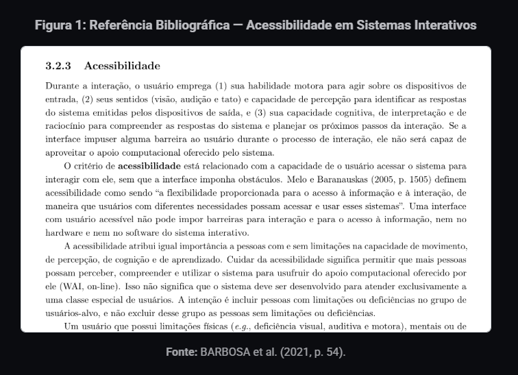
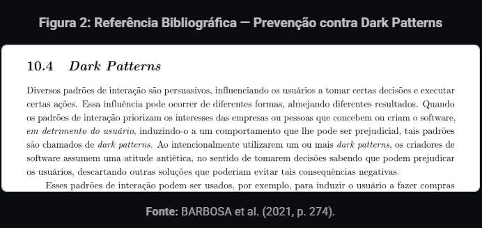
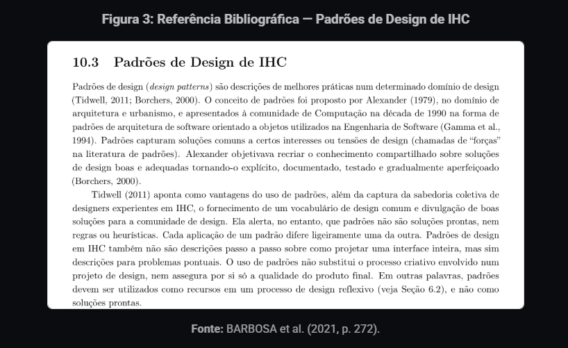
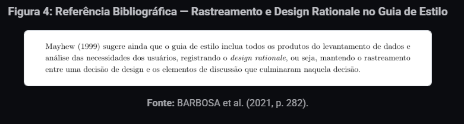

# Lista de verificação — Etapa 3

**Universidade de Brasília – Campus UnB Gama**
**Disciplina:** Interação Humano Computador | **Professor:** André Barros de Sales

| Campo | Valor |
|---|---|
| Responsável | João Paulo da Silva Pereira (Grupo 01, matrícula 241025784) |
| Autor do item | João Paulo da Silva Pereira |
| Versão | 1.0, de 21/11/2026 |

## Introdução

Esta lista reúne as perguntas para verificar os artefatos da Etapa 3 de autoria de João Paulo: Guia de Estilo (seções 3.2 a 3.8), Metas de Usabilidade e Características Gerais, da avaliação e do redesenho do agendamento de reunião com o coordenador no Microsoft Teams.

Cada pergunta traz autor, o que conferir e a origem. Os itens de desenvolvimento seguem o modelo de lista sugerida; os de conteúdo seguem o critério do plano de ensino.

- **Valores possíveis:** Sim, Não, Incompleto e Não se aplica.
- **Avaliar:** o próprio Grupo e o Grupo +1.

## Tabela 1 – Tabela de contribuição

| Integrante | Contribuição | Artefato / atividade |
|---|---|---|
| João Paulo da Silva Pereira | Autoavaliação e organização dos critérios da Etapa 3 | Conteúdo |
| Claude (Anthropic) | Apoio à estruturação do texto, tabelas e formatação | Agradecimentos |

## Tabela 2 – Lista de verificação da Etapa 3

### Desenvolvimento do projeto (D01 a D10)

Origem de todos os itens D01–D10: *Lista de verificação sugerida para as entregas do projeto (CONFIA.pdf), Entrega 1 – Itens do Desenvolvimento do projeto.* Autor de todos os itens: João Paulo da Silva Pereira.

| Nº | Questão | O que conferir | Resposta (Sim / Não / Incompleto) | Data da avaliação |
|---|---|---|---|---|
| D01 | O histórico de versão está padronizado? | Versão, data, descrição, autor e revisor em cada artefato. | | |
| D02 | Autores e revisores estão identificados, com revisão efetivamente registrada? | Revisor diferente do autor; campo vazio não comprova revisão. | | |
| D03 | Há referências bibliográficas em todos os artefatos? | Correspondência entre citação, edição, página e referência. | | |
| D04 | Tabelas e figuras têm número, legenda, fonte e chamada no texto? | Abrir os materiais e conferir cada tabela e figura. | | |
| D05 | Os artefatos têm introdução que esclarece objetivo e escopo? | Vínculo com a funcionalidade e com as etapas anteriores. | | |
| D06 | O cronograma executado registra quem fez cada atividade e as datas reais? | Comparar com o planejado; agenda proposta não é execução. | | |
| D07 | Há atas das reuniões, com data, horários, pessoas e decisões? | Conferir em Atas e Apresentações. | | |
| D08 | As gravações de reuniões e avaliações estão acessíveis e autorizadas? | Link, permissão e correspondência com a reunião. | | |
| D09 | O vídeo da apresentação da Etapa 3 está acessível na categoria "não listado" do YouTube? | Link, participantes e conteúdo dos artefatos. | | |
| D10 | A tabela de contribuição aparece no início de cada artefato e corresponde a quem atuou? | Contribuição com hiperligação para a atividade e a gravação, se houver. | | |

### Conteúdo da disciplina (C10 a C17)

Origem de todos os itens C10–C17: *Plano de Ensino FIHC 02/2026, Turma 01 (SALES, 2026), Apresentação 3: Princípios Gerais de Projeto, Metas de usabilidade, Guia de Estilo, itens 10 a 17 (respectivamente).* Autor de todos os itens: João Paulo da Silva Pereira.

| Nº | Questão | O que conferir | Resposta (Sim / Não / Incompleto) | Data da avaliação |
|---|---|---|---|---|
| C10 | O GitHub Pages possui as características da plataforma para o projeto? | Contexto de uso, características físicas e lógicas e implicações para o redesenho. | | |
| C11 | O GitHub Pages possui os Princípios Gerais do Projeto que serão utilizados no projeto, com referência bibliográfica e foto do texto? | Referência bibliográfica da fonte e foto do texto explicando os Princípios Gerais do Projeto. Artefato de outro integrante. | | |
| C12 | Os Princípios Gerais do Projeto contêm os oito tópicos (expectativas dos usuários; simplicidade; controle e liberdade; consistência e eficiência; antecipação; visibilidade e reconhecimento; conteúdo relevante; projeto para erros), com referência e foto do texto? | Os oito tópicos e a foto do texto da fonte. Artefato de outro integrante. | | |
| C13 | O GitHub Pages possui as metas de usabilidade que devem ser alcançadas no projeto (ou os objetivos de uma avaliação de IHC), com referência bibliográfica e foto do texto? | Referência bibliográfica da fonte e foto do texto explicando as metas de usabilidade. | | |
| C14 | O GitHub Pages possui a razão da seleção das metas de usabilidade? | Justificativa, indicador e faixa de valores por meta. | | |
| C15 | O GitHub Pages possui o Guia de Estilo do projeto, com referência bibliográfica e foto do texto? | Referência bibliográfica da fonte e foto do texto explicando o guia de estilo. | | |
| C16 | O Guia de Estilo possui a estrutura: 1 Introdução; 2 Resultados de análise; 3 Elementos de interface (grid, janelas, tipografia, cores); 4 Elementos de interação; 5 Elementos de ação; 6 Vocabulário e padrões? | As seis seções e a foto do texto da fonte sobre a estrutura do guia de estilo. | | |
| C17 | O Guia de Estilo corresponde ao site avaliado? | Mesmo site na análise e no redesenho. | | |

#### Campos "Foto" dos itens C10 a C17

Cada item possui um campo **Foto** para anexar a referência bibliográfica da fonte e a foto do texto. Situação atual dos campos:

- **C10** – 10 - As características da plataforma para o projeto.
- **C11** – 11 - Os Princípios Gerais do Projeto que serão utilizados no projeto? *(Adicionar referência bibliográfica da fonte e foto do texto da referência. Autor: ___)*
- **C12** – 12 - Os Princípios Gerais do Projeto contêm os seguintes tópicos:
  1. correspondência com as expectativas dos usuários;
  2. simplicidade nas estruturas das tarefas;
  3. equilíbrio entre controle e liberdade do usuário;
  4. consistência e padronização; promoção da eficiência do usuário;
  5. antecipação das necessidades do usuário;
  6. visibilidade e reconhecimento;
  7. conteúdo relevante e expressão adequada; e
  8. projeto para erros.

  *(Adicionar referência bibliográfica da fonte e foto do texto da referência explicando os tópicos dos Princípios Gerais do Projeto. Autor: ___)*
- **C13** – 13 - As metas de usabilidade que devem ser alcançadas no projeto ou os objetivos de uma avaliação de IHC. *(Adicionar referência bibliográfica da fonte e foto do texto. Autor: ___)*
- **C14** – 14 - A razão da seleção das metas de usabilidade?
- **C15** – 15 - O Guia de Estilo do projeto? *(Adicionar referência bibliográfica da fonte e foto do texto explicando guia de estilo. Autor: ___)*
- **C16** – 16 - O Guia de Estilo do projeto possui a seguinte estrutura:
  1. **Introdução:** objetivo do guia de estilo; organização e conteúdo do guia; público-alvo do guia de estilos (programadores, gerentes, equipe de suporte); como utilizar o guia (em produção e manutenção); como manter o guia.
  2. **Resultados de análise:** descrição do ambiente de trabalho do usuário.
  3. **Elementos de interface:** disposição espacial e grid; janelas; tipografia; cores.
  4. **Elementos de interação:** estilos de interação; seleção de um estilo; aceleradores (teclas de atalho).
  5. **Elementos de ação:** preenchimento de campos; seleção; ativação.
  6. **Vocabulário e padrões:** terminologia; tipos de tela (para tarefas comuns); sequências de diálogos (por exemplo, para feedback ou confirmação de uma operação).

  *(Adicionar referência bibliográfica da fonte e foto do texto explicando a estrutura do guia de estilo. Autor: ___)*
- **C17** – 17 - O Guia de Estilo corresponde ao site avaliado?

### Itens elaborados pelo grupo (G18 a G21)

Autor de todos os itens: João Paulo da Silva Pereira.
Origem de todos os itens: BARBOSA, Simone Diniz Junqueira et al. *Interação Humano-Computador e Experiência do Usuário.* 2021.

| Nº | Questão | O que conferir | Origem (página) | Resposta (Sim / Não / Incompleto) | Data da avaliação |
|---|---|---|---|---|---|
| G18 | O Guia de Estilo trata de acessibilidade? | Contraste, alvos de toque e critérios WCAG. | p. 54 | | |
| G19 | O Guia de Estilo trata de Dark Patterns? | Zonas e cores que evitam cliques enganosos. | p. 274 | | |
| G20 | O Guia de Estilo especifica Design Patterns? | Padrões de componentes e de interação. | p. 272 | | |
| G21 | O Guia de Estilo traz o Design Rationale das decisões? | Ligação entre requisitos, personas e decisões. | p. 282 | | |

#### Fotos de referência dos itens G18 a G21

Cada figura é uma foto do trecho do livro, com a fonte indicada na legenda. Salve as imagens em uma pasta `img/` do repositório (ou ajuste os caminhos abaixo).

**Figura 1 – Referência bibliográfica: Acessibilidade em Sistemas Interativos (G18)**

Fonte: BARBOSA et al. (2021, p. 54), seção 3.2.3 Acessibilidade.

**Figura 2 – Referência bibliográfica: Prevenção contra Dark Patterns (G19)**

Fonte: BARBOSA et al. (2021, p. 274), seção 10.4 Dark Patterns.

**Figura 3 – Referência bibliográfica: Padrões de Design de IHC (G20)**

Fonte: BARBOSA et al. (2021, p. 272), seção 10.3 Padrões de Design de IHC.

**Figura 4 – Referência bibliográfica: Rastreamento e Design Rationale no Guia de Estilo (G21)**

Fonte: BARBOSA et al. (2021, p. 282).

## Referências

1. SALES, A. B. de. *Plano de Ensino da disciplina de Interação Humano-Computador.* FCTE/UnB, 2026.
2. BARBOSA, S. D. J. et al. *Interação Humano-Computador e Experiência do Usuário.* 2021.
3. W3C. *Web Content Accessibility Guidelines (WCAG) 2.2.* W3C Recommendation, 2023.
4. Lista de verificação sugerida para as entregas do projeto da disciplina.
