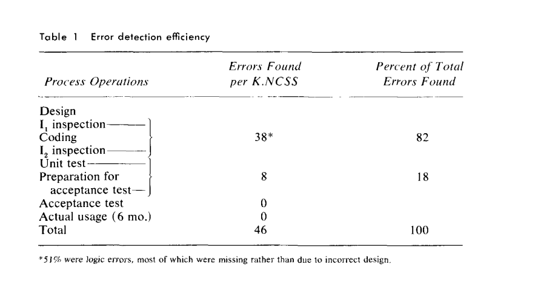
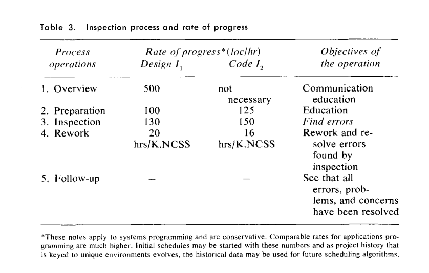
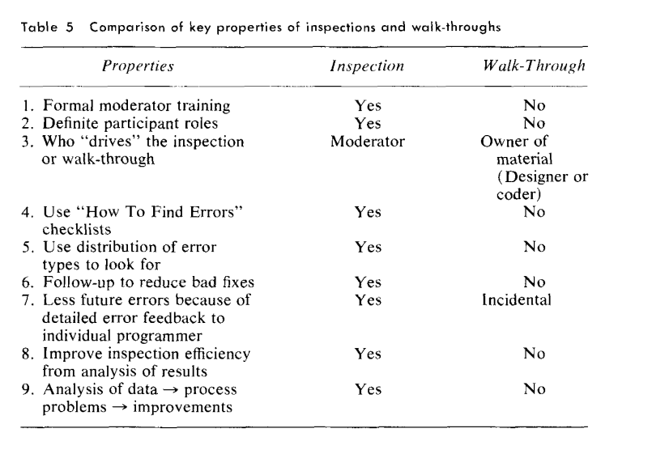
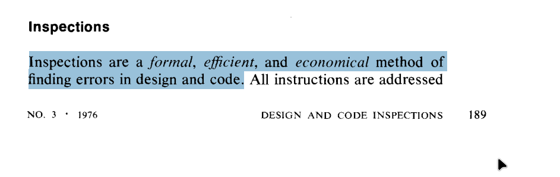
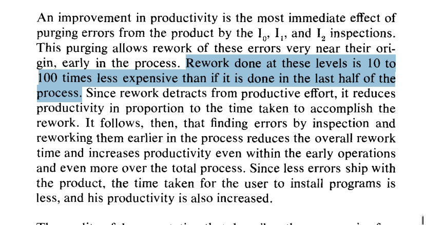
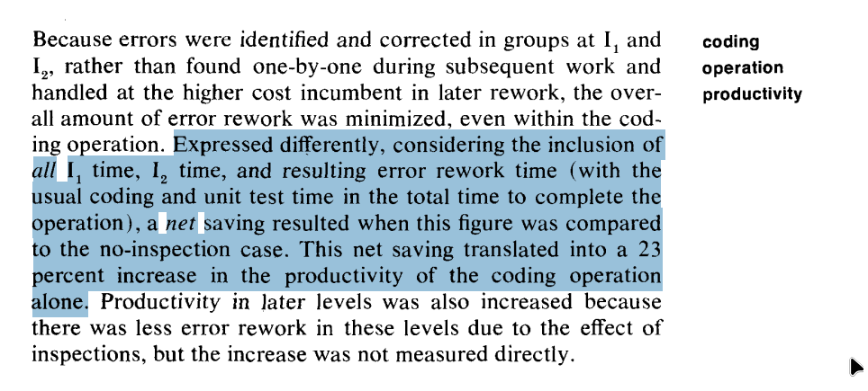
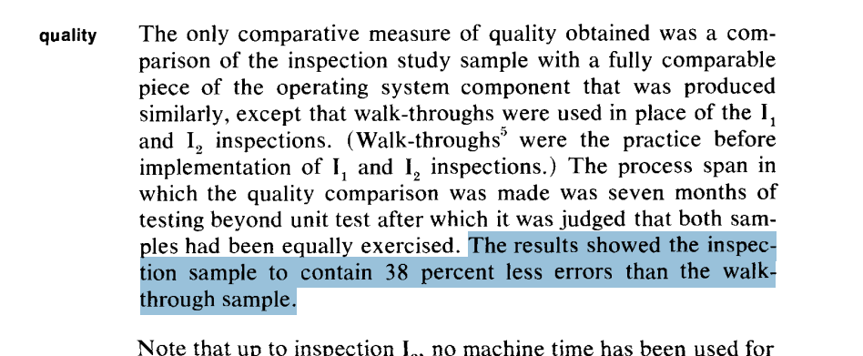
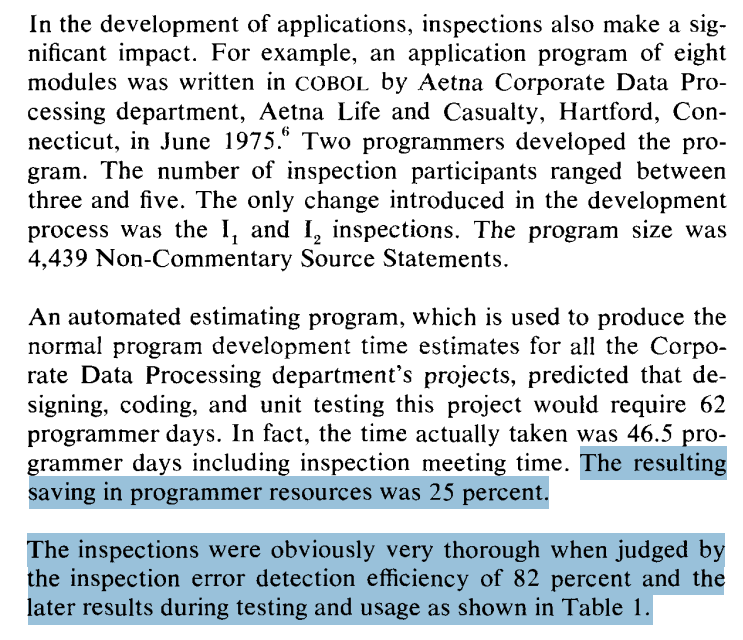
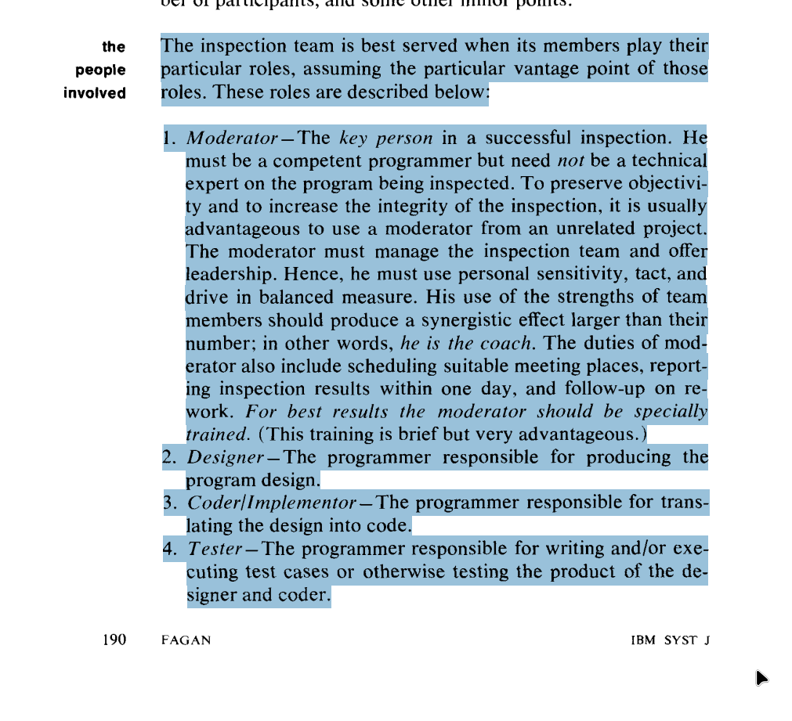
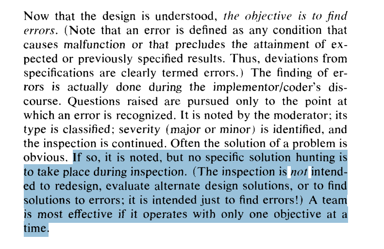

# Lista de Verificação – Etapa 5

## Tabela de contribuição

| Data | Contribuição | Autor(es) | Revisor(es) |
|---|---|---|---|
| 22/11/2026 | Criação da página | Lucas Sales | João Paulo |
| 22/11/2026 | Definição do processo de inspeção e lista de verificação da etapa 5 | Evellyn Rocha | Lucas Sales |

## Introdução

Inspeções são um método formal, eficiente e econômico de encontrar erros em projeto e código (FAGAN, 1976, p. 189). Como o custo de retrabalho cresce quanto mais tarde o erro é corrigido, achar defeitos perto de onde nasceram sai de 10 a 100 vezes mais barato do que corrigi-los na segunda metade do processo (FAGAN, 1976, p. 186). Em um estudo da IBM, a adição das inspeções I1 e I2 aumentou em 23% a produtividade da etapa de codificação (FAGAN, 1976, p. 187), e a amostra inspecionada teve 38% menos erros do que uma amostra revisada por *walk-throughs* (FAGAN, 1976, p. 188). Em outro caso, o programa de aplicação do Aetna, as inspeções detectaram 82% dos erros e economizaram 25% das horas de programação previstas, como descrito na [figura 1](#figura-1) (FAGAN, 1976, p. 189).

Figura 1 - Eficiência de detecção de erro 

O que torna a técnica tão eficaz é o processo bem definido, com papéis claros (moderador, projetista, codificador e testador) e etapas que separam os objetivos: visão geral, preparação, inspeção, retrabalho e acompanhamento, como declarados na [figura 2](#figura-2) (FAGAN, 1976, p. 190). Na reunião de inspeção o foco é apenas encontrar erros, sem tentar resolvê-los na hora, o que mantém a equipe concentrada em um objetivo por vez (FAGAN, 1976, p. 193). Diferente dos walk-throughs, que variam muito de lugar para lugar e geram resultados pouco repetíveis, a inspeção usa moderador treinado, checklists de "como achar erros" e a distribuição dos tipos de erro mais frequentes, como descrito na [figura 3](#figura-3) (FAGAN, 1976, p. 200), além de um acompanhamento que reduz as correções mal feitas (FAGAN, 1976, p. 194).

Figura 2 - Processo de inspeção de Fagan. 

Figura 3 - Comparação entre inspeção e walk-through. 

Além de achar defeitos, a inspeção traz benefícios de longo prazo. O programador recebe feedback detalhado e rápido sobre os tipos de erro que mais comete e tende a melhorar até dentro do mesmo projeto (FAGAN, 1976, p. 197), e os participantes ganham muito conhecimento do produto em pouco tempo (FAGAN, 1976, p. 203). Os dados coletados também permitem identificar módulos mais propensos a erros (FAGAN, 1976, p. 198-199) e acompanhar a qualidade e o andamento do projeto já na primeira metade do cronograma (FAGAN, 1976, p. 202-203). Fagan ressalta que esses resultados devem servir ao aprendizado da equipe e nunca à avaliação de desempenho individual (FAGAN, 1976, p. 197), e conclui que as inspeções aumentam a produtividade, melhoram a qualidade final e fortalecem o controle do processo (FAGAN, 1976, p. 205).

Desta forma, o presente documento visa, utilizando as técnicas de Fagan, declarar uma **lista de verificação** para a etapa 1 da disciplina de Interação Humano Computador(IHC) da Faculdade de Ciências e Tecnologia em Engenharia (FCTE) da Universidade de Brasília (UnB).

**Fonte**

Conteúdo de Fagan (1976).

Página 189. 

Figura 4 - Método de inspeções por Fagan 

Página 186. 

Figura 5 - Custo de retrabalho  

Página 187. 

Figura 6 - Produtividade em relação às inspeções  

Página 188. 

Figura 7 - Porcentagem de erro a menos entre as amostras I1 e I2.  

Página 189. 

Figura 8 - Relação de economia e eficiência na detecção de erros.  

Página 190. 

Figura 9 - Papéis na inspeção.  

Página 193. 

Figura 10 - Objetivo da inspeção.  

## Lista de verificação Storyboard

## Os entregáveis
Para a entrega da etapa 5, os seguintes itens devem ser apresentados:

1. Planejamento da avaliação do storyboard e Análise de tarefas.
2. Planejamento do relato de resultados da avaliação do Storyboard e análise de tarefas
 

### Checklist de Verificação do Storyboard 

| ID | Categoria / Etapa | Pergunta de Verificação de Conformidade | Avaliação (Sim / Não / Parcial) | Evidências / Observações Registradas |
|---|---|---|---|---|
| C-01 | Persona | O personagem principal retratado no Storyboard corresponde explicitamente a uma Persona pré-definida do projeto? | | |
| C-02 | Cenário de Uso | A história descreve um cenário de interação realista, verossímil e relevante no contexto do domínio do sistema? | | |
| C-03 | Ato 1: Início (Gatilho) | O primeiro quadro apresenta a motivação inicial, a necessidade acadêmica/pessoal e o contexto do usuário antes de usar o sistema? | | |
| C-04 | Ato 2: Meio (Ações) | Os quadros intermediários detalham a sequência cronológica de ações e escolhas do usuário ao navegar pela interface? | | |
| C-05 | Ato 3: Fim (Resolução) | O quadro final demonstra a conclusão satisfatória da tarefa, a emissão do resultado (ex.: protocolo/recibo) e o alívio do personagem? | | |
| C-06 | Fidelidade (Sketches) | As ilustrações utilizam desenhos simples (*sketches*, figuras de palito, caixas), focando na narrativa e não no acabamento gráfico refinado? | | |
| C-07 | Feedback da Interface | Cada ação executada pelo personagem é acompanhada pela resposta (feedback) visual ou informativa fornecida pelo sistema? | | |
| C-08 | Legendas e Balões | Cada quadro possui uma legenda descritiva clara ou balões de pensamento/diálogo que contextualizam a intenção do ator? | | |
| C-09 | Prevenção de Erros | O fluxo retratado ilustra mecanismos visuais que ajudam a prevenir erros (ex.: avisos de limite, validações de arquivo)? | | |
| C-10 | Requisitos do Domínio | A história contempla todas as etapas operacionais e regulamentares exigidas para que a tarefa seja válida na vida real? | | |
| C-11 | Divisão de Papéis | Fica evidente na história o que é responsabilidade/ação do usuário e o que é papel automatizado do sistema? | | |
| C-12 | Autonomia da Narrativa | A sequência de painéis permite que qualquer revisor compreenda o objetivo e o desfecho sem necessidade de explicações verbais externas? | | |

## Agradecimento e Uso de IA Generativa

O documento utiliza IA generativa nos seguintes pontos:

- Formatação e redação de texto;
- Geração e adaptação de código Markdown.

## Referências Bibliográficas

BARBOSA, Simone Diniz Junqueira et al. *Interação Humano-Computador e Experiência do Usuário*. Rio de Janeiro: Autopublicação, 2021. ISBN 978-65-00-19677-1.

ROGERS, Yvonne; SHARP, Helen; PREECE, Jenny. *Design de Interação: além da interação homem-computador*. Porto Alegre: Bookman, 2013.

RETTIG, Marc. Prototyping for Tiny Budgets. *Communications of the ACM*, v. 37, n. 4, p. 21–27, 1994.

## Histórico de Versão

| Versão | Data | Descrição | Autor(es) | Revisor(es) |
|---|---|---|---|---|
| 1.0 | 22/11/2026 | Criação da página. | Lucas Sales | |
| 1.1 | 22/11/2026 | adição de lista de verificação | Lucas Sales | |Evellyn Rocha