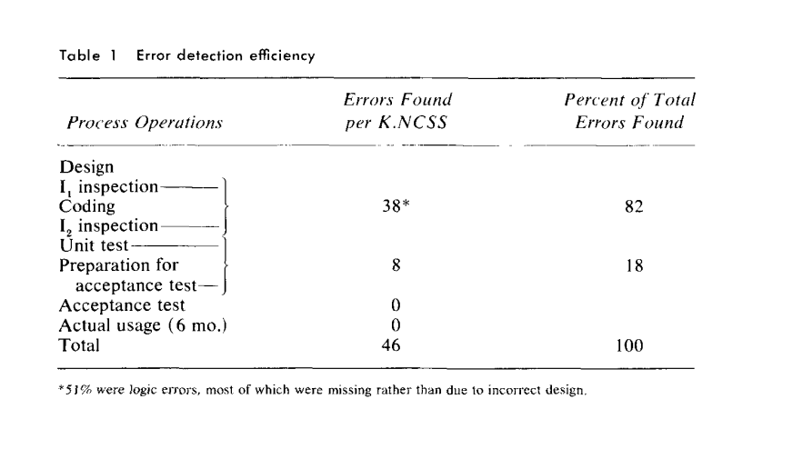
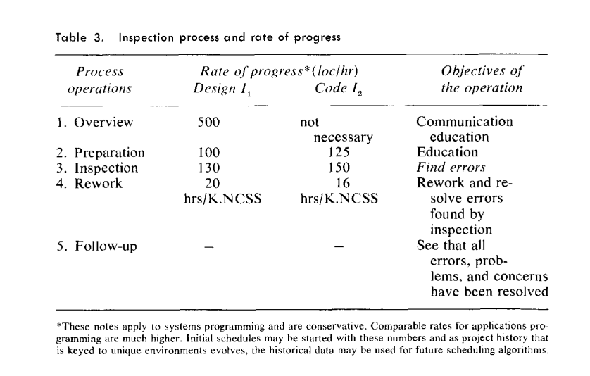
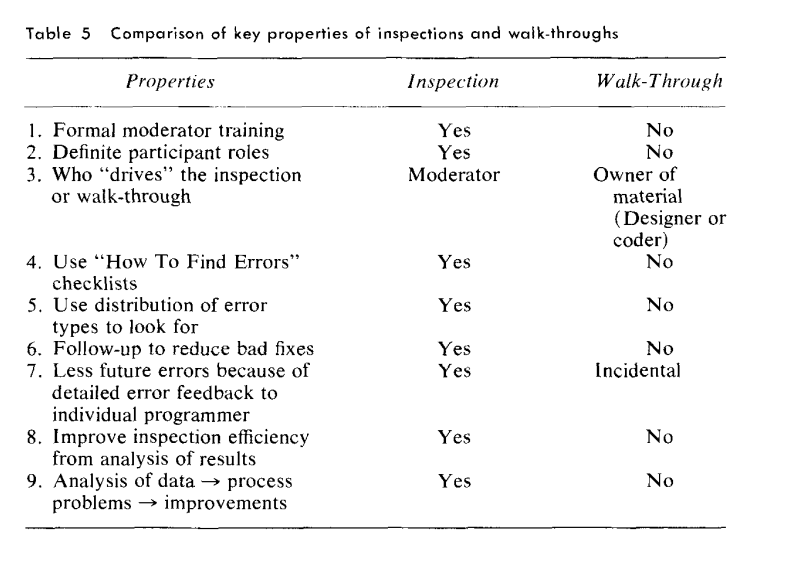
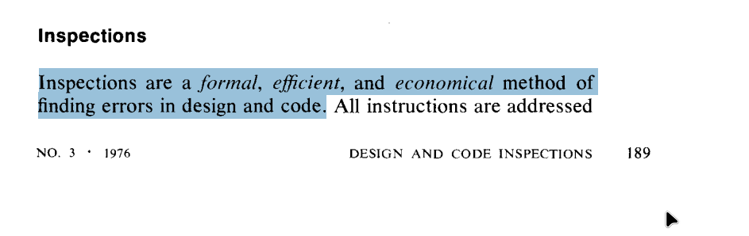
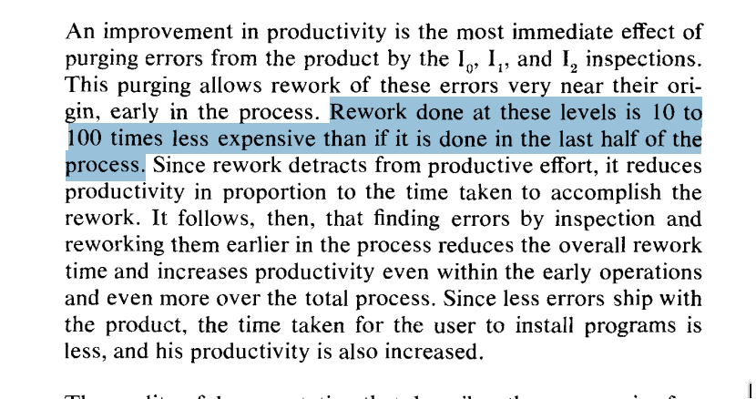
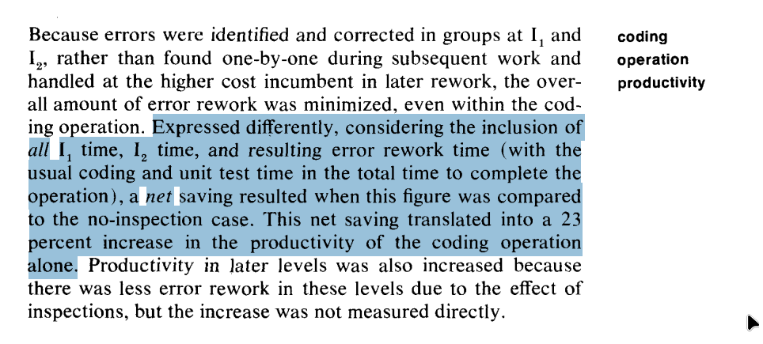
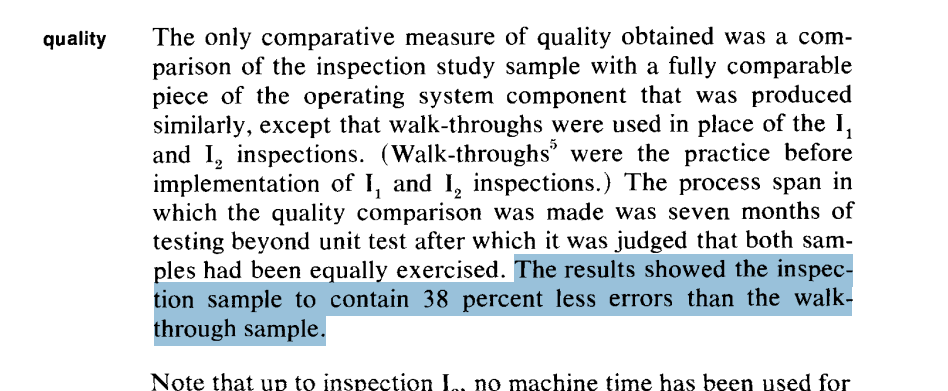
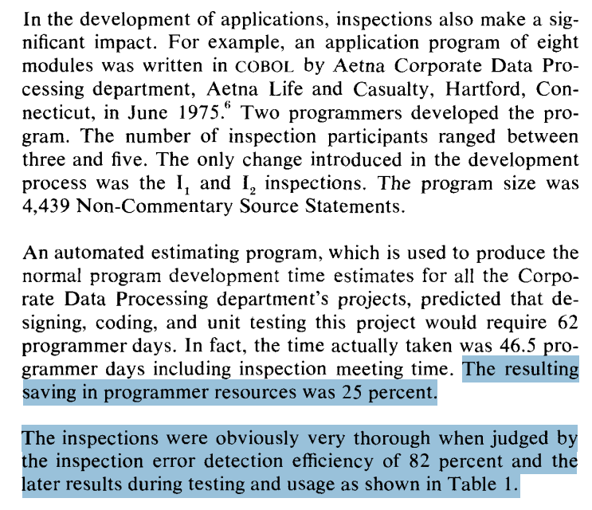
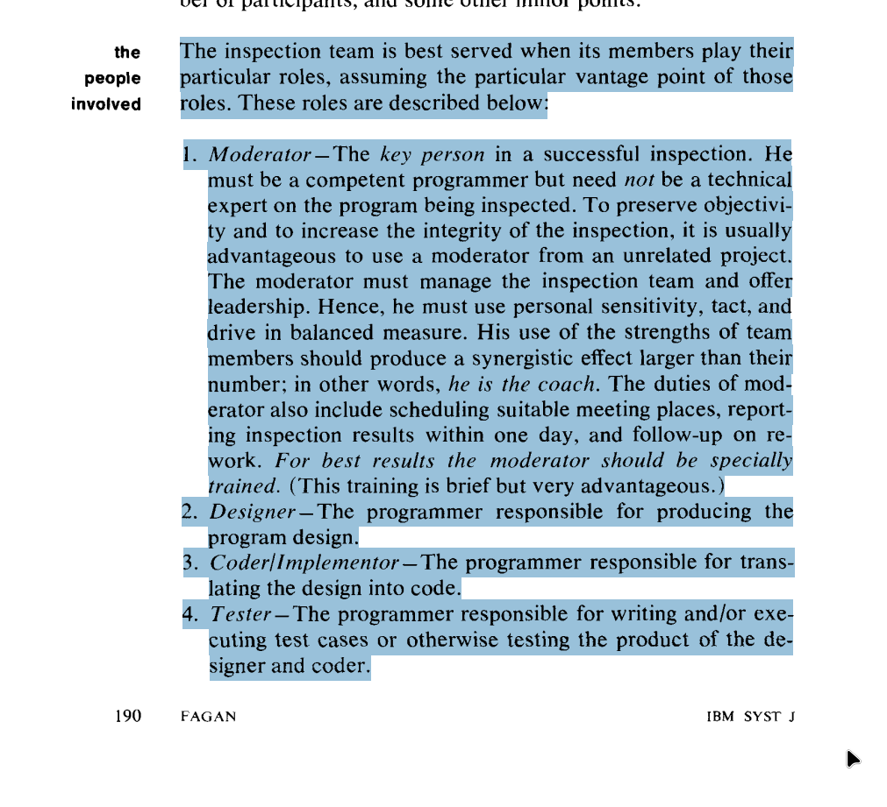
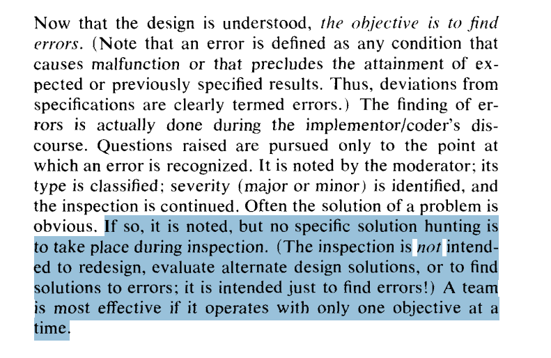

# Lista de Verificação – Etapa 7

## Tabela de contribuição

| Data | Contribuição | Autor(es) | Revisor(es) |
|---|---|---|---|
| 22/11/2026 | Criação da página | lucas sales  | João Paulo |
| 22/11/2026 | Definição do processo de inspeção e lista de verificação da etapa 5 | Evellyn Rocha | Lucas Sales |

## Introdução

Inspeções são um método formal, eficiente e econômico de encontrar erros em projeto e código (FAGAN, 1976, p. 189). Como o custo de retrabalho cresce quanto mais tarde o erro é corrigido, achar defeitos perto de onde nasceram sai de 10 a 100 vezes mais barato do que corrigi-los na segunda metade do processo (FAGAN, 1976, p. 186). Em um estudo da IBM, a adição das inspeções I1 e I2 aumentou em 23% a produtividade da etapa de codificação (FAGAN, 1976, p. 187), e a amostra inspecionada teve 38% menos erros do que uma amostra revisada por *walk-throughs* (FAGAN, 1976, p. 188). Em outro caso, o programa de aplicação do Aetna, as inspeções detectaram 82% dos erros e economizaram 25% das horas de programação previstas, como descrito na [figura 1](#figura-1) (FAGAN, 1976, p. 189).

Figura 1 - Eficiência de detecção de erro 

O que torna a técnica tão eficaz é o processo bem definido, com papéis claros (moderador, projetista, codificador e testador) e etapas que separam os objetivos: visão geral, preparação, inspeção, retrabalho e acompanhamento, como declarados na [figura 2](#figura-2) (FAGAN, 1976, p. 190). Na reunião de inspeção o foco é apenas encontrar erros, sem tentar resolvê-los na hora, o que mantém a equipe concentrada em um objetivo por vez (FAGAN, 1976, p. 193). Diferente dos walk-throughs, que variam muito de lugar para lugar e geram resultados pouco repetíveis, a inspeção usa moderador treinado, checklists de "como achar erros" e a distribuição dos tipos de erro mais frequentes, como descrito na [figura 3](#figura-3) (FAGAN, 1976, p. 200), além de um acompanhamento que reduz as correções mal feitas (FAGAN, 1976, p. 194).

Figura 2 - Processo de inspeção de Fagan. 

Figura 3 - Comparação entre inspeção e walk-through. 

Além de achar defeitos, a inspeção traz benefícios de longo prazo. O programador recebe feedback detalhado e rápido sobre os tipos de erro que mais comete e tende a melhorar até dentro do mesmo projeto (FAGAN, 1976, p. 197), e os participantes ganham muito conhecimento do produto em pouco tempo (FAGAN, 1976, p. 203). Os dados coletados também permitem identificar módulos mais propensos a erros (FAGAN, 1976, p. 198-199) e acompanhar a qualidade e o andamento do projeto já na primeira metade do cronograma (FAGAN, 1976, p. 202-203). Fagan ressalta que esses resultados devem servir ao aprendizado da equipe e nunca à avaliação de desempenho individual (FAGAN, 1976, p. 197), e conclui que as inspeções aumentam a produtividade, melhoram a qualidade final e fortalecem o controle do processo (FAGAN, 1976, p. 205).

Desta forma, o presente documento visa, utilizando as técnicas de Fagan, declarar uma **lista de verificação** para a etapa 1 da disciplina de Interação Humano Computador(IHC) da Faculdade de Ciências e Tecnologia em Engenharia (FCTE) da Universidade de Brasília (UnB).

**Fonte**

Conteúdo de Fagan (1976).

Página 189. 

Figura 4 - Método de inspeções por Fagan 

Página 186. 

Figura 5 - Custo de retrabalho  

Página 187. 

Figura 6 - Produtividade em relação às inspeções  

Página 188. 

Figura 7 - Porcentagem de erro a menos entre as amostras I1 e I2.  

Página 189. 

Figura 8 - Relação de economia e eficiência na detecção de erros.  

Página 190. 

Figura 9 - Papéis na inspeção.  

Página 193. 

Figura 10 - Objetivo da inspeção.  

## Lista de verificação do protótipo de alta fidelidade

## Os entregáveis

Para a entrega da etapa 7, os seguintes itens devem ser apresentados:

1. Relato dos resultados da avaliação do protótipo de alta fidelidade

### Checklist de Verificação do protótipo de alta fidelidade 
| ID | Categoria / Etapa | Pergunta de Verificação de Conformidade | Avaliação (Sim / Não / Parcial) | Evidências / Observações Registradas |
|---|---|---|---|---|
| C-01 | Objetivos e Escopo | O relato especifica claramente os objetivos da avaliação e os requisitos/funcionalidades testados no protótipo de alta fidelidade? | | |
| C-02 | Método de Avaliação | O método de avaliação (ex.: Teste de Usabilidade com Protótipo Interativo, Ensaio de Interatividade) é descrito com justificativa teórica apropriada? | | |
| C-03 | Perfil dos Participantes e Avaliadores | O documento detalha a quantidade e o perfil demográfico/tecnológico dos participantes, bem como os papéis desempenhados pelos avaliadores? | | |
| C-04 | Ambiente e Ferramentas | Estão documentadas as especificações do ambiente de teste (Web/Desktop/Mobile), a plataforma do protótipo (ex.: Figma interativo, software executável) e os recursos de gravação? | | |
| C-05 | Estudo-Piloto (Calibração) | O relato inclui o registro do Estudo-Piloto com protótipo de alta fidelidade (com data, minutagem e ajustes efetuados antes da coleta oficial)? | | |
| C-06 | Especificação das Tarefas | Os cenários de tarefas e o passo a passo detalhado executado pelos participantes na interface interativa estão claramente descritos? | | |
| C-07 | Métricas e Coleta de Dados | São apresentados os dados e métricas de desempenho/usabilidade (ex.: taxa de sucesso na tarefa, tempo de execução, número de erros e/ou relatos verbais por Think Aloud)? | | |
| C-08 | Identificação dos Problemas | Os problemas de usabilidade e interatividade encontrados são descritos com precisão, indicando o local da interface e a operação em que ocorreram? | | |
| C-09 | Classificação de Severidade | Os problemas de IHC mapeados foram classificados de forma fundamentada segundo uma escala formal de severidade (ex.: escala de 1 a 4 de Nielsen, 1994a)? | | |
| C-10 | Propostas de Redesign (REP) | São apresentadas propostas concretas e priorizadas de redesign/reprojeto (REP) para a evolução final da interface com base na severidade dos problemas? | | |
| C-11 | Conformidade Ética | O documento comprova o cumprimento das diretrizes éticas (assinatura prévia do TCLE, respeito à LGPD e esclarecimento de que o teste avalia o sistema, não o usuário)? | | |
| C-12 | Registro Audiovisual e Rastreabilidade | O relato disponibiliza o link funcional da gravação em vídeo e apresenta o mapeamento temporal (minutagens/transcrições) das evidências observadas? | | |

## Referências Bibliográficas

1. BARBOSA, Simone Diniz Junqueira; SILVA, Bruno Santana da. Interação Humano-Computador. Rio de Janeiro: Elsevier / Editora Campus, 2010. 
2. NIELSEN, Jakob. Usability Engineering. San Diego: Academic Press, 1994. (Classificação de Severidade de Problemas de Usabilidade, pp. 43–45).
3. ROGERS, Yvonne; SHARP, Helen; PREECE, Jenny. Design de Interação: além da interação homem-computador. Porto Alegre: Bookman, 2013. (Capítulo 8 e 12: Avaliação e Testes de Usabilidade).

## Histórico de Versão

| Versão | Data | Descrição | Autor(es) | Revisor(es) |
|---|---|---|---|---|
| 1.0 | 22/11/2026 | Criação da página. | Lucas Sales | |

