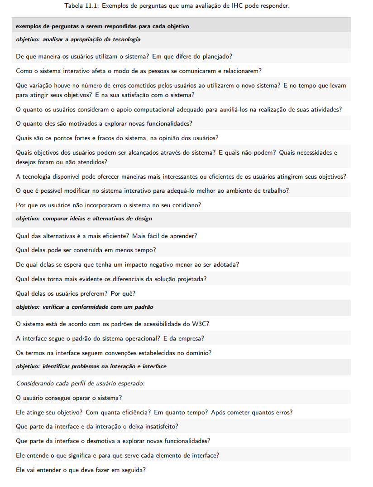
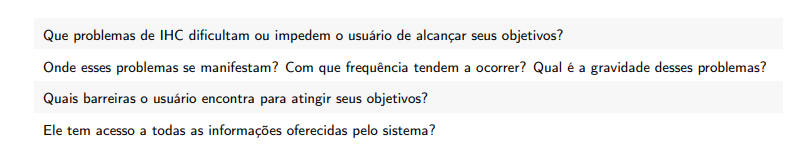

| Data       | Contribuição                                                                                               | Autor(es)              | Revisor(es) |
| ---------- | ---------------------------------------------------------------------------------------------------------- | ---------------------- | ----------- |
| 13/10/2026 | Criação da página com o planejamento da avaliação do Storyboard, organizado pelas etapas do DECIDE.        | Evellyn de Sousa Rocha | A definir   |
| 19/10/2026 | Adição do objetivo da avaliação e perguntas a serem exploradas para a tarefa de comunicação entre usuários | Lucas Sales Ribeiro    | A definir   |
| 19/10/2026 | Adição da seção de uso de IA generativa                                                                    | Lucas Sales Ribeiro    | A definir   |
| 20/10/2026 | Adição do objetivo, das perguntas, do método e do roteiro da avaliação do storyboard para a tarefa de agendamento de reunião com o coordenador do curso | João Paulo da Silva Pereira | A definir   |
| 22/10/2026 | Redefinição do storyboard de agendamento para a reunião com o coordenador do curso e adição da seção 3.3 com as melhorias propostas | João Paulo da Silva Pereira | A definir   |

# Planejamento da Avaliação do Storyboard (Microsoft Teams)

## 1. Introdução

O planejamento da avaliação do Storyboard consiste em definir objetivos, critérios, perfil dos participantes, métodos e cronograma para avaliar a solução conceitual de Interação Humano-Computador (IHC). O Storyboard é uma técnica de prototipação de baixa fidelidade composta por uma sequência de quadros que ilustra como o usuário realiza uma atividade em seu contexto.

Neste projeto, a avaliação será direcionada ao Storyboard elaborado para o reprojeto conceitual do Microsoft Teams, considerando a jornada de um estudante universitário ao tentar localizar e baixar um arquivo de aula na aba "Arquivos" de uma equipe. A avaliação permitirá verificar se a narrativa visual é compreensível, representa adequadamente a atividade e está alinhada às necessidades dos usuários.

## 2. Metodologia

Para a elaboração deste planejamento, utiliza-se o **Framework DECIDE**, proposto por Sharp, Rogers e Preece (2007) e apresentado por Barbosa e Silva (2010, Cap. 9, Seção 9.8, pp. 312–313). As letras da palavra DECIDE representam seis etapas relacionadas ao planejamento da avaliação:

**Tabela 1 – Etapas do Framework DECIDE para o Storyboard do Microsoft Teams**

| Letra | Definição no Framework DECIDE                | Aplicação no Projeto Microsoft Teams                                                                         |
| ----- | -------------------------------------------- | ------------------------------------------------------------------------------------------------------------ |
| **D** | Determinar os objetivos da avaliação de IHC. | Verificar a clareza e o alinhamento da narrativa visual do Storyboard com a rotina acadêmica dos estudantes. |
| **E** | Explorar perguntas a serem respondidas.      | Investigar se a jornada gráfica é compreensível e coerente com os Cenários de Uso e o perfil dos usuários.   |
| **C** | Escolher os métodos de avaliação.            | Utilizar entrevistas semiestruturadas guiadas pela apresentação do Storyboard.                               |
| **I** | Identificar e administrar questões práticas. | Definir participantes, materiais, ferramentas de comunicação e cronograma.                                   |
| **D** | Decidir como lidar com as questões éticas.   | Prever consentimento informado, participação voluntária, privacidade e anonimato.                            |
| **E** | Avaliar, interpretar e apresentar os dados.  | Organizar as observações, identificar dificuldades e sintetizar os resultados da avaliação.                  |

*Fonte: Adaptado de Barbosa e Silva (2010, p. 313) e do arquivo-modelo.*

## 3. D – Determinar os Objetivos da Avaliação

A avaliação tem como objetivo geral verificar se os Storyboards elaborados para o reprojeto conceitual do Microsoft Teams apresentam uma narrativa clara, compreensível e alinhada às necessidades do público universitário.

Os objetivos específicos incluem:

- Verificar se a sequência visual representa de forma compreensível a jornada de um estudante ao tentar localizar e baixar um material de aula.
- Identificar possíveis ambiguidades na transição entre os quadros e etapas que não estejam suficientemente representadas no fluxo de navegação da aba "Arquivos".
- Investigar se os elementos visuais permitem compreender as ações realizadas em cada etapa.
- Identificar oportunidades de melhoria que possam subsidiar futuras decisões de design e a elaboração de protótipos de maior fidelidade.

**Fundamentação bibliográfica:** Barbosa e Silva (2010), Capítulo 9 (Planejamento da Avaliação de IHC), Seção 9.2 (Por que Avaliar?), pp. 288–290; Seção 9.8 (Framework DECIDE), p. 313.

### 3.1 Objetivos da avaliação do storyboard - Comunicação entre usuários

Barbosa e Silva (2021), propõem 4 objetivos para realizar uma avaliação de IHC e perguntas específicas relacionadas a cada um deles, para decidir os objetivos da avaliação do storyboard, foram analisados estes objetivos e suas perguntas:

| Objetivo                                       | Exemplos de perguntas a serem respondidas                                                                                |
| ---------------------------------------------- | ------------------------------------------------------------------------------------------------------------------------ |
| Analisar a apropriação da tecnologia           | De que maneira os usuários utilizam o sistema?                                                                           |
|                                                | Em que difere do planejado?                                                                                              |
|                                                | Como o sistema interativo afeta o modo de as pessoas se comunicarem e relacionarem?                                      |
|                                                | Que variação houve no número de erros cometidos pelos usuários ao utilizarem o novo sistema?                             |
|                                                | E no tempo que levam para atingir seus objetivos?                                                                        |
|                                                | E na sua satisfação com o sistema?                                                                                       |
|                                                | O quanto os usuários consideram o apoio computacional adequado para auxiliá-los na realização de suas atividades?        |
|                                                | O quanto eles são motivados a explorar novas funcionalidades?                                                            |
|                                                | Quais são os pontos fortes e fracos do sistema, na opinião dos usuários?                                                 |
|                                                | Quais objetivos dos usuários podem ser alcançados através do sistema? E quais não podem?                                 |
|                                                | Quais necessidades e desejos foram ou não atendidos?                                                                     |
|                                                | A tecnologia disponível pode oferecer maneiras mais interessantes ou eficientes de os usuários atingirem seus objetivos? |
|                                                | O que é possível modificar no sistema interativo para adequá-lo melhor ao ambiente de trabalho?                          |
|                                                | Por que os usuários não incorporaram o sistema no seu cotidiano?                                                         |
| Comparar ideias e alternativas de design       | Qual das alternativas é a mais eficiente? Mais fácil de aprender?                                                        |
|                                                | Qual delas pode ser construída em menos tempo?                                                                           |
|                                                | De qual delas se espera que tenha um impacto negativo menor ao ser adotada?                                              |
|                                                | Qual delas torna mais evidente os diferenciais da solução projetada?                                                     |
|                                                | Qual delas os usuários preferem? Por quê?                                                                                |
| Verificar a conformidade com um padrão         | O sistema está de acordo com os padrões de acessibilidade do W3C?                                                        |
|                                                | A interface segue o padrão do sistema operacional? E da empresa?                                                         |
|                                                | Os termos na interface seguem convenções estabelecidas no domínio?                                                       |
| Identificar problemas na interação e interface | Considerando cada perfil de usuário esperado: O usuário consegue operar o sistema?                                       |
|                                                | Ele atinge seu objetivo? Com quanta eficiência? Em quanto tempo? Após cometer quantos erros?                             |
|                                                | Que parte da interface e da interação o deixa insatisfeito?                                                              |
|                                                | Que parte da interface o desmotiva a explorar novas funcionalidades?                                                     |
|                                                | Ele entende o que significa e para que serve cada elemento de interface?                                                 |
|                                                | Ele vai entender o que deve fazer em seguida?                                                                            |
|                                                | Que problemas de IHC dificultam ou impedem o usuário de alcançar seus objetivos?                                         |
|                                                | Onde esses problemas se manifestam?                                                                                      |
|                                                | Com que frequência tendem a ocorrer?                                                                                     |
|                                                | Qual é a gravidade desses problemas?                                                                                     |
|                                                | Quais barreiras o usuário encontra para atingir seus objetivos?                                                          |
|                                                | Ele tem acesso a todas as informações oferecidas pelo sistema?                                                           |

Tabela 1 - Relação de objetivos x perguntas de IHC.

Pelo entendimento que o autor Lucas Sales teve da funcionalidade, dos objetivos e perguntas definidas por Barbosa e Silva (2021), dois objetivos se destacam fortemente para serem analisados na avaliação do storyboard: **Apropriação da tecnologia pelos usuários** e **Problemas na interação e interface**.

Por questões relacionadas a prazo e complexidade, o autor escolhe realizar a avaliação considerando apenas um objetivo, e reavaliando as perguntas de cada um, foi escolhido o objetivo de **Apropriação da tecnologia**, pelas perguntas que tem forte relação com o objetivo de comunicação via chat Teams, que serão exploradas no tópico [4. E – Explorar Perguntas a Serem Respondidas com a Avaliação](#4-e-explorar-perguntas-a-serem-respondidas-com-a-avaliacao)

**Fonte:**

Conteúdo de Barbosa e Silva (2021), páginas 250 e 251:

Figura 1 - Objetivos e perguntas 

Figura 2 - Objetivos e perguntas 

A Tabela 1 foi gerada com auxílio de inteligência artificial (Claude) a partir do conteúdo da literatura.

### 3.2 Objetivos da avaliação do storyboard - Agendamento de reunião com o coordenador do curso

Esta subseção trata do storyboard da tarefa de **agendar uma reunião com o coordenador do curso**, sob a ótica do Perfil 1 (Estudante). Como a persona oficial do Estudante ainda não está preenchida na wiki, o storyboard usa uma persona provisória e fictícia, **Rafaela Duarte**, 21 anos, estudante de graduação, que precisa tirar uma dúvida com o coordenador sobre aproveitamento de disciplinas antes da matrícula. Esse nome deve ser trocado pelo da persona oficial quando o grupo a definir. Aqui não há canal da turma: a reunião é entre duas pessoas, e o desafio é encontrar o coordenador, achar um horário livre para os dois e deixar claro o assunto.

O storyboard avaliado (SB-A) tem sete quadros, apresentados na Tabela 1-A.

| Quadro | Cena                                                                     | Resposta do sistema                                         |
| ------ | ------------------------------------------------------------------------ | ----------------------------------------------------------- |
| 1      | Rafaela precisa tirar uma dúvida com o coordenador antes da matrícula.       | -                                                           |
| 2      | Abre o Calendário e aciona "Nova reunião".                               | Formulário enxuto aberto.                                   |
| 3      | Busca o coordenador pelo nome e o adiciona como participante.            | Sugestão do coordenador exibida ao digitar.                 |
| 4      | Consulta a disponibilidade do coordenador e escolhe um horário livre.    | Horários livres dos dois destacados; conflitos sinalizados. |
| 5      | Informa o assunto e a duração da reunião.                                | Campo de assunto com orientação do que escrever.            |
| 6      | Envia o convite.                                                         | Confirmação de envio; lembrete padrão discreto.             |
| 7      | O coordenador responde e Rafaela confere o status no calendário.          | Status do convite (aceito, pendente ou recusado) visível.   |

Tabela 1-A - Quadros do storyboard de agendamento de reunião com o coordenador (SB-A).

Considerando os objetivos e as perguntas definidas por Barbosa e Silva (2021), declarados na [Tabela 1](#3-d-determinar-os-objetivos-da-avaliacao), o objetivo escolhido para esta tarefa foi **Identificar problemas na interação e interface**. A escolha se justifica porque o storyboard foi construído para evidenciar pontos de atrito já relatados: dificuldade de localizar a pessoa certa e a ação, conflito de horários percebido tarde, mensagens vagas sem a ação esperada e excesso de opções na tela.

Os objetivos específicos para esta tarefa incluem:

- Verificar se o participante compreende a sequência de ações necessária para marcar uma reunião com outra pessoa.
- Verificar se a busca pelo coordenador e a escolha de um horário livre para os dois são claras.
- Identificar elementos do formulário cuja função não fique clara.
- Verificar se o envio do convite e o status da resposta são percebidos nos quadros.
- Identificar oportunidades de melhoria para o reprojeto do fluxo de agendamento.

**Fundamentação bibliográfica:** Barbosa e Silva (2021), Capítulo 11, páginas 250 e 251 (objetivos e perguntas de IHC), conforme [Figura 1](#figura-1) e [Figura 2](#figura-2).

### 3.3 Melhorias propostas para o agendamento de reunião com o coordenador

O storyboard SB-A representa o reprojeto conceitual do agendamento. A Tabela 1-B relaciona cada problema já identificado na análise de tarefas (HTA de Comunicação entre usuários e HTA do Gestor, nó 3.1) e nas necessidades do perfil Estudante à melhoria proposta e ao quadro em que ela aparece. As melhorias são hipóteses de design: a avaliação com participantes verificará se elas funcionam, sem presumir que serão mantidas.

**Tabela 1-B – Problemas, melhorias propostas e quadros do SB-A**

| ID  | Problema identificado                                                              | Melhoria proposta                                                                                              | Quadro | Origem                                       |
| --- | ---------------------------------------------------------------------------------- | -------------------------------------------------------------------------------------------------------------- | ------ | -------------------------------------------- |
| M01 | Dificuldade de localizar a pessoa certa e a ação de agendar.                       | Sugerir o coordenador ao digitar o nome e oferecer atalho "Marcar reunião" a partir da conversa com ele.       | 3      | HTA 2.4 (Comunicação entre usuários)         |
| M02 | Choque de horários, percebido só depois de enviar o convite.                       | Exibir a disponibilidade do coordenador durante o agendamento e sinalizar conflitos antes do envio.            | 4      | HTA 3.1 (Gestor)                             |
| M03 | Formulário com muitas opções e termos sem explicação.                              | Mostrar só os campos essenciais (participante, horário, assunto) e explicações curtas embutidas.               | 2      | Perfil Estudante (a confirmar na persona) |
| M04 | Mensagem vaga, sem a ação esperada explícita.                                      | Pedir um assunto e orientar o que escrever (motivo e o que se espera do coordenador).                          | 5      | HTA 1.1 (Comunicação entre usuários)         |
| M05 | Notificações em excesso, que geram ansiedade.                                      | Lembrete padrão discreto, com opção de escolher se e quando ele é enviado.                                     | 6      | Perfil Estudante (a confirmar na persona) |
| M06 | Incerteza sobre o envio do convite.                                                | Confirmar o envio com mensagem clara e mostrar onde a reunião ficou no calendário.                             | 6      | Fluxo do SB-A                                |
| M07 | Falta de retorno sobre a resposta do convidado.                                    | Mostrar o status do convite (aceito, pendente, recusado) e permitir propor outro horário.                      | 7      | HTA 3.1 (Comunicação entre usuários)         |

*Fonte: Elaborado pela equipe, a partir das HTA e do perfil Estudante; origens marcadas "a confirmar" dependem da persona oficial.*

Cada melhoria deve ficar visível no desenho do quadro indicado, e não apenas na legenda. A Tabela 3-A (seção 7.2) verifica M01 a M04 e M06 nas perguntas 3, 4 e 5. M05 e M07 ainda não têm pergunta própria e podem ser acrescentadas ao roteiro se a equipe decidir mantê-las.

## 4. E – Explorar Perguntas a Serem Respondidas com a Avaliação

Com base nos objetivos do projeto, foram formuladas as seguintes perguntas para orientar a avaliação:

- **Coerência com a realidade:** a narrativa apresentada nos quadros do Storyboard é compatível com a rotina de estudos e com as ações realizadas pelos estudantes no Microsoft Teams?
- **Alinhamento com os modelos anteriores:** as ações retratadas estão de acordo com os Cenários de Uso e o perfil de usuário definidos anteriormente?
- **Composição e fluidez:** a composição visual, incluindo personagens, cenários, caixas de diálogo e ícones, permite identificar o que acontece em cada etapa?
- **Compreensão da tarefa:** o Storyboard apresenta os passos necessários para localizar e baixar um arquivo de aula?
- **Identificação de dificuldades:** existem pontos confusos, transições pouco claras ou etapas ausentes que possam dificultar a compreensão da atividade?

### 4.1 Perguntas da avaliação do storyboard - Comunicação entre usuários

As perguntas segundo Barbosa e Silva (2021), declaradas na [Figura 1](#figura-1) e [Figura 2](#figura-2), que se destacam para esta avaliação, são:

**Como o sistema interativo afeta o modo de as pessoas se comunicarem e relacionarem?**: Relação direta com a funcionalidade de comunicação entre usuários.

**O quanto os usuários consideram o apoio computacional adequado para auxiliá-los na realização de suas atividades?**: Uma vez que a comunicação entre usuários pode ocorrer de diversas formas, esta pergunta avalia o impacto da funcionalidade no dia a dia dos usuários.

**O quanto eles são motivados a explorar novas funcionalidades?**: O chat Teams dispões de diversos recursos de comunicação além do texto comum, há opções de formatação, *emojis*, *GIF's*, *stickers* e o *loop component*.

**Quais objetivos dos usuários podem ser alcançados através do sistema? E quais não podem? Quais necessidades e desejos foram ou não atendidos?**: Explora quais recursos de comunicação os usuários utilizam que o chat teams não supre.

**Por que os usuários não incorporaram o sistema no seu cotidiano?**: Analisa quais impedimentos os usuários enfrentam e explora o motivo de menor utilização da ferramenta e/ou da funcionalidade.

### 4.2 Perguntas da avaliação do storyboard - Agendamento de reunião com o coordenador

As perguntas segundo Barbosa e Silva (2021), declaradas na [Figura 1](#figura-1) e na [Figura 2](#figura-2), que se destacam para esta avaliação, dentro do objetivo **Identificar problemas na interação e interface**, são:

**O usuário consegue operar o sistema?**: Verifica se, a partir dos quadros, o participante entende como iniciar a reunião, encontrar o coordenador e enviar o convite.

**Ele atinge seu objetivo? Com quanta eficiência? Após cometer quantos erros?**: Verifica se o fluxo leva a um horário livre para os dois sem tentativas repetidas.

**Ele entende o que significa e para que serve cada elemento de interface?**: Explora campos como participante, indicador de disponibilidade e assunto, relacionados à necessidade de explicações embutidas.

**Ele vai entender o que deve fazer em seguida?**: Avalia as transições entre os quadros, principalmente entre a escolha do horário e o envio do convite.

**Que problemas de IHC dificultam ou impedem o usuário de alcançar seus objetivos? Onde esses problemas se manifestam?**: Registra o quadro em que cada dificuldade aparece, para alimentar a tabela de problemas do relato dos resultados.

**Ele tem acesso a todas as informações oferecidas pelo sistema?**: Verifica se a disponibilidade do coordenador, a confirmação de envio e o status da resposta são visíveis ao usuário.

## 5. C – Escolher os Métodos de Avaliação

Para a realização da avaliação, será utilizada uma adaptação de método de investigação, combinando **entrevista semiestruturada** com a apresentação de um **protótipo de baixa fidelidade (Storyboard)**.

A entrevista semiestruturada permite que o entrevistador siga um roteiro de perguntas e, ao mesmo tempo, aprofunde questões a partir das reações e dos comentários espontâneos do participante. A apresentação do Storyboard permite que o estudante compreenda a situação proposta sem a necessidade de implementar a interface em código.

**Fundamentação bibliográfica:**

- Barbosa e Silva (2010), Capítulo 5 (Identificação de Necessidades e Requisitos), Seção 5.5.1 (Entrevistas), pp. 145–147.
- Barbosa e Silva (2010), Capítulo 8 (Princípios e Diretrizes para o Design de IHC), Seção 8.2.4 (Storyboard e Prototipação em Papel), pp. 263–264.

### 5.1 - Método de avaliação escolhido para avaliação do storyboard - Comunicação entre usuários

Pela tabela 12.10 da pag 307 do livro, escolhi investigação, entrevista

### 5.2 - Método de avaliação escolhido para avaliação do storyboard - Agendamento de reunião

Para o agendamento de reunião, o método escolhido é o mesmo descrito na seção 5: **investigação por entrevista semiestruturada**, guiada pela apresentação do storyboard SB-A. O objetivo "Identificar problemas na interação e interface" pede que o participante explique o que entende de cada quadro, o que a entrevista permite, sem exigir uma interface em código.

Como o facilitador não explica nem orienta durante a sessão, tudo o que o participante precisa saber deve estar nos quadros. O autor do storyboard não conduz a sessão de avaliação desse storyboard.

## 6. I – Identificar Questões Práticas da Avaliação

### 6.1. Recrutamento e Perfil dos Participantes

O recrutamento será orientado pelo perfil de usuário definido para o projeto, considerando estudantes universitários de graduação que utilizem o Microsoft Teams em suas atividades acadêmicas.

- **Quantidade prevista:** seis participantes.
- **Perfil desejado:** estudantes de graduação, preferencialmente entre 20 e 35 anos, que utilizem o Microsoft Teams semanalmente e tenham experiência na localização de materiais acadêmicos na plataforma.

A adequação dos participantes ao perfil definido deverá ser verificada durante o recrutamento.

### 6.2. Preparação e Papéis dos Avaliadores

Os integrantes responsáveis pela avaliação poderão conduzir as sessões individualmente ou em duplas, distribuindo as funções de entrevistador/facilitador e anotador/observador.

O entrevistador apresentará os quadros do Storyboard, contextualizará a atividade e conduzirá as perguntas do roteiro. O observador registrará as dúvidas, dificuldades, comentários e sugestões apresentados pelo participante.

Nas sessões on-line, o Storyboard será compartilhado pelo Microsoft Teams, permitindo que o participante acompanhe a apresentação visual durante a entrevista.

### 6.3. Ferramentas e Custos

A avaliação será planejada para ocorrer sem custos financeiros adicionais para a equipe ou para os participantes.

- **Prancha digital do Storyboard:** apresentação dos quadros que representam a jornada no Microsoft Teams.
- **Plataforma de comunicação:** Microsoft Teams para a realização das entrevistas on-line.
- **Documentos de apoio:** roteiro de perguntas, termo de consentimento, quando aplicável, e ficha de registro de observações.
- **Recursos de registro:** anotações das respostas e observações; gravação de áudio ou vídeo somente mediante consentimento e conforme os procedimentos definidos pela equipe.

### 6.4. Prazos e Cronograma das Entrevistas

**Tabela 2 – Cronograma Previsto das Avaliações do Storyboard**

| ID     | Avaliador(es)          | Participante (Iniciais/Código) | Perfil do Participante | Data e Horário     | Local / Meio              |
| ------ | ---------------------- | ------------------------------ | ---------------------- | ------------------ | ------------------------- |
| **01** | João Paulo             | L.S.                           | Estudante de graduação | 15/10/2026 – 14:00 | Microsoft Teams (on-line) |
| **02** | Lucas Sales            | J.P.                           | Estudante de graduação | 15/10/2026 – 15:00 | Microsoft Teams (on-line) |
| **03** | Evellyn de Sousa Rocha | E.R.                           | Estudante de graduação | 16/10/2026 – 10:00 | Microsoft Teams (on-line) |
| **04** | João Paulo             | L.S.                           | Estudante de graduação | 16/10/2026 – 11:30 | Microsoft Teams (on-line) |
| **05** | Lucas Sales            | J.P.                           | Estudante de graduação | 17/10/2026 – 16:00 | Microsoft Teams (on-line) |
| **06** | Evellyn de Sousa Rocha | E.R.                           | Estudante de graduação | 17/10/2026 – 17:00 | Microsoft Teams (on-line) |

*Fonte: Elaborado pela equipe.*

**Observação:** as datas e os horários representam uma proposta de cronograma. As iniciais L.S., J.P. e E.R. identificam os integrantes do grupo conforme solicitado, mas não devem ser utilizadas como identificação de participantes externos sem confirmação. Antes da realização das entrevistas, a equipe deverá definir os participantes, evitando confundir os avaliadores com os entrevistados.

## 7. Roteiro de Perguntas da Entrevista

Durante a apresentação do Storyboard, o entrevistador utilizará as perguntas da Tabela 3 para orientar a avaliação.

**Tabela 3 – Roteiro de Perguntas para Validação do Storyboard do Microsoft Teams**

| ID    | Pergunta / Enunciado                                                                                                                                | Opções de Resposta       | Espaço para Observações e Justificativas                           |
| ----- | --------------------------------------------------------------------------------------------------------------------------------------------------- | ------------------------ | ------------------------------------------------------------------ |
| **1** | A narrativa visual apresentada no Storyboard é coerente com o objetivo da tarefa de localizar um arquivo na área de equipes?                        | Sim / Não / Parcialmente | Registrar se o participante compreendeu o fluxo inicial.           |
| **2** | A situação retratada, incluindo as dificuldades de localização de arquivos e pastas, é compatível com sua experiência acadêmica no Microsoft Teams? | Sim / Não / Parcialmente | Registrar comentários sobre experiências semelhantes.              |
| **3** | O Storyboard apresenta os principais passos necessários para encontrar o documento de aula?                                                         | Sim / Não / Parcialmente | Identificar possíveis etapas ausentes.                             |
| **4** | As ações representadas entre os quadros seguem uma ordem lógica e fácil de compreender?                                                             | Sim / Não / Parcialmente | Registrar transições que gerem dúvidas.                            |
| **5** | Os elementos visuais, como personagens, ícones, pastas e caixas de texto, são claros e identificáveis?                                              | Sim / Não / Parcialmente | Registrar dificuldades de interpretação e sugestões.               |
| **6** | A proposta de interação apresentada no final do Storyboard parece facilitar a localização do arquivo de aula?                                       | Sim / Não / Parcialmente | Registrar a percepção geral do participante e suas justificativas. |

*Fonte: Adaptado do arquivo-modelo de Arthur de Melo e Rafael Ferreira e de Barbosa e Silva (2010).*

### 7.1. Execução do Roteiro

Durante a entrevista, o facilitador incentivará o participante a expressar suas impressões e a explicar o que compreende em cada quadro. Caso o participante discorde de alguma representação ou sugira mudanças no fluxo, o observador registrará a manifestação para posterior análise.

As respostas fechadas deverão ser acompanhadas, sempre que possível, de justificativas que permitam compreender as razões da avaliação.

### 7.2. Roteiro de perguntas - Agendamento de reunião com o coordenador

Para o storyboard SB-A, o entrevistador utilizará as perguntas da Tabela 3-A, no mesmo formato da Tabela 3.

**Tabela 3-A – Roteiro de Perguntas para Validação do Storyboard de Agendamento de Reunião com o Coordenador**

| ID    | Pergunta / Enunciado                                                                                                            | Opções de Resposta       | Espaço para Observações e Justificativas                           |
| ----- | ------------------------------------------------------------------------------------------------------------------------------- | ------------------------ | ------------------------------------------------------------------ |
| **1** | A narrativa visual é coerente com o objetivo de marcar uma reunião com o coordenador do curso?                                  | Sim / Não / Parcialmente | Registrar se o participante compreendeu o fluxo inicial.           |
| **2** | A situação retratada é compatível com sua experiência ao marcar reuniões com outras pessoas no Microsoft Teams?                 | Sim / Não / Parcialmente | Registrar comentários sobre experiências semelhantes.              |
| **3** | O storyboard apresenta os passos necessários para marcar a reunião, da abertura do formulário ao status da resposta?            | Sim / Não / Parcialmente | Identificar possíveis etapas ausentes.                             |
| **4** | Fica claro como encontrar o coordenador e o que cada campo do formulário significa?                                             | Sim / Não / Parcialmente | Registrar campos ou ícones que gerem dúvida.                       |
| **5** | A disponibilidade do coordenador e a confirmação de envio do convite são fáceis de perceber?                                    | Sim / Não / Parcialmente | Registrar o quadro em que a informação passou despercebida.        |
| **6** | A proposta de interação apresentada nos quadros parece facilitar o agendamento em relação ao que você conhece do Teams?         | Sim / Não / Parcialmente | Registrar a percepção geral do participante e suas justificativas. |

*Fonte: Elaborado pela equipe, no formato da Tabela 3.*

## 8. D – Lidar com as Questões Éticas

As questões éticas da avaliação deverão considerar os princípios de participação voluntária, respeito, privacidade e proteção das informações dos participantes.

- **Autonomia:** informar os objetivos e os procedimentos da avaliação, assegurando a liberdade de participação e de desistência.
- **Beneficência:** buscar contribuições para a melhoria da experiência de interação, minimizando os inconvenientes da participação.
- **Não maleficência:** evitar situações constrangedoras e respeitar o tempo e os limites dos participantes.
- **Justiça e equidade:** tratar os participantes com igualdade e respeito, sem discriminação.
- **Privacidade e anonimato:** restringir o acesso aos registros e utilizar códigos ou pseudônimos nos documentos divulgados.

Quando houver gravação ou coleta de dados pessoais, a equipe deverá informar previamente sua finalidade e obter a autorização necessária. Os registros deverão ser utilizados apenas para os objetivos definidos para o projeto.

**Fundamentação bibliográfica:** Barbosa e Silva (2010), Capítulo 5, Seção 5.4 (Aspectos Éticos de Pesquisas Envolvendo Pessoas), pp. 139–142.

## 9. E – Avaliar, Interpretar e Apresentar os Dados

Após a realização das sessões de avaliação, as informações coletadas serão organizadas e analisadas considerando o contexto em que foram produzidas.

O relato dos dados deverá contemplar:

- **Registro e classificação dos problemas:** organizar as dificuldades, ambiguidades visuais e etapas que não tenham sido compreendidas pelos participantes.
- **Fatores de usabilidade:** relacionar os problemas identificados à facilidade de aprendizado, à eficiência e à satisfação, conforme pertinente.
- **Comparação das observações:** identificar dificuldades recorrentes e diferenças entre as percepções dos participantes.
- **Sugestões de melhoria:** registrar recomendações fundamentadas nas observações, sem presumir antecipadamente que mudanças específicas serão necessárias.
- **Apresentação dos resultados:** sintetizar os achados em tabelas e descrições que permitam compreender as evidências obtidas.

**Fundamentação bibliográfica:** Barbosa e Silva (2010), Capítulo 9, Seção 9.7.5 (Relato dos Resultados), p. 312; Seção 9.8 (Etapa E do DECIDE), p. 313.

## 10. Planejamento do Teste-Piloto

Segundo Barbosa e Silva (2010, Cap. 9, Seção 9.7.2), o teste-piloto tem como finalidade avaliar o próprio planejamento e verificar se os procedimentos definidos permitem obter informações relevantes para responder às perguntas da avaliação.

O teste-piloto será conduzido pelos integrantes da equipe, simulando uma sessão de avaliação.

- **Data e horário previstos:** 14/10/2026, às 19h.
- **Participantes do piloto:** integrantes da equipe, com distribuição dos papéis de facilitador e participante simulado.
- **Finalidade:** verificar se o tempo estimado de 15 a 20 minutos é suficiente, avaliar a clareza das perguntas da Tabela 3 e testar o compartilhamento do Storyboard e os recursos de comunicação do Microsoft Teams.

Após o teste-piloto, o roteiro poderá ser ajustado caso sejam identificados problemas de clareza, duração ou condução da sessão.

## 11. Agradecimento e Uso de IA generativa:

O documento utiliza IA generativa nos seguintes pontos:

- Formatação e redação de texto;
- Geração e adaptação de código markdown;
- Estruturação e redação das subseções 3.2, 3.3, 4.2, 5.2 e 7.2, sobre o agendamento de reunião, a partir do conteúdo da wiki, com revisão do autor;

## 12. Referências Bibliográficas

- **BARBOSA, Simone Diniz Junqueira; SILVA, Bruno Santana da.** *Interação Humano-Computador*. Rio de Janeiro: Elsevier / Editora Campus, 2010. ISBN 978-85-352-3418-3.
  - **Capítulo 5 – Identificação de Necessidades dos Usuários e Requisitos de IHC:** Seção 5.4 (Aspectos Éticos de Pesquisas Envolvendo Pessoas), pp. 139–142; Seção 5.5.1 (Entrevistas), pp. 145–147.
  - **Capítulo 6 – Organização do Espaço de Problema:** Seção 6.2 (Personas), pp. 176–180; Seção 6.3 (Cenários), pp. 183–190.
  - **Capítulo 7 – Design de IHC:** Seção 7.2 (Cenários de Interação), pp. 209–212.
  - **Capítulo 8 – Princípios e Diretrizes para o Design de IHC:** Seção 8.2.4 (Storyboard e Prototipação em Papel), pp. 263–264.
  - **Capítulo 9 – Planejamento da Avaliação de IHC:** Seção 9.2 (Por que Avaliar?), pp. 288–293; Seção 9.7 (Atividades de Avaliação), pp. 303–312; Seção 9.8 (O Framework DECIDE), pp. 312–313.
- **BRASIL. Conselho Nacional de Saúde.** Resolução nº 196, de 10 de outubro de 1996. Diretrizes e normas regulamentadoras de pesquisas envolvendo seres humanos. Brasília: Ministério da Saúde, 1996.
- **DE MELO, Arthur; FERREIRA, Rafael.** *Planejamento da Avaliação do Storyboard (Arquivo Modelo)*. Faculdade UnB Gama (FGA), Disciplina de Interação Humano-Computador, 2023. Texto-fonte interno do repositório.
- **SHARP, Helen; ROGERS, Yvonne; PREECE, Jenny.** *Interaction Design: Beyond Human-Computer Interaction*. 2. ed. New York: John Wiley & Sons, 2007.
